# pixel-games

Small arcade games in MicroPython on a DFRobot FireBeetle 2 ESP32-S3 with the DFR0664 display (ST7789, 240 x 320, SPI). A C display driver, a fork of [russhughes/s3lcd](https://github.com/russhughes/s3lcd), sends each frame by DMA, so the Python games can run at about 20 fps.

The repository is also a log of how the games got smooth: every step was measured on the bench and written down.

## What is here

| path | what it holds |
| --- | --- |
| `games/` | the games and their small framework (`app.py` starts them, `lcd.py` and `gfx.py` draw) |
| `art/` | the painted art: one set per game, the brush and the export |
| `engine/` | a git submodule: [pixel-engine](https://github.com/xmejkal/pixel-engine), the C engine (bodies, balls, the heat field) with its Mac tests. Its own submodule `engine/driver/` is the [s3lcd fork](https://github.com/xmejkal/s3lcd), the C display driver with `frame.c`, a DMA send of one frame and partial updates |
| `tests/` | the tests that run on a computer, with no board: `python3 -B -m unittest discover tests` from the repository root (the C ones need clang). The engine's own tests run with the same command in `engine/` |
| `tools/` | `render_scene.py`: `python3 -B tools/render_scene.py SUBJECT out.png FRAMES...` draws a game, a scene or the overlay on the Mac, the board's way, to a PNG sheet, and with `--gif OUT.gif --every K` to a GIF. `--list` names the subjects, and `--all docs/screenshots` writes every picture below from the tool's own table. It needs clang, Pillow and the MicroPython clone under `~/esp` for the letters. `crackle_wav.py out.wav [seconds]` renders the fire's crackle to a WAV on the Mac (needs clang). `crackle.sh [seconds] [voice] [look]` builds the C crackle as `crackle_c.mpy`, copies it to the board and plays it on Fire |
| `build.sh` | builds the MicroPython firmware, with or without the driver |
| `bench.md` | the bench log: each run, its numbers and what it taught |
| `logs/` | the kept logs of some runs in `bench.md`, named by run number |
| `p537-finding.md` | the options for smooth motion, ranked, with a plan in slices |
| `docs/` | the discoveries: a public graphics library (P539) and the restyle of the games (P565). Also the wiring guides: `wiring.html` (every wire, with pictures) and `p758-encoder-steps.html` (the encoder, one wire per step) |
| `docs/screenshots/` | a PNG and a GIF of each game, scene and the overlay, made by `tools/render_scene.py --all docs/screenshots` |

## What it looks like

The frames come from a Mac program that runs the games' own Python and C with a stand-in for the display (`tests/drawing_tft.py`), not from photos of the board. Each GIF keeps one frame in every one to four and shows it for as long as those frames took, so it runs at the board's pace.

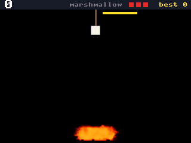

Marshmallow: a hold lowers the marshmallow into the campfire and a release lifts it. The three lives sit in the score bar, and the yellow bar above the fire runs down.

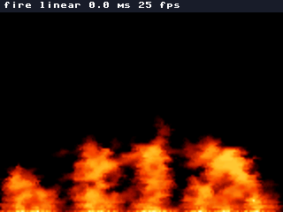

The fire: the heat field burns over the whole screen, and its label says the mode (linear) and the frame rate.

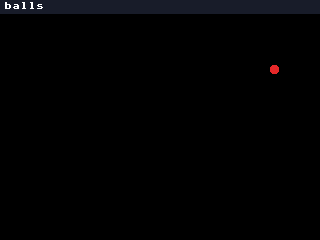

The ball pit: a pour of 10 balls every 0.4 s piles up in layers of colour, and the label counts the balls and the hits a second.

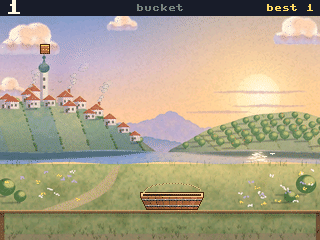

Bucket: the bucket goes right while the button is held and left when it is not, and a caught box is a point.

Every subject, with the button pattern that made its picture (`tools/render_scene.py --list` prints them). The picture links to the GIF.

| subject | button | what the picture shows | picture |
| --- | --- | --- | --- |
| the fire | tap: next mode | Tongues of flame over a white-hot base, in the linear mode, with the label's mode and frame rate. | <a href="docs/screenshots/fire.gif">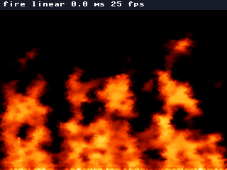</a> |
| the rain | tap: again | 160 boxes fall as the C engine's bodies, bounce and come to rest near the bottom, each on its own line, and a sleeper falls again from the top. | <a href="docs/screenshots/rain.gif">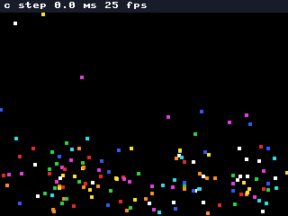</a> |
| Marshmallow | hold to roast | The marshmallow deep in the campfire after the first point. | <a href="docs/screenshots/marshmallow.gif">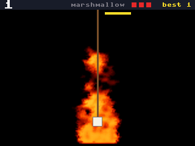</a> |
| the ball pit | tap pours, hold shakes | 120 balls in twelve pours, each pour in its own colour. | <a href="docs/screenshots/ballpit.gif">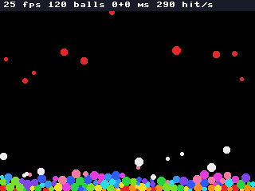</a> |
| the bodies on fire | tap: next mode | Eight falling bodies burn trails into the field and flare where they land. | <a href="docs/screenshots/burningbodies.gif">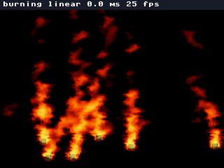</a> |
| Bucket | hold: right | The bucket on its rail at the first catch, with the point's burst at its edge and two missed boxes piled below the rail. | <a href="docs/screenshots/bucket.gif">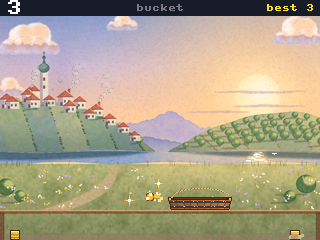</a> |
| Flappy | tap to flap | The painted morning scrolls by and the bird flaps between the pipes. | <a href="docs/screenshots/flappy.gif">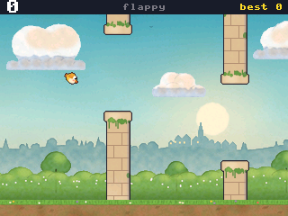</a> |
| Runner | tap jump, hold higher | The painted runner jumps over a cactus in front of the mountains. | <a href="docs/screenshots/runner.gif">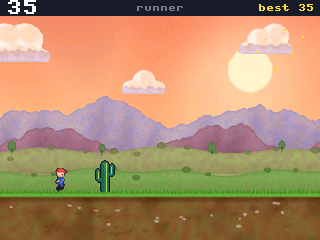</a> |
| Snake | tap turns right | The snake moves on its grid and turns right at each tap. The red square is the food. | <a href="docs/screenshots/snake.gif">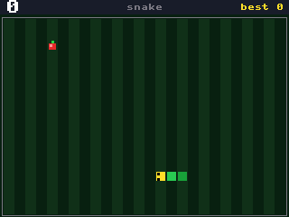</a> |
| Stack | tap to drop | The crane drops a floor at each tap. Two floors stand, and the sign shows the price. | <a href="docs/screenshots/stack.gif">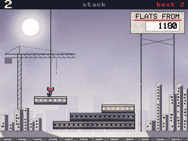</a> |
| Cave | hold to climb | The helicopter climbs while the button is held and sinks when it is not, between the cave's walls. | <a href="docs/screenshots/cave.gif">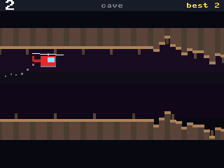</a> |
| Tunnel | tap turns the ship | The ship rides the tunnel's walls and a tap turns it. | <a href="docs/screenshots/tunnel.gif">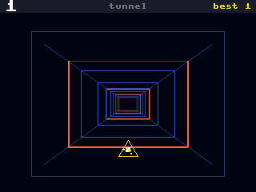</a> |
| Road | tap lane, hold boost | The car on a road that bends, the mountains and the sun behind it. | <a href="docs/screenshots/road.gif">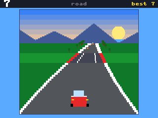</a> |
| Starfire | tap fires | The laser from the ship's nose, the reticle on a target and a point. | <a href="docs/screenshots/starfire.gif">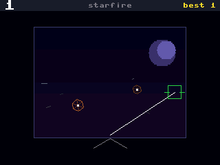</a> |
| CubeTiming | tap: mark faces you | A wire cube turns over the timing bar. A tap marks the face that faces you, and a lost life flashes red. | <a href="docs/screenshots/cubetiming.gif">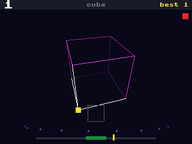</a> |
| GravityPong | tap flips paddle | The ball falls under gravity onto the paddle, which flips its way at each tap. | <a href="docs/screenshots/gravitypong.gif">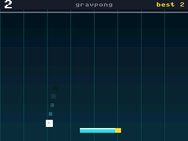</a> |
| the overlay | turn the knob | The volume pane over the ball pit, see-through at alpha 128, so the balls show through its dark part. | <a href="docs/screenshots/overlay.gif">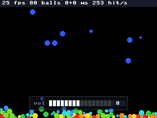</a> |

## Build and run

You need ESP-IDF v5.5.2 in `~/esp/esp-idf-v5.5.2`. The script clones MicroPython v1.29.0 into `~/esp` if it is not there.

1. Clone with the submodules: `git clone --recurse-submodules https://github.com/xmejkal/pixel-games.git`. If you cloned
   without them, `build.sh` fetches them.
2. Build the firmware with the driver and the engine: `./build.sh engine`.
3. Put the board in download mode: `mpremote bootloader`.
4. Write the image: `esptool --before no_reset --after watchdog_reset write_flash 0x10000 micropython.bin`.
5. Copy the games: `mpremote cp games/*.py :`.
6. Reset the board. `main.py` starts the games.

If the board stays dark after a long press of its D14 button, hold D14 for 1 to 2 seconds. That button also switches the board's power off.

## Status

Runs now:

- Marshmallow (P773, `games/marshmallow.py`), first at power-on: a one-button game on the fire's heat field. A
  marshmallow hangs on a stick over a campfire. Hold BOOT to lower it into the flames, and let go to lift it. The
  heat browns it from white to golden, then dark, then black. A golden or dark one that reaches the top is a point.
  A black one is lost, and so is one whose time ran out (the bar under the score). Three lost ones end the round.
  Each point makes the campfire higher and less steady (up to 5 points), the time shorter (8 s down to 3.2 s) and
  black nearer to golden. So deep in the flames is fast and risky, and the shallow way is safe and too slow. On the
  Mac a player who does nothing loses in 24 s, a hold with no end in 12 s, and no fixed rhythm of hold and release
  played on (the best reached about 20 to 30 points). The plain flame is even, so there a few fixed rhythms play on
  with no end. From 16 points on, nothing gets harder.
  The game burns the campfire itself at the bottom middle (`HeatField.burn`, the field's own base is off) and reads
  the flame's height from `HeatField.stats`. It plays `serve`, `burn` (also for a late one), `die` and a fire loop that follows the
  flame's height. With no engine module a plain flame of three bars takes the campfire's place, with the same rules.
  On the board it keeps 24 fps with the sound and no late refill (bench.md, P773). The PO's hand, eye and ear on it
  are still open.
- The fire (P595, `games/fire.py`), the scene under Marshmallow. Since P773 it is not in the box's list. The
  probes and `tools/crackle.sh` still start it as `app.Fire`: a heat field in C (`engine.HeatField`) burns over the whole
  screen. A BOOT tap moves through three modes: linear (C writes the screen's frame), picture (the fire over the painted
  sky) and nearest. It needs the engine image. The flames rise from wandering hot spots, break into tongues, rise at two speeds, lean in gusts of wind and
  throw embers. On the board, B runs at 24 fps with 11.5 to 11.8 ms of step + draw, and the sky variant at 15 to
  16 fps (bench.md, P595). In the picture mode C blends the fire in C at an alpha that follows the heat, full from heat 96
  (P603). The blend swaps the bytes of each colour in and out (`engine/driver/src/blend565.h`), so the colours are right.
  Since P608 the fire draws with bilinear filtering (`HeatField.set_filter(engine.LINEAR)`, OpenGL's `GL_LINEAR`): each
  cell's 2 x 2 px mix its heat with its neighbours', so no blocks show. The nearest mode draws the blocks as before.
  Linear costs 6.4 ms a frame to draw against 4.3 ms for nearest, at the same 24 to 25 fps (bench.md, P608).
- The ball pit (P598, `games/balls.py`), second: round balls of radius 2 to 5 px fall, knock, bounce and pile in the
  screen's box. The solver is C (`engine.Balls`): position Verlet with relaxation passes on a uniform grid
  (`engine/core/grid.c`). A BOOT tap pours 10 balls in the next colour, up to 2,000. A hold of 0.3 s or more shakes the
  pit when you let go, more strongly the longer you held it. `set_material(friction, restitution,
  restitution_threshold)` takes Box2D v3's names, and the pit uses 0.5, 0.7 and 100 px/s. Each hit is an event with
  its speed, and the HUD counts the hits a second. On the board, about 100 balls keep 23 to 24 fps (run99d, run100), and 320 run at 6 to 8 fps (run104, run100).
  A settled pile's step takes 4.2 ms at 100 balls and 13.8 ms at 300 (bench.md, P598). It needs the engine image.
- The bodies on fire (P596, P607, `games/burning.py`), third: eight falling bodies on the rain's physics each carry
  an `effects.FireTrail`, which burns heat into the fire's field behind them (`HeatField.burn`), and the field's own base is off (`HeatField.set_base`), so only the bodies
  burn. A hit at 600 px/s or faster flares up at the body's plane: C reports the hit with its speed as an event, and
  Python decides the flare (P590). The flames show behind and in front of a body: the scene draws the field, the
  bodies, then the field's hot part again, cut out with a soft edge (P639). A BOOT tap walks three modes: linear,
  picture (over the sky) and nearest. `tools/render_scene.py` draws it on the Mac. Smoke is later (cut by the PO,
  2026-11-04).
- Bucket (P773, `games/bucket.py`), fourth: a one-button game on the rain's physics. Boxes drop one by one, straight
  down. Hold BOOT and the bucket on the rail goes right, let go and it goes left. A box in the bucket is a point. A
  missed box bounces onto the pile in its column, and a column of 3 boxes reaches the rail and ends the round. Each
  point of the first 10 makes the boxes come faster (a box each 1.5 s, down to 1 s). On the Mac, with frames of 42
  ms, 60 ms and random 20 to 90 ms, a player who does nothing loses in 14 to 54 s, a hold with no end in 14 to 51 s,
  and 50 fixed rhythms of hold and release (42 and 60 ms only) lost in 61 s at the latest. A bot that steers to the lowest box lasted the
  whole 600 s of the trial every time, and one that gets columns 0 and 31 in turn at full speed misses none (a trial
  script that is not in the repository made these numbers; the bucket is 64 px wide and goes 360 px a second). The bodies do not touch each other, so the pile is a
  count per column, and a missed box bounces on its column's top. It plays `catch`, `miss` and `die`. The PO's hand,
  eye and ear on it are still open.
- The rain (P593, `games/rain.py`), the scene under Bucket. Since P773 it is not in the box's list: 160 boxes fall,
  stepped by the C engine, and a BOOT tap starts the rain again. On the board, C ran at 24 to 25 fps with a 0.22 ms step, and the Python twin at 8 to 9 fps with a
  28 ms step (bench.md P590). Since P768 the box runs only the C stepper. The Python twin steps the rain where no
  engine module exists (the Mac's tests, a stock image).
- The bodies' API (P590): `engine.Bodies(n)` in C and its twin `motion.Bodies(n)` in Python take the same calls:
  `spawn`, `step`, `read` into an `array('h')` and `drain` into an `array('i')`. A step reports each hit with its
  speed (`HIT`) and each body that comes to rest (`SLEEP`) as an event, and the game drains them once per frame.
  `plugins.PhysicsPlugin` holds either one, and its `motion.StepClock` turns a frame's ms into 10 ms steps.
- Plugins (P633, `games/plugins.py`): a scene turns on an engine layer by listing it in one line, and leaves a layer
  off by not making it. The rain lists `(physics_plugin,)`, the fire `(fire_plugin,)` and the bodies on fire both:

  ```python
  self.plugins = (self.physics_plugin, self.fire_plugin)  # in BurningBodies.setup
  ```

  While the game plays, `Game.step` runs each plugin's `fixed_update(ms)` (the bodies step by their clock), then the
  game's `play` (reads, events, burns), then each plugin's `late_update(ms)` (the field takes the burns, blows and
  steps), in Unity's order. The game's `paint` calls each plugin's `draw` where it wants that layer.
- Effects on bodies (P607, `games/effects.py`): a body of a `PhysicsPlugin` carries an effect, and an event can start
  one. A scene makes `EffectSystem(physics_plugin)` once and calls `dispatch` and `update` each frame, after the read:

  ```python
  effects = EffectSystem(physics_plugin)
  effects.bodies[0].effect = FireTrail(field, 8, 3, 200, 0.5)  # size px, radius cells, heat, lag frames
  handlers = {HIT: lambda body, speed: ...}  # Python decides what a hit causes; it can set body.effect
  effects.dispatch(handlers)
  effects.update()
  ```

  A new effect is one more subclass of `effects.Effect` (`update(x, y)`, `reset()`), and its callers do not change.
- Sound (P748, P747, `games/sound.py`, `games/crackle.py`): a `Mixer` renders 16 kHz mono samples, and a driver
  feeds them to the amplifier through stock `machine.I2S`: `FrameRefill` once per frame, or `CallbackRefill` from the
  I2S callback. The fire's crackle is a soft, deep roar and one pop per ember birth (`HeatField.take_births()`), so
  the pops come with the sparks. `NativeCrackle` renders it in C (`engine/core/fx_crackle.c`), loaded from
  `crackle_c.mpy` with no firmware rebuild: at most 0.41 ms per 16 ms block, and Fire keeps 24 fps (bench.md, P747).
  `SampledCrackle` is the plain Python path: four pre-rendered pops through the `Mixer`. Since P751, `GrainCrackle` plays
  one woody pop per ember, in sync with the sparks, over a low flame roar, from a bank rendered on the Mac
  (`tools/fire_bank.py`), kept in `engine.SoundBank` outside the GC heap. The fastest embers (rise 4 and 5) get larger pops. The fire's sound plays only in the bench probe
  (`probe733_games.py`). The game box plays its own sounds since P768 (see the overlay's status below). Try a change to the C crackle with `tools/crackle.sh`. Since P753, `FireSound` adds integer noise in C (`engine/core/fx_noise.c`): each falling burning body of `BurningBodies` whooshes by its airspeed, and Fire plays the pops alone, because the PO heard the noise bed as wind. Try it with `GAME=BurningBodies tools/crackle.sh 30 FireSound`.
- The rotary encoder (P758, `games/encoder.py`): `Encoder.on_board(pins.ENC_A, pins.ENC_B, EDGES_PER_DETENT)` reads
  the knob through `machine.Encoder`, the ESP32-S3's pulse counter, so no interrupt runs. `detents()` gives the clicks,
  + one way and - the other. The bench measured 4 edges per click (bench.md, P758). The knob can rest 1 edge from a
  click's border, so a use that must not flicker calls `take_detents(now_ms)`: it has a dead band of 2 edges, and
  its rest point follows the knob. The game box uses the knob for the volume (P764). The encoder sits on the pads RX
  and TX (`docs/wiring.html`), which the image gives to its serial console at each reset. So `app.py`, `encoder.py`
  and `pins.py` go on the board together.
  `encoder.take_pads(pins.ENC_A, pins.ENC_B)` takes them, and `app.run` calls it first.
- The master volume (P757, `games/volume.py`): `MasterVolume` is one gain on the whole mix, the last step before
  the I2S. It has 16 steps of 3 dB, and step 0 is silent. A change of step ramps across one block, so it does not
  click. Give it to a driver: `CallbackRefill(mixer, i2s, sd, ring_samples, volume)`. `MasterVolume` is plain
  MicroPython (1.2 ms a block). `ViperMasterVolume` (`games/volume_viper.py`) gives the same samples in 0.1 ms.
  `VolumeKnob(encoder, volume, store)` turns the step, 1 step per click, from `poll(now_ms)` once per frame.
  `VolumeStore` keeps the step in `volume.txt`, and the knob saves it 3 s after the last turn. The save is off in the
  probe by default: each 37th save takes 2.4 s and stops the sound (bench.md, P757). The fix is a later card.
  Status: the gain works, and the knob turns it on the pads RX (GA, GPIO44) and TX (GB, GPIO43). On the first
  pads, SDA and SCL, the step did not move in Fire. A closed contact read 1.2 to 1.4 V there, not 0 V. A
  device at 0x36 also answers on those pads (bench.md, P757, entries 11 to 19). So the encoder moved on
  2026-11-11. The games take both pads from the console at their start (entry 24). While the PO turned the knob,
  the counter counted with no sound and with a tone (entry 26). In Fire the step went from 0 up to 16 (entry
  27). The PO: "yeah, seems to be working." From a reset until a game starts, a turn of the knob can
  type into the console. That time is not measured. If the start stops before `take_pads`, the console keeps
  both pads. No run starts the board with a contact closed on RX. Set the step with `LEVEL`:
  `VOLUME=ViperMasterVolume LEVEL=4 tools/crackle.sh 30 FireSound`. `KNOB=1` adds the knob, and `SAVE=1` the save.
- The system overlay (P762, P764, `games/overlay.py`): small pictures over the running game, for system information.
  `Overlay` holds a list of panes. A pane is one piece of information: it decides when it shows (`update`), paints
  itself (`draw`) and has its own settings (`alpha`, `hold_ms`). A new kind of information is one `Pane` class and
  one `overlay.add(...)` line. `VolumePane` is the first pane: the volume's step as 16 cells and a number. It
  watches the volume's step, so each change shows it for 1 s, and no caller shows it. The app owns the overlay
  (`App.overlay`), and each output draws it after the game.
  Status: the game box opens the rotary encoder as the volume's knob (`app.open_knob`) and adds the pane when it has
  one, so every game shows the volume for 1 s when the knob turns. To see it, start the box and turn the knob. The
  box plays its first sounds since P768 (PR 1): `Runner` plays `jump` and `die`, and the knob's volume is the `Speaker`'s master volume (the PO's hand on
  it is not yet confirmed). A
  game emits a signal by name (`self.emit("jump")`) and names its cues (`cues = {"jump": Cue("jump")}`).
  `SoundCues` plays the cue's sound from the bank (`games/box_bank.raw`, made by `tools/sound_bank.py`) through
  the `Speaker`'s `Mixer`. `main.py` opens the `Speaker`. `app.run()` with no speaker is the silent box. Since
  PR 2 the `Mixer` sums 4 voices (`VoiceSum` in plain Python, `ViperVoiceSum` in `games/sound_viper.py`), and
  `Runner` also plays `land`, `pickup`, `footstep` and a fire loop that gets louder as the flame grows. A cue with
  `loop=True` is one voice: its signal carries a level from 0 to 256 (`self.emit("fire", self.fire_k)`), and 0 ends
  it. To add a sound, add it to `tools/sound_bank.py`, run the tool, and name the cue in the game's `cues`.
  `games/box_bank.SOURCES.md` gives each sound's source and license. Since PR 3 a small music loop
  plays in every game: `App.switch` starts it once, as a protected voice of the group `music`, and the tune is a
  note list in `tools/sound_bank.py`. `docs/sound.md` says how a game gets a sound. All 14 games keep their fps
  with the music, within 1 fps (bench.md, P768). The box
  does not save the step. The sound probe passes its own knob to the box, so only one
  encoder exists: `VOLUME=ViperMasterVolume KNOB=1 tools/crackle.sh 60 FireSound`. With `KNOB=0` the box opens its
  own knob, and the sound does not follow it. A run with no hand went through all 14 games with the knob
  open, and with the pane shown by a spin of the step (`probe764_box.py`, bench.md, P764, PR B). The PO's hand and
  eye in the games are still open. The picture is see-through by default (`VolumePane.alpha` is 128), and
  `ALPHA=255` on the command makes it solid. The PO turned the knob in the probe and saw it at 192 ("it could be
  more see through") and at 128 ("yes, nice"). The blend costs about 1 ms more per frame while the picture shows,
  measured at 192 (bench.md, P762). Now the first show paints
  both parts (4.4 ms), and a new step paints the cells and the number again (2.2 ms). With nothing on the
  screen the fire's sound has no safe margin in Fire: the longest gap between two refills was 47 ms in P762's run
  and 48 ms in two of P764's three runs, each with 1 late refill, and a gap over 48 ms is late (bench.md, P764).
  With the overlay and fast turns the gap reached 49 ms. The PO's turns made 5 late refills in 120 s, with the
  first form of the picture (bench.md, P762). Nobody reported a gap in the sound.
- The wiring comes from spark (P758): `requirements.json` names the board, the parts and the PO's wired pads. After a
  change, run `python3 ~/Development/spark/scripts/check_spine.py requirements.json --keep build --json` and copy
  `build/firmware/pins.py` to `games/pins.py`. The run ends in `problems` today, only because the reserved display pins
  connect to no part. The microphone's record, `parts/inmp441-i2s-mic-round.json`, comes from one photo through
  `/spark:identify`: list its open facts with `parts.py --unverified inmp441-i2s-mic-round --project .`. The wiring
  guide with pictures is `docs/wiring.html`, also at https://claude.ai/artifact/Xyppus2vF8xmC3Etc9Rbm4.
- The HUD is drawn once into a strip and blitted each frame (P599).
- Fourteen games. Two are effect scenes: the ball pit and bodies on fire. Marshmallow is a game on the fire's field and Bucket a game on the rain's physics (P773). Three are painted: runner, flappy and stack (stack as RENT). The other seven are flat.
- The double buffer: the game paints into PSRAM, and `show()` copies the frame and returns.
- Measured fps per painted game, from `bench.md`: flappy 24 under an autopilot (run92, the P602 run before the fire went on), runner 21 to 24 with no play, both at a 40 ms frame pace; stack 24.

Done last: P598 ([#799](https://github.com/xmejkal/spark/issues/799)), the ball pit, merged 2026-11-05. Before it, P602 ([#803](https://github.com/xmejkal/spark/issues/803)), fire that drifts with a scrolling world (`HeatField.scroll`, `FireLayer`), merged with no game on it: the PO tried it behind flappy's bird and kept it for other games. The PO chose "Full MVP, 4 slices" on 2026-11-04 to close the effects epic P594 ([#795](https://github.com/xmejkal/spark/issues/795)). Paused: P582 ([#783](https://github.com/xmejkal/spark/issues/783)), heavy floors for RENT, on the branch `p582-heavy`, not merged.

In Idea, after the pit: P614 ([#820](https://github.com/xmejkal/spark/issues/820)), a faster ball solver, and P618 ([#824](https://github.com/xmejkal/spark/issues/824)), a soft contact with a damping ratio, P619 ([#825](https://github.com/xmejkal/spark/issues/825)), balls drawn from small pictures, and P616 ([#822](https://github.com/xmejkal/spark/issues/822)), balls on fire. Also in Idea: P610 ([#814](https://github.com/xmejkal/spark/issues/814)), a Blur effect on a screen region, and P611 ([#815](https://github.com/xmejkal/spark/issues/815)), a motion blur behind a fast body, combined with its FireTrail. Later: P612 ([#817](https://github.com/xmejkal/spark/issues/817)), a spike on where a game's frame time goes and how to reach 25 fps or more, and P583 ([#784](https://github.com/xmejkal/spark/issues/784)), effects in C on the S3's PIE (its vector instructions).

The work is planned on the board of the [spark](https://github.com/xmejkal/spark) project.

## Licence

MIT, see `LICENSE`. The files under `engine/driver/` keep their own terms.
