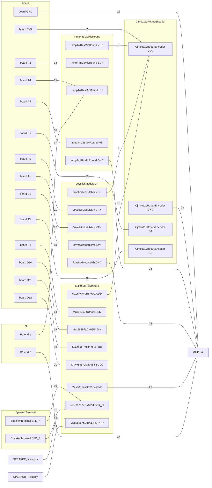

# Breadboard: pixel-p757, on a DFRobot FireBeetle 2 ESP32-S3

## Parts

| qty | part | for | have |
| --- | --- | --- | --- |
| 1 | DFRobot FireBeetle 2 ESP32-S3 | the board |  |
| 1 | DFRobot DFR0954 MAX98357A I2S amplifier | Max98357aDfr0954 |  |
| 1 | 2-pin speaker terminal (JST PH) | SpeakerTerminal |  |
| 1 | Two-axis thumb joystick module (PS2-style, 5-pin, silkscreen "MH") | JoystickModuleMh |  |
| 1 | CJMCU-111 rotary encoder module (4-pad: GA GB VCC GND, knob fitted) | Cjmcu111RotaryEncoder |  |
| 1 | Round INMP441-type I2S MEMS microphone breakout (6 pads: SCK WS L/R / SD VDD GND), chip marking unread | Inmp441I2sMicRound |  |
| 1 | 100kΩ resistor, through-hole | R1 pull-down on Inmp441I2sMicRound SD |  |
| | what feeds SPEAKER_P: a supply from off the board, not part of this list | Max98357aDfr0954, SpeakerTerminal | |
| | what feeds SPEAKER_N: a supply from off the board, not part of this list | Max98357aDfr0954, SpeakerTerminal | |
| | a breadboard and jumper wires | |  |

*have*: yours = your drawer holds it for this project · in your drawer = you own it, not held here · to get = not in your drawer · blank = this project is not on your list (`/spark:init` puts it there)

## Wiring

### Changes since the last build

- Take out the jumper from board SCL to the row of Cjmcu111RotaryEncoder GB.
- Take out the jumper from board SDA to the row of Cjmcu111RotaryEncoder GA.
- Run a jumper from board RX to the row of Cjmcu111RotaryEncoder GA.
- Run a jumper from board TX to the row of Cjmcu111RotaryEncoder GB.

### Steps

One connection per step. The board's pins take the rows beside them, so a board pin always gets a jumper.

1. Put the board in the breadboard, each pin in its own row.
2. Put Max98357aDfr0954 in the breadboard, each pin in its own row.
3. Put SpeakerTerminal in the breadboard, each pin in its own row.
4. Put JoystickModuleMh in the breadboard, each pin in its own row.
5. Put Cjmcu111RotaryEncoder in the breadboard, each pin in its own row.
6. Put Inmp441I2sMicRound in the breadboard, each pin in its own row.
7. Run a jumper from board 3V3 to the row of Cjmcu111RotaryEncoder VCC.
8. Run a jumper from the row of Inmp441I2sMicRound VDD to the row of Cjmcu111RotaryEncoder VCC.
9. Run a jumper from the row of JoystickModuleMh VCC (second pin from the GND end, printed +5V) to the row of Cjmcu111RotaryEncoder VCC.
10. Run a jumper from the row of Max98357aDfr0954 VCC to the row of Cjmcu111RotaryEncoder VCC.
11. Run a jumper from board A0 to the row of JoystickModuleMh VRX.
12. Run a jumper from board A1 to the row of JoystickModuleMh VRY.
13. Run a jumper from board A2 to the row of Max98357aDfr0954 SD.
14. Run a jumper from board A3 to the row of Inmp441I2sMicRound SCK.
15. Run a jumper from board A4 to the row of Inmp441I2sMicRound SD.
16. Put R1 (100kΩ pull-down on Inmp441I2sMicRound SD), end 1, in the row of Inmp441I2sMicRound SD.
17. Run a jumper from board A5 to the row of Inmp441I2sMicRound WS.
18. Run a jumper from board D5 to the row of JoystickModuleMh SW.
19. Run a jumper from board D10 to the row of Max98357aDfr0954 DIN.
20. Run a jumper from board D11 to the row of Max98357aDfr0954 LRC.
21. Run a jumper from board D12 to the row of Max98357aDfr0954 BCLK.
22. Run a jumper from board GND to a free rail. Mark it GND.
23. Run a jumper from the row of Cjmcu111RotaryEncoder GND (the pad labelled GND, at the end of the row beside the lone tan ceramic capacitor) to the GND rail.
24. Run a jumper from the row of Inmp441I2sMicRound GND to the GND rail.
25. Run a jumper from the row of JoystickModuleMh GND (the header pin at the end labelled GND) to the GND rail.
26. Run a jumper from the row of Max98357aDfr0954 GND to the GND rail.
27. Put R1 (100kΩ pull-down on Inmp441I2sMicRound SD), end 2, in the GND rail.
28. Run a jumper from board RX to the row of Cjmcu111RotaryEncoder GA.
29. Run a jumper from board TX to the row of Cjmcu111RotaryEncoder GB.
30. Run a jumper from the row of SpeakerTerminal SPK_N to the row of Max98357aDfr0954 SPK_N.
31. Connect the SPEAKER_N supply, from off the board, to the row of Max98357aDfr0954 SPK_N. Check its voltage first (Before you power it).
32. Run a jumper from the row of SpeakerTerminal SPK_P to the row of Max98357aDfr0954 SPK_P.
33. Connect the SPEAKER_P supply, from off the board, to the row of Max98357aDfr0954 SPK_P. Check its voltage first (Before you power it).

### Diagram

Each line is one step, with its number.

breadboard.json and breadboard.svg not written: nothing says how to draw Max98357aDfr0954 in Wokwi.

### Points

After the steps, each line is one point: its ends must be joined, and nothing else.

1. board 3V3 · Cjmcu111RotaryEncoder VCC (the pad labelled VCC, next to GND) · Inmp441I2sMicRound VDD · JoystickModuleMh VCC (second pin from the GND end, printed +5V) · Max98357aDfr0954 VCC
2. board A0 · JoystickModuleMh VRX (middle pin)
3. board A1 · JoystickModuleMh VRY (fourth pin from the GND end)
4. board A2 · Max98357aDfr0954 SD
5. board A3 · Inmp441I2sMicRound SCK
6. board A4 · Inmp441I2sMicRound SD · R1 (100kΩ pull-down on Inmp441I2sMicRound SD), end 1
7. board A5 · Inmp441I2sMicRound WS
8. board D5 · JoystickModuleMh SW (the pin at the end labelled SW)
9. board D10 · Max98357aDfr0954 DIN
10. board D11 · Max98357aDfr0954 LRC
11. board D12 · Max98357aDfr0954 BCLK
12. board GND · Cjmcu111RotaryEncoder GND (the pad labelled GND, at the end of the row beside the lone tan ceramic capacitor) · Inmp441I2sMicRound GND · JoystickModuleMh GND (the header pin at the end labelled GND) · Max98357aDfr0954 GND · R1 (100kΩ pull-down on Inmp441I2sMicRound SD), end 2 — more ends than one breadboard row holds: join board GND to a rail and put the others on that rail
13. board RX · Cjmcu111RotaryEncoder GA (the pad labelled GA, at the end of the 4-pad row away from the lone tan ceramic capacitor)
14. board TX · Cjmcu111RotaryEncoder GB (the pad labelled GB, next to GA)
15. Max98357aDfr0954 SPK_N · SpeakerTerminal SPK_N · the SPEAKER_N supply, from off the board, not part of the parts list
16. Max98357aDfr0954 SPK_P · SpeakerTerminal SPK_P · the SPEAKER_P supply, from off the board, not part of the parts list

Not wired:

- SCLK: board SCK, nothing wired to it yet (the requirements add this signal)
- MOSI: board MO, nothing wired to it yet (the requirements add this signal)
- MISO: board MI, nothing wired to it yet (the requirements add this signal)
- GDI_RST: board D3, nothing wired to it yet (the requirements add this signal)
- GDI_CS: board D6, nothing wired to it yet (the requirements add this signal)
- GDI_SD_CS: board D7, nothing wired to it yet (the requirements add this signal)
- GDI_BL: board D13, nothing wired to it yet (the requirements add this signal)
- SWITCH_BUTTON: board D14, nothing wired to it yet (the requirements add this signal)

## Before you power it

- SPEAKER_P comes from off the board, and this sheet does not say its voltage: check it against the supply range of Max98357aDfr0954, SpeakerTerminal (`parts.py --show`) before you connect it
- SPEAKER_N comes from off the board, and this sheet does not say its voltage: check it against the supply range of Max98357aDfr0954, SpeakerTerminal (`parts.py --show`) before you connect it
- Max98357aDfr0954 GAIN: left unconnected on this board, which selects 9 dB. Tie to GND for 12 dB, GND via 100k for 15 dB, VCC for 6 dB, VCC via 100k for 3 dB
- Max98357aDfr0954 NC: genuinely floating — the schematic shows an unterminated stub. Safe as a mechanical anchor
- DFRobot DFR0954 MAX98357A I2S amplifier: NEVER stop LRCLK while BCLK is running. Maxim state twice that this can produce a large DC output voltage, which into an 8 ohm speaker cooks the voice coil. Stop BCLK, not LRCLK.
- DFRobot DFR0954 MAX98357A I2S amplifier: SD must be DRIVEN LOW to shut the amplifier down, not left floating — an on-board resistor holds it high, and floating selects a channel rather than turning it off. Removing the clock only reaches standby at 340 uA.
- DFRobot DFR0954 MAX98357A I2S amplifier: Holding SD low draws current through that on-board resistor for as long as it is held: 33 uA at 3.3 V if R1 is 100k, 4.9 uA if it is 680k. The host GPIO sinks it, and it is spent precisely while the amplifier is meant to be off.
- DFRobot DFR0954 MAX98357A I2S amplifier: SPK+ and SPK- are on OPPOSITE rows, diagonally — top row rightmost and bottom row rightmost. They are not an adjacent pair, and a footprint drawn as if they were will wire the speaker across the wrong two pads.
- DFRobot DFR0954 MAX98357A I2S amplifier: This module has no mounting holes. Whatever holds it is the host board's problem.
- DFRobot DFR0954 MAX98357A I2S amplifier: There is NO pad-1 marker — no square pad, no dot: orient the module by its silkscreen labels, never by a pad number, on a breadboard, a perfboard or a footprint.
- 2-pin speaker terminal (JST PH): NEVER ground either pin. The amplifier's output is bridged: SPK+ and SPK- both swing and the speaker sits across them, so a pin that meets a ground, or another output, shorts the amplifier.
- 2-pin speaker terminal (JST PH): This connector and any other 2-pin JST PH on the board — the power inlet's above all — can be cross-plugged. Key one of them or use another series: a motor supply into an amplifier output destroys it.
- 2-pin speaker terminal (JST PH): The speaker's impedance decides the current through this terminal and what the amplifier delivers: check it against the amplifier's record before choosing a speaker.
- JoystickModuleMh SW has no resistor: the firmware must pull it up with Pin.PULL_UP, as `pins.py` says (P204)
- Two-axis thumb joystick module (PS2-style, 5-pin, silkscreen "MH"): Feed the pin labelled +5V from 3.3 V, never from 5 V. The pot wipers swing up to whatever that pin gets, and 5 V on an ESP32-C6 ADC pin is above its absolute maximum.
- Two-axis thumb joystick module (PS2-style, 5-pin, silkscreen "MH"): Pull SW up, either with the internal pull-up or with a 10k to 3.3 V. R1 on this board is empty, so an unpulled SW floats and the game sees random presses.
- Two-axis thumb joystick module (PS2-style, 5-pin, silkscreen "MH"): Read VRX and VRY on ADC1 pins with 11 dB attenuation so the full 0 to 3.3 V swing is in range. At rest the stick sits near half scale, not exactly at it, so calibrate the centre at start-up and allow a dead zone.
- Two-axis thumb joystick module (PS2-style, 5-pin, silkscreen "MH"): Debounce SW in firmware. A stick switch bounces like any tactile switch.
- Cjmcu111RotaryEncoder GA has no resistor: the firmware must pull it up with Pin.PULL_UP, as `pins.py` says (P204)
- Cjmcu111RotaryEncoder GB has no resistor: the firmware must pull it up with Pin.PULL_UP, as `pins.py` says (P204)
- CJMCU-111 rotary encoder module (4-pad: GA GB VCC GND, knob fitted): Feed VCC from the FireBeetle's 3V3 and never from 5 V or VBUS: if the board's own pull-ups go to VCC (unconfirmed), GA and GB idle at the supply voltage, which on 5 V is more than the 3.3 V GPIOs of an ESP32-S3 are rated for. Funduino's sheet says 5 V (4.5-5.5 V) and Leybold says 3.3-5 V; neither is a maker, so 3.3 V is unproven until the knob has been turned on a bench.
- CJMCU-111 rotary encoder module (4-pad: GA GB VCC GND, knob fitted): No pull-ups are confirmed on this board: have the firmware pull GA and GB up internally (spark's pins.py does when the host board states its internal pull-up), and measure the unit - VCC to GA and VCC to GB with power off - to find out. The contacts then pull each line to GND, so both idle HIGH and read 0 while closed.
- CJMCU-111 rotary encoder module (4-pad: GA GB VCC GND, knob fitted): THE PUSH SWITCH IS NOT ON THE HEADER of the pictured board (4 pads: GA GB VCC GND). A press cannot be read through it. If the unit has a fifth pad or a SW label, this record does not describe it. To use the press, solder wires to the encoder's two switch pins (small pads on the underside) after checking with a meter that they are isolated from the other pads; that switch is then a bare contact: one side to GND, the other to a GPIO with the internal pull-up.
- CJMCU-111 rotary encoder module (4-pad: GA GB VCC GND, knob fitted): Shop pages for 'CJMCU-111' describe two different boards: Leybold's text and a search summary list 5 pins (GND + SW DT CLK, KY-040 style) while both shops' photos show 4 pads labelled GA GB VCC GND. Wire from the silkscreen on the unit, never from a CLK/DT/SW diagram: reading the row from the wrong end puts GND on GA and VCC on GB.
- CJMCU-111 rotary encoder module (4-pad: GA GB VCC GND, knob fitted): Debounce in firmware (the contacts are mechanical and an on-board capacitor, if it is a filter, has an unknown value), and decode both channels together: A alone cannot tell the direction. Count per detent on the bench before trusting a figure: shops give 20 detents and 20 pulses per turn, not the edges per detent.
- CJMCU-111 rotary encoder module (4-pad: GA GB VCC GND, knob fitted): The board ships with the 4-pin header loose in the bag (Funduino: unsoldered). Solder it, shaft side up or down as the enclosure needs, and do not push sideways on the shaft: the sheet warns against lateral force.
- Inmp441I2sMicRound LR: NOT unused: a strap that must be tied, never left floating. Tie to GND for the LEFT slot of the I2S frame, to VDD for the RIGHT slot. No host GPIO is needed
- Round INMP441-type I2S MEMS microphone breakout (6 pads: SCK WS L/R / SD VDD GND), chip marking unread: Feed VDD from the host's 3V3 and never from 5 V or VBUS: the chip's absolute maximum on VDD is 3.63 V and on the digital pins VDD + 0.3 V, and no regulator can be seen on the pad side of this board (the other face was not seen).
- Round INMP441-type I2S MEMS microphone breakout (6 pads: SCK WS L/R / SD VDD GND), chip marking unread: L/R must be tied: to GND the samples come in the LEFT slot, to VDD in the RIGHT slot. Do not leave it floating; the slot is undefined.
- Round INMP441-type I2S MEMS microphone breakout (6 pads: SCK WS L/R / SD VDD GND), chip marking unread: The host is the I2S master and must clock SCK at exactly 64 times WS (32-bit slots, both channels), SCK 0.5 to 3.2 MHz, WS 7.8 to 50 kHz. Read 32-bit words: the 24 bits are the top of each word, two's complement.
- Round INMP441-type I2S MEMS microphone breakout (6 pads: SCK WS L/R / SD VDD GND), chip marking unread: The first 2^18 SCK cycles after power-up (85 ms at 3.072 MHz) read zero; drop those samples.
- Round INMP441-type I2S MEMS microphone breakout (6 pads: SCK WS L/R / SD VDD GND), chip marking unread: SD floats in the half-frame the chip does not use. Read only the slot that L/R selects, or add the datasheet's 100 kOhm pull-down to GND on SD.
- Round INMP441-type I2S MEMS microphone breakout (6 pads: SCK WS L/R / SD VDD GND), chip marking unread: Do not leave SCK and WS running while VDD is off: the datasheet warns that it continuously turns on the ESD diodes and may affect the chip's long-term reliability.
- Round INMP441-type I2S MEMS microphone breakout (6 pads: SCK WS L/R / SD VDD GND), chip marking unread: The sound port is the small plated hole at the centre of the PAD SIDE: keep it clear of dust, tape and a breadboard surface pressed against it, or the sensitivity drops.
- Round INMP441-type I2S MEMS microphone breakout (6 pads: SCK WS L/R / SD VDD GND), chip marking unread: Pad order and the identity of the chip rest on one photo of one face. Look at the other face before the pad order is trusted for a PCB footprint.

Each record whole, with what it asks of the board: `parts.py --show cjmcu-111-rotary-encoder`, `parts.py --show inmp441-i2s-mic-round`, `parts.py --show joystick-module-mh`, `parts.py --show max98357a-dfr0954`, `parts.py --show speaker-terminal`.
