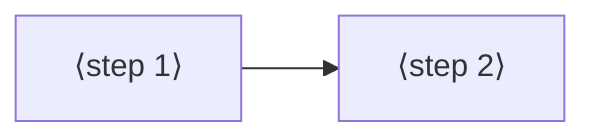

# Jobs and journeys
<!-- Tags as in the brief: E with a pointer, H with its source, D with who and when; an unknown is —. -->

## Who
<!-- One line per persona: who · evidence status (E pointer | H source).
e.g. `- Team leads who assign work · H Lena's belief, no interview yet` -->
- The PO, who plays the games on his board and shows them · E his play verdicts in bench.md (P562 "super cool, I love it"; P564 "flappy is a bit stucky") and this request · n = 1 <!-- REQUIRED:who -->
- A reader of his showcase repo, for example a hiring manager who opens it from a job application · H P539 D5 (showcase first); nobody of this group was asked

## Jobs
<!-- One job story per line, each clause tagged: When …, I want to …, so I can ….
e.g. `- When I assign a task in a meeting [E tickets.csv:6], I want the assignee to see it that day [H Lena], so I can stop chasing people [E tickets.csv:7]` -->
- When I pick up the board to play [E the request], I want each game to look and move like a small indie game, wild and beautiful [E the request], so I can enjoy it and feel it is mine [H the facilitator, from "I love it" in P562] <!-- REQUIRED:jobs -->
- When I show the games to someone, for example in a job application [E P539 D5], I want them to be surprised by what a small board does [H the facilitator], so I can prove I build well with AI [E memory "spark-showcase-and-teaching", PO 10-21]
- When a game says something about the world [E the request: "controversial political or social topic"], I want it to make the player think while playing [H the facilitator], so I can show more than technique [H the facilitator]

## Today they…
<!-- Per job: what they do instead today (a competitor, a workaround or nothing), tagged.
e.g. `- Job 1 · paste each task into Slack by hand · E tickets.csv:7` -->
- Job 1 · three games painted (runner, stack, flappy) in one pencil-and-watercolour style; seven games are flat fills and lines · E games/art (55 files, 1.6 MB), art_index.py <!-- REQUIRED:today -->
- Job 2 · the repository is private and its README is short; no pictures of the games · E P566 #770, the PO's repo setting (private first, 2026-11-02)
- Job 3 · no game has a theme beyond its rules · E games/arcade.py, arcade2.py, space3d.py, world3d.py class names

## Journeys
<!-- One ### per actor and scenario: the table, then a Mermaid flowchart of the same steps. Never a Mermaid
journey block: it forces a score on every task. "n/a — a one-step job" may replace both.
e.g. `| 2 | opens the app | E analytics, 90 days | never sees the task | not yet | Do they read email? |` -->
### ⟨actor⟩ — ⟨scenario⟩ <!-- REQUIRED:journey -->
| step | what they do | evidence | friction or harm | today | open question |
| --- | --- | --- | --- | --- | --- |
| 1 | ⟨fill⟩ | ⟨tag and pointer⟩ | ⟨fill⟩ | ⟨works, partly, not yet or —⟩ | ⟨fill or —⟩ |

