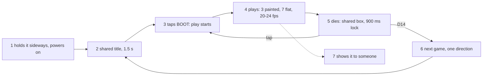
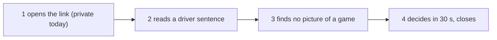

# Jobs and journeys
<!-- Tags as in the brief: E with a pointer, H with its source, D with who and when; an unknown is —. -->

## Who
<!-- One line per persona: who · evidence status (E pointer | H source).
e.g. `- Team leads who assign work · H Lena's belief, no interview yet` -->
- The PO, who plays the games on his board and shows them · E his play verdicts in bench.md (P562 "super cool, I love it"; P564 "flappy is a bit stucky") and this request · n = 1 <!-- REQUIRED:who -->
- A reader of his showcase repo, for example a hiring manager who opens it from a job application · H P539 D5 (showcase first); nobody of this group was asked

## Jobs
<!-- One job story per line, each clause tagged: When …, I want to …, so I can ….
e.g. `- When I assign a task in a meeting [E tickets.csv:6], I want the assignee to see it that day [H Lena], so I can stop chasing people [E tickets.csv:7]` -->
- When I pick up the board to play [E the request], I want each game to look and move like a small indie game, wild and beautiful [E the request], so I can enjoy it and feel it is mine [H the facilitator, from "I love it" in P562] <!-- REQUIRED:jobs -->
- When I show the games to someone, for example in a job application [E P539 D5], I want them to be surprised by what a small board does [H the facilitator], so I can prove I build well with AI [E memory "spark-showcase-and-teaching", PO 10-21]
- When a game says something about the world [E the request: "controversial political or social topic"], I want it to make the player think while playing [H the facilitator], so I can show more than technique [H the facilitator]

## Today they…
<!-- Per job: what they do instead today (a competitor, a workaround or nothing), tagged.
e.g. `- Job 1 · paste each task into Slack by hand · E tickets.csv:7` -->
- Job 1 · three games painted (runner, stack, flappy) in one pencil-and-watercolour style; seven games are flat fills and lines · E games/art (55 files, 1.6 MB), art_index.py <!-- REQUIRED:today -->
- Job 2 · the repository is private and its README is short; no pictures of the games · E P566 #770, the PO's repo setting (private first, 2026-11-02)
- Job 3 · no game has a theme beyond its rules · E games/arcade.py, arcade2.py, space3d.py, world3d.py class names

## Journeys
<!-- One ### per actor and scenario: the table, then a Mermaid flowchart of the same steps. Never a Mermaid
journey block: it forces a score on every task. "n/a — a one-step job" may replace both.
e.g. `| 2 | opens the app | E analytics, 90 days | never sees the task | not yet | Do they read email? |` -->
Both journeys are read from code and the bench log by the user lens (council/user.md), not watched: nothing ran on the board, and nobody of the second group was asked.

### The PO — picks up the board and plays through the ten games <!-- REQUIRED:journey -->
| step | what they do | evidence | friction or harm | today | open question |
| --- | --- | --- | --- | --- | --- |
| 1 | holds the board sideways and powers it on; the canvas is 320 wide by 240 tall on a 240x320 panel turned on its side | E games/st7789.py:15, games/lcd.py:28-29 (user.md, art-direction.md ART-1) | — | works | — |
| 2 | sees the title: growing rectangles, the game name in 3x font on a black band, a blinking hint, "best N", for 1.5 s; the same shell for all ten games | E games/gfx.py:340-396, TITLE_MS (user.md USER-1) | no theme and no picture; the painted games get the same shell over their art | works | does he read the name there, or count D14 presses? (user.md Q3) |
| 3 | taps BOOT: the tap ends the title early and starts play on the same press | E games/gfx.py step (USER-4) | — | works | — |
| 4 | plays: three painted games (flappy, runner, stack) at 20 to 24 fps, seven flat ones; speeds of 150 to 520 px/s, pipes 95 to 155 px/s | E bench.md:116; games/app.py:42; user.md USER-2, USER-6, per-game table | his verdicts are about smoothness: "froze sometimes" (bench.md:36), tearing (:57), "stepped" (:92), "a bit stucky" (P564); a busier background costs readability at speed (H, USER-6); fps in play after P562/P564 is not logged | partly | which game did he play longest, and leave first? (user.md Q2); is a 2 to 4 fps drop acceptable for a stronger look? (user.md Q12) |
| 5 | dies: a black 200x100 box, "game over" in red, "score N best N"; retry is blocked for 900 ms and a tap inside it is ignored | E games/gfx.py OVER_MS, step and draw (USER-4); art-direction.md ART-8 | a possible "I pressed and nothing happened"; the death moment is the same for all ten | partly | did the game restart when he pressed at once? (user.md Q8) |
| 6 | presses D14 to cycle to the next game: one direction, no menu, no preview; nine presses from flappy to gravpong; a long hold powers the board off | E games/app.py:70-79, :121-124 (USER-3) | the jump from the painted three to the flat seven is the first thing he meets; the switch button has a power-off hazard | partly | keep all ten, or drop or merge some? (po-assistant.md Q5; user.md Q1) |
| 7 | shows the board to someone (job 2) | H the facilitator; no account of a showing in bench.md | which game he starts with and what they said is — | — | when he last showed it, which game first, and what did they say? (user.md Q9) |

### A hiring manager — opens the showcase repo with 30 seconds
| step | what they do | evidence | friction or harm | today | open question |
| --- | --- | --- | --- | --- | --- |
| 1 | opens the repository link from a job application | E P539 D5 (showcase first); the repository is private today (jobs-and-journeys.md Today, P566 #770) | cannot open it today | not yet | when does it go public, and with what in it? (P566) |
| 2 | reads the first lines of README.md: 36 lines, opening "A C display driver, a fork of russhughes/s3lcd ...", a build recipe needing ESP-IDF v5.5.2, a Status line about paint time | E README.md (user.md USER-10) | the first 30 seconds show a build log, not a game | not yet (P566) | — |
| 3 | looks for a picture: zero images in README; art/preview.png is a 1320x3234 contact sheet of assets at 2x to 4x, not linked, not the games | E README.md image grep 0; art/preview.png (USER-10, USER-11) | the only art that looks designed is runner, stack and flappy; the flat seven beside them would look like an earlier project | not yet | does the restyle produce stills or a clip that P566 can show? (user.md Q10) |
| 4 | decides whether this person builds well with AI, and closes the tab | H the facilitator (job 2); nobody of this group was asked | nothing on the page shows a game running | not yet | — |

