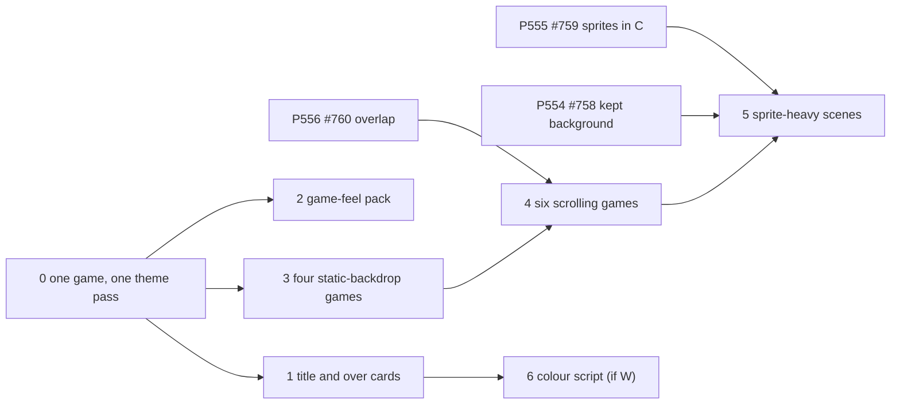

# Story map
<!-- Proposed, not applied: this map stays here until the decider confirms it; nothing changes the product's own
map file. -->
**Status:** proposed, not applied <!-- REQUIRED:map-status -->

## Backbone
<!-- The activities, left to right, as the user does them. e.g. `Assign → Notice → Act → Close` -->
Pick up → Choose a game (D14) → Title → Play → Die → Retry or switch → Show someone <!-- REQUIRED:backbone -->

The steps are the PO's journey in jobs-and-journeys.md (steps 1 to 7). "Show someone" is also where the hiring manager's journey begins.

## Slices
<!-- Walking skeleton first: the thinnest slice that runs end to end. One row per story. job: a job in
jobs-and-journeys.md. tag: as in the brief. proof: something the decider can read.
e.g. `| 0 | Notice | the assignee gets one daily digest | job 1 | H ★C2 | the digest log for one team |` -->
Slice 0 is the smallest thing the PO can play and judge: one game, one theme pass. It is also the test of the riskiest assumption (A1 in risks-and-tests.md). Which game it is, is Q6. The slices after 0 are grouped by what they depend on (tech-lead.md TL-16), not by the order the PO must take; he orders them.

| slice | activity | story | job | tag | proof |
| --- | --- | --- | --- | --- | --- |
| 0 walking skeleton <!-- REQUIRED:slices --> | Title → Play → Die | one game gets one theme pass: a palette, a backdrop, one sprite with 3 to 4 frames, one death cue, a painted title and over card with baked lettering; the PO plays it blind (the theme not named to him) and says what it is about | jobs 1, 3 | H ★C15, ★C19 (po-assistant.md PO-19; art-direction.md Q-F) | his words in bench.md, and the `time` log line's fps for that game before and after the pass |
| 1 | Title → Die | every game gets its own painted title and game-over card (3 to 6 frames inside 1.5 s, 4 to 6 inside 900 ms), replacing the shared shell; no drawn text | jobs 1, 3 | E ★C11 (user.md USER-1, USER-8; art-direction.md ART-7, ART-8) | ten cards on the board; the over-screen paint time against today's 33 to 54 ms box (bench.md:163) |
| 2 | Play | a game-feel pack in Python with no driver dependency: coyote time and jump buffer, hitstop of 2 to 3 frames, a 3 to 5 frame death shake, squash and stretch by frame choice, damped springs for secondary parts (backpack, cage, net) | job 1 | E ★C12; H ★C13 (tech-lead.md PHYS-5; art-direction.md "well animated" table) | the PO's verdict per game in bench.md; a timed loop of the body update on the board |
| 3 | Play | the four static-backdrop games (snake, stack, gravpong, cube) get their theme and look; a still backdrop keeps partial sends small | jobs 1, 3 | E ★C4, ★C5 (tech-lead.md TL-2, TL-16a) | fps per game in the time log not below its own pre-slice fps; his words |
| 4 | Play | the six scrolling games (flappy, runner, cave, road, tunnel, starfire) get their theme and look; every frame is a full send, so the cap is near 29 fps | jobs 1, 3 | E ★C3, ★C4 (TL-1, TL-2) | fps per game not below the P556 numbers (flappy 20 to 22, runner 21 to 24) or its own pre-slice fps; his words |
| 5 | Play | sprite-heavy scenes (many obstacles, crowds, paper storms) once sprites and the hud are in C | job 1 | E ★C5, ★C24 (TL-5, TL-16b, TL-16c) | sprite count per frame at the same fps, from the time log |
| 6 | Choose a game → Title | if one city (option W): a colour script across the D14 cycle, dawn to night, and one shared skyline layer reused by flappy, runner, stack and road | jobs 2, 3 | H (art-direction.md option W) | the ten title cards in cycle order, as stills |
| later, optional | Play | glow, smoke, fades and sub-pixel motion, once blend modes and soft edges exist | job 1 | E ★C8 (TL-6, PHYS-6) | — |

Dependencies, as the tech lead reads the code (TL-16), proposed:
- slices 0 (static-backdrop game), 1, 2, 3: no driver card needed;
- slice 0 (scrolling game) and slice 4: P556 #760 (the overlap) merged first; parallax wants P557 #761;
- slice 5: P555 #759 (sprites in C) and P554 #758 (kept background, hud in C);
- later: P558 #762 (soft edges), P559 #763 (blend modes).

## Delta to the product's map <!-- REQUIRED:spark-process:map-delta -->
<!-- The rows to add or change in the repository's own story map file, in that file's table shape, with its journey
step numbers; proposed, not applied. "n/a — no map file" is allowed. -->
n/a — no map file: pixel-games has no story map file (docs/ holds only discovery/). Its cards sit on spark's board, whose Slice field holds spark's own slices; which Slice holds the pixel-games cards did not come back from `gh issue view --json projectItems` (the field was not in the answer), so items.md asks the decider for the slice.
<!-- EXTEND:map -->
