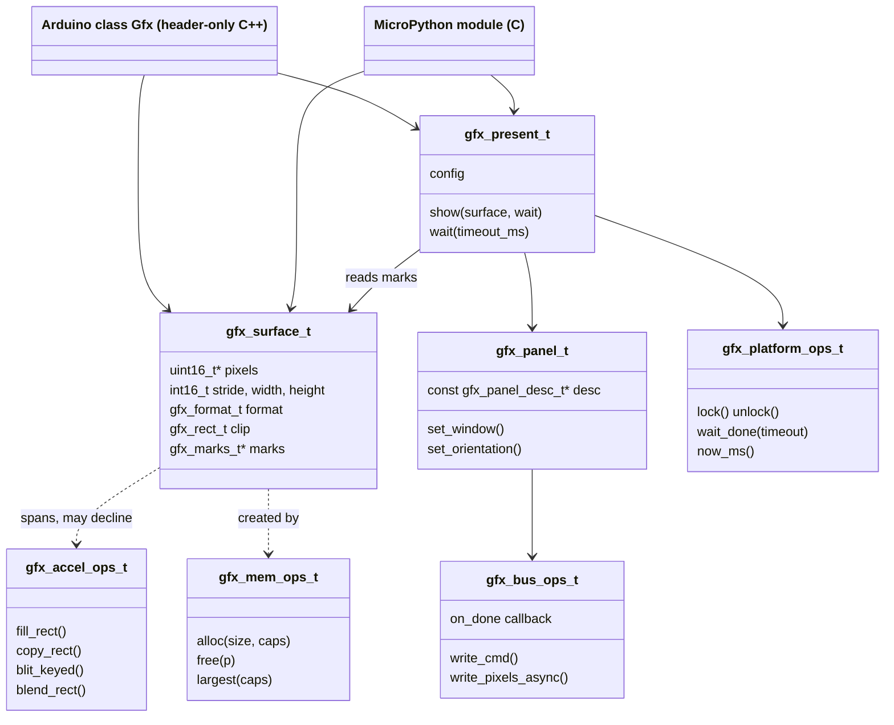
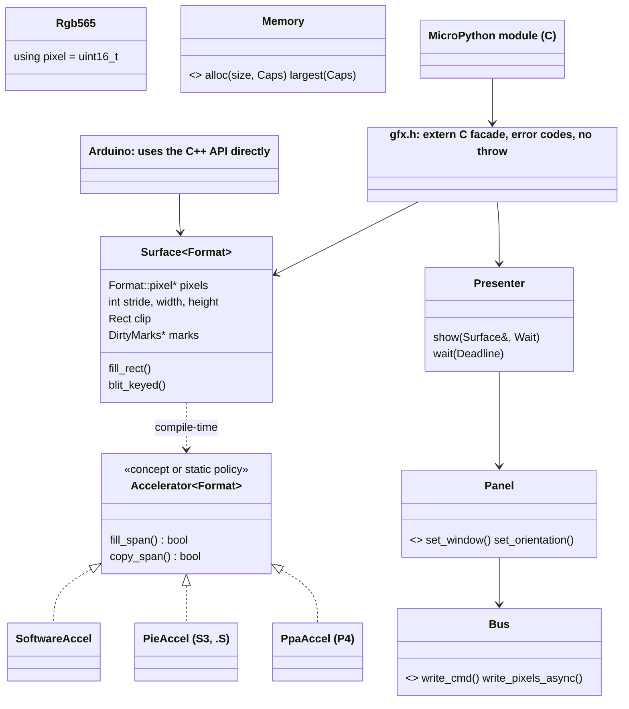
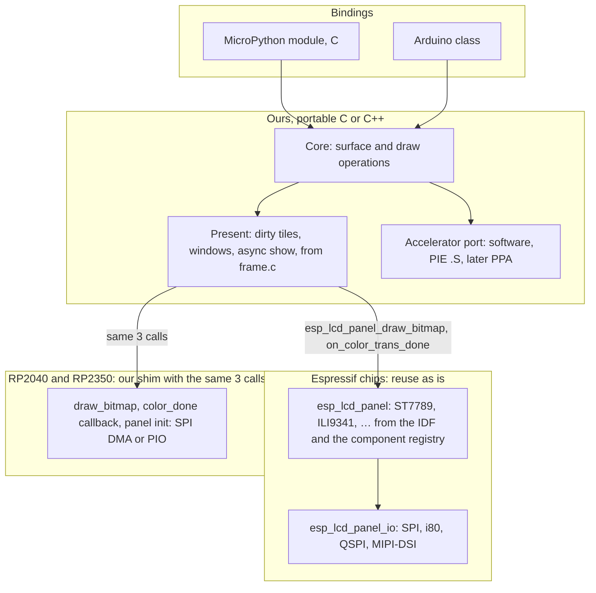

# P539 council: the tech lead (feasibility, fit, electronics-firmware:physics)

The tech lead (Opus) wrote this on 2026-11-02, from about 12:46 CET. It reads and changes nothing in the product. Tags: E means evidence, with a pointer. H means a hypothesis or model knowledge, with its source. D means a decision, with who and when. A dash (—) is an unknown. "fg" is firebeetle-games at its working tree on 2026-11-02 (HEAD 5badc28). "Scratch" means the session scratchpad. A web page cited as "read 2026-11-02" was fetched on that day. Nothing here is a decision.

## Findings

### Feasibility: what exists and what the work would touch

- TL-1 · The P533 driver already holds three layers in one file. A layer design can cut along these lines. Lines 1-351 of `frame.c` are presentation: the dirty-tile marks, the windows, the strips and the done-count. They call only FreeRTOS and two esp_lcd functions, `esp_lcd_panel_draw_bitmap` in `frame_queue` and the `on_color_trans_done` callback. Lines 381-528 are MicroPython binding, the `config()` parsing. Errors go out as `mp_raise_*` from inside the core (lines 66, 88, 174, 205), and the PSRAM framebuffer comes from `m_malloc` (line 105). · E fg `s3lcd/src/frame.c:131-142,160-176,199-207,105,381-528`; `frame.h:1-5` ("talks to the panel only through esp_lcd's panel API … works for any panel esp_lcd drives") · supports only: the cut into presentation, bus and binding is mechanical. To move the core off MicroPython, `mp_raise` must become error codes and `m_malloc` must become a memory port.
- TL-2 · Today the drawing code is bound to the MicroPython object. `_setpixel`, `_fill_rect`, `blit_buffer`, `line` and the text paths take `s3lcd_obj_t *`, which starts with `mp_obj_base_t` and holds esp_lcd handles. Pixels go to `self->frame_buffer + y * self->width + x`. A core "surface" (pixels, stride, width, height, dirty marks) must come out of `s3lcd_obj_t` before any second binding can share it. · E fg `s3lcd/src/s3lcd.h:86-117`, `s3lcd.c:227-285,584-616` · supports only: the size of the extraction is about 2,900 lines of s3lcd.c to sort. Most of it is binding glue (38 methods in the locals table, `s3lcd.c:2700-2740`) or decoders (jpg, png, pngenc). The draw primitives are a few hundred lines.
- TL-3 · The existing primitives have contract defects that a shared core must fix, not copy. (a) `_fill_rect` takes `uint16_t x, y`, so a negative x from Python wraps to a large number and the rectangle is dropped. It is not clipped on the left (`s3lcd.c:254-258`, called with `mp_int_t` at `:409-416`). The games avoid it only because `TftCanvas.fill` clips in Python first (`games/lcd.py:45-55`). (b) `blit_buffer` forms `dst` before it clips (`s3lcd.c:597`), so a negative x or y points before the array. It works in practice, but it is undefined behaviour in C. It also tests the bounds of every pixel in the inner loop and calls `alpha_blend_565` even at alpha 255 (`:599-611`). (c) `_fill` repaints the whole frame one pixel at a time with 16-bit stores (`:244-252`). · E the lines cited · supports only: the core API needs a clipping contract stated once (signed coordinates, clip at entry, then preclipped inner loops), and tests for it.
- TL-4 · Inside a MicroPython user C module, `ESP_PLATFORM` is not defined and no `-std` is set. The frame.c line in the build's compile database has neither `-DESP_PLATFORM` nor any `-std=` flag. It has `-O2 -mlongcalls -fno-builtin-memcpy -mdisable-hardware-atomics …`, while `ports/esp32/main.c` in the same build gets `-DESP_PLATFORM -O2 -std=gnu17`. The bench's FreeRTOS trace-hook workaround has the same cause. · E command: python over `~/esp/micropython-v1.29.0/ports/esp32/build-s3lcd/compile_commands.json`, output `main.c ['-DESP_PLATFORM', '-O2', '-std=gnu17']` against frame.c's list with neither; fg `frame.c:40-44`; fg `bench.md` slice 3 build notes; the cause sits in `esp32_common.cmake:282-285` ("User C modules don't pick up certain compile options set by the IDF") · supports only: a port picked by `#ifdef ESP_PLATFORM`, as LovyanGFX does (TL-14), picks wrongly inside a MicroPython build. The library needs its own port macro set by each build file, or `CONFIG_IDF_TARGET_*` from `sdkconfig.h`.
- TL-5 · The same gap probably applies to C++ in a user C module. Such a file probably gets IDF's generic `COMPILE_OPTIONS`, but not IDF's `CXX_COMPILE_OPTIONS`: not `-std=gnu++2b`, and possibly not `-fno-exceptions` or `-fno-rtti`. It then compiles at GCC 14's default dialect. · H inferred from TL-4 and `esp32_common.cmake:282-285`, which copies only `COMPILE_OPTIONS`. The IDF's own C++ files in the same build do get `-std=gnu++2b -fno-exceptions -fno-rtti` (E: the compile_commands entry for `components/cxx/cxx_exception_stubs.cpp`). GCC's default C++ dialect (gnu++17 since GCC 11) is H, model knowledge · supports only: a C++ core must set its own `-std` and `-fno-exceptions -fno-rtti` in `micropython.cmake` with `target_compile_options(... $<$<COMPILE_LANGUAGE:CXX>:...>)`. A spike settles it in minutes with no board: add `examples/usercmodule/cppexample` to the s3lcd build and read compile_commands.
- TL-6 · The cost of building the s3lcd module is measured, and the flash budget leaves room for a graphics core. s3lcd.c is 17,767 bytes of text and frame.c 3,383. The png and jpg pieces are deflate 9,473, miniz 7,842, tjpgd565 5,262 and pngle 5,016 bytes. The 07:20 build left 229,776 bytes free in the app partition. · E command `xtensa-esp-elf-size` on the `__idf_main.dir/.../s3lcd/src/*.c.obj` files (output above, read 2026-11-02 12:5x CET); fg `bench.md` "Builds" · supports only: a core of tens of KB fits. Dropping the png encoder (deflate and its siblings) frees about 10 KB or more. That is an estimate from the sizes, and trees.c, zutil.c and the others were not summed.
- TL-7 · The paint, not the pixels, sets the frame time now, and the pixel work itself costs little. A full-frame RGB565 fill at 240 MHz (`CONFIG_ESP_DEFAULT_CPU_FREQ_MHZ=240`) costs 76,800 px × 1.146 cycles/px = 0.37 ms in C. With PIE it costs 0.063 ms. A full-frame copy costs 1.10 ms in C and 0.11 ms with PIE. Against that, runner's paint measures 34 ms a frame. · E cycles/px from esp_lvgl_port's simd README, as quoted in fg `p537-finding.md` (chip acceleration, PIE); E CPU clock `build-s3lcd/sdkconfig:1592`; E runner paint fg `bench.md` run 22; the arithmetic is calculated (PHYS-9) · supports only: today's 34 ms is per-call Python overhead plus repeated work (`fill(bg)` and `paint_static` every frame, `lcd.py:110-114`; hud text as fill_rect runs, `gfx.py:336-351`). The first lever is to batch calls into C (sprite, text, kept background), as P537 slices 2 and 3 say. PIE is not that lever. This agrees with P537's slice order.
- TL-8 · I measured the cost of C++ by compiling, not on the board. A template fill (`template<class Format> fill_rect`) compiles to the same 92 bytes as the C fill. Both inner loops are the Xtensa zero-overhead `loop` with 2 instructions a pixel (`s16i`, `addi.n`). A virtual `set_pixel` per pixel, in the PicoGraphics shape, gives an inner loop of 13 instructions a pixel: GCC devirtualizes speculatively, with a vtable load, a slot load, a compare and three field reloads. When the target is not the one guessed, it falls back to one `callx8` a pixel. A virtual call per span (row) is 38 bytes, with one indirect call a row. · E command: `xtensa-esp32s3-elf-gcc/g++ 14.2.0 -O2 -mlongcalls` (`-std=gnu17` and `-std=gnu++2b -fno-exceptions -fno-rtti`) on four test files in scratch `cxx/`; `size -A` gives fill_c 92 B, fill_tpl 92 B, fill_virt 107+23 B, fill_span 38 B; `objdump -d` shows the loops · supports only: code size and instruction counts, not cycles, and no cache effects. The rule it supports is a virtual (or a function pointer) per span or per operation, never per pixel. Templates over pixel format cost nothing at run time, but each instantiation adds code size. That last part is H (mikrocontroller.net "C vs C-Plusplus", read 2026-11-02).
- TL-9 · No build of the core exists outside MicroPython, and nobody built the targets beyond the S3: Arduino-ESP32, ESP-IDF, Pico SDK, arduino-pico. Spark's own Arduino path is still unproven (spike A0, P361 #462, open). · E spark `docs/discovery/2026-11-02-p528-platforms/notes.md:67-75`; fg `build.sh:1-17` (MicroPython only) · supports only: every claim that "one core builds under four build systems" stays H until a compile spike runs each one. The Arduino and Pico toolchains are not installed here (— checked only for ESP-IDF and MicroPython under `~/esp`).
- TL-10 · Host (Mac) tests of a core in pure C are cheap, because the pattern already exists. The games pass their Mac tests with a fake driver (`bench.md` P533 slice 2: "Tested on the Mac with a fake driver"). P537's slice 3 asks for the same ("The Mac tests pass with a fake driver"). A core that renders to a `uint16_t *` surface can be tested with golden hashes on the host. Only the bus port and the accelerator port need the board. · E fg `bench.md` P533 slice 2; fg `p537-finding.md` slice 3 · supports only: the testing practice the PO asked for is feasible from the MVP onward. It is feasible only if the core includes no `py/*.h`, no esp_lcd and no FreeRTOS header.

### Layers and ports: how four libraries split theirs (read in their source, 2026-11-02)

- TL-11 · LVGL v9 splits a draw-task queue from draw units. A unit is a struct of function pointers: `dispatch_cb`, `evaluate_cb` and a wait-for-finish callback for asynchronous hardware. A task carries `preferred_draw_unit_id` and `preference_score` ("80: means 20% better (faster) than software rendering"). The software blender has macro hooks, for example `#ifndef LV_DRAW_SW_COLOR_BLEND_TO_RGB565 … LV_RESULT_INVALID`, that an assembly backend overrides. When the hook returns `LV_RESULT_INVALID`, the C loop runs. The display driver is `flush_cb`, `flush_wait_cb`, `buf_1`, `buf_2` and `render_mode`. · E `lvgl/src/draw/lv_draw_private.h:30-150` (master, read 2026-11-02); `src/draw/sw/blend/lv_draw_sw_blend_to_rgb565.c:81-93,297`; `src/display/lv_display_private.h:66-115`; `library.properties` version 9.6.0 · supports only: the pattern of an accelerator hook with a C fallback, and of picking an accelerator by score per operation. This is the model for a PIE, PPA or GDMA port that may decline an operation.
- TL-12 · LovyanGFX splits C++ virtual interfaces by role. `IBus` has `init`, `beginTransaction`, `addDMAQueue`, `execDMAQueue`, `getDMABuffer`, `writeCommand`, `writePixels(pixelcopy_t*)` and more, 24 virtual functions in all. `IPanel` has `setWindow`, `writeFillRectPreclipped`, `writeImage(…, pixelcopy_t*, use_dma)`, `display(x,y,w,h)`, `getScanLine` and more. Pixel conversion lives in `pixelcopy_t`, a struct with `fp_copy` and `fp_skip` function pointers that templates pick per source and destination format. So dispatch happens per span through a function pointer, not per pixel through a virtual. One repository ships as an Arduino library (`library.properties`, `architectures=esp32,esp8266,samd,rp2040,…`), as a PlatformIO library (`library.json`, `"frameworks": ["arduino", "espidf", "*"]`) and through CMake, which picks `boards.cmake/esp-idf.cmake` under `ESP_PLATFORM` or `pico-sdk.cmake` under `PICO_PLATFORM`. · E `lovyan03/LovyanGFX` master: `src/lgfx/v1/Bus.hpp:44-122`, `Panel.hpp:35-144`, `misc/pixelcopy.hpp:30-120`, `library.properties`, `library.json:22-23`, `CMakeLists.txt:1-14` (read 2026-11-02, version 1.2.36) · supports only: one repository can serve Arduino, ESP-IDF and Pico SDK. Its port choice by `ESP_PLATFORM` breaks inside a MicroPython user C module (TL-4). LovyanGFX has no MicroPython binding in its tree (— not searched beyond the files listed).
- TL-13 · CircuitPython displayio uses a C struct of function pointers for the bus: `display_bus_send`, `begin_transaction`, `end_transaction`, `bus_reset`, `bus_free`, `collect_ptrs`, plus a new optional `send_async` and `flush` ("may return before the data is sent … NULL when the bus has no such mode; only set and read when CIRCUITPY_BUSIO_SPI_ASYNC"). The panel facts (column and row commands, colstart, `SH1107_addressing`) are data in `displayio_display_bus_t`, not code. The core composes each refresh area into a small buffer (`displayio_display_core_fill_area`) with no full framebuffer. · E `adafruit/circuitpython` main: `shared-module/displayio/bus_core.h:17-63`, `shared-bindings/displayio/__init__.h:46-53`, `shared-module/busdisplay/BusDisplay.c:210-379` (read 2026-11-02) · supports only: the C pattern of a bus vtable, panel facts as data, and asynchronous send as an optional capability. It fits P539's "panel drivers as data" and spark's "facts, not behaviour".
- TL-14 · Pimoroni PicoGraphics puts a C++ virtual in the pixel path. `PicoGraphics` has `virtual set_pixel(const Point&)` and `virtual set_pixel_span(const Point&, uint)`, one subclass per pen format (`PicoGraphics_PenRGB565` and others). The display side is `DisplayDriver` with `virtual update(PicoGraphics*)` and `partial_update(PicoGraphics*, Rect)`. The MicroPython module is a thin `picographics.c` plus `picographics.cpp` over the shared C++ drivers and library. It is one `usermod_picographics` INTERFACE library that lists the C++ sources by relative path and calls `pico_generate_pio_header`. The same C++ library also builds as a Pico SDK library (`pico_graphics.cmake`). · E `pimoroni/pimoroni-pico` main: `libraries/pico_graphics/pico_graphics.hpp:214-321,580-611`; `micropython/modules/picographics/micropython.cmake:1-46`; `libraries/pico_graphics/pico_graphics.cmake:1-24` (read 2026-11-02) · supports only: one C++ core shared by a MicroPython binding and a native SDK build is proven practice on the RP2040. Its per-pixel virtual is the shape that TL-8 measures as about 6 times the instructions.
- TL-15 · MicroPython's own guidance for C++ is a small C wrapper over the C++ code. The guidance: `extern "C"` on every symbol that crosses, `SRC_USERMOD_CXX` and `CXXFLAGS_USERMOD` in `micropython.mk`, and `-lstdc++` for make ports. Its cppexample `micropython.mk` sets `-std=c++11`. · E `~/esp/micropython-v1.29.0/docs/develop/cmodules.rst:350-380`; `examples/usercmodule/cppexample/micropython.cmake`, `micropython.mk` · supports only: the binding layer stays C even if the core is C++. H, model knowledge, not read in source: `mp_raise_*` leaves through MicroPython's nlr (setjmp/longjmp-like). So a raise that crosses C++ frames skips their destructors, and the C++ core must return error codes that the C wrapper turns into raises.

### Toolchains and C++ standards (read at source, 2026-11-02)

- TL-16 · ESP-IDF 5.5.2 uses GCC 14.2.0 (`xtensa-esp-elf-g++ (crosstool-NG esp-14.2.0_20251107) 14.2.0`). Its defaults are `-std=gnu17` and `-std=gnu++2b`. The docs say "C++23 language standard with GNU extensions (-std=gnu++23)". Exceptions are off by default ("adds an additional ~500 bytes of heap overhead when an exception is thrown"). RTTI is off by default ("increases binary size (typically by tens of kB)"). · E `~/esp/esp-idf-v5.5.2/tools/cmake/build.cmake:158-159`; `docs/en/api-guides/cplusplus.rst:29`; `Kconfig:477-501`; the g++ `--version` output; `build-s3lcd/sdkconfig:614-615` (both off in our MicroPython build) · supports only: C17 and C++23 are available on the S3 today.
- TL-17 · Arduino-ESP32 master is version 3.3.12 and is built on the libraries `idf-release_v5.5-b774170f-v3`. Its C++ flags come from a prebuilt `flags/cpp_flags` file that I did not get to read. The lib-builder's `configs/defconfig.common` on master sets `CONFIG_COMPILER_CXX_EXCEPTIONS=y`. · E `espressif/arduino-esp32` master `platform.txt:2,53`, `package/package_esp32_index.template.json:56-57,109-110`; `espressif/esp32-arduino-lib-builder` master `configs/defconfig.common:12` (read 2026-11-02) · supports only: Arduino-ESP32 runs with exceptions on, unlike the other targets. So the core must compile both with and without exceptions, and must never throw. Its `-std` is — (H: gnu++2b, inherited from IDF 5.5, not read).
- TL-18 · arduino-pico master (platform version 6.3.2) uses `-std=gnu23` for C and `-std=gnu++23` for C++, with `build.flags.rtti=-fno-rtti` and `build.flags.exceptions=-fno-exceptions` by default. · E `earlephilhower/arduino-pico` master `platform.txt:23,61,68,101,107` (read 2026-11-02) · supports only: C++23 is the default there.
- TL-19 · The Pico SDK (master, 2.3.1) sets no C or C++ standard. pico-examples sets `CMAKE_C_STANDARD 11` and `CMAKE_CXX_STANDARD 17`. The SDK's `pico_cxx_options` turns exceptions and RTTI off by default (`PICO_CXX_ENABLE_EXCEPTIONS` and `PICO_CXX_ENABLE_RTTI` default 0, giving `-fno-exceptions` and `-fno-rtti`). MicroPython's rp2 port sets no `CMAKE_CXX_STANDARD`. · E `raspberrypi/pico-sdk` master `pico_sdk_version.cmake:4-10`, `src/rp2_common/pico_cxx_options/CMakeLists.txt:9-25`; `pico-examples` `CMakeLists.txt:9-10`; grep of `~/esp/micropython-v1.29.0/ports/rp2/CMakeLists.txt` found no standard set · supports only: on the Pico SDK and in MicroPython rp2, the dialect is whatever the compiler defaults to, unless the library's CMake sets it. The arm-none-eabi GCC version that pairs with MicroPython rp2 is —.
- TL-20 · Summary of the dialects. C17 is available everywhere. C++17 is the floor that every target reaches without a flag fight. C++23 is the default only on ESP-IDF, Arduino-ESP32 (H) and arduino-pico. It needs an explicit flag in MicroPython user C modules (TL-5) and in the Pico SDK (TL-19). MISRA C++:2023 targets C++17 (ISO/IEC 14882:2017), was published in October 2023, and was produced jointly with AUTOSAR, so it replaces AUTOSAR C++14. · E TL-16 to TL-19; misra.org.uk (MISRA C++:2023 page, found by search 2026-11-02, summary not read in full); all-about-industries.com (on AUTOSAR) · supports only: the PO's "newest C++ standard" and a MISRA C++:2023 profile pull apart. MISRA covers C++17 only, so C++20 and C++23 features fall outside it.
- TL-21 · ESP-IDF's own style guide fits an ESP-first C core, and frame.c already follows it. The guide asks for a per-component prefix on public names, `snake_case` types ending in `_t`, `s_` for static variables, namespaced enums made with typedef, 4 spaces, 120 columns and astyle. For C++ it asks for `CamelCase` classes, `snake_case` members and methods, lower `snake_case` namespaces, `.hpp` and `.cpp` files, and no `…Interface` suffix. frame.c uses the `frame_` prefix, `_t` types, 4 spaces and `FRAME_` macros. · E docs.espressif.com `esp-idf/en/v5.5.2/esp32s3/contribute/style-guide.html` (fetched 2026-11-02); fg `frame.c` and `frame.h` · supports only: one naming style already in use. BARR-C:2018 is a free PDF whose stylistic rules are "fully harmonized with MISRA C:2012" (E LDRA and Barr Group press pages, found by search 2026-11-02). Its exact naming rules were not read (—).
- TL-22 · No mature, deterministic tool checks that the prose of a C or C++ comment still matches the code. Mechanical checks do exist. Clang's `-Wdocumentation` warns "parameter 'X' not found in the function declaration" when a `\param` names a parameter that is gone or renamed. Doxygen can warn on undocumented or mismatched parameters (H, model knowledge: `WARN_NO_PARAMDOC`, `WARN_AS_ERROR`). The only drift tool found is go-commentage, for Go. A "Stale CLI" checks README text against code, with an optional AI mode. · E search results 2026-11-02 (emmtrix.com Clang -Wdocumentation page; boostorg/graph PR 546; pkg.go.dev go-commentage; socket.dev stale-cli; arXiv 2307.04291) · supports only: CI can gate the mechanical drift with a clang host build plus `-Wdocumentation -Werror`, plus Doxygen warnings as errors. Prose drift needs a reviewer, a person or an agent, per PR.

### Fit with spark's technical direction

- TL-23 · The library is firmware behaviour, so it lives outside spark. That fits "Spark exports facts, never behaviour … The conversation writes the firmware". What spark can feed it is facts: the display's pins through `pins.h`, which the yellow `CHeaderPinMapRenderer` writes for Arduino and ESP-IDF, and `pins.py` for MicroPython. · E spark `AGENTS.md` (principles); spark `docs/discovery/2026-11-02-p532-platform-architecture/README.md:25,128,160` · supports only: no spark change is needed for P539. That matches the brief's proposed scope ("out … a spark change").
- TL-24 · The library's bindings line up with spark's platforms, but it is not a spark platform. Spark's roles are MicroPython (green), Arduino and ESP-IDF (yellow), PlatformIO (a build tool, yellow) and Rust (gray). Its MVP board for the compiled platforms is the FireBeetle 2 ESP32-S3. The library's targets are MicroPython, Arduino, ESP-IDF and the Pico SDK on the same board first. PlatformIO maps to a `library.json` (TL-12). Rust has no counterpart. Spark's notes have no Pico SDK column, and spark has no RP2040 board path. · E spark P532 README `:157-168`; spark P528 notes `:8-27,79` · supports only: the shared first board, and that the Pico targets in P539 run ahead of spark. H: a C ABI core leaves a later Rust FFI binding open.
- TL-25 · The layer pattern under each option matches spark's own: one core, small single-job classes or structs, and strategies chosen by a table ("PLATFORMS: name to builder", "ImageBuilderChoice … picks by tools.json role"). The rule "slices 2 and 3 edit no caller … If one needs an edit, the seam is wrong" carries over as a port test: adding a port must edit no core file. · E spark P532 README `:42-76,245-254`; spark `AGENTS.md` ("One core, many interfaces") · supports only: the fit of the shape, not of the code. Spark is Python and the library is C or C++.

## Physics lens: what the hardware does, in numbers

Inputs, with provenance. The panel is 240 × 320 at 16 bpp (stated: `games/lcd.py:28`, RGB565 per `gfx.py:10`). A frame is 240 × 320 × 2 = 153,600 B (calculated; also `bench.md` 09:58). The ESP32-S3 GPSPI uses an integer divider of its source clock (datasheet-typ: ESP-IDF v5.5.2 S3 spi_master page, fetched 2026-11-02, "SPI peripheral only has an integer divider"). Requested 60 MHz gives a real 40 MHz (measured, `bench.md` 08:18 and slice 3). The ST7789 serial write cycle is 16 ns, so 62.5 MHz at most (stated in `games/app.py:30`, from the datasheet, which I did not read). 80 MHz gave a dark panel (measured, `bench.md` 08:26). The CPU runs at 240 MHz. PSRAM is octal at 80 MHz. The D-cache is 32 KB with 32 B lines, and the FreeRTOS tick is 100 Hz (stated, `build-s3lcd/sdkconfig:1592,1541,1549,1609,1614,1848`). The arithmetic is in one python run in this session. Its output is quoted below.

- PHYS-1 · A full frame at 40 MHz needs 153,600 × 8 / 40e6 = 30.72 ms on the wire (calculated). Measured: 31.0 ms (`bench.md` slice 3), so 0.28 ms of overhead (calculated). The ceiling is 32.6 fps for full frames on this bus (calculated). At 62.5 MHz it is 19.66 ms, and at 80 MHz 15.36 ms (calculated). No integer divider of an 80 MHz source falls between 40 and 62.5 MHz, so 40 MHz is the highest clock this panel takes. The source clock value of 80 MHz is H (the IDF page says only "the highest frequency among GPSPI supported clock sources"). The pins are not the limit: on the S3, "routing SPI pins via the GPIO matrix will behave the same compared to routing them via IOMUX" at 80 MHz or below (datasheet-typ, the same page). · supports only: on this board a full-frame send costs at least 30.7 ms at 16 bpp, whatever the library does. Only fewer bytes go faster: partial windows, or 12 bpp. 12 bpp gives 240 × 320 × 1.5 × 8 / 40e6 = 23.04 ms (calculated). Whether the panel accepts RGB444 (COLMOD) is H, from ST7789 datasheet knowledge, not read.
- PHYS-2 · A window costs about 128 µs of fixed overhead (calculated from measured data). Before 3542d74, the upstream constructor read `dma_rows` from `idle_mode` (= 1). Every strip was then one row: 320 windows at rotation 0 and 240 at rotation 1. The measured sends fit one constant: (71.3 − 30.72) / 320 = 126.8 µs (slice 2, run 14), (71.9 − 30.72) / 320 = 128.7 µs (slice 3 "strips") and (61.8 − 30.72) / 240 = 129.5 µs (slice 1, rotation 1). Check against probe7, with the unchanged-frame show at 0.08 ms (measured) as the base: one 16 px tile, model 0.08 + 0.128 + 0.102 = 0.31 ms, measured 0.35. A 240 × 16 band, model 1.744 ms, measured 1.78 ms. · E fg `s3lcd.c:2809` ("upstream lacked it, so dma_rows read idle_mode (1)"); git `3542d74`; fg `bench.md` slices 1, 2, 3 and 5 · Two documents disagree. `bench.md` slice 2 says "s3lcd sends 16-row strips, 15 at rotation 1 and 20 at rotation 0 … each strip costs about 1.9 ms beyond its bytes". `bench.md` 11:30 says "Every strip held one row of 320 pixels. Slice 3's 'strips 71.9 ms …' was measured with one-row strips". It limits the bug to slice 3, but the code comment says the bug was upstream, so it also held for slices 1 and 2. `frame.c:29` says "a window costs about 60-120 us of bus setup" (stated). The fit says about 128 µs. · supports only: a cost model for the present layer of send ≈ 0.08 ms + n × 0.128 ms + bytes / 5 MB/s, not a count of windows alone. At `windows=40` the overhead is 40 × 0.128 = 5.1 ms, a sixth of a full frame (calculated). One board probe settles it: n windows of equal bytes, n = 1 to 64.
- PHYS-3 · From PHYS-2, the bytes sent per frame in partial show (calculated from measured sends and window counts, `bench.md` probe6, tile 16): flappy in play (14 windows, 11.3 ms) is (11.3 − 0.08 − 1.79) × 5,000 = 47,140 B, 31 % of a frame. Runner in play (7 windows, 7.7 ms) is 33,620 B, 22 %. Flappy at game over (25, 21.3 ms) is 90,100 B, 59 %. Runner at game over (18, 18.3 ms) is 79,580 B, 52 %. Window overhead in play is 1.79 ms for flappy and 0.90 ms for runner. · Two documents disagree. `p537-finding.md` (option 5) says "A 7.7 to 11.3 ms send at 40 MHz carries about 75 to 110 tiles of 512 B. So the copy is 40 to 55 KB a frame". That counts every ms as wire time. With the window overhead removed it is about 34 to 47 KB (calculated). · supports only: the size of the PSRAM-to-internal copy in slice 4b, which PHYS-7 prices.
- PHYS-4 · Internal DMA-capable RAM cannot hold two frames. Free at boot: 264,347 B. Largest block: 188,416 B (measured, `bench.md` 09:58). Two frames need 307,200 B, more than 264,347 (calculated). After one frame, the largest block keeps 188,416 − 153,600 = 34,816 B (calculated). That is `bench.md`'s "about 35 KB left in that heap", but it is the rest of the largest block, not of the heap. The heap keeps about 264,347 − 153,600 − 20,480 (two strips, 16 rows × 320 × 2 B each, `frame.c:62`) − 1,600 (marks, 40 × 40, `frame.c:74-76`) = 88,667 B (calculated, assuming the strips and marks come from the same capability pool; the marks use `MALLOC_CAP_INTERNAL` without DMA, so this is an upper bound for DMA RAM). An 8-bit indexed back buffer of 76,800 B fits in that rest by size. Whether it fits in one block is — (the largest free block after `init()` with "dma" was not measured). · supports only: the memory port must report capabilities and the largest block (`heap_caps_get_largest_free_block`), and a double buffer on the S3 at this resolution is PSRAM or nothing. It also bounds what the RP2040 can do (264 KB SRAM in all, H from its datasheet, not read): a full RGB565 frame takes 58 % of it.
- PHYS-5 · The frame budget per `FRAME_MS`, from the measured step (0.6 to 1.2 ms, `p537-finding.md`) and partial sends (flappy 11.3 ms, runner 7.7 ms). With a synchronous `show()`, the paint must stay under `FRAME_MS − send − step`. At 40 ms that is flappy 27.5 ms and runner 31.1 ms. At 33.3 ms it is 20.8 and 24.4. At 25 ms, 12.5 and 16.1. At 16.7 ms, 4.2 and 7.8 (calculated). With the send fully overlapped, the paint must stay under `FRAME_MS − step`: 38.8, 32.1, 23.8 and 15.5 ms (calculated), and the send must also end within the frame. Runner today paints 34 ms (measured, run 22). That is over its 31.1 ms budget at 40 ms, which matches the measured 20 to 21 fps and the 70 to 80 ms worst gap. · supports only: the targets P537 already sets, now with each input named.
- PHYS-6 · At 60 fps (16.7 ms) and 40 MHz, at most 16.7e-3 × 5e6 = 83,500 B can go out per frame. That is 54 % of a frame, before window overhead (calculated). The panel scans at about 60 Hz with no TE line (`p537-finding.md`, plan E5 and E6). · supports only: 60 fps is out of reach for any frame that changes more than half the screen, on any library over this bus. It is reachable for game play (22 to 31 % per PHYS-3) only if paint plus send overlap.
- PHYS-7 · Memory bandwidth (field: esp32.com forum posts, ESP32-S3-WROOM-1U-N8R8, 240 MHz CPU, octal PSRAM at 80 MHz, found by search 2026-11-02, not controlled): PSRAM to PSRAM 22 to 27 MB/s, internal to PSRAM about 57 MB/s, PSRAM to internal about 50 MB/s, internal memcpy about 361 to 364 MB/s, PIE 128-bit copy internal 1.4 to 1.9 GB/s. A slice-4b tile copy of 34 to 55 KB from PSRAM costs 0.7 to 1.1 ms a frame (calculated). A full-frame internal memcpy costs 0.42 ms (calculated). An internal-to-strip copy implied by probe7 (column 1.85 ms against the band's 1.78 ms) is about 72 MB/s (calculated, small difference, low confidence). In-house measurement: flappy's paint is 25.5 ms into a PSRAM framebuffer against 18.2 ms into internal RAM, +40 % (measured, `bench.md` run 14 against run 15, via `p537-finding.md`). · supports only: a PSRAM back buffer costs about 1 ms of copy, plus a paint penalty of tens of percent, which a probe must measure (P537 slice 4b). Note `-fno-builtin-memcpy` is set for every file in this build (E, compile_commands, main.c and frame.c), so every `memcpy` is a library call and is never inlined, even a small one.
- PHYS-8 · Dirty-tile granularity: a 16 × 16 tile is 512 B = 102.4 µs on the wire at 40 MHz (calculated), about 0.8 of one window's fixed cost (PHYS-2). At tile 8 a tile is 128 B = 25.6 µs, a fifth of a window's fixed cost. · supports only: why tile 8 saved only about 1 ms with twice the windows (`bench.md` probe6). Below tile 16, windows cost more than the bytes they save, unless window joining improves.
- PHYS-9 · CPU pixel throughput, from the inputs of TL-7 (calculated, cycles from the esp_lvgl_port README as quoted in `p537-finding.md`, measured on an S3 by Espressif): full-frame fill 0.367 ms in C and 0.063 ms with PIE. Full-frame copy 1.10 ms in C and 0.113 ms with PIE. Our own C fill emits one `s16i` per pixel in a zero-overhead loop (TL-8). That is 2 instructions a pixel, against PIE's 8 pixels per 128-bit store (H: lane count from `p537-finding.md`, "8 x 16-bit lanes"). · supports only: PIE gains under about 1.5 ms a frame on paths that are already in C. The 34 ms of paint is not pixel-bound.

## Options for the layers and ports (for the decider; none is chosen)

Common to all three options: the layers are the same in each. The difference is how they are expressed and what is reused.

- Core: a surface (pixels, stride, size, format, clip, dirty marks) and the draw operations on it. These are fill, line, blit with key and flips, text from a glyph cache and sprite, plus later tiles, blend and soft edges, as in P537.
- Accelerator port: fill, copy, key-blit and blend over a span or a rectangle. It can decline an operation, and the C loop then runs (the LVGL pattern, TL-11).
- Memory port: alloc and free with capabilities (internal-DMA, PSRAM, fast) and the largest block (PHYS-4).
- Present layer: dirty tiles to windows, the send, the done-count, and async show. This is frame.c lines 1-351 without esp_lcd.
- Panel driver: init sequence, address window, orientation, as data where possible (TL-13).
- Bus port: commands, async pixel write, a done callback.
- Platform port: lock, a wait with timeout, time.
- Bindings: a MicroPython module in C, and an Arduino class.

### Option A: a C17 core with ports as structs of function pointers (the CircuitPython and LVGL shape)



Port interfaces (sketch, C17):

```c
// gfx_accel.h: each entry may return GFX_DECLINED, and the core then runs its C loop.
typedef enum { GFX_OK = 0, GFX_DECLINED, GFX_E_NOMEM, GFX_E_TIMEOUT, GFX_E_BUS } gfx_err_t;
typedef struct {
    gfx_err_t (*fill_rect)(void *ctx, uint16_t *dst, int stride, int w, int h, uint16_t color);
    gfx_err_t (*copy_rect)(void *ctx, uint16_t *dst, int dst_stride, const uint16_t *src, int src_stride, int w, int h);
    gfx_err_t (*blit_keyed)(void *ctx, uint16_t *dst, int dst_stride, const uint16_t *src, int src_stride,
                            int w, int h, uint16_t key, uint8_t flips);
    void *ctx;
} gfx_accel_ops_t;

// gfx_mem.h
typedef enum { GFX_MEM_DMA = 1u << 0, GFX_MEM_INTERNAL = 1u << 1, GFX_MEM_EXTERNAL = 1u << 2 } gfx_mem_caps_t;
typedef struct {
    void *(*alloc)(size_t size, unsigned caps);
    void (*free)(void *p);
    size_t (*largest)(unsigned caps);           // heap_caps_get_largest_free_block on ESP-IDF
} gfx_mem_ops_t;

// gfx_bus.h: the done callback runs in an ISR; the present layer counts windows (frame.c's in_flight).
typedef void (*gfx_bus_done_cb_t)(void *user);
typedef struct {
    gfx_err_t (*write_cmd)(void *bus, uint8_t cmd, const uint8_t *params, size_t len);
    gfx_err_t (*write_pixels_async)(void *bus, const void *pixels, size_t bytes);   // after set_window
    void (*set_done_cb)(void *bus, gfx_bus_done_cb_t cb, void *user);
    unsigned caps;                               // GFX_BUS_ASYNC, GFX_BUS_READ, …
} gfx_bus_ops_t;

// gfx_panel.h: panel facts as data (CircuitPython's style), code only where a panel needs it.
typedef struct {
    uint16_t width, height;
    int16_t col_offset, row_offset;
    uint8_t caset, raset, ramwr, madctl;         // 0x2A, 0x2B, 0x2C, 0x36 on MIPI DCS panels
    const uint8_t *init_seq;                     // cmd, len, params…, delay
} gfx_panel_desc_t;
```

On ESP-IDF, the bus and panel ports are thin adapters over `esp_lcd_panel_io` and `esp_lcd_panel` (today's frame.c calls). The PIE accelerator is `.S` files behind `fill_rect` and `copy_rect`. Cost: indirect calls per span or per operation only (TL-8). Fit: C everywhere, the MicroPython binding is direct, the Arduino class is a header over C, and MISRA C:2023 and BARR-C apply. Against it: no type safety across formats, and pixel formats beyond RGB565 need a switch or macros.

### Option B: a C++ core (templates over pixel format, virtual only at device boundaries) with a C ABI facade



Sketch (C++17, so that it passes MISRA C++:2023 and builds with no flag fight; C++20 concepts only if every build file sets the flag, see TL-5 and TL-19):

```cpp
namespace gfx {
struct Rgb565 { using pixel = std::uint16_t; static constexpr int bits = 16; };

template <class Format, class Accel>
class Surface {
public:
    void fill_rect(Rect r, typename Format::pixel c) noexcept {
        r = clip_.intersect(r);
        if (r.empty()) { return; }
        marks_.mark(r);
        if (!Accel::fill(row(r.y) + r.x, stride_, r.w, r.h, c)) { soft_fill(r, c); }  // Accel may decline
    }
private:
    typename Format::pixel *pixels_; int stride_; Rect clip_; DirtyMarks marks_;
};

class Bus {                       // virtual per window, never per pixel
public:
    virtual Error write_cmd(std::uint8_t cmd, std::span<const std::uint8_t> params) noexcept = 0;   // span: C++20
    virtual Error write_pixels_async(const void *px, std::size_t bytes) noexcept = 0;
protected:
    ~Bus() = default;             // no virtual destructor needed when no delete through Bus*
};
}  // namespace gfx

extern "C" gfx_err_t gfx_fill_rect(gfx_surface_t *s, int x, int y, int w, int h, uint16_t c);
```

Cost: the template per format and accelerator compiles to the C loop (TL-8). Each format × accelerator pair adds a copy of the code (H). With exceptions and RTTI off it builds everywhere (TL-16 to TL-19). It must be noexcept for Arduino-ESP32, where exceptions are on (TL-17). Fit: the PO's "C++ if not much slower" holds when nothing is virtual per pixel. The MicroPython binding stays C (TL-15). Against it: `std::span` and concepts are C++20, outside MISRA C++:2023 and missing from a default MicroPython usermod build. Templates make the error messages and the public ABI harder for contributors (H).

### Option C: reuse esp_lcd as the bus and panel port on Espressif, and write only the core plus the present layer



The present layer needs only `draw_bitmap(x0, y0, x1, y1, pixels)`, a done callback and panel init (TL-1, frame.h:1-5). On Espressif chips that is esp_lcd, which already covers several buses and panels (H for the full list of buses and the registry's panel drivers: from frame.h's claim and model knowledge, not read). On RP2xxx a small shim gives the same three calls. Cost: the least new code for the S3 and P4. Fit: matches "do not reinvent the wheel" (#743). Against it: the panel and bus choices on Espressif follow esp_lcd's API and its 32 KB chunking (`frame.c:3-5`). Arduino-ESP32 3.x has the IDF 5.5 libraries, so esp_lcd is likely present (H, not checked in its libs). The RP2 shim is a second port to maintain.

### One core shared by a MicroPython user C module and an Arduino library (the build files)

```text
gfx/                                   one repository
  src/                                 the core and ports: Arduino compiles everything under src/ (H, Arduino library spec 1.5)
    core/      gfx_surface.c …         includes no py/*.h, esp_lcd or FreeRTOS header (TL-10)
    present/   gfx_present.c           frame.c lines 1-351, ports in
    ports/esp32/  gfx_bus_esp_lcd.c, gfx_mem_heap_caps.c, pie_fill.S
                  each file opens with #if GFX_PORT_ESP32 (not ESP_PLATFORM: TL-4)
    ports/rp2/    gfx_bus_pio.c …      #if GFX_PORT_RP2
    Gfx.h                              Arduino entry header (C++ class over the C API)
  library.properties                   Arduino: name, version, architectures=esp32,rp2040, includes=Gfx.h
  library.json                         PlatformIO: frameworks arduino, espidf; platforms espressif32, raspberrypi
  CMakeLists.txt                       ESP-IDF: idf_component_register(SRCS … REQUIRES esp_lcd) when IDF_TARGET is set;
                                       Pico SDK: add_library(gfx INTERFACE) + target_sources when PICO_PLATFORM is set
  idf_component.yml                    the ESP component registry entry
  bindings/micropython/
    micropython.cmake                  add_library(usermod_gfx INTERFACE); target_sources(… ../../src/core/*.c …)
                                       target_compile_definitions(usermod_gfx INTERFACE GFX_PORT_ESP32=1)  (or RP2)
                                       target_compile_options(usermod_gfx INTERFACE $<$<COMPILE_LANGUAGE:CXX>:-std=gnu++17 -fno-exceptions -fno-rtti>)
    micropython.mk                     SRC_USERMOD_C += …, for make-based ports (unix: the host test build)
    modgfx.c                           MP_REGISTER_MODULE, argument parsing, error code to mp_raise
  tests/host/                          a CMake host build with clang: -Wdocumentation -Werror, golden-hash render tests
```

This is the layout that LovyanGFX (TL-12) and PicoGraphics (TL-14) use, combined. It is H that the Arduino IDE compiles `src/` recursively and that the `#if GFX_PORT_*` guards keep the wrong port out. A compile spike in each of the four systems settles it (TL-9). For the Arduino build, `GFX_PORT_ESP32` comes from `ARDUINO_ARCH_ESP32`, and `GFX_PORT_RP2` from `ARDUINO_ARCH_RP2040` (H, macro names from model knowledge).

## What you could not check, and why

- Any timing on the board. I had no bench time, and the brief says read only. PHYS-2's 128 µs per window rests on old runs and one known bug (the code comment and the commit). Its check needs a probe with n windows. The averages per draw phase do not exist yet (P537 slice 0).
- The C++ flags that a user C module gets (TL-5). I did not add cppexample to the build, because that changes the MicroPython tree. It is a minutes-long spike with no board.
- Arduino-ESP32's real `-std` and RTTI flags: its `flags/cpp_flags` lives in a prebuilt package that I did not get to fetch (the `esp32-arduino-libs` branches hold no `idf-release/v5.5`).
- The arm-none-eabi GCC version that MicroPython rp2 and the Pico SDK use, and so their default C++ dialect: `lib/pico-sdk` is not checked out in `~/esp/micropython-v1.29.0`.
- That one repository compiles under all four build systems (TL-9): Arduino CLI and the Pico SDK are not installed here, and installing them is a cost to name first.
- The licence of each file I would port (LovyanGFX is "BSD style, mixed", and esp_lvgl_port is Apache-2.0, both from `p537-finding.md`). I read code shapes, not licence headers.
- The PSRAM bandwidth comes from forum posts (field), not from an Espressif document or our bench.
- The ST7789 datasheet: the 16 ns write cycle and RGB444 support are read from `app.py:30` and model knowledge, not from the PDF.
- The barrgroup.com naming rules and the MISRA C:2023 texts are not open. MISRA documents are sold.
- Whether the S3's GPSPI can take a clock source above 80 MHz. The IDF page gives no value.
- A WebFetch summary said that the S3 spi_master page "never mentions PSRAM". `p537-finding.md` cites a section "transactions with data on PSRAM" on the latest page. I did not settle which is right, because it does not decide a layer.

## Questions for the decider

- Q-TL1 · Is the core C17 with function-pointer ports (Option A), C++17 with templates and a C facade (Option B), or C with esp_lcd reused as the Espressif port (Option C, combinable with A or B)? · decides: the language, the shape of the ports, and which coding standard applies (MISRA C:2023 or BARR-C, or MISRA C++:2023).
- Q-TL2 · "The newest C++ standard": C++23 where the toolchain gives it by default, or C++17 everywhere so that MISRA C++:2023 covers the code and MicroPython and Pico builds need no extra flag? · decides: the flags in every build file, and whether a MISRA profile can gate CI.
- Q-TL3 · Which targets must build in the MVP: only MicroPython on the S3, or also an Arduino-ESP32 sketch, and when do the Pico SDK and arduino-pico join? · decides: how many compile spikes come before the MVP (TL-9), and whether the port macros (TL-4) matter from day one.
- Q-TL4 · Does the library keep the decoders (jpg, png, png write) from s3lcd, or drop them? · decides: about 27 KB of code (TL-6) and whether the core depends on miniz and zlib.
- Q-TL5 · Is the present layer's cost model the measured "fixed cost per window plus bytes" (PHYS-2), after one board probe, or a count of windows as now? · decides: when show() sends the whole frame, and the default tile size (PHYS-8).
- Q-TL6 · Does the first cut keep the library inside the s3lcd fork (P538), moving frame.c and the primitives into `core/` and `present/`, or start a new repository that the fork then uses? · decides: what P538's builds publish, and where the MicroPython binding lives.
- Q-TL7 · Does a stale comment get caught by a clang `-Wdocumentation` host build plus Doxygen warnings, with prose checked by a reviewer agent per PR, or does the PO want something stricter? · decides: the CI jobs and the review checklist (TL-22).

## Searches

1. `ESP32-S3 SPI master maximum clock frequency IO MUX GPIO matrix 80 MHz LCD` · served PHYS-1 (the bus ceiling, and whether the pins or the panel limit it) · used. It led to the fetch of the v5.5.2 S3 spi_master page (a fetch, not a search).
2. `MISRA C++:2023 C++17 published guidelines` · served TL-20 and Q-TL2 (the standard against the C++ dialect) · used.
3. `tool detect stale outdated code comments CI static analysis` · served TL-22 and Q-TL7 (how a stale-comment check runs in CI) · used.
4. `clang -Wdocumentation warning parameter not found in function declaration doxygen \param` · served TL-22 (which mechanical check exists for C and C++) · used.
5. `C++ virtual function call cost per pixel embedded microcontroller benchmark code size templates -fno-exceptions` · served TL-8 and Q-TL1 (the cost of C++) · used for the template code-size remark only. No microcontroller measurement was found, so I compiled one (TL-8).
6. `ESP32-S3 octal PSRAM 80MHz memcpy bandwidth MB/s measured internal SRAM comparison` · served PHYS-7 (the cost of a PSRAM back buffer and tile copy) · used, as field data.
7. `Barr Group Embedded C Coding Standard BARR-C:2018 naming rules module prefix uint16_t` · served TL-21 (which naming standard fits) · used for the harmonization with MISRA. The naming rules themselves were not found.

Fetches of known files, which are not searches: the S3 spi_master page v5.5.2, the ESP-IDF style guide v5.5.2, and raw source files of LovyanGFX, LVGL, CircuitPython, pimoroni-pico, arduino-esp32, esp32-arduino-lib-builder, arduino-pico, pico-sdk and pico-examples (each named at its finding).
