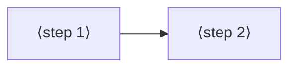

# Jobs and journeys
<!-- Tags as in the brief: E with a pointer, H with its source, D with who and when; an unknown is —. -->

## Who
<!-- One line per persona: who · evidence status (E pointer | H source).
e.g. `- Team leads who assign work · H Lena's belief, no interview yet` -->
- The PO, who writes small games in MicroPython on a FireBeetle 2 ESP32-S3 with the DFR0664 display · E firebeetle-games `games/`, `bench.md`; n = 1
- Makers who write C or C++ in Arduino on an ESP32 or a Pico with a small display · H the PO's words on #743 ("usable from c, so in arduino")
- MicroPython users on other boards and panels · H the PO's words on #743 ("all fully usable from micropython")
- Contributors who port the library to a new chip, panel or firmware · H the PO's words on #743 ("easy swap ins, porting")
<!-- REQUIRED:who -->

## Jobs
<!-- One job story per line, each clause tagged: When …, I want to …, so I can ….
e.g. `- When I assign a task in a meeting [E tickets.csv:6], I want the assignee to see it that day [H Lena], so I can stop chasing people [E tickets.csv:7]` -->
- J1 · When my game moves objects on a small display [E p537-finding.md, ed58361], I want each frame painted and sent within one frame period [E bench.md slice 4, FRAME_MS 40], so the motion looks smooth, not "stucky" [D the PO, 2026-11-02, #741]
- J2 · When I write a game in MicroPython [E games/], I want fast sprites, tiles and text that I call from Python [D the PO, #743], so I keep Python's ease without its speed cost [H the lead]
- J3 · When I move a project to another chip, board, panel or firmware [D the PO, #743], I want to swap one port layer [D the PO, #743], so my game code stays the same [H the lead]
- J4 · When a chip has special hardware or instructions (S3 PIE and GDMA, P4 PPA, Pico PIO) [D the PO, #743], I want the library to use them behind the same calls [H the lead], so my game gets their speed without chip code of its own [H the lead]
- J5 · When I find a bug or want a feature [H the lead], I want a public, tested project with released builds [D the PO, #743], so I trust it and can contribute [H the lead]
<!-- REQUIRED:jobs -->

## Today they…
<!-- Per job: what they do instead today (a competitor, a workaround or nothing), tagged.
e.g. `- Job 1 · paste each task into Slack by hand · E tickets.csv:7` -->
- J1 · the s3lcd fork with `frame.c`: DMA send 31.0 ms, partial show; Python paint is now the limit (runner 34 ms) · E bench.md slice 4, p537-finding.md
- J2 · games repaint background and HUD in Python each frame through s3lcd calls · E p537-finding.md (refuter-checked, ed58361)
- J3 · each chip and panel gets its own driver fork (s3lcd for the S3, st7789_mpy elsewhere) · E firebeetle-games `research.md`; how others do it: — (council)
- J4 · no chip-specific acceleration used beyond GDMA in esp_lcd · E s3lcd fork `frame.c`; others: — (council)
- J5 · Arduino users pick TFT_eSPI, LovyanGFX or Adafruit GFX · H the lead's model knowledge, to be read by the council
<!-- REQUIRED:today -->

## Journeys
<!-- One ### per actor and scenario: the table, then a Mermaid flowchart of the same steps. Never a Mermaid
journey block: it forces a score on every task. "n/a — a one-step job" may replace both.
e.g. `| 2 | opens the app | E analytics, 90 days | never sees the task | not yet | Do they read email? |` -->
### ⟨actor⟩ — ⟨scenario⟩ <!-- REQUIRED:journey -->
| step | what they do | evidence | friction or harm | today | open question |
| --- | --- | --- | --- | --- | --- |
| 1 | ⟨fill⟩ | ⟨tag and pointer⟩ | ⟨fill⟩ | ⟨works, partly, not yet or —⟩ | ⟨fill or —⟩ |

