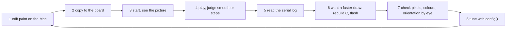

# Jobs and journeys
<!-- Tags as in the brief: E with a pointer, H with its source, D with who and when; an unknown is —. -->

## Who
<!-- One line per persona: who · evidence status (E pointer | H source).
e.g. `- Team leads who assign work · H Lena's belief, no interview yet` -->
- The PO, who writes small games in MicroPython on a FireBeetle 2 ESP32-S3 with the DFR0664 display · E firebeetle-games `games/`, `bench.md`; n = 1
- Makers who write C or C++ in Arduino on an ESP32 or a Pico with a small display · H the PO's words on #743 ("usable from c, so in arduino")
- MicroPython users on other boards and panels · H the PO's words on #743 ("all fully usable from micropython")
- Contributors who port the library to a new chip, panel or firmware · H the PO's words on #743 ("easy swap ins, porting") <!-- REQUIRED:who -->

## Jobs
<!-- One job story per line, each clause tagged: When …, I want to …, so I can ….
e.g. `- When I assign a task in a meeting [E tickets.csv:6], I want the assignee to see it that day [H Lena], so I can stop chasing people [E tickets.csv:7]` -->
- J1 · When my game moves objects on a small display [E p537-finding.md, ed58361], I want each frame painted and sent within one frame period [E bench.md slice 4, FRAME_MS 40], so the motion looks smooth, not "stucky" [D the PO, 2026-11-02, #741]
- J2 · When I write a game in MicroPython [E games/], I want fast sprites, tiles and text that I call from Python [D the PO, #743], so I keep Python's ease without its speed cost [H the lead]
- J3 · When I move a project to another chip, board, panel or firmware [D the PO, #743], I want to swap one port layer [D the PO, #743], so my game code stays the same [H the lead]
- J4 · When a chip has special hardware or instructions (S3 PIE and GDMA, P4 PPA, Pico PIO) [D the PO, #743], I want the library to use them behind the same calls [H the lead], so my game gets their speed without chip code of its own [H the lead]
- J5 · When I find a bug or want a feature [H the lead], I want a public, tested project with released builds [D the PO, #743], so I trust it and can contribute [H the lead] <!-- REQUIRED:jobs -->

## Today they…
<!-- Per job: what they do instead today (a competitor, a workaround or nothing), tagged.
e.g. `- Job 1 · paste each task into Slack by hand · E tickets.csv:7` -->
- J1 · the s3lcd fork with `frame.c`: DMA send 31.0 ms, partial show; Python paint is now the limit (runner 34 ms) · E bench.md slice 4, p537-finding.md
- J2 · games repaint background and HUD in Python each frame through s3lcd calls · E p537-finding.md (refuter-checked, ed58361)
- J3 · each chip and panel gets its own driver fork (s3lcd for the S3, st7789_mpy elsewhere) · E firebeetle-games `research.md`; how others do it: — (council)
- J4 · no chip-specific acceleration used beyond GDMA in esp_lcd · E s3lcd fork `frame.c`; others: — (council)
- J5 · Arduino users pick TFT_eSPI, LovyanGFX or Adafruit GFX · H the lead's model knowledge, to be read by the council <!-- REQUIRED:today -->

## Journeys
<!-- One ### per actor and scenario: the table, then a Mermaid flowchart of the same steps. Never a Mermaid
journey block: it forces a score on every task. "n/a — a one-step job" may replace both.
e.g. `| 2 | opens the app | E analytics, 90 days | never sees the task | not yet | Do they read email? |` -->
All four journeys come from `council/user.md`. Clock times are bench.md's own, on 2026-11-02, zone not named in the log (the PO works in Europe/Prague). Scenario (a) is E, an account of one person on one day. Scenarios (b), (c) and (d) are H: no log shows them.

### The PO — writes or changes a game and sees it run smoothly on the board (E, n = 1) <!-- REQUIRED:journey -->
| step | what they do | evidence | friction or harm | today | open question |
| --- | --- | --- | --- | --- | --- |
| 1 | Edits a game's paint in Python on the Mac, with stand-ins for the driver | E games/lcd.py:1-12, `council/user.md` USER-14 | MicroPython syntax limits pass `py_compile` and fail on the board (bench.md:43) | works | Does the Mac loop catch a draw that is wrong in panel coordinates? — |
| 2 | Copies the files to the board (`mpremote cp`) | E bench.md:54, USER-7 | The first run after a copy lost USB each try on one day, the likely cause (an unclaimed SPI bus after soft reset) is a reading, not proven | partly | Is it gone since the finalizer fix? — |
| 3 | Starts `import app, app.run()` or resets, and sees the picture | E bench.md:41-42, bench.md:149, USER-8 | The board can be dark after a power-off with no LED, a long D14 hold during play powers it off | partly | How often did he lose the board in a week? — account (Q9) |
| 4 | Plays, and judges smooth or steps with his eyes | E bench.md:116-117, USER-1, USER-3, USER-4 | No threshold number, steps of 3 to 25 px per frame and uneven 40 to 80 ms frames, a vertical tear stays (no TE line) | partly | At which px per frame does he stop seeing steps? — account (Q9) |
| 5 | Reads the serial log to see why it is slow | E bench.md runs 5, 8, 16, USER-5, USER-11 | Counting costs time itself (114 ms a frame when counting allocations), phases are maxima, a heap leak was found only after a heap line was added | partly | Which numbers did he read, and which did he ignore? — account |
| 6 | Wants a faster draw (score text, sprites) | E p537-finding.md ranked options, USER-5 | A C change means rebuilding MicroPython against a 647 MB ESP-IDF checkout and flashing, the no-button flash path and the download-mode entries conflict in the log (bench.md:22, 27) | not yet | How long did one rebuild and flash take him? — account |
| 7 | Checks stale pixels, colours and orientation by eye | E bench.md:88, bench.md:117, USER-9, USER-10 | Wrong colours, a dark screen at 80 MHz and stale pixels give no error, the PO is the only detector | partly | Which of the last wrong pictures did he find by eye, which by log? — account |
| 8 | Tunes with `tft.config()` and compares on and off | E bench.md slice 4 table, USER-12 | He asked for it, no log shows him running the comparison himself | partly | Did he change a setting himself, and which? — account |

### The PO — moves a game to another board or panel (H: no log shows a move, built from the nearest cases)
| step | what they do | evidence | friction or harm | today | open question |
| --- | --- | --- | --- | --- | --- |
| 1 | Picks the other board or panel | H no log, `council/user.md` USER-13, USER-15 | Only the FireBeetle 2 ESP32-S3 and the DFR0664 appear anywhere in the repository | — | Which board or panel would he move to first, and does he own one? — account (Q9) |
| 2 | Finds the pins | E games/gdi.py:1-19, USER-18 | Hand-read from a schematic image, "not verified" | partly | Did he ever re-wire a game to different pins? — account |
| 3 | Gets a firmware with the C driver | E build.sh:1-17, bench.md:8-9, USER-21 | Needs the matching ESP-IDF for the chip, no prebuilt image yet (#742), the S3 memory trick (188,416 B internal DMA block) may not fit another chip | not yet | Would he build, or want a downloaded image? — |
| 4 | Sets geometry and orientation | E games/lcd.py:28, games/lcd.py:38-39, USER-16, USER-17 | Constants in three files, the map was found by a corner picture, only 0 and 180 exist | partly | Which orientations did he need on a real move? — account |
| 5 | Sets the SPI clock and the colours | E games/app.py:28-32, bench.md:38, bench.md:88, USER-20 | Dark screen at too high a clock, wrong colours with no error, byte order pre-swapped in the game colours | partly | How many tries did the clock and the colours take? — account |
| 6 | Plays, and judges tear | E #737 comment (TE absent), USER-20 | TE exists only on some panels and is untested | not yet | Does the other panel have a TE pin? — |
| 7 | Falls back if the image has no s3lcd | E games/app.py:36-38, USER-14 | The fallback is the old Python driver at 1 to 13 fps (research.md) | works | Is a slower but working fallback acceptable, or must a move not lose speed? — |
| 8 | Checks that nothing harmed the board | E bench.md:56, bench.md:149, USER-19 | Power-off behaviour and USB are board facts the code cannot carry | — | What warnings would he want printed at first run? — |

### An Arduino maker — wants the library from C++ (H only: no interview, no log)
| step | what they do | evidence | friction or harm | today | open question |
| --- | --- | --- | --- | --- | --- |
| 1 | Installs through the Library Manager or PlatformIO | E spec https://github.com/arduino/library-registry/blob/main/FAQ.md read 2026-11-02, `council/user.md` USER-22, `council/practice.md` PRAC-17 | Needs `library.properties` at the root, a new version per release, no submodules, that a maker takes this path is H | — | Library Manager or PlatformIO first? — |
| 2 | Sets a panel and draws a first sprite | H USER-23 | No C++ API exists yet, no panel presets, today he picks TFT_eSPI, LovyanGFX or Adafruit GFX (stars 4967, 1797, 2865 on 2026-11-02, `council/po-assistant.md` PO-10) | — | What panel config would he write, and in what form? — |
| 3 | Writes a loop with a pace and buttons | H USER-24 | No pace helper and no phase log in C++, the games' helpers live in Python | — | Does he expect game helpers? — |
| 4 | Meets a silent fault | H from USER-10, USER-26 | Wrong colour order, wrong rotation, a dark screen at a high SPI clock, with no message | — | Which faults should the library name at init? — |
| 5 | Moves to another chip or panel | H USER-25 | No port layer exists yet, S3 GDMA and PIE code is inactive on a Pico | — | Which chips matter first? — |

### A MicroPython user on a different board — wants the module without building firmware (H only)
| step | what they do | evidence | friction or harm | today | open question |
| --- | --- | --- | --- | --- | --- |
| 1 | Downloads an image, or builds MicroPython with the module | E #742 "Done when", build.sh:1-17, `council/user.md` USER-27, USER-28 | One image for one board, building needs a 647 MB ESP-IDF, a native `.mpy` cannot call esp_lcd | not yet | Prebuilt for which boards? — |
| 2 | Imports the module, sets up a panel, draws | E games/lcd.py:12-14, USER-29 | Only ST7789 on one board is proven, the 8 x 8 `framebuf` font is the only text without a font module | — | Which panels at first? — |
| 3 | Copies a game from the repository | E games/gfx.py:21, games/st7789.py:15, USER-30 | The games are tied to 320 x 240 landscape and the fallback driver | partly | Do games ship in the library repository? — |
| 4 | Flashes, and risks the board's contents | E bench.md:23-24, USER-32 | The PO made a 16 MB backup (59.7 s) before his first flash, a public user is not told to | — | Does the README tell them to back up first? — |

