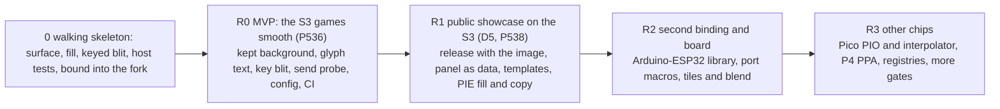

# Story map
<!-- Proposed, not applied: this map stays here until the decider confirms it; nothing changes the product's own
map file. -->
**Status:** proposed, not applied <!-- REQUIRED:map-status -->

## Backbone
<!-- The activities, left to right, as the user does them. e.g. `Assign → Notice → Act → Close` -->
Install → Set up panel → Draw → Animate → Port → Contribute <!-- REQUIRED:backbone -->

The backbone follows the four journeys in `jobs-and-journeys.md`: the PO and a MicroPython user install an image, set up their panel, draw, and animate a game, the PO and a contributor port to another board, chip or firmware, a maker contributes a fix or a panel. The releases are the synthesizer's proposal from the five reports, for the PO to order (Q6, Q8). D5 (the PO, 2026-11-02) answers Q2: R1 is the showcase of his games, a public repository he can link when he applies for a job, not yet a library for other people. Demand work (T1, P548) waits.

## Slices
<!-- Walking skeleton first: the thinnest slice that runs end to end. One row per story. job: a job in
jobs-and-journeys.md. tag: as in the brief. proof: something the decider can read.
e.g. `| 0 | Notice | the assignee gets one daily digest | job 1 | H ★C2 | the digest log for one team |` -->
| slice | activity | story | job | tag | proof |
| --- | --- | --- | --- | --- | --- |
| 0 walking skeleton <!-- REQUIRED:slices --> | Draw, Animate | (waits on Q4: P537 slices 2 and 3 run first on `frame_t`, see P546) a surface type with signed, clipped `fill_rect` and `blit_keyed` in C, rendered into a RAM buffer on the Mac with golden-hash tests, and the same code bound into the s3lcd fork so one game paints through it | J1, J2 | E ★C10 ★C12, H the tech lead's cut | `ctest` green on the Mac, and one bench.md run line of a game painting through the new call |
| 0 walking skeleton | Install | the fork's image builds with the skeleton inside, by `build.sh`, and flashes to the FireBeetle | J1 | E build.sh:1-17 | the build log line and the flash receipt in bench.md |
| R0 MVP: the S3 games smooth (P536 #740) | Animate | a kept background restored per dirty tile in C (P537 slice 2, second step) | J1 | H ★C4 (a projection) | runner's paint average, measured by the bench probes, before and after |
| R0 MVP | Draw | glyph text from a cache in C (P537 slice 2, first step) | J1, J2 | H ★C4 (a projection) | runner paint under 12 ms at FRAME_MS 40 (the finding's line) |
| R0 MVP | Draw | a key-colour sprite blit (P537 slice 3): `framebuf.blit` over a frame view if the P541 trial passes, else a C blit | J2 | H the PO assistant's T3 | the trial's pass or miss line, then a game using it |
| R0 MVP | Animate | the paint composition probe (P550) shows what the 34 ms is made of, before any C | J1 | H ★C3 (composition unmeasured) | the three numbers and the pass line of A2 in bench.md |
| R0 MVP | Animate | the send-overhead probe (P542) settles the window cost model and the default tile size | J1 | E ★C6 | the probe's table, n windows against ms, in bench.md |
| R0 MVP | Animate | `config()` kept and readable, with orientations 0 and 180 as today (P537 slice 3's orientation map). Orientations 90 and 270 are the PO's unprioritised request from slice 1 (bench.md:70, 10:08): "it would be good to offer all orientations and make it fast to transform" | J1, J3 | E ★C14 | `tft.config()` output, and a 90-degree run seen by the PO once he prioritises it |
| R0 MVP | Contribute | host tests with ASan and golden hashes, `.clang-format`, `-Werror`, one S3 build job in CI | J5 | E ★C34 | a green workflow run on the fork |
| R1: public showcase on the S3 (D5, P538 #742) | Install | a public repository with the one S3 image attached to a release, a README with a backup-first line that says it is a showcase of the PO's games, not yet supported for other people (D5), LICENSE and a COPYRIGHTS table | J5, J2 | E ★C33 ★C35, H the practice seat's PRAC-42 | the release page with its `.bin`, and the COPYRIGHTS table with a row per bundled file |
| R1 | Set up panel | a panel described as data (size, offsets, init sequence, MADCTL), ST7789 first, the DFR0664 as the first entry | J3 | E ★C21 (CircuitPython's shape) | a second ST7789 geometry runs by changing data only |
| R1 | Contribute | three issue templates, CONTRIBUTING, and a comment-drift gate (`-Wdocumentation`, Doxygen as errors) | J5 | E ★C19 ★C34 | the templates on GitHub and one PR blocked by the gate |
| R1 | Animate | the S3 PIE fill and copy kernels behind the accelerator port, with the Apache notice, measured on the board (P537 slice 8, P544) | J4 | E ★C27 | cycles per pixel within 25 % of Espressif's table, and the frame-time gain in ms |
| R2: a second binding and a second board | Install | the core builds as an Arduino-ESP32 library on the same FireBeetle (`library.properties`, arduino-lint) | J2 (C++), J5 | E ★C15 ★C16, H ★C20 | one sketch draws one sprite on the board, and the compile matrix is green |
| R2 | Port | the port macros (`GFX_PORT_*`) and the rule "adding a port edits no core file", tested by a fake port | J3 | H the tech lead's TL-25 | a fake port added with a diff that touches no file under `core/` |
| R2 | Draw | tiles and layers composed per dirty tile (`_stage`'s loop), and alpha blend with a scalar fallback | J2 | E ★C21, H the PO assistant's mix table | a tiled game level at the R0 frame time |
| R2 | Port | a second S3 board or panel the PO owns, by data and pins only | J3 | H Q9 | the PO's account of the move, logged |
| R3: other chips | Port | the Pico (RP2040 or RP2350) bus port over PIO and the interpolator for affine sprites, after a board is bought | J3, J4 | E ★C31 | the same game on a Pico, frame time logged |
| R3 | Port | the P4 accelerator port over PPA (fill, keyed blit, rotate), after a board is bought | J4 | E ★C30 | PPA against the C loop, ms per frame on the P4 |
| R3 | Install | PlatformIO and ESP-IDF component registry publishing on a tag | J5 | E ★C35 | the registry pages |
| R3 | Contribute | release-please, a stale bot, a 32-bit host build, a diff-coverage gate | J5 | E ★C34 | the workflows green on main |

## Delta to the product's map <!-- REQUIRED:spark-process:map-delta -->
<!-- The rows to add or change in the repository's own story map file, in that file's table shape, with its journey
step numbers; proposed, not applied. "n/a — no map file" is allowed. -->
n/a — the library has its own map. Spark's map (`spark/scrum/STORY_MAP.md`) holds spark's journey, and the library is firmware behaviour outside spark (★C36: "Spark exports facts, never behaviour"). No row of spark's map changes. Spark meets the library only at journey step 9, Firmware, where `pins.py` and `pins.h` feed the library its pins, and that step's text already says "pins.py only". If the PO later wants spark to know the library exists (for example a stand-in for the C module, P524 #720), that is a spark card, not a row of this map.
<!-- EXTEND:map -->
