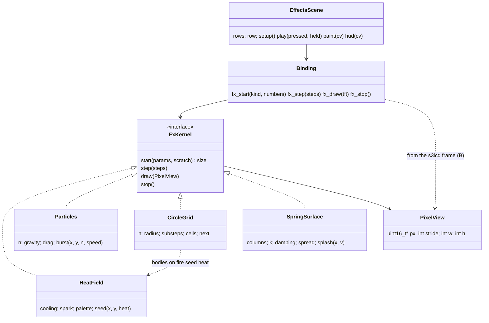
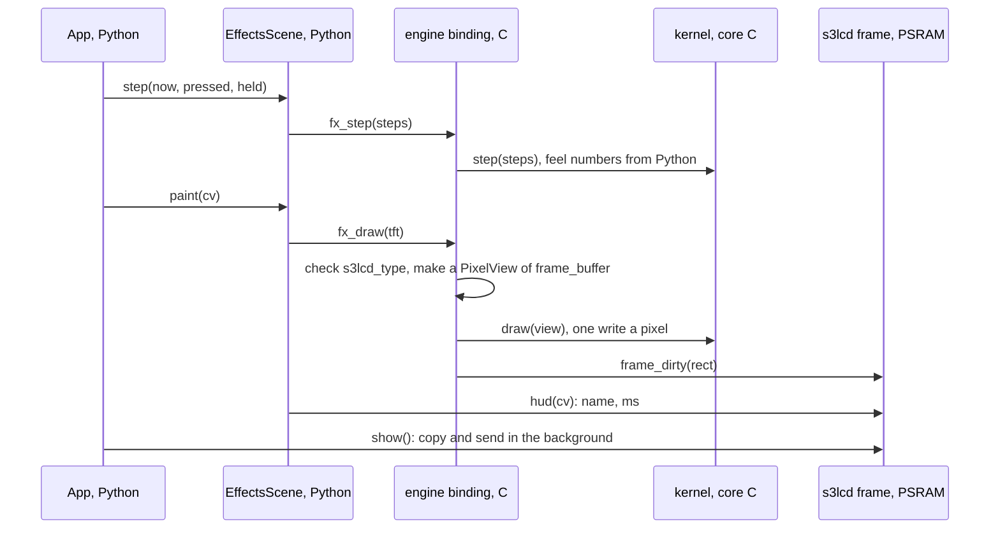

<!-- Resume: invoke product-discovery again; `discovery.py check <this folder>` names the next step. -->
# P594 ten native effects tried alone on the board: discovery brief

<!-- Readiness, its one home. collecting evidence: anything short of the two below. an experiment: the decider chose
a test (a D) before choosing an option. design: the decider confirmed the frame, the jobs and a direction, and accepted
the remaining risk (D rows). An extension may tighten these. Next: design, or a chosen test of kind spike or prototype
→ the design skill the facts name, with this file; otherwise none, and the collection plan says who runs it.
Stands on: the assumptions not retired in risks-and-tests.md; of which those the decider rated high, or — while any
is unrated. check computes both. -->
**Ready for:** collecting evidence (Q1 waits: the importance of each assumption and the pass line of the riskiest. No option and no test is chosen) <!-- REQUIRED:ready -->
**Stands on:** 11 H, — of which would change the decision <!-- REQUIRED:debt -->
**Decision needed:** Q1: rate the eleven assumptions in risks-and-tests.md and set the pass line of the riskiest (A2 is proposed). Then Q2 to Q12, one at a time <!-- REQUIRED:decision-needed -->

## Frame
- Request, verbatim (corrections marked): the PO's words of 2026-11-03, after he played the rain (P593 #794), verbatim on [#795](https://github.com/xmejkal/spark/issues/795) (E): "nice. Alright, I really like it, before we move on, Let's now create other cool effects that might be really doable in C, or even by trying to call the special assembler methods or through ESP-IDF. I don't know, but let's try to make 10 more effects, something including fire and smoke, and maybe some bodies colliding, being on fire, and maybe water. Think of some research. Feel free to get inspired by other code, and let's just make more native effects that we can then later use in the engine. But now, just like with the rain, let's just try the effects themselves." On the way of working: "the usual research refinement, the cards, the councils, all of that" <!-- REQUIRED:request -->
- Decision · decider: which ten effects, how each is computed (plain C, a PIE `.S` kernel, or an ESP-IDF component such as esp-dsp), where their code lives in the engine module, what one effect scene shows (the effect, its cost on screen, a BOOT tap like the rain), which code is learned from under which licence, and the order of the slice cards · the PO <!-- REQUIRED:decision -->
- Outcome and how it is observed (a metric with unit and source, a proof command, or a log): the PO confirms a brief with a ranked list of ten effects (each with its look, its method, its cost per frame and its provenance) and proposed slice cards. Later, done on #795: ten effect scenes run on the board, each alone as the rain does, with the cost on screen and in bench.md, and the PO played them. Today's rain as the reference: N 160, C step 0.16 to 0.17 ms, draw 13.5 to 14.0 ms, HUD text 10.6 to 10.9 ms a frame, 24 fps (pixel-games bench.md P593, measured) <!-- REQUIRED:outcome -->
- Already decided (D · who · when · where; include the product's stated non-goals and earlier decisions the request names): effects move to C and the C layer may own an effect's state if the game reads nothing back (Q13 yes) · the PO · 2026-11-02 · #771, p580-finding.md question 4. C computes facts, Python decides consequences, every feel number comes from Python (D12) · the PO · 2026-11-03 · engine brief. The engine C lives in an own `engine` module beside s3lcd: core/ plain C for the Mac and the board, port/s3/ for fast paths, one thin binding (D17). A Mac build of the same C (D15). Own small solver with chip fast paths, ideas from Box2D-Lite, Box2D v3 and Chipmunk2D (D16). Fixed 10 ms step (D18). A feel slice stops at "ready to play" until the PO played it (D21) · all the PO · 2026-11-03 · docs/discovery/2026-11-03-engine/brief.md. Each effect is tried alone first, the way the rain was; use in the engine and the games comes later · the PO · 2026-11-03 · #795. The games are original in name, art and levels (#769). P583 #784 puts effects into RENT; this card does not <!-- REQUIRED:decided -->
- Open questions: which ten (P580 ranks eight: fire and smoke, particles, ripple, glow, dissolve, shake, noise smoke, shatter); what "bodies colliding" and "bodies on fire" mean on screen and whether they use the engine's world.c; what "water" is (a ripple window, a falling liquid of particles, a filled level with waves); where PIE or esp-dsp pays and where plain C is enough; code to learn from and its licence; the frame budget of one scene, given the HUD text at about 11 ms; how the effects reach the screen (a C buffer that Python blits, or C drawing into the s3lcd frame through s3lcd.h) <!-- REQUIRED:open -->
- Scope · out of scope (proposed): in: ten effect scenes, each alone, its method, its cost on screen and in bench.md, the C home of the kernels inside the engine module, the research gaps P580 left (colliding and burning bodies, water, licences, esp-dsp and PIE kernels) · out: effects inside a game (P583 #784), the engine's rigid tip and topple (P592), sound, a spark change, a copy of any existing game or demo <!-- REQUIRED:scope -->
- Start and reach (proposed until Q0): start own idea (the PO's) · decider reachable yes · users the PO as player and game writer, n = 1 reachable · data and connectors: the pixel-games repository (code, tests, bench.md, run logs, p580-finding.md), the board on USB, the web (search and fetch), GitHub (gh), the Espressif docs MCP, Miro; no analytics connected · decider as a user n = 1 · must not get worse: the ten games and the rain as they play now (rain 24 fps at N 160, bench.md P593) <!-- REQUIRED:start-reach -->
- Flags (yes · no · —; asked only when it changes a decision; never legal advice; any date or threshold is read at its source at run time and cited):
  - sold or given away, or personal use: given away as open source (pixel-games is public, MIT) <!-- REQUIRED:flag-sold -->
  - connects to a network or runs software (for example the EU's Cyber Resilience Act): software; no network <!-- REQUIRED:flag-network -->
  - children or food contact: no <!-- REQUIRED:flag-children -->
  - market: public on GitHub, worldwide <!-- REQUIRED:flag-market -->
  - radio (unlicensed-device rules; read at their source when it decides): no <!-- REQUIRED:electronics-firmware:flag-radio -->
  - a Li-ion cell (charging, transport, battery rules): no <!-- REQUIRED:electronics-firmware:flag-li-ion -->
  - mains: no <!-- REQUIRED:electronics-firmware:flag-mains -->
  <!-- EXTEND:flags -->
- Extensions (each active id · the fact that activated it; when none matched, only "none matched: core only · the fact that decided it", naming no extension; list any directive skipped under rule 9): electronics-firmware · "doable in C", "special assembler methods", "ESP-IDF" (firmware on the ESP32-S3 and its PIE unit); spark-process · "the cards, the councils", the item is on spark's board (project 2) <!-- REQUIRED:extensions -->
- The item (its issue, or the proposal in the decider's words) · what is still open elsewhere · the repository's push check, or "no push check here": [P594 #795](https://github.com/xmejkal/spark/issues/795), in Discovery on spark project 2, under the engine epic P586 #787, slice pixel-games · still open elsewhere: P469 #637 and P511 #706 in Build, Ready holds 6 of 5 (#783 waits on P592), the engine discovery P586 is Ready for an experiment (P589 done, P590 #791 next) · pixel-games has no push check: the folder lands by PR <!-- REQUIRED:spark-process:item -->
<!-- EXTEND:frame -->
- Depth: TRIO (default: PO assistant, user, tech lead) | FULL or LIGHT (who asked, when); add "no independent review" if subagents could not start: TRIO plus one researcher (D1) for the gaps: the PO assistant (Opus), the user (Sonnet), the tech lead with the C and PIE lens (Opus), an effects researcher for colliding and burning bodies, water, esp-dsp and licences (Opus); the refuter on Fable 5.1; 5 agents <!-- REQUIRED:depth -->
  <!-- Cost, measured once: the P900 rehearsal's council took 6 agents, 499 calls and about 90M input tokens (2026-10-06). -->
- Search budget: web searches: 34 in all: PO assistant 6, tech lead 8, effects researcher 14, user 0, refuter 6 <!-- REQUIRED:budget -->
- Appetite (the decider's, asked only when heading for design) | —: — <!-- REQUIRED:appetite -->

## What we found <!-- CLAIMS -->
<!-- One claim per line: `- [★C<n>] claim · E pointer | H source | D who date · caveat: qualifier | none`.
★ marks a claim that a decision, an option or the riskiest assumption rests on. A quote is verbatim, with its pointer.
Say what the evidence can support: an account (what happened to one person), data (how often, in its population and
period), a document (what was specified), the product (what exists, not whether anyone needs it), a benchmark (a
comparison). Model knowledge is H until a source is read. Elsewhere cite a ★ claim as ★C<n>, with its keep: words.
e.g. `- [★C2 (C draw cost is H)] 13 of 526 tickets ask for recurring tasks · E tickets.csv:2-14 · caveat: picked by Lena; shows that, not how often` -->
Every cost below is per frame of the board's 40 ms pace (games/app.py:27, so 25 fps at most), on the ESP32-S3 at 240 MHz. "Calculated" means arithmetic on the numbers named. A cycle count per pixel is H unless a board run measured it. Only the compose costs and the C step are measured.

Today's reference and the frame budget:
- [★C1] The rain at N 160 in C runs at 24 fps with a step of 0.16 to 0.17 ms, a read of 1.06 to 1.14 ms, a draw of 13.47 to 14.01 ms and a HUD of 10.6 to 10.9 ms a frame. At N 192 it drops to 23 fps · E bench.md:268-274 (P593, run55 and run54, 5 s intervals) · caveat: one run per N on one board <!-- REQUIRED:findings -->
- [★C2] The rain's draw is Python call cost, not pixels: 160 fills of 4 x 4 px cost about 85 µs each, and their 2,560 px cost about 0.14 ms at 55.3 ns/px. So any effect that Python draws element by element is capped near 150 to 300 elements, and the effects draw in C · E bench.md:270, games/rain.py:64-66 (one fill per body). Calculated by the tech lead (PHYS-4) · caveat: the per-fill cost is the draw divided by 160. The C draw cost is H: about 0.19 ms for the same draw
- [★C3] Three pixel costs into the PSRAM frame are measured or follow from measurements: a write adds 55.3 ns/px, an opaque full-frame blit costs 88.9 ns/px, and s3lcd's C alpha blend costs 337.5 ns/px · E bench.md:198 (6.83 ms "double" against 2.58 ms "dma" over 76,800 px, calculated), bench.md:205 (run46, 64 x 64 at alpha 128) · caveat: run46 timed a 64 x 64 window and full frames. The kernel cycles are H, per pixel on top of these
- [★C4] An effect has about 15 ms a frame with today's HUD and about 26 ms with a HUD drawn once into a buffer. The rain's game side (step, read, draw, HUD) is 25.3 to 26.2 ms at 24 fps, so the rest of a 40 ms frame (background fill, the copy in `show()`, gc, the loop) is about 14 ms · H the tech lead's calculation from E bench.md:268-274 (PHYS-2) · caveat: the 14 ms rest, and so the 15 ms is inferred, not measured per part. The PO assistant reads the same numbers as about 25 ms for an effect with today's HUD (PO-5: 40 minus 11 minus a 3.4 ms copy). The split is in verification.md and decides Q10

The engine module today:
- [★C5] The engine module has no drawing path and no contact between bodies. Its binding exports load, step, read_y, spawn, read, drain, call_back and nothing. Each body falls onto its own plane `rest_y` and has no radius · E engine/binding.c:141-151, engine/core/world.c:77-90, engine/core/world.h:29-40 · caveat: none
- [★C6] Two paths to the screen exist in the code, and neither is built. A: C fills a buffer and Python calls `blit_buffer`, whose opaque and keyed paths are row copies that mark the dirty tiles themselves. B: the engine writes into the s3lcd frame. `s3lcd_type` is a non-static global, but s3lcd.h does not declare it, so B needs one `extern` line in s3lcd.h. frame.h pulls in FreeRTOS, esp_lcd and `py/obj.h`, so B's code sits in the binding or port/s3/, never in core/. MicroPython gathers the include directories of every user module into one list, so the engine already sees s3lcd/src. A full screen costs 76,800 x (55.3 + 88.9) ns = 11.1 ms on A and about 4.25 ms on B · E s3lcd/src/s3lcd.c:604-627, :2782-2799, s3lcd/src/s3lcd.h:86-123, s3lcd/src/frame.h:13-17, ~/esp/micropython-v1.29.0/py/usermod.cmake:17-21, micropython.cmake:2-3. Costs calculated by the tech lead from ★C3 (TL-3, kernel cycles are H) · caveat: neither path was built. B couples the engine to the layout of `s3lcd_obj_t`, which the tech lead rates a low risk because both modules build into one image (H). A full-screen RGB565 buffer for A is 153,600 B, so it lives in PSRAM. Not built
- [★C7] C state outlives a soft reset: the world is a static in the binding, and a run at 192 left 192 bodies that broke the next run at 160 · E engine/binding.c:11-12, bench.md:276 · caveat: an effect with static state repeats this. The tech lead's fix (`start` allocates the scratch, `stop` frees it) is H (TL-8)
- [★C8] Internal RAM for an effect's scratch on the engine image is unknown. The largest free internal block, 31,744 B, was measured on the s3lcd image while the games ran. The engine image adds 12,320 B of static RAM for its two worlds. P593 did not measure free internal RAM · E bench.md:186 (run41), engine/core/world.h:11, bench.md:279 · caveat: the tech lead guesses under 20 KB (H). Only a field of 19,200 B or less is a candidate for internal RAM. Not measured on the engine image

The effects, their methods and their costs:
- [★C9] P580 already ranks eight effects with a cost each: fire and smoke from one heat kernel, particles, ripple and shockwave, glow, dissolve, screen shake, noise smoke and shatter. None is colliding bodies, burning bodies or water as a liquid. Its only water is a ripple seen from above · E p580-finding.md:17-28 · caveat: P580 priced game windows (small windows composed into games), not scenes alone. Its PIE rows are instruction counts (H)
- [★C10] Sparks, dust and debris already exist as a look in Python: `Particles` holds at most 40, and 40 cost 2.27 ms per update · E games/gfx.py:225-258, p580-finding.md:20 (run46) · caveat: a C particle scene gains count and speed, not a new look (PO-6)
- [★C11] Fire, smoke and bodies on fire can share one heat kernel. Fire from a 160 x 120 field drawn at 2 x 2 to the full screen, opaque, costs about 7.3 ms. At full resolution it costs about 16.4 ms. Smoke is the same kernel with a grey palette, slower cooling and a drift. Bodies on fire seed heat at each body, about 6.6 ms whatever the body count, or 9.9 ms with 300 colliding circles · H the tech lead (PHYS-5, TL-11) and the researcher (FX-16 a). The smoke variant is E p580-finding.md:46 as a design, not a run · caveat: the kernel's 30 cycles and the palette's 8 cycles a pixel come from P580, so the cycles are H and each row can be 2 times off
- [★C12] Colliding bodies as a few hundred circles fit in plain C. A uniform grid with one cell per diameter and position-based separation costs about 2.6 ms for 300 circles and 8.6 ms for 1,000, in about 120 to 200 lines of C. One MIT source holds this method: position Verlet with a grid, 8 substeps. Its grid caps a cell at 4 bodies and overwrites the fifth · H the tech lead (TL-1, PHYS-5). E for the method: github.com/johnBuffer/VerletSFML-Multithread src/physics/physics.hpp:17-46, collision_grid.hpp:9-21 (master, read 2026-11-03, MIT, FX-1, FX-2, FX-10) · caveat: the cost is H (150 cycles a body-iteration, guessed). The source is desktop C++, float, threaded
- [★C13] Circles of radius 4 tunnel at the engine's 10 ms step under stack's gravity: a 240 px fall at 2,000 px/s² reaches 979.8 px/s, 9.8 px a step, more than the 8 px diameter. They need 3 substeps, a radius of about 10 px or a lower gravity · E games/rain.py:31 (GRAVITY 2000.0), D18 (fixed 10 ms step). Calculated by the tech lead (PHYS-9) · caveat: an assumed 240 px fall, the full screen height
- [★C14] Water has four methods with known costs, and other candidates fill the ten. A spring surface seen from the side with splash droplets, about 1.9 ms for 320 columns over a 320 x 100 body. Water and sand as cells at 160 x 120, about 5.5 ms. A ripple seen from above, 14.6 ms at half resolution full screen or 3.9 ms in a 128 x 128 window. A particle liquid of 500 particles, about 15 ms. Also: plasma 9.1 ms, metaballs 10.7 ms, cloth 5.0 ms, lightning and a starfield under 0.1 ms plus a glow · H the tech lead (PHYS-5) and the researcher (FX-17 to FX-31). E for the methods: code.tutsplus.com/make-a-splash-with-dynamic-2d-water-effects--gamedev-236t (2012-08-14), github.com/MaxBittker/sandspiel crate/src/species.rs:167-215 at 9936e06b (read 2026-11-03) · caveat: the costs are H, from cycle counts. "Fits" near the line can flip
- [★C15] A scene alone on black writes opaque pixels at about 55 ns/px. In a game the effect blends over the background at 337.5 ns/px in C, about 6 times as much. A full screen costs about 4.2 ms opaque and about 25.9 ms blended · E p580-finding.md:15, :44 (run46). Calculated by the PO assistant (PO-8) · caveat: black understates a game's cost, unless the scene also draws over a picture. A faster C blend would narrow the gap (★C16, not timed)
- [★C16] s3lcd's alpha blend is a naive per-pixel unpack, two multiplies per channel and two branches, and its blit path checks bounds per pixel. A SWAR blend in C (red and blue in one 32-bit word, green in another, one multiply each) is a known trick, guessed at 10 to 15 cycles a pixel · E s3lcd/src/s3lcd.c:186-199, :630-641. H for the cycles: the tech lead's instruction count. The method: virtualdub.org/blog2/entry_117.html, read as a search summary 2026-11-03 (PHYS-6) · caveat: the SWAR blend was not timed. "2 to 3 times faster than s3lcd's" is H
- [★C17] esp-dsp holds no pixel kernel: its S3 paths are dot products, FIR, FFT, element-wise add, sub and mul, matrix multiply, memcpy and memset. A `.S` file in the engine module will very likely build: user module sources compile in the main IDF component, the IDF project enables ASM and the QSTR scan reads only `.c` files. Whether ESP-IDF 5.5.2 saves the PIE registers on a task switch is unknown · E `gh api repos/espressif/esp-dsp/git/trees/master?recursive=1` (2026-11-03, TL-6, FX-37), ~/esp/esp-idf-v5.5.2/tools/cmake/project.cmake:589, ~/esp/micropython-v1.29.0/py/makeqstrdefs.py:34-38 · caveat: no `.S` was built. With a cached HUD, no effect at the sizes in ★C11 (cycles are H) and ★C14 (costs are H) needs PIE to be tried alone (the tech lead, TL-7, H). The S3 path of `dsps_add_s8_aes3` saturates at 127 and gives other results than its fallback (FX-39). No .S built
- [★C18] Licences of the code found: FastLED, Pimoroni, VerletSFML, sandspiel and Box2D-Lite are MIT, esp-dsp is Apache-2.0, and Adafruit_PixelDust carries a BSD line (variant unchecked). WLED is EUPL-1.2, BitsForPeople's PIE blend is GPL-3.0, Lode's pages say "All rights reserved", and Hoffman's tutorials state no licence for their code · E `gh api` reads of each repository's licence, 2026-11-03 (PO-10 to PO-13, FX-10, FX-22, FX-41, FX-42), lodev.org/cgtutor/plasma.html · caveat: what EUPL and GPL mean for this MIT repository is general knowledge, not legal advice

Overlaps with other cards:
- [★C19] Three places claim the effects' C. P583 builds them "in the s3lcd fork", P587 splits s3lcd into files that include "effects (the home for P583's PIE effects and C motion)", and P580 put `fx.c` beside `frame.c`. D17, taken later on 2026-11-03, puts the engine's C in its own `engine` module, which P594's frame follows · E #784 "Done when", #788 "Done when", p580-finding.md:75, docs/discovery/2026-11-03-engine/brief.md:293 (D17) · caveat: whether D17's "engine C" covers effects is the PO's reading to give (Q5)
- [★C20] Colliding bodies is contact code, the same kind of code as P592's rigid tip and D16's own solver. A circle grid can serve P592 as its broad phase, but not as its solver: P592 needs boxes with an angle, a box-box test and impulses · E #793, docs/discovery/2026-11-03-engine/brief.md:292 (D16). H for the split into broad phase and solver: the tech lead (TL-2), from model knowledge of Box2D-Lite · caveat: the split is H. Box2D-Lite's source was read only for its broad phase and line counts (FX-7)

The player:
- [★C21] Scenes are reached by a one-way ring on D14. Ten more `GAMES` entries make a ring of 21, with no back step and no name on screen, because the rain's HUD replaces the game name · E games/app.py:40, :59-68, games/rain.py:160-164 (USER-2, USER-13) · caveat: taps accepted unknown: nobody asked him how many
- [★C22] The rain's step bar shows 0 px in C mode: 1 px per 200 µs against a step of 160 to 170 µs. The draw and the HUD, which set the fps, reach only the serial log · E games/rain.py:35, :151, bench.md:270-274 (USER-5) · caveat: derived from the code, not seen on the panel
- [★C23] Under D21, ten scenes built as ten feel slices are ten stops at "ready to play", serial on his play time · E docs/discovery/2026-11-03-engine/brief.md:297 (D21) (USER-10, PO-25) · caveat: whether a group of scenes counts as one feel slice is his call (Q7)
- [★C24] His recorded words on effects are about look and kind, never about ms or fps: "nice. Alright, I really like it" after the rain, "cool effects", "fire and smoke", "bodies colliding, being on fire", "water". His 17 RENT feel notes name no number · E #794, #795, docs/discovery/2026-11-03-engine/p588-feel-notes.md (USER-8, USER-9) · caveat: n = 1. Whether he reads the cost on screen is — (Q12)
- [★C25] Every feel number comes from Python (D12), and the rain already passes its gravity, bounce, friction and spawn ranges from Python · E docs/discovery/2026-11-03-engine/brief.md:288 (D12), games/rain.py:31, :113-116 · caveat: none
- [C26] Nobody is blocked without P594 now: P583 names RENT as its need, D19 puts P590 and P592 next on the engine, and Ready holds 6 of 5 · E #784 "Needed by", engine brief.md:295 (D19), the Frame's item line (PO-20) · caveat: its value is his interest and the later reuse of the kernels

Where the reports disagree, each now a question: the effect room, 15 ms (the tech lead) against 25 ms (the PO assistant), Q10. The riskiest assumption, the pixel path (the PO assistant) against the look (the user lens's emphasis on his words), Q1. PIE in this card (his words "special assembler methods", PO-26) against PIE as a later rung (the tech lead, TL-7), Q8. verification.md lists the agree and split lines.

## Options <!-- CLAIMS -->
<!-- Two or three per open decision: decision · option · cost · what it would prove · opinion (whose), then the tag
and caveat cells. e.g. `- Q2 what first · fix delivery · two weeks · whether seen tasks get done · opinion (the facilitator's) · H ★C2 (C draw cost is H) · caveat: none` -->
Every option below is a proposal. None is chosen, and the PO decides each. "Opinion" says whose it is.

Which ten effects (Q2). Grouped by the kernel they share (K1 heat field, K2 particles, K3 wave from above, K4 spring surface, K5 circle grid, K6 grain grid):
- Q2 which ten · a1: the PO assistant's ten, six kernels: fire, smoke and bodies on fire (K1), water from the side with splashes (K4 and K2), sparks or fireworks (K2), colliding bodies (K5), ripple from above (K3), falling sand and water cells (K6), a shockwave or glow, and plasma or dissolve · cost: six kernels, three scenes on K1 · proves: his five words first, at the least new code · opinion (the PO assistant, PO-18) · H ★C9 (P580 priced game windows), ★C11 (cycles are H), ★C14 (costs are H) · caveat: the pre-mortem's first cause: ten scenes may read as three ideas (A5) <!-- REQUIRED:options -->
- Q2 · a2: ten different looks, about nine kernels, from the tech lead's sizes and the researcher's candidates: fire (smoke as a BOOT palette), bodies on fire, colliding circles, water from the side, water and sand as cells, a particle liquid drawn as metaballs, ripple from above, plasma, lightning, cloth or rope · cost: about nine kernels. The particle liquid alone is about 15 ms and fits only with a cheap HUD · proves: variety he counts as ten · opinion (the synthesis, from PHYS-5 and FX-28 to FX-31) · H ★C11 (cycles are H), ★C14 (costs are H) · caveat: every cost is H, and more kernels mean more slices
- Q2 · a3: his five words first, then he picks the other five from a menu after playing them: fire, smoke, bodies on fire, colliding bodies and water in the first scenes, then a menu of the rest (sparks, ripple, sand, plasma, lightning, metaballs, cloth, glow, shockwave) · cost: one extra question to him after the first scenes · proves: the second half follows his taste, not ours · opinion (the synthesis, from ★C24 (n = 1): his words are about look) · H ★C24 · caveat: the second half waits for his play time (★C23 (his call))

The path to the screen (Q4):
- Q4 path · A: C fills a buffer that Python blits with the existing `blit_buffer` · cost: touches only engine/. Doubles the pixel traffic: 11.1 ms for a full screen. A full-screen RGB565 buffer is 153,600 B in PSRAM. Python maps game to panel coordinates · proves: an effect on screen with no change to s3lcd · opinion (the PO assistant, PO-30: the cheapest first test; the tech lead: only for small keyed windows) · H ★C6 · caveat: costs calculated, not built
- Q4 · B: the engine writes into the s3lcd frame through s3lcd.h, as D17 names · cost: one `extern` line in s3lcd.h, the binding reads `frame_buffer`, `width` and `height` and calls `frame_dirty()`. One write a pixel: about 4.25 ms for a full screen · proves: D17's route and D11's "drawing moves to C" · opinion (the tech lead, TL-3) · H ★C6 (not built) · caveat: couples the engine to `s3lcd_obj_t`'s layout. Not built
- Q4 · AB: A in the walking skeleton and B in the same session, both timed on the same fire field · cost: about one session more than either alone · proves: the choice by a number, not an estimate · opinion (the synthesis) · H ★C6 (not built) · caveat: it builds a path that is then dropped

Colliding bodies (Q3):
- Q3 colliding · c1: circles with position Verlet on a uniform grid now, in the engine's core/: the grid as a shared module, the circle solver as an effects mode, P592's rigid solver later on the same grid · cost: about 120 to 200 lines of C, 2.6 ms for 300 circles, 3 substeps at g 2,000 · proves: hundreds of colliding bodies on the board, and a broad phase P592 can reuse · opinion (the tech lead, TL-1, TL-2) · H ★C12 (cost is H), ★C13 (assumed 240 px fall), ★C20 (split is H) · caveat: decides the grid's shape before P592 does. A circle solver shown as the engine's rigid solver would be a wrong promise (TL-2)
- Q3 · c2: wait for P592's solver, and the colliding scene comes after it · cost: the PO's word "bodies colliding" waits for the engine's order (D19) · proves: one solver, no second one · opinion (the PO assistant's risk PO-22, as an option) · E #793 · caveat: P592 builds boxes that tip, not hundreds of bodies
- Q3 · c3: a demo-only collider inside the effect's own file, thrown away later · cost: the same lines as c1, with nothing shared · proves: the look only · opinion (none of the lenses recommends it) · H ★C20 (split is H) · caveat: the pre-mortem's fifth cause: a second solver to redo

Where the kernels live, and who owns them (Q5):
- Q5 home · d1: the engine module per D17: core/fx_<name>.c in plain C (Mac and board), port/s3/ for fast paths, one thin binding. P594 builds the kernels, and P583 places them in RENT · cost: P583's and P587's cards change (items.md) · proves: one home and one owner · opinion (the tech lead, TL-10: D17 is the newer decision) · E #784, #788, engine brief.md:293 (★C19 (the PO's reading)) · caveat: P580's API shape becomes the engine's (PO-23)
- Q5 · d2: the s3lcd effects file, as P583 and P587 say · cost: the scenes wait for P587's split, or the kernels move once · proves: effects beside the frame they draw into · opinion (P580's plan and the cards as written) · E #784, #788, p580-finding.md:75 (★C19 (the PO's reading)) · caveat: against D17 if effects count as engine C
- Q5 · d3: P594 stays a throwaway demo, and P583 builds its own kernels · cost: the same kernels are built twice · proves: nothing P583 keeps · opinion (the PO assistant names it as a question, PO-21) · E #784 (★C19 (the PO's reading)) · caveat: the pre-mortem's sixth cause

The scene harness (Q6):
- Q6 harness · e1: one generic effects scene with a table of rows (name, kernel, feel numbers, size) and its own pick, with its name on screen and its draw ms on screen · cost: one Python file, one `fx_start`, `fx_step`, `fx_draw`, `fx_stop` in the binding · proves: one entry in the ring, and the binding stays thin · opinion (the tech lead, TL-9) · E games/app.py:40, :59-68 (★C21 (taps accepted unknown)) · caveat: BOOT then has to choose between "next effect" and "change it" (a tap and a hold)
- Q6 · e2: ten `GAMES` entries, one per effect, each like the rain · cost: ten Python files, a ring of 21 · proves: each scene alone, exactly as the rain · opinion (the shape today's code gives, USER-2) · E games/app.py:40, :59-68 (★C21 (taps accepted unknown)) · caveat: one tap too far costs the whole ring
- Q6 · e3: the effects in their own ring, chosen at power-on, and the games in theirs · cost: a start choice in app.py · proves: short rings for both · opinion (the user lens, Q-U9) · E games/app.py:40, :59-68 (★C21 (taps accepted unknown)) · caveat: a start choice is new UI to learn

The slicing against D21 (Q7):
- Q7 slicing · f1: ten play turns, one per scene · cost: ten stops, serial on his time · proves: his words on each scene before the next · opinion (D21 read literally) · E engine brief.md:297 (★C23 (his call)) · caveat: none
- Q7 · f2: a few groups by kernel (K1: fire, smoke, bodies on fire. Water. Bodies. The rest), one play turn each, about four or five · cost: a group is built before his words on its first scene · proves: one kernel judged across its looks · opinion (the PO assistant, PO-25, and the user lens's question Q-U8) · E engine brief.md:297 (★C23 (his call)) · caveat: a group built ahead may be redone after his words, as with P568's swing (PO-31 cause 7)
- Q7 · f3: the walking skeleton alone first (one turn), then the rest in groups · cost: one extra turn · proves: the harness, the path and the look before any group · opinion (the synthesis) · E engine brief.md:297 (★C23 (his call)) · caveat: none

PIE now or later (Q8):
- Q8 PIE · g1: plain C only in P594. PIE is P583's slice 0, as written · cost: nothing in this card · proves: what C alone does · opinion (the tech lead: no scene needs PIE to be tried alone with a cheap HUD, TL-7) · H ★C17 (no .S built) · caveat: his words "special assembler methods" stay unshown (PO-26)
- Q8 · g2: plain C first, then a SWAR blend in C, then a PIE `.S` probe for the one effect that misses its line · cost: one probe slice late in the card · proves: where PIE pays, after the cheaper rung · opinion (the tech lead, TL-6, TL-7) · H ★C16 (not timed), ★C17 (no .S built) · caveat: esp-dsp has no pixel kernel, so the `.S` is ours
- Q8 · g3: a PIE kernel in one scene, with a BOOT swap from C to PIE as the rain swaps C and Python · cost: a `.S`, its build (unproven) and the PIE register question · proves: the assembler he asked about, visible on the board · opinion (the PO assistant's risk of disappointment, PO-26) · H ★C17 (no .S built) · caveat: on opaque writes PIE gains least (★C15 (black understates a game's cost))

Opaque on black or over a background (Q9):
- Q9 background · h1: each scene alone on black, opaque · cost: the least, about 55 ns/px · proves: the effect's own cost · opinion (#795 "just like with the rain") · E p580-finding.md:15, :44 (★C15 (black understates a game's cost)) · caveat: the costs do not carry into P583
- Q9 · h2: each scene over a painted background, blended or keyed · cost: 337.5 ns/px with s3lcd's blend · proves: a cost P583 can use · opinion (the PO assistant, PO-8) · E p580-finding.md:15, :44 (★C15 (black understates a game's cost)) · caveat: full-screen blends do not fit 15 ms (★C4 (15 ms is inferred))
- Q9 · h3: on black, plus one BOOT variant over a picture in the scenes that P583 needs (fire, smoke, particles) · cost: one variant in three scenes · proves: both numbers where a game will use them · opinion (the synthesis) · E p580-finding.md:15, :44 (★C15 (black understates a game's cost)) · caveat: none

The pieces of option e1 with option B, a proposal. Each kernel is plain C over a neutral pixel view, and only the binding knows s3lcd:

One frame of an effect scene, option B (the path D17 names and the tech lead leads with; a proposal, not chosen):

Option A in short: `fx_step` is the same. Then `fx_draw(buf)` writes into a Python-owned buffer, and Python calls `tft.blit_buffer(buf, x, y, w, h)`, which copies it a second time into the frame and marks its tiles. Two writes a pixel instead of one (★C6 (not built)).
- Proposed no-gos and rabbit holes (proposals until the decider confirms): no-gos: code copied from EUPL, GPL or all-rights-reserved sources (WLED, BitsForPeople, Lode's pages), ideas and formulas only (★C18 (not legal advice), PO-28). Feel numbers as C constants (★C25, D12). Static effect state that outlives a soft reset (★C7). A circle solver presented as the engine's rigid solver (★C20 (split is H)). Effects inside a game, which is P583 (the Frame's scope). Rabbit holes: a particle liquid or a full-screen ripple before a cheap HUD exists (★C4 (15 ms is inferred), ★C14 (costs are H)). A PIE kernel before a C kernel misses its line (★C17 (no .S built)). esp-dsp as a managed component, which needs a patch to MicroPython's tree in build.sh (TL-6) · H the synthesis, from the reports named · caveat: proposals until the PO confirms them <!-- REQUIRED:nogos -->

## Riskiest assumption and its test
- Riskiest: A2: plain C in the engine module writes an effect's pixels to the screen cheaply enough that a full-screen fire holds 24 fps with today's HUD. Every scene but sparks needs a C pixel path, none exists in the engine module (★C5), and how it is built decides what P583 inherits. Its evidence is code and calculation only: the paths exist in the code (★C6 (not built)), but the kernel's cycles are H (★C11) and the room of about 15 ms is inferred (★C4). The other candidates: A1, the look on this panel, has no evidence beyond the rain, but any scene tests it for free in the same run. A5, ten looks from six kernels, waits for Q2. A8, one home, is a decision, not a test · proposed — the PO assistant's opinion (PO-30, A2 with A3), weighed by the synthesis against the tech lead's code evidence (TL-3) and the user lens (USER-9), pending Q1 <!-- REQUIRED:riskiest -->
- Test · kind · pass line, dated before any result · proposed | D<n>: the walking skeleton P595 on the board: fire from a 160 x 120 heat field in plain C, drawn at 2 x 2 to the full screen, opaque on black, with today's HUD. Time it through the path Q4 picks (or both, option AB), and print the largest free internal block at the scene's start (★C8 (not measured on the engine image)). The PO plays it and gives his words (A1 in the same run). Also record the same fire at alpha 128 over a painted background as a number for P583, with no pass line (A3) · kind: prototype on the board (electronics-firmware:R6, one board, n = 1) · pass line, proposed 2026-11-03 before any result: the effect's step plus draw is at most 15 ms a frame (the room of ★C4 (15 ms is inferred)) and the scene shows 24 fps, in each of three 5 s report lines. Over 15 ms or under 24 fps: the scenes shrink to a strip or a window (a 320 x 80 strip is about 5.5 ms, H), or the cached HUD (F1) comes first · proposed — the PO assistant's opinion (PO-30) as the test, the synthesis's pass line, pending Q1 <!-- REQUIRED:test -->

## Questions
<!-- A queue; the first open question is asked alone. Each: Q<n> · question · decides: … · options · unblocks ·
opinion (whose) · kind: decision | account (a past-tense question about the decider's own use; the answer is E,
account, n = 1) · status: queued | asked <date> | answered D<n>.
If the decider cannot be asked, the queue stays here, and whatever rests on it stays H. -->
- Q0 · Is this frame right: the decision, the start and reach, the extensions and the depth? · decides: the frame · status: answered D1 <!-- REQUIRED:q0 -->
- Q1 · How important is each assumption, and what pass line must the riskiest test meet? Example: if A2 is high and passes at 15 ms, the walking skeleton shows full-screen fire at 24 fps. If it fails, the next scenes are strips or windows, or the cached HUD comes first · decides: importance and pass lines · options: A2 as proposed, A1 (the look) or A5 (the variety) as the riskiest. A pass line of 15 ms, 7.3 ms (the tech lead's estimate for the kernel) or his own · opinion (the PO assistant): A2 · kind: decision · status: queued, to be asked first <!-- REQUIRED:q1 -->
- Q2 · Which ten effects? Example: in a1, fire, smoke and bodies on fire are three scenes of one heat kernel. In a2, smoke is a BOOT palette on fire, and plasma and lightning take its places. In a3, you play your five words first and then pick five from a menu. What "water" means is part of it: a surface seen from the side with splashes, ripples seen from above, water and sand as cells, or a liquid of particles · decides: the list and the number of kernels (six to about nine) · options: a1, a2, a3 · unblocks: the story map's order, P596 and later · opinion (the PO assistant): a1 · kind: decision · status: queued
- Q3 · How do bodies collide? Example: 300 round bodies of 8 px in a box knock each other about at about 2.6 ms, with 3 substeps so they do not pass through each other. RENT's floors that tip are P592's boxes, a different solver · decides: the colliding scene's code, and its overlap with P592 and D16 · options: c1 a circle grid now in core/, shared with P592 as its broad phase; c2 wait for P592; c3 a demo-only collider · unblocks: P598 · opinion (the tech lead): c1 · kind: decision · status: queued
- Q4 · How does an effect reach the screen? Example: a full-screen fire written once into the s3lcd frame costs about 4.25 ms. Written into a buffer that Python then blits, it costs about 11.1 ms · decides: the binding's shape and whether full-screen scenes fit · options: A buffer and blit, B the s3lcd frame through s3lcd.h, AB both timed in the walking skeleton · unblocks: P595 · opinion (the tech lead): B. The PO assistant: A as the cheapest first test · kind: decision · status: queued
- Q5 · Where do the effect kernels live, and who builds them? Example: the fire kernel is written once in engine/core/fx_fire.c in P594, and P583 later calls it in RENT. Or it goes into an s3lcd effects file that P587 creates · decides: one home and one owner, and the changes to P583 and P587 · options: d1 the engine module (D17), d2 the s3lcd effects file, d3 P594 as a throwaway · unblocks: P595, the card changes · opinion (the tech lead): d1 · kind: decision · status: queued
- Q6 · How do you pick an effect on the board? Example: one effects scene shows "fire 1/10" at the top, a BOOT tap goes to the next row and a hold changes it. Or each effect is one more game in the D14 ring, 21 in all · decides: the harness and the number of Python files · options: e1 one scene with a table, e2 ten `GAMES` entries, e3 an effects ring chosen at power-on · unblocks: P595 · opinion (the tech lead): e1 · kind: decision · status: queued
- Q7 · How many play turns do the ten scenes take? Example: after fire, you play it and speak. Then smoke and bodies on fire come together as one turn, or each alone · decides: the slice cards' size and order under D21 · options: f1 ten turns, f2 four or five groups by kernel, f3 the skeleton alone, then groups · unblocks: the order of P596 to P598 · opinion (the PO assistant and the user lens ask it, PO-25, Q-U8) · kind: decision · status: queued
- Q8 · Is the S3's assembler (PIE) part of this card? Example: the fire runs in plain C at about 7.3 ms. A PIE kernel and a BOOT swap from C to PIE would show your "special assembler methods" on the board, but on opaque writes it gains least · decides: whether a `.S` probe enters P594, and its place against P583's slice 0 · options: g1 C only here, g2 C then a SWAR blend then a PIE probe, g3 one scene with a C-to-PIE swap · unblocks: the late slices · opinion (the tech lead): g2. The PO assistant warns of disappointment without it · kind: decision · status: queued
- Q9 · Are the scenes drawn on black, or over a picture? Example: full-screen fire costs about 4.2 ms opaque on black and about 25.9 ms blended over RENT's art in today's C · decides: whether P594's costs carry into P583 · options: h1 black, h2 over a picture, h3 black plus a picture variant in the scenes P583 needs · unblocks: P595's report line · opinion (the PO assistant): the numbers must carry · kind: decision · status: queued
- Q10 · Does a cached HUD come first, as its own card? Example: today the HUD's text costs about 11 ms a frame. Drawn once into a buffer when it changes and blitted each frame, it costs about 0.4 ms, so an effect gets about 26 ms instead of 15. It helps the ten games too · decides: the room of every scene, and a card outside this scope (F1) · options: a card before P595, after it, or not now · unblocks: P599 · opinion (the tech lead, TL-4) · kind: decision · status: queued
- Q11 · May code be copied with its notice, or are the effects only our own code learned from formulas? Example: the circle grid could be ported from an MIT C++ source with its notice, or written from the method alone · decides: the licence rule of every slice, and a notice file · options: MIT, BSD and Apache-2.0 code with its notice; formulas only · unblocks: P596 to P598 · opinion (the PO assistant): no WLED code, notices kept for the rest · kind: decision · status: queued
- Q12 · When you played the rain, did you read the HUD line or tap BOOT to see Python? · decides: what each scene shows on screen (a name, ms, a bar) and what BOOT means there · options: — (an account) · unblocks: P595's HUD · opinion (the user lens, Q-U1, Q-U2) · kind: account · status: queued

## Decisions
<!-- D<n> · what · who · when · where recorded · options considered.
A yes covers only the actions and choices it names. A standing yes names its kind of action and its source.
Name what a D confirms in its words: the frame, the jobs, a direction, the remaining risk, a test, items.md. -->
- D1 · the frame confirmed (Q0 yes): scope, start and reach, extensions, the 5-agent council (PO assistant Opus, user Sonnet, tech lead Opus, effects researcher Opus, refuter Fable 5.1) · the PO · 2026-11-03 · this session, AskUserQuestion Q0 · options: as written, TRIO only, change the scope

## Found on the way <!-- CLAIMS -->
<!-- Outside this item's scope. Each is a separate proposal, never folded in. Same line format as What we found. -->
- [F1] The HUD's text costs 10.6 to 10.9 ms a frame because each glyph run is a Python fill every frame, while the label changes every 500 ms. Rendered once into a 320 x 14 buffer when it changes, it costs about 0.40 ms a frame (4,480 px x 88.9 ns, the memcpy path of `blit_buffer`). That gains about 10.5 ms in the rain and in the ten games, whose runner HUD costs 8.2 to 10.96 ms · E bench.md:274, games/lcd.py:104-105, games/rain.py:34, s3lcd/src/s3lcd.c:611-627. Calculated by the tech lead (TL-4) · proposal: a card P599 (items.md), separate from P594, Q10 · caveat: the 0.40 ms is calculated, not measured. The text must be drawn in panel order <!-- REQUIRED:found -->
- [F2] P583 #784 and P587 #788 put the effects into s3lcd, and D17 puts the engine's C into its own module (★C19). P580's plan of `fx.c` beside `frame.c` predates D17 · E #784, #788, p580-finding.md:75, engine brief.md:293 · proposal: edit P583 and P587 once Q5 is answered (items.md) · caveat: whether effects count as engine C is the PO's reading
- [F3] The rain's step bar cannot show a C step: 1 px per 200 µs gives 0 px at 160 to 170 µs (★C22) · E games/rain.py:35, :151 · proposal: a scale per stepper, or the draw ms on screen, inside the walking skeleton's HUD · caveat: derived from the code, not seen
- [F4] Free internal RAM on the engine image was never measured, though P593's plan asked for it · E bench.md:279 · proposal: print the largest free internal block at the start of each effect scene (P595) · caveat: none
- [F5] esp-dsp's `dsps_add_s8_aes3` gives other results on its S3 path than on its fallback for the same call (signed saturation at 127 against unsigned wrap), and its header names `int16_t` arguments · E esp-dsp modules/math/add/fixed/dsps_add_s8_aes3.S:14-22, :38-98 (FX-39, read 2026-11-03) · proposal: a note for anyone who uses it. Possibly an upstream report, only on the PO's yes · caveat: read in the source, not run

## Board actions <!-- REQUIRED:spark-process:board-actions -->
<!-- Each action on the board or the issue (stage, waiting flag, comment, filing): taken, with its D, or pending.
None is taken without a D. e.g. `- move #16 to Discovery · pending` -->
- open a PR for this folder from p594-discovery in xmejkal/pixel-games · pending, needs the PO's yes
- comment on #795 with the brief's link, the options and the question queue · pending
- set Waiting on the PO on #795 (Q1) · pending
- file P595 to P599 (items.md) as sub-issues of #795, Slice pixel-games · pending, needs a D that names items.md
- apply the proposed changes to #784, #788 and #793 (items.md) · pending, needs a D
<!-- EXTEND:brief-sections -->

## Hand-off
<!-- Written only after the decider confirms the understanding (a D); copies only confirmed constraints. Holds: outcome ·
who · success and its proof · constraints (appetite, confirmed no-gos, rabbit holes) · what they said (D) against what
we assume (H) · links to the journeys and the map · riskiest assumptions and their tests · options considered. -->
not yet: the PO has not confirmed the understanding. Q1 (importance and the pass line) and Q2 to Q12 are open, the refuter has not run on this brief, and no option is chosen <!-- REQUIRED:handoff -->

## Files
[Jobs and journeys](jobs-and-journeys.md) · [Story map](story-map.md) · [Risks and tests](risks-and-tests.md) · [Verification](verification.md) · [Items](items.md) · council/
