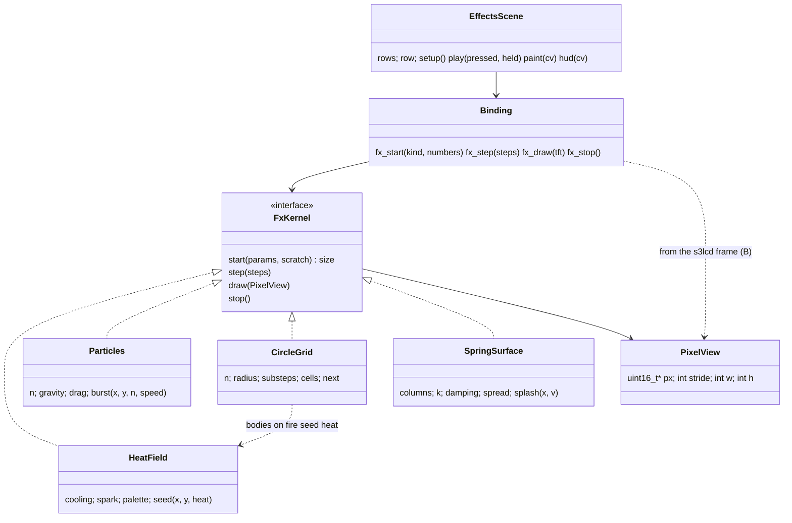
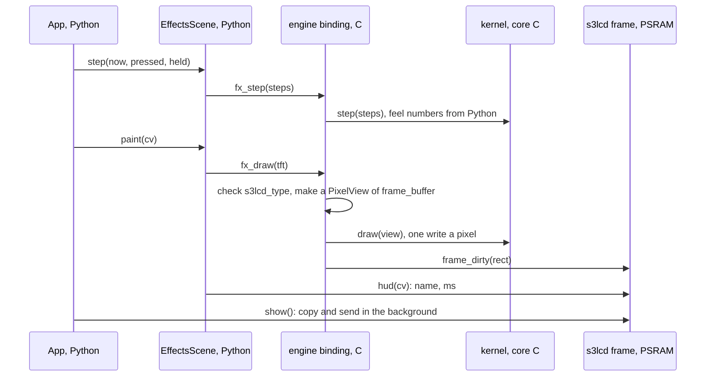
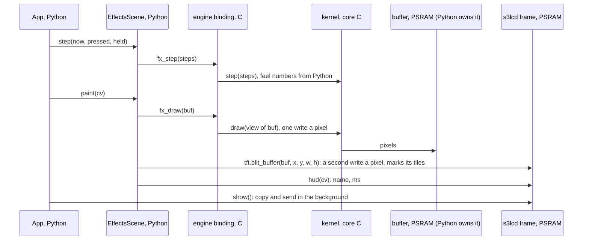

<!-- Resume: invoke product-discovery again; `discovery.py check <this folder>` names the next step. -->
# P594 ten native effects tried alone on the board: discovery brief

<!-- Readiness, its one home. collecting evidence: anything short of the two below. an experiment: the decider chose
a test (a D) before choosing an option. design: the decider confirmed the frame, the jobs and a direction, and accepted
the remaining risk (D rows). An extension may tighten these. Next: design, or a chosen test of kind spike or prototype
→ the design skill the facts name, with this file; otherwise none, and the collection plan says who runs it.
Stands on: the assumptions not retired in risks-and-tests.md; of which those the decider rated high, or — while any
is unrated. check computes both. -->
**Ready for:** an experiment (D2, D7: the fire scene P595, with A1's fixed question and both screen paths timed. D4 to D16 chose the list, the home, the harness, the turns and the rules) <!-- REQUIRED:ready -->
**Stands on:** 9 H, — of which would change the decision <!-- REQUIRED:debt -->
**Decision needed:** the PO's confirmation of the understanding (the Hand-off draft), then his yes to items.md and to the PR for this folder <!-- REQUIRED:decision-needed -->

## Frame
- Request, verbatim (corrections marked): the PO's words of 2026-11-03, after he played the rain (P593 #794), verbatim on [#795](https://github.com/xmejkal/spark/issues/795) (E): "nice. Alright, I really like it, before we move on, Let's now create other cool effects that might be really doable in C, or even by trying to call the special assembler methods or through ESP-IDF. I don't know, but let's try to make 10 more effects, something including fire and smoke, and maybe some bodies colliding, being on fire, and maybe water. Think of some research. Feel free to get inspired by other code, and let's just make more native effects that we can then later use in the engine. But now, just like with the rain, let's just try the effects themselves." On the way of working: "the usual research refinement, the cards, the councils, all of that". Later in the session, asked how much of the effects the engine can use: "especially the colisions, but all of it really" (the PO, 2026-11-03, this session, E) <!-- REQUIRED:request -->
- Decision · decider: which ten effects, how each is computed (plain C, a PIE `.S` kernel, or an ESP-IDF component such as esp-dsp), where their code lives in the engine module, what one effect scene shows (the effect, its cost on screen, a BOOT tap like the rain), which code is learned from under which licence, and the order of the slice cards · the PO <!-- REQUIRED:decision -->
- Outcome and how it is observed (a metric with unit and source, a proof command, or a log): the PO confirms a brief with a list of ten effects to try (his ask) and proposed slice cards. The team adds to each effect its look, its method, its cost per frame and its provenance: the cost is the team's measure, from the team's "Done when" on #795, not his words. He reads the numbers, and the team keeps the lines (D15, ★C24 (n = 1)). Later, done on #795 (the team's wording): ten effect scenes run on the board, each alone as the rain does, with the cost on screen and in bench.md, and the PO played them. Today's rain as the reference: N 160, C step 0.16 to 0.17 ms, draw 13.5 to 14.0 ms, HUD text 10.6 to 10.9 ms a frame, 24 fps printed (pixel-games bench.md P593, measured. The print is an integer floor of frames over 5 s, so 24 means 24.0 to 24.99, and the 40 ms pace caps it at 25) <!-- REQUIRED:outcome -->
- Already decided (D · who · when · where; include the product's stated non-goals and earlier decisions the request names): effects move to C and the C layer may own an effect's state if the game reads nothing back (Q13 yes) · the PO · 2026-11-02 · recorded in the team's comment on #784 ("The PO said yes to effects keeping their own motion in C (Q13, 2026-11-02)") and p580-finding.md:77 as a plan. His own words for that yes are not quoted in the folder (—). C computes facts, Python decides consequences, every feel number comes from Python (D12) · the PO · 2026-11-03 · engine brief. The engine C lives in an own `engine` module beside s3lcd: core/ plain C for the Mac and the board, port/s3/ for fast paths, one thin binding (D17). A Mac build of the same C (D15). Own small solver with chip fast paths, ideas from Box2D-Lite, Box2D v3 and Chipmunk2D (D16). Fixed 10 ms step (D18). A feel slice stops at "ready to play" until the PO played it (D21) · all the PO · 2026-11-03 · docs/discovery/2026-11-03-engine/brief.md. Each effect is tried alone first, the way the rain was. Use in the engine and the games comes later · the PO · 2026-11-03 · #795. The games are original in name, art and levels (#769). P583 #784 puts effects into RENT, and this card does not <!-- REQUIRED:decided -->
- Open questions: D4 to D16 answered the queue. Still open: the control for the picture variant (D12), whether any effect misses its line (D11, P601) <!-- REQUIRED:open -->
- Scope · out of scope (proposed): in: ten effect scenes, each alone, its method, its cost on screen and in bench.md, the C home of the kernels (the engine module, D8), the research gaps P580 left (colliding and burning bodies, water, licences, esp-dsp and PIE kernels) · out: effects inside a game (P583 #784), the engine's rigid tip and topple (P592), sound, a spark change, a copy of any existing game or demo <!-- REQUIRED:scope -->
- Start and reach (proposed until Q0): start own idea (the PO's) · decider reachable yes · users the PO as player and game writer, n = 1 reachable · data and connectors: the pixel-games repository (code, tests, bench.md, run logs, p580-finding.md), the board on USB, the web (search and fetch), GitHub (gh), the Espressif docs MCP, Miro; no analytics connected · decider as a user n = 1 · must not get worse: the ten games and the rain as they play now (rain 24 fps at N 160, bench.md P593) <!-- REQUIRED:start-reach -->
- Flags (yes · no · —; asked only when it changes a decision; never legal advice; any date or threshold is read at its source at run time and cited):
  - sold or given away, or personal use: given away as open source (pixel-games is public, MIT) <!-- REQUIRED:flag-sold -->
  - connects to a network or runs software (for example the EU's Cyber Resilience Act): software; no network <!-- REQUIRED:flag-network -->
  - children or food contact: no <!-- REQUIRED:flag-children -->
  - market: public on GitHub, worldwide <!-- REQUIRED:flag-market -->
  - radio (unlicensed-device rules; read at their source when it decides): no <!-- REQUIRED:electronics-firmware:flag-radio -->
  - a Li-ion cell (charging, transport, battery rules): no <!-- REQUIRED:electronics-firmware:flag-li-ion -->
  - mains: no <!-- REQUIRED:electronics-firmware:flag-mains -->
  <!-- EXTEND:flags -->
- Extensions (each active id · the fact that activated it; when none matched, only "none matched: core only · the fact that decided it", naming no extension; list any directive skipped under rule 9): electronics-firmware · "doable in C", "special assembler methods", "ESP-IDF" (firmware on the ESP32-S3 and its PIE unit); spark-process · "the cards, the councils", the item is on spark's board (project 2) <!-- REQUIRED:extensions -->
- The item (its issue, or the proposal in the decider's words) · what is still open elsewhere · the repository's push check, or "no push check here": [P594 #795](https://github.com/xmejkal/spark/issues/795), in Discovery on spark project 2, under the engine epic P586 #787, slice pixel-games · still open elsewhere (spark project 2, read 2026-11-03): P469 #637 and P511 #706 in Build, Ready holds 6 of 5 (#783 waits on P592), the engine discovery P586 is Ready for an experiment (P589 done, P590 #791 next) · pixel-games has no push check: the folder lands by PR <!-- REQUIRED:spark-process:item -->
<!-- EXTEND:frame -->
- Depth: TRIO (default: PO assistant, user, tech lead) | FULL or LIGHT (who asked, when); add "no independent review" if subagents could not start: TRIO plus one researcher (D1) for the gaps: the PO assistant (Opus), the user (Sonnet), the tech lead with the C and PIE lens (Opus), an effects researcher for colliding and burning bodies, water, esp-dsp and licences (Opus); the refuter on Fable 5.1; 5 agents <!-- REQUIRED:depth -->
  <!-- Cost, measured once: the P900 rehearsal's council took 6 agents, 499 calls and about 90M input tokens (2026-10-06). -->
- Search budget: web searches: 34 in all: PO assistant 6, tech lead 8, effects researcher 14, user 0, refuter 6 <!-- REQUIRED:budget -->
- Appetite (the decider's, asked only when heading for design) | —: — <!-- REQUIRED:appetite -->

## What we found <!-- CLAIMS -->
<!-- One claim per line: `- [★C<n>] claim · E pointer | H source | D who date · caveat: qualifier | none`.
★ marks a claim that a decision, an option or the riskiest assumption rests on. A quote is verbatim, with its pointer.
Say what the evidence can support: an account (what happened to one person), data (how often, in its population and
period), a document (what was specified), the product (what exists, not whether anyone needs it), a benchmark (a
comparison). Model knowledge is H until a source is read. Elsewhere cite a ★ claim as ★C<n>, with its keep: words.
e.g. `- [★C2 (C draw cost is H)] 13 of 526 tickets ask for recurring tasks · E tickets.csv:2-14 · caveat: picked by Lena; shows that, not how often` -->
Every cost below is per frame of the board's 40 ms pace (games/app.py:27, so 25 fps at most), on the ESP32-S3 at 240 MHz. "Calculated" means arithmetic on the numbers named. A cycle count per pixel is H unless a board run measured it, and every ms built on one is H too. Measured today: the compose costs (run46), the C step, and the parts of the rain's frame (run55 and run54: background fill, draw, HUD, copy, gc). The background fill is also the measured low end of a C store into the PSRAM frame: 4.6 to 4.7 ms over 76,800 px, 59.9 to 61.2 ns/px (★C3 (store floor)). Not measured: a kernel's store, whose writes mix with reads of its field. So each full-screen opaque cost below is the fill's 4.6 to 4.7 ms plus the kernel's cycles (H). The 88.9 ns/px top stays only where the code also reads PSRAM: a blit, or a field kept in PSRAM. The board measures the kernels in P595. "Step plus draw" is one formula everywhere in this folder: the `step` field of an interval's `time` line plus the `paint` field of the same interval's `avg` line. games/app.py:104-106 prints `time`, whose step is `us[0]`, and :109 prints `avg`, whose paint is `gfx.PHASE_SUM[1]`, the scene's draw phase. In run55 and run54 each `avg` line is two lines below its `time` line, for example run55-p593-rain-c160.log:10 step 1.7 and :12 paint 14.2 give 15.9 ms (E).

Today's reference and the frame budget:
- [★C1] The rain at N 160 in C runs at 24 fps with a step of 0.16 to 0.17 ms, a read of 1.06 to 1.14 ms, a draw of 13.47 to 14.01 ms and a HUD of 10.6 to 10.9 ms a frame. At N 192 it drops to 23 fps · E bench.md:268-274 (P593, run55 and run54, 5 s intervals) · caveat: one run per N on one board <!-- REQUIRED:findings -->
- [★C2] The rain's draw is Python call cost, not pixels: 160 fills of 4 x 4 px cost about 85 µs each, and their 2,560 px cost about 0.15 ms at the fill's store cost (59.9 to 61.2 ns/px, ★C3 (store floor)). So an effect that Python draws as 4 x 4 fills at about 85 µs each gets about 180 to 214 fills into the rain's room with today's HUD (15.3 to 18.2 ms, ★C4 (the rain's room, H for an effect, moved by covers and the HUD)), and about 300 to 338 with a cached HUD (25.5 to 28.7 ms). The effects draw in C · E bench.md:270, games/rain.py:64-66 (one fill per body). Calculated by the tech lead (PHYS-4) and the synthesis · caveat: the per-fill cost is the draw divided by 160. The C draw cost is H: about 0.19 ms for the same draw. Rival not ruled out: part of the 85 µs is `TftCanvas.fill`'s Python rotation mapping (games/lcd.py:59-80), which a C draw through the same entry still pays. The fill count is the rain's shape: it says what Python could not do, and it is no budget for an effect in C (the refuter's second pass)
- [★C3] Four pixel costs into the PSRAM frame follow from measurements. A plain C store loop costs 59.9 to 61.2 ns/px: s3lcd's `_fill` writes one colour to each of the 76,800 px of the PSRAM frame, and `avg rain static` reads 4.6 to 4.7 ms in all ten intervals of run55 and run54. A memcpy into the PSRAM frame takes 55.3 ns/px more than into the internal frame, an opaque full-frame blit costs 88.9 ns/px in all, and `blit_buffer`'s alpha path costs 337.5 ns/px · E s3lcd/src/s3lcd.c:244-252 (`for (size_t i = 0; i < self->width * self->height; ++i) { *b++ = color; }`), games/lcd.py:140-143 (tracking off, then `tft.fill(game.bg)` when the game does not set `covers`), games/gfx.py:340 (an empty `paint_static`, which the rain does not override), run55-p593-rain-c160.log:12, :18, :24, :30, :36 and run54-p593-rain-c.log at the same lines (`avg rain static 4.6` to `4.7`), calculated: 4.6 ms / 76,800 = 59.9 ns, 4.7 ms / 76,800 = 61.2 ns. bench.md:198 (`full-frame blit, opaque (sky 320x240) | 6.83 | 2.58 | ms`, "double" against "dma" over 76,800 px, calculated: (6.83 − 2.58) / 76,800 = 55.3 ns, 6.83 / 76,800 = 88.9 ns), bench.md:205 (run46, 64 x 64 at alpha 128) · caveat: 59.9 to 61.2 ns/px is the store floor, not a kernel's cost. It is a constant store, and a kernel's writes mix with reads of its field (the refuter's second pass). That it takes the same store path a kernel uses, in panel order, with the same cache write-back, is H (the refuter). 88.9 ns/px is a memcpy that also reads PSRAM, so it overstates a store-only loop and stays only where the code reads PSRAM. 55.3 ns/px is the PSRAM penalty over an internal memcpy, not the cost of a write. 337.5 ns/px is `blit_buffer`'s alpha path with its per-pixel bounds and key checks (s3lcd.c:632-637). run46 timed a 64 x 64 window and full frames. The kernel cycles are H, per pixel on top of these
- [★C4] The rain's room for its step plus draw is between about 15.3 and 18.2 ms a frame with today's background fill and HUD, at 24 fps printed. The rain at N 160 spends 15.3 to 15.9 ms on its step plus draw and prints 24. At N 192 it spends 18.2 to 18.9 ms and prints 23. So the drop from 24 to 23 lies between 15.9 and 18.2 ms, and 15.3, the lowest point that printed 24, is a conservative floor. The rest of its frame is measured: background fill 4.6 to 4.7, effects phase 0.1, HUD 10.6 to 10.9, the copy in `show()` 3.2 to 3.3, gc 1.6 to 1.7 ms, together 20.2 to 20.5 ms. The four `time` fields (step, paint, send, gc) sum to 36.0 to 36.5 ms, and a frame that prints 24 lasts 40.0 to 41.7 ms, so 3.5 to 5.7 ms go to the loop and the pace, unlogged. For an effect the room is H: an effect scene has no `read` inside its `time` step (the rain's is 1.06 to 1.14 ms), its HUD has another length, and on path B it makes one store where the rain makes 160 Python fills. An attribute and a card move the room. A scene that sets `covers` skips the background fill (games/lcd.py:142), so about 19.9 to 22.9 ms. A HUD drawn once into a buffer (F1, calculated 0.40 ms) gives about 25.5 to 28.7 ms, and both about 30.1 to 33.4 ms · E run55-p593-rain-c160.log:10 `time rain step 1.7 paint 29.9 send 3.2 gc 1.7 fps 24`, :12 `avg rain static 4.7 paint 14.2 fx 0.1 hud 10.8` and the four intervals after them (:16 with :18 to :34 with :36), run54-p593-rain-c.log at the same lines (N 192), games/lcd.py:142 `if not game.covers:  # a game whose still picture covers the whole screen needs no fill under it`, games/app.py:101 (fps is an integer floor). Step plus draw is the folder's one formula, named at the head of What we found: the `time` line's step plus the same interval's `avg` paint (games/app.py:104-106, :109), so 1.7 + 14.2 = 15.9 at :10 and :12. The bracket and the room calculated by the synthesis in a script from those lines, re-derived in the second pass · caveat: one run per N. The room is the rain's (E), and for an effect it is H. The rest at N 192 was 19.3 to 20.3 ms, not the same as at N 160, and its HUD 9.7 to 10.7 ms, so the cached-HUD figures use N 160's HUD. The split of the 3.5 to 5.7 ms between loop cost and sleep is not in the log. The `time` paint holds 0.1 to 0.2 ms more than its four `avg` phases, so the reading "the `time` step plus the `time` paint minus static, fx and hud" gives 15.5 to 16.0 and 18.3 to 19.0 ms. That reading is not used. `covers` is documented for a still picture that covers the screen, so an effect that covers it in its draw reads it in a sense its comment does not name (H), and only an opaque full-screen scene can use it. The tech lead's 15 ms (PHYS-2) and the PO assistant's 25 ms (PO-5) are both superseded: 15 sits at the bracket's low end, and 25 needs `covers` and more

The engine module today:
- [★C5] The engine module has no drawing path and no contact between bodies. Its binding exports load, step, read_y, spawn, read, drain, call_back and nothing. Each body falls onto its own plane `rest_y` and has no radius · E engine/binding.c:141-151, engine/core/world.c:77-90, engine/core/world.h:29-40 · caveat: none
- [★C6] Two paths to the screen exist in the code, and neither is built. A: C fills a buffer and Python calls `blit_buffer`, whose opaque and keyed paths are row copies that mark the dirty tiles themselves. B: the engine writes into the s3lcd frame. `s3lcd_type` is a non-static global, but s3lcd.h does not declare it, so B needs one `extern` line in s3lcd.h. frame.h pulls in FreeRTOS, esp_lcd and `py/obj.h`, and `frame_dirty` is `static inline` in frame.h:62, so B's binding includes frame.h, and B's code sits in the binding or port/s3/, never in core/. MicroPython gathers the include directories of every user module into one list, so the engine already sees s3lcd/src. A full screen costs about 11.4 to 11.5 ms on A (one store at the fill's 4.6 to 4.7 ms plus a blit at 88.9 ns/px, 6.83 ms, which reads PSRAM) and about 4.6 to 4.7 ms on B (one store), plus the kernel's cycles · E s3lcd/src/s3lcd.c:604-627, :2782-2799, s3lcd/src/s3lcd.h:86-123, s3lcd/src/frame.h:13-17, :62, ~/esp/micropython-v1.29.0/py/usermod.cmake:17-21, micropython.cmake:2-3. Costs calculated by the tech lead (TL-3) and restated by the synthesis on ★C3 (store floor) · caveat: neither path was built, and a kernel's store is not measured, only its floor (★C3 (store floor)). B couples the engine to the layout of `s3lcd_obj_t`, which the tech lead rates a low risk because both modules build into one image (H). P511 #706 (a self-built driver spike) and P587 #788 (the s3lcd split) are open and both change the fork's files, so the coupling is on two cards' paths. On A, even a 160 x 120 RGB565 window (38,400 B) exceeds the internal block, so A's buffer is in PSRAM, and a full-screen one is 153,600 B. Not built
- [★C7] C state outlives a soft reset: the world is a static in the binding, and a run at 192 left 192 bodies that broke the next run at 160 · E engine/binding.c:11-12, bench.md:276 · caveat: an effect with static state repeats this. The tech lead's fix (`start` allocates the scratch, `stop` frees it) is H (TL-8), and `App.switch` calls no hook on the old game today (games/app.py:59-68), so a scene's stop has no caller yet
- [★C8] Internal RAM for an effect's scratch on the engine image is unknown. The largest free internal block, 31,744 B, was measured on the s3lcd image while the games ran. The engine image adds 12,320 B of static RAM for its two worlds. P593 did not measure free internal RAM · E bench.md:186 (run41), engine/core/world.h:11, bench.md:279 · caveat: no estimate. The 12,320 B may or may not come out of the same region as the 31,744 B block. Only a field of 19,200 B or less is a candidate for internal RAM. Not measured on the engine image

The effects, their methods and their costs:
- [★C9] P580 already ranks eight effects with a cost each: fire and smoke from one heat kernel, particles, ripple and shockwave, glow, dissolve, screen shake, noise smoke and shatter. None is colliding bodies, burning bodies or water as a liquid. Its only water is a ripple seen from above · E p580-finding.md:17-28 · caveat: P580 priced game windows (small windows composed into games), not scenes alone. Its PIE rows are instruction counts (H). Its "PSRAM write 55 ns/px" (p580-finding.md:15) is the delta of ★C3 (store floor), not a write cost. The store floor is 59.9 to 61.2 ns/px
- [★C10] Sparks, dust and debris already exist as a look in Python: `Particles` holds at most 40, and 40 cost 2.27 ms per update · E games/gfx.py:225-258, p580-finding.md:20 (run46) · caveat: a C particle scene gains count and speed, not a new look (PO-6)
- [★C11] Fire, smoke and bodies on fire can share one heat kernel. Fire from a 160 x 120 field drawn at 2 x 2 to the full screen, opaque, costs about 7.6 to 7.7 ms on path B: 3.04 ms of kernel and palette cycles (H) plus the 4.6 to 4.7 ms store. On path A it costs about 14.5 to 14.6 ms, with the 6.83 ms blit. At full resolution, with its 76,800 B field in PSRAM, it costs about 16.8 to 19.0 ms. A 320 x 80 strip costs about 5.6 ms. Smoke is the same kernel with a grey palette, slower cooling and a drift. Bodies on fire seed heat at each body: about 7.0 to 7.1 ms with no palette pass (the researcher's model, FX-16 a), or about 10.2 to 10.3 ms with the palette pass and 300 colliding circles (the tech lead's model, PHYS-5). Each opaque cost is the cycles (H) plus ★C3 (store floor). Only the full-resolution row keeps the 88.9 ns/px top, because its field is in PSRAM · H the tech lead (PHYS-5, TL-11) and the researcher (FX-16 a), restated by the synthesis on the store floor. The smoke variant is E p580-finding.md:46 as a design, not a run · caveat: the kernel's 30 cycles and the palette's 8 cycles a pixel come from P580, so the cycles are H and each row can be 2 times off. The rows near the room's line do not survive that error (tech-lead.md:59). The two bodies-on-fire numbers come from two models. "Whatever the body count" holds only while the seeding loop, which runs per body, stays small against the field
- [★C12] Colliding bodies as a few hundred circles fit in plain C. A uniform grid with one cell per diameter and position-based separation costs about 2.6 ms for 300 circles and 8.6 ms for 1,000 at 4 steps and 2 iterations. With substeps the collide part grows by about 50 %, so 300 circles at 3 substeps cost about 3.4 ms. One MIT source holds this method: position Verlet with a grid, 8 substeps. Its grid caps a cell at 4 bodies and overwrites the fifth · H the tech lead (TL-1, PHYS-5, tech-lead.md:47 for the 50 %). E for the method: github.com/johnBuffer/VerletSFML-Multithread src/physics/physics.hpp:17-46, collision_grid.hpp:9-21 (master, read 2026-11-03, MIT, FX-1, FX-2, FX-10) · caveat: the cost is H (150 cycles a body-iteration, guessed). The size, about 120 to 200 lines of C, is H (tech-lead.md:93). The source is desktop C++, float, threaded. Rival not ruled out (the refuter): in a box the bodies pile, so each body tests about 20 to 36 pairs instead of about 6, and a pile may need the source's 8 substeps, so the scene may cost 3 to 10 ms
- [★C13] Circles of radius 4 tunnel at the engine's 10 ms step under stack's gravity: a 240 px fall at 2,000 px/s² reaches 979.8 px/s, 9.8 px a step, more than the 8 px diameter. They need 3 substeps, a radius of about 10 px, a lower gravity or a speed clamp at one diameter a step · E games/rain.py:31 (GRAVITY 2000.0), D18 (fixed 10 ms step). Calculated by the tech lead (PHYS-9). The clamp is the refuter's lever · caveat: an assumed 240 px fall, the full screen height. Once bodies pile, the fall is shorter
- [★C14] Water has four methods with known costs, and other candidates fill the ten. A spring surface seen from the side with splash droplets, about 1.9 to 2.0 ms for 320 columns over a 320 x 100 body. Water and sand as cells at 160 x 120, about 5.8 to 5.9 ms. A ripple seen from above, about 14.6 ms at half resolution full screen or 3.9 ms in a 128 x 128 window (both on the tech lead's 175 ns/px render cost). A particle liquid of 500 particles with 20 neighbours, about 15 ms (the tech lead, tech-lead.md:53), or 200 particles with 12 neighbours, about 6 ms (the researcher, effects-research.md:39). Also: plasma about 9.4 to 9.5 ms, metaballs about 11.0 to 11.1 ms, cloth 5.0 ms, lightning and a starfield under 0.1 ms plus a glow. Each opaque cost is the cycles (H) plus ★C3 (store floor) · H the tech lead (PHYS-5) and the researcher (FX-17 to FX-31), restated by the synthesis on the store floor. E for the methods: code.tutsplus.com/make-a-splash-with-dynamic-2d-water-effects--gamedev-236t (2012-08-14), github.com/MaxBittker/sandspiel crate/src/species.rs:167-215 at 9936e06b (read 2026-11-03) · caveat: the costs are H, from cycle counts. "Fits" near the line can flip
- [★C15] A scene alone on black stores opaque pixels at a floor of 59.9 to 61.2 ns/px (★C3 (store floor)). In a game the effect blends over the background through `blit_buffer`'s alpha path at 337.5 ns/px. A full screen costs about 4.6 to 4.7 ms opaque plus the kernel's cycles, and about 25.9 ms blended through that path · E p580-finding.md:15, :44 (run46), bench.md:198, :205, s3lcd/src/s3lcd.c:244-252. Calculated by the PO assistant (PO-8), restated by the synthesis on the store floor · caveat: black understates a game's cost, unless the scene also draws over a picture. The 337.5 includes `blit_buffer`'s per-pixel bounds and key checks. A kernel that blends in its own loop pays neither, so the gap for P583's effects may be about 1.5 to 3 times, not 6 (the refuter's estimate, H). A faster C blend would narrow it further (★C16, not timed)
- [★C16] s3lcd's alpha blend is a naive per-pixel unpack, two multiplies per channel and two branches, and its blit path checks bounds per pixel. A SWAR blend in C, red and blue blended together and green apart, is on virtualdub entry 117 (2006-07-08). The one-multiply form and its 10 to 15 cycles a pixel are model knowledge and the tech lead's instruction count · E s3lcd/src/s3lcd.c:186-199, :630-641, virtualdub.org/blog2/entry_117.html (opened by the refuter, 2026-11-03: it uses lookup tables and the mask 0xf81f07e0). H for the cycles (PHYS-6) · caveat: the SWAR blend was not timed. "2 to 3 times faster than s3lcd's" is H
- [★C17] esp-dsp holds no pixel kernel: its S3 paths are dot products, FIR, FFT, element-wise add, sub and mul, matrix multiply, memcpy and memset. A `.S` file in the engine module will very likely build: user module sources compile in the main IDF component, the IDF project enables ASM, and the QSTR scan reads `.c` and C++ files, not `.S`. Whether ESP-IDF 5.5.2 saves the PIE registers on a task switch is unknown · E `gh api repos/espressif/esp-dsp/git/trees/master?recursive=1` (2026-11-03, TL-6, FX-37), ~/esp/esp-idf-v5.5.2/tools/cmake/project.cmake:589, ~/esp/micropython-v1.29.0/py/makeqstrdefs.py:34-38 · caveat: no `.S` was built. The MicroPython docs name an ASM list only for the Make build (`SRC_USERMOD_LIB_ASM`) and say nothing about CMake (TL-5), a reason for doubt. With a cached HUD, no effect at the sizes in ★C11 (cycles are H) and ★C14 (costs are H) needs PIE to be tried alone (the tech lead, TL-7, H). The S3 path of `dsps_add_s8_aes3` saturates at 127 and gives other results than its fallback (FX-39). No .S built
- [★C18] Licences of the code found: FastLED, Pimoroni, VerletSFML, sandspiel and Box2D-Lite are MIT, esp-dsp is Apache-2.0, and Adafruit_PixelDust carries a BSD line (variant unchecked). WLED is EUPL-1.2, BitsForPeople's PIE blend is GPL-3.0, Lode's pages say "All rights reserved", and Hoffman's tutorials state no licence for their code · E `gh api` reads of each repository's licence, 2026-11-03 (PO-10 to PO-13, FX-10, FX-22, FX-41, FX-42), lodev.org/cgtutor/plasma.html · caveat: what EUPL and GPL mean for this MIT repository is general knowledge, not legal advice

Overlaps with other cards:
- [★C19] Three places claim the effects' C. P583 builds them "in the s3lcd fork", P587 splits s3lcd into files that include "effects (the home for P583's PIE effects and C motion)", and P580 put `fx.c` beside `frame.c`. D17, taken later on 2026-11-03, puts the engine's C in its own `engine` module, which P594's frame follows if Q5 picks d1 · E #784 "Done when", #788 "Done when", p580-finding.md:75, docs/discovery/2026-11-03-engine/brief.md:293 (D17) · caveat: whether D17's "engine C" covers effects is the PO's reading to give (Q5)
- [★C20] Colliding bodies is contact code, the same kind of code as P592's rigid tip and D16's own solver. A circle grid can serve P592 as its broad phase, but not as its solver: P592 needs boxes with an angle, a box-box test and impulses · E #793, docs/discovery/2026-11-03-engine/brief.md:292 (D16). H for the split into broad phase and solver: the tech lead (TL-2), from model knowledge of Box2D-Lite · caveat: the split is H. Box2D-Lite's source was read only for its broad phase and line counts (FX-7)

The player:
- [★C21] Scenes are reached by a one-way ring on D14. Ten more `GAMES` entries make a ring of 21, with no back step and no name on screen, because the rain's HUD replaces the game name · E games/app.py:40, :59-68, games/rain.py:160-164 (USER-2, USER-13) · caveat: taps accepted unknown: nobody asked him how many. So far the team put the scene to play first in `GAMES` and he tapped nothing to reach it: "The rain starts at power-on" (bench.md:264, :280)
- [★C22] The rain's step bar shows 0 px in C mode: 1 px per 200 µs against a step of 160 to 170 µs. The draw and the HUD, which set the fps, reach only the serial log · E games/rain.py:35, :151, bench.md:270-274 (USER-5) · caveat: derived from the code, not seen on the panel
- [★C23] Under D21, ten scenes built as ten feel slices are ten stops at "ready to play", serial on his play time · E docs/discovery/2026-11-03-engine/brief.md:297 (D21) (USER-10, PO-25) · caveat: whether a group of scenes counts as one feel slice is his call (Q7)
- [★C24] His recorded words on effects are about look and kind: "nice. Alright, I really like it" after the rain, "cool effects", "fire and smoke", "bodies colliding, being on fire", "water". No note of his is about fps or milliseconds. One of his 17 RENT feel notes names a size in pixels: note 10, "one short thud (the screen drops 1 or 2 px)" · E #794, #795, docs/discovery/2026-11-03-engine/p588-feel-notes.md:52 (USER-8, USER-9) · caveat: n = 1. Nobody asked him for a number, and the HUD shows only the step ms, so a missing number is no evidence that cost is not his criterion (the refuter's rival, Q13). Whether he reads the cost on screen is — (Q12)
- [★C25] Every feel number comes from Python (D12), and the rain already passes its gravity, bounce, friction and spawn ranges from Python · E docs/discovery/2026-11-03-engine/brief.md:288 (D12), games/rain.py:31, :113-116 · caveat: none
- [C26] Nobody is blocked without P594 now: P583 names RENT as its need, D19 puts P590 and P592 next on the engine, and Ready holds 6 of 5 · E #784 "Needed by", engine brief.md:295 (D19), the Frame's item line (PO-20) · caveat: its value is his interest and the later reuse of the kernels

Where the reports disagree, each now a question or a measurement. The effect room, 15 ms (the tech lead) against 25 ms (the PO assistant): the refuter's reading of run55 settles both as wrong in their basis. The room is 15.3 to 18.2 ms with today's fill and HUD (★C4 (the rain's room, H for an effect, moved by covers and the HUD)). `covers` is an attribute a scene sets, so Q10 asks only whether and when a cached HUD comes. The riskiest assumption, the pixel path (the PO assistant) against the look (the user lens's emphasis on his words, and the refuter's count of evidence), Q1. PIE in this card (his words "special assembler methods", PO-26) against PIE as a later rung (the tech lead, TL-7), Q8. The write cost (55.3 ns/px as a cost, the tech lead, the PO assistant and P580, against a delta, the refuter): the background fill measures the store floor at 59.9 to 61.2 ns/px (★C3 (store floor)), and P595 measures a kernel's store. verification.md lists the agree and split lines.

## Options <!-- CLAIMS -->
<!-- Two or three per open decision: decision · option · cost · what it would prove · opinion (whose), then the tag
and caveat cells. e.g. `- Q2 what first · fix delivery · two weeks · whether seen tasks get done · opinion (the facilitator's) · H ★C2 (C draw cost is H) · caveat: none` -->
The options stay as history. Each option the PO chose carries its D. "Opinion" says whose it is.

Which ten effects (Q2). Grouped by the kernel they share (K1 heat field, K2 particles, K3 wave from above, K4 spring surface, K5 circle grid, K6 grain grid):
- Q2 which ten · a1 (chosen, D4): the PO assistant's ten, six kernels: fire, smoke and bodies on fire (K1), water from the side with splashes (K4 and K2), sparks or fireworks (K2), colliding bodies (K5), ripple from above (K3), falling sand and water cells (K6), a shockwave or glow, and plasma or dissolve · cost: six kernels, three scenes on K1 · proves: his five words first, at the least new code, ranked by "cool per unit of work", the PO assistant's own criterion (PO-18), not his · opinion (the PO assistant, PO-18) · H ★C9 (P580 priced game windows), ★C11 (cycles are H), ★C14 (costs are H) · caveat: the pre-mortem's first cause: ten scenes may read as three ideas (A5) <!-- REQUIRED:options -->
- Q2 · a2: ten different looks from the tech lead's sizes and the researcher's candidates: fire (smoke as a BOOT palette), bodies on fire, colliding circles, water from the side, water and sand as cells, a particle liquid drawn as metaballs, ripple from above, plasma, lightning, cloth or rope · cost: about nine kernels (the synthesis's count, not the reports': heat field, circle grid, spring surface, cells, particle liquid with a metaball draw, wave, plasma, lightning, cloth). The particle liquid alone is about 6 to 15 ms (two models, ★C14) and fits only with a cheaper HUD or `covers` · proves: variety he counts as ten · opinion (the synthesis, from PHYS-5 and FX-28 to FX-31) · H ★C11 (cycles are H), ★C14 (costs are H) · caveat: every cost is H, and more kernels mean more slices
- Q2 · a3: his five words first, then he picks the other five from a menu after playing them: fire, smoke, bodies on fire, colliding bodies and water in the first scenes, then a menu of the rest (sparks, ripple, sand, plasma, lightning, metaballs, cloth, glow, shockwave) · cost: one extra question to him after the first scenes · proves: the second half follows his taste, not ours · opinion (the synthesis, from ★C24 (n = 1): his words are about look) · H ★C24 · caveat: the second half waits for his play time (★C23 (his call))

The path to the screen (Q4):
- Q4 path · A: C fills a buffer that Python blits with the existing `blit_buffer` · cost: touches only engine/. Doubles the pixel traffic: about 11.4 to 11.5 ms for a full screen plus the kernel's cycles (calculated: the fill's floor plus the measured blit, ★C3 (store floor)). Even a 160 x 120 window (38,400 B) is over the internal block, so the buffer is in PSRAM, and a full-screen one is 153,600 B. Python maps game to panel coordinates · proves: an effect on screen with no change to s3lcd · opinion (the PO assistant, PO-30: the cheapest first test, as a 64 x 64 and a 320 x 40 window. The tech lead: only for small keyed windows) · H ★C6 (not built) · caveat: costs calculated, not built. D17 says the engine "reaches the screen only through s3lcd.h" (E engine brief.md:293). On A the engine never reaches the screen, and Python does, through `blit_buffer`. Whether A keeps D17's letter is the PO's reading (Q4)
- Q4 · B: the engine writes into the s3lcd frame through s3lcd.h, as D17 names · cost: one `extern` line in s3lcd.h, the binding includes frame.h (FreeRTOS and esp_lcd headers come with it), reads `frame_buffer`, `width` and `height` and calls `frame_dirty()`. One store a pixel: about 4.6 to 4.7 ms for a full screen plus the kernel's cycles (★C3 (store floor)) · proves: D17's route and D11's "drawing moves to C" · opinion (the tech lead, TL-3) · H ★C6 (not built) · caveat: couples the engine to `s3lcd_obj_t`'s layout, and P511 #706 and P587 #788 both change the fork's files. Not built
- Q4 · AB (chosen, D7): A in the walking skeleton and B in the same card, both timed on the same fire field · cost: about one PR more than either alone (H) · proves: the choice by a number, not an estimate · opinion (the synthesis) · H ★C6 (not built) · caveat: it builds a path that is then dropped. Its result measures the path, so each path is read against A2's line on its own, and the result names the path

Colliding bodies (Q3):
- Q3 colliding · c1 (chosen, D6): circles with position Verlet on a uniform grid now, in the engine's core/: the grid as a shared module, the circle solver as an effects mode, P592's rigid solver later on the same grid · cost: about 120 to 200 lines of C (H), about 3.4 ms for 300 circles at 3 substeps and g 2,000 (H, 2.6 ms at 4 steps plus 50 % on the collide part), 3 to 10 ms if they pile (the refuter's rival) · proves: hundreds of colliding bodies on the board, and a broad phase P592 can reuse · opinion (the tech lead, TL-1, TL-2) · H ★C12 (cost is H), ★C13 (assumed 240 px fall), ★C20 (split is H) · caveat: decides the grid's shape before P592 does. A circle solver shown as the engine's rigid solver would be a wrong promise (TL-2)
- Q3 · c2: wait for P592's solver, and the colliding scene comes after it · cost: the PO's word "bodies colliding" waits for the engine's order (D19) · proves: one solver, no second one · opinion (the PO assistant's risk PO-22, as an option) · E #793 · caveat: P592 builds boxes that tip, not hundreds of bodies
- Q3 · c3: a demo-only collider inside the effect's own file, thrown away later · cost: the same lines as c1, with nothing shared · proves: the look only · opinion (none of the lenses recommends it) · H ★C20 (split is H) · caveat: the pre-mortem's fifth cause: a second solver to redo
- What carries into the engine from the colliding bodies (c1 or c3), for the PO's ask "especially the colisions, but all of it really" (his words, 2026-11-03, this session). Carries: the uniform grid as the broad phase P592's solver can reuse (H TL-2). Contacts written as facts (kind, body id, speed, x, y) into the event buffer, so Python decides what follows (E engine brief.md:288-289, D12 and D13. H FX-34: sparks spawn from those contacts). Substeps against tunnelling at the 10 ms step (★C13 (assumed 240 px fall)). Does not carry: circles give no rigid tip or topple. Boxes with an angle, a box-box test and impulses stay P592's solver (★C20 (split is H), H TL-2). On c3 nothing carries, by its own design · H TL-2, FX-34, the synthesis · caveat: proposals from the reports. Nothing is built, and the event format is D13's, not yet used for contacts

Where the kernels live, and who owns them (Q5):
- Q5 home · d1 (chosen, D8): the engine module per engine D17: core/fx_<name>.c in plain C (Mac and board), port/s3/ for fast paths, one thin binding. P594 builds the kernels, and P583 places them in RENT · cost: P583's and P587's cards change (items.md) · proves: one home and one owner · opinion (the tech lead, TL-10: D17 is the newer decision) · E #784, #788, engine brief.md:293 (★C19 (the PO's reading)) · caveat: P580's API shape becomes the engine's, and a demo API chosen now becomes the public one by default (PO-23, P539 #743)
- Q5 · d2: the s3lcd effects file, as P583 and P587 say · cost: the scenes wait for P587's split, or the kernels move once · proves: effects beside the frame they draw into · opinion (P580's plan and the cards as written) · E #784, #788, p580-finding.md:75 (★C19 (the PO's reading)) · caveat: against D17 if effects count as engine C
- Q5 · d3: P594 stays a throwaway demo, and P583 builds its own kernels · cost: the same kernels are built twice · proves: nothing P583 keeps · opinion (the PO assistant names it as a question, PO-21) · E #784 (★C19 (the PO's reading)) · caveat: the pre-mortem's sixth cause

What each effect kernel carries into the engine, and what stays demo-only (for the PO's "all of it really", 2026-11-03, this session). Each line holds on d1. On d3 nothing carries:
- K1 heat field (fire, smoke, bodies on fire) · carries: P583's fire and smoke, named in its done-when (E #784 "Done when", read by the PO assistant, PO-19). Bodies on fire read body positions the world already holds (H TL-11, PO-18) · demo-only: the full-screen opaque draw on black. A game blends a window over its art (★C15 (black understates a game's cost)) · H the reports named in the line · caveat: the synthesis's reading of the reports. Which use a game makes is the PO's call
- K2 particles (sparks, splash droplets) · carries: P583's dust, debris and sparks (E #784 "Done when", PO-19). Sparks spawned from contact facts in the event buffer (H FX-34, D13) · demo-only: the counts a scene alone holds may exceed what a game's room leaves (H the synthesis, ★C4 (the rain's room, H for an effect, moved by covers and the HUD)) · H the reports named in the line · caveat: the synthesis's reading of the reports. Which use a game makes is the PO's call
- K3 wave seen from above (ripple, shockwave) · carries: P580's slice 3 for HIGH WATER (H PO-19, p580-finding.md:88) · demo-only: the full-screen ripple. A game takes a window (H TL, PHYS-5) · H the reports named in the line · caveat: the synthesis's reading of the reports. Which use a game makes is the PO's call
- K4 spring surface (water from the side) · carries: water a body falls into, for RENT or HIGH WATER (H PO-14). A splash's speed can be a contact fact (H the synthesis, D12) · demo-only: none named · H the reports named in the line · caveat: the synthesis's reading of the reports. Which use a game makes is the PO's call
- K5 circle grid (colliding bodies) · carries and demo-only: as the line under Q3 above · H TL-2, FX-34 · caveat: ★C20 (split is H)
- K6 grain grid (sand and water cells) · carries: nothing any card names (H the synthesis, PO-19 lists no use) · demo-only: all of it, unless the PO names a game for it · H the reports named in the line · caveat: the synthesis's reading of the reports. Which use a game makes is the PO's call
- the rest (plasma, metaballs, lightning, cloth, a particle liquid) · carries: nothing any card names (H PO-19) · demo-only: all of them, unless the PO names a use. Cloth uses distance constraints, a kind of step a solver's joints also use (H FX-6, the synthesis's reading) · H the reports named in the line · caveat: the synthesis's reading of the reports. Which use a game makes is the PO's call

The scene harness (Q6):
- Q6 harness · e1: one generic effects scene with a table of rows (name, kernel, feel numbers, size) and its own pick, with its name on screen and its draw ms on screen · cost: one Python file, one `fx_start`, `fx_step`, `fx_draw`, `fx_stop` in the binding · proves: one entry in the ring, and (H, tech-lead.md:166) the binding stays thin · opinion (the tech lead, TL-9) · E games/app.py:40, :59-68 (★C21 (taps accepted unknown)) · caveat: BOOT then has to choose between "next effect" and "change it" (a tap and a hold). `App.switch` calls no `stop` on the old game (★C7 (stop has no caller yet))
- Q6 · e2 (chosen, D9): ten `GAMES` entries, one per effect, each like the rain · cost: ten Python files, a ring of 21 · proves: each scene alone, exactly as the rain · opinion (the shape today's code gives, USER-2) · E games/app.py:40, :59-68 (★C21 (taps accepted unknown)) · caveat: one tap too far costs the whole ring, unless the scene to play is put first, as the rain was (bench.md:264, :280)
- Q6 · e3: the effects in their own ring, chosen at power-on, and the games in theirs · cost: a start choice in app.py · proves: short rings for both · opinion (the user lens, Q-U9) · E games/app.py:40, :59-68 (★C21 (taps accepted unknown)) · caveat: a start choice is new UI to learn

The slicing against D21 (Q7):
- Q7 slicing · f1: ten play turns, one per scene · cost: ten stops, serial on his time · proves: his words on each scene before the next · opinion (D21 read literally) · E engine brief.md:297 (★C23 (his call)) · caveat: the slowest: ten turns of his time
- Q7 · f2: a few groups by kernel (K1: fire, smoke, bodies on fire. Water. Bodies. The rest), one play turn each, about four or five · cost: a group is built before his words on its first scene · proves: one kernel judged across its looks · opinion (the PO assistant, PO-25, and the user lens's question Q-U8) · E engine brief.md:297 (★C23 (his call)) · caveat: a group built ahead may be redone after his words, as with P568's swing (PO-31 cause 7)
- Q7 · f3 (chosen, D10): the walking skeleton alone first (one turn), then the rest in groups · cost: one extra turn · proves: the harness, the path and the look before any group · opinion (the synthesis) · E engine brief.md:297 (★C23 (his call)) · caveat: every group after the first carries f2's caveat: it is built before his words on its first scene and may be redone (PO-31 cause 7)

PIE now or later (Q8):
- Q8 PIE · g1: plain C only in P594. PIE is P583's slice 0, as written · cost: nothing in this card · proves: what C alone does · opinion (the tech lead: no scene needs PIE to be tried alone with a cheap HUD, TL-7) · H ★C17 (no .S built) · caveat: his words "special assembler methods" stay unshown (PO-26)
- Q8 · g2 (chosen, D11): plain C first, then a SWAR blend in C, then a PIE `.S` probe for the one effect that misses its line · cost: one probe slice late in the card · proves: where PIE pays, after the cheaper rung · opinion (the tech lead, TL-6, TL-7) · H ★C16 (not timed), ★C17 (no .S built) · caveat: esp-dsp has no pixel kernel, so the `.S` is ours. If no effect misses its line, his words stay unshown, as in g1
- Q8 · g3: a PIE kernel in one scene, with a BOOT swap from C to PIE as the rain swaps C and Python · cost: a `.S`, its build (unproven) and the PIE register question · proves: the assembler he asked about, visible on the board · opinion (the PO assistant's risk of disappointment, PO-26), on his own words "or even by trying to call the special assembler methods or through ESP-IDF" (E #795), the only words of his on method · H ★C17 (no .S built) · caveat: a scene alone writes opaque pixels, where PIE gains least, so the scene may show little of what he asked about (PO-26, ★C15 (black understates a game's cost))

Opaque on black or over a background (Q9):
- Q9 background · h1: each scene alone on black, opaque · cost: the least, a store floor of 59.9 to 61.2 ns/px plus the kernel's cycles (★C3 (store floor)) · proves: the effect's own cost · opinion (the shape the rain gave: it ran on black as a demo of falling boxes. His words say "try the effects themselves" and nothing about the background) · E p580-finding.md:15, :44 (★C15 (black understates a game's cost)) · caveat: the costs do not carry into P583. The pre-mortem's second cause: small windows on black may look like a 1990s demo (PO-31)
- Q9 · h2: each scene over a painted background, blended or keyed · cost: 337.5 ns/px through `blit_buffer`'s alpha path · proves: a cost P583 can use · opinion (the PO assistant, PO-8) · E p580-finding.md:15, :44 (★C15 (black understates a game's cost)) · caveat: a full-screen blend at about 25.9 ms does not fit the room with today's HUD (15.3 to 18.2 ms) nor with `covers` (about 19.9 to 22.9 ms) (★C4 (the rain's room, H for an effect, moved by covers and the HUD))
- Q9 · h3 (chosen, D12): on black, plus one BOOT variant over a picture in the scenes that P583 needs (fire, smoke, particles) · cost: one variant in three scenes · proves: both numbers where a game will use them · opinion (the synthesis) · E p580-finding.md:15, :44 (★C15 (black understates a game's cost)) · caveat: the blended variants carry h2's caveat: full-screen they do not fit the room, so they are windows or wait for a cached HUD

History: the pieces drawn for option e1 with option B, before D9 chose e2 and D7 chose both paths. The kernels over a neutral pixel view and the thin binding still fit D8 (H, the synthesis). Each kernel is plain C, and only the binding knows s3lcd:

One frame of an effect scene, option B (the path D17 names. Built and timed in P595 beside A, D7):

One frame of an effect scene, option A (the PO assistant's cheapest first test. Built and timed in P595 beside B, D7). The step is the same. The draw writes into a Python-owned buffer in PSRAM, and `blit_buffer` copies it a second time into the frame. The engine never touches the screen, so A keeps D17's code apart but not its words "reaches the screen only through s3lcd.h" (★C6 (not built), Q4):

- Proposed no-gos and rabbit holes (proposals until the decider confirms): no-gos: code copied from EUPL, GPL, all-rights-reserved or unlicensed sources (WLED, BitsForPeople, Lode's pages, Hoffman's tutorials), ideas and formulas only. MIT, BSD and Apache-2.0 code can be ported with its notice in a notices file (D14, ★C18 (not legal advice)). Feel numbers as C constants (★C25, D12). Static effect state that outlives a soft reset (★C7 (stop has no caller yet)). This no-go has no mechanism yet: `App.switch` calls no `stop` on the old game, so the slice that keeps it adds one. A circle solver presented as the engine's rigid solver (★C20 (split is H)). Effects inside a game, which is P583 (the Frame's scope). Rabbit holes: a particle liquid or a full-screen ripple before the room grows by `covers` or a cheap HUD (★C4 (the rain's room, H for an effect, moved by covers and the HUD), ★C14 (costs are H)). A PIE kernel before a C kernel misses its line (★C17 (no .S built)). esp-dsp as a managed component, which needs a patch to MicroPython's tree in build.sh (TL-6) · H the synthesis, from the reports named · caveat: the licence no-go is D14. The rest are proposals until the PO confirms them <!-- REQUIRED:nogos -->

## Riskiest assumption and its test
- Riskiest: A1: the effects read as cool on this 240 x 320 panel (E README.md:3, the DFR0664. Its 2.0 in size is PO-27's and is not on that line, so it is H), so he keeps a scene as it looks and wants the next one. It is a value assumption, and its whole evidence is one sentence after the rain (★C24 (n = 1)). Why A2 no longer leads: on the folder's own numbers A2 is expected to pass. The half-res fire is about 7.6 to 7.7 ms on path B (★C11 (cycles are H)) against the rain's room of 15.3 to 18.2 ms (★C4 (the rain's room, H for an effect, moved by covers and the HUD)), so it fits on B even at 2 times its cycles (about 10.8 ms). On path A the writes alone are about 11.4 to 11.5 ms and the fire about 14.5 ms, near the line (★C6 (not built)), so its test measures the Q4 path more than A2. Its fps clause cannot miss: a scene whose logged work stays under about 36.0 to 38.2 ms prints 24 (41.7 ms less the 3.5 to 5.7 ms unlogged, games/app.py:27, :101). A2 stays an assumption, with a pass line in ms. The other candidates: A5, ten looks from six kernels (value, n = 1, tested after the K1 group), and A8, one home for the kernels, which three cards claim (★C19 (the PO's reading)). A8 was retired by D8, not by a test · D2, the PO chose it. Proposed by the synthesis, from the refuter's count of evidence (council/refuter.md, "A2") and the user lens (USER-8, USER-9). The PO assistant proposed A2 (PO-30) <!-- REQUIRED:riskiest -->
- Test · kind · pass line, dated before any result · proposed | D<n>: the walking skeleton P595 on the board: fire from a 160 x 120 heat field in plain C, drawn at 2 x 2 to the full screen, opaque on black, with today's HUD. He plays it. His words are written down verbatim first and sorted into look, variety or HUD (D5). Only look words count for A1. Then one fixed question, asked as written: "Keep the fire as it looks now, or change its look before the next scenes?" In the same run, from app.py's `time` and `avg` lines: the scene's step plus draw (the formula at the head of What we found: the `time` line's step plus the same interval's `avg` paint) on each path of D7, read on its own, for A2. A4 is not exercised: the fire at about 7.6 to 14.6 ms (H) gives no interval near its line. The largest free internal block at the scene's start (A9, ★C8 (not measured on the engine image)). The same fire at alpha 128 over a painted background, through `blit_buffer`'s alpha path (337.5 ns/px, s3lcd/src/s3lcd.c:630-641), the only blend in the code, recorded for P583 with no pass line (A3). This test is the synthesis's: PO-30 proposed two windows, 64 x 64 and 320 x 40, through `blit_buffer` · kind: prototype on the board (electronics-firmware:R6, one board, n = 1) · pass line for A1, proposed 2026-11-03 before any result: he keeps the fire as it looks now and asks no change to its palette, its size or its banding. A change asked to its look, or a word such as "flat" or "banded", is a miss: the palette or the size changes before the next scene is built. The lines of A2 and A9 are in risks-and-tests.md, set 2026-11-03 before any result. A3 is a number with no line, and A4 needs a scene loaded to its line. These riders were restated on 2026-11-03 after D2, from the refuter's second pass, before any result. A1's test and line, which D2 chose, are unchanged · D2: the synthesis's test and pass line, chosen by the PO <!-- REQUIRED:test -->

## Questions
<!-- A queue; the first open question is asked alone. Each: Q<n> · question · decides: … · options · unblocks ·
opinion (whose) · kind: decision | account (a past-tense question about the decider's own use; the answer is E,
account, n = 1) · status: queued | asked <date> | answered D<n>.
If the decider cannot be asked, the queue stays here, and whatever rests on it stays H. -->
- Q0 · Is this frame right: the decision, the start and reach, the extensions and the depth? · decides: the frame · status: answered D1 <!-- REQUIRED:q0 -->
- Q1 · How important is each assumption, and what pass line must the riskiest test meet? Example: if A1 is high, the walking skeleton ends with one fixed question after your play, "keep the fire as it looks now, or change its look first?". A change asked means the palette or the size changes before the next scene. If A2 is high instead, its line is the fire's step plus draw at most 15.3 ms, which the folder expects it to clear (about 7.3 to 9.9 ms, H) · decides: importance and pass lines · options: A1 as proposed, A2 (the pixel path), A5 (the variety) or A8 (one home) as the riskiest. Pass lines as proposed, or his own · opinion (the synthesis, after the refuter): A1. The PO assistant: A2 · kind: decision · status: answered D2 <!-- REQUIRED:q1 -->
- Q2 · Which ten effects, and what does "water" mean? · decides: the list and the number of kernels · options: a1, a2, a3 (Options) · opinion (the PO assistant): a1 · kind: decision · status: answered D4
- Q15 · What does a miss of A1 change? · decides: how A1's result is read · options: m1 the look changes before the next scene · m2 a second miss re-opens Q2 · m3 his words are sorted into look, variety or HUD first · opinion (the refuter): m2 or m3 · kind: decision · status: answered D5
- Q3 · What does "bodies colliding" mean on screen, and how is it built? · decides: the colliding scene and its overlap with P592 · options: c1, c2, c3 (Options) · opinion (the tech lead): c1 · kind: decision · status: answered D6
- Q4 · How does an effect reach the screen? · decides: the binding's shape and the reading of D17 · options: A, B, AB (Options) · opinion (the tech lead): B. The PO assistant: A · kind: decision · status: answered D7
- Q5 · Where do the effect kernels live, and who builds them? · decides: one home, one owner, the edits to P583 and P587 · options: d1, d2, d3 (Options) · opinion (the tech lead): d1 · kind: decision · status: answered D8
- Q6 · How do you pick an effect on the board? · decides: the harness · options: e1, e2, e3 (Options) · opinion (the tech lead): e1 · kind: decision · status: answered D9
- Q7 · How many play turns do the ten scenes take? · decides: the cards' size and order under engine D21 · options: f1, f2, f3 (Options) · opinion (the PO assistant and the user lens ask it) · kind: decision · status: answered D10
- Q8 · Is the S3's assembler (PIE) part of this card? · decides: whether a `.S` probe enters P594 · options: g1, g2, g3 (Options) · opinion (the tech lead): g2 · kind: decision · status: answered D11
- Q9 · Are the scenes drawn on black, or over a picture? · decides: whether P594's costs carry into P583 · options: h1, h2, h3 (Options) · opinion (the PO assistant): the numbers must carry · kind: decision · status: answered D12
- Q10 · Is a card filed for a cached HUD (P599), and when? · decides: P599 and its place against P595 (F1). `covers` is an attribute, not a choice (F6) · options: before P595, after P595, not now · opinion (the tech lead): the cached HUD · kind: decision · status: answered D13
- Q11 · May code be copied with its notice, or only learned from formulas? · decides: the licence rule and a notices file · options: copy with notice, formulas only · opinion (the PO assistant): no WLED code, notices kept for the rest · kind: decision · status: answered D14
- Q12 · When you played the rain, did you read the HUD line or tap BOOT to see Python? · decides: what each scene shows and what BOOT means there · options: — (an account) · opinion (the user lens) · kind: account · status: answered D3
- Q13 · Is "cheap enough" a number you set, or what you see? · decides: what each scene shows, and whose criterion cost is · options: his number, the fps he sees, the look alone · opinion (the user lens) · kind: decision · status: answered D15
- Q14 · What does "being on fire" mean to you? · decides: K1's layout and whether the scene needs contact events · options: trail, carry, catch on contact · opinion (the PO assistant and the researcher ask it) · kind: decision · status: answered D16

## Decisions
<!-- D<n> · what · who · when · where recorded · options considered.
A yes covers only the actions and choices it names. A standing yes names its kind of action and its source.
Name what a D confirms in its words: the frame, the jobs, a direction, the remaining risk, a test, items.md. -->
- D1 · the frame confirmed (Q0 yes): scope, start and reach, extensions, the 5-agent council (PO assistant Opus, user Sonnet, tech lead Opus, effects researcher Opus, refuter Fable 5.1) · the PO · 2026-11-03 · this session, AskUserQuestion Q0 · options: as written, TRIO only, change the scope
- D2 · the riskiest (Q1): A1, the look, with its pass line as proposed: P595's fire is played, his words are written down first, then one fixed question, "Keep the fire as it looks now, or change its look before the next scenes?"; a change asked (palette, size, "flat", "banded") is a miss, and the look changes before the next scene. A1 rated high. The other assumptions stay unrated · the PO · 2026-11-03 · this session, AskUserQuestion Q1 · options: A1, A2, A5, A8 · confirms a test
- D3 · an account (Q12): when he played the rain, he read the HUD numbers and tapped BOOT to compare C with Python (E, his answer). So each effect scene shows its name and its cost on screen, and BOOT swaps two ways of computing it where a twin exists · the PO · 2026-11-03 · this session, AskUserQuestion Q12 · options: both, BOOT only, HUD only, neither · an account, E
- D4 · which ten (Q2): a1, the PO assistant's ten on six kernels: fire, smoke and bodies on fire (K1), water from the side with splashes (K4 and K2), sparks or fireworks (K2), colliding bodies (K5), ripple from above (K3), falling sand and water cells (K6), a shockwave or glow, and plasma or dissolve · the PO · 2026-11-03 · this session, AskUserQuestion Q2 · options: a1 least code, a2 most variety, a3 his five then a menu · confirms a direction (the list)
- D5 · a miss of A1 (Q15): m3, his words are sorted first into look (A1), variety (A5) or HUD; only look words count as a miss of A1 · the PO · 2026-11-03 · this session, AskUserQuestion Q15 · options: m3 split the words, m2 two misses re-open Q2, m1 as now · confirms a test (how A1's result is read)
- D6 · colliding bodies (Q3): round bodies in a box, a few hundred balls that fall, knock and pile; c1, circles with Verlet steps on a uniform grid in the engine's core/ now, the grid shared with P592's rigid solver later as its broad phase, each hit a fact in the event buffer · the PO · 2026-11-03 · this session, AskUserQuestion Q3 in two parts · options: round bodies, grains, tipping boxes; c1 grid now, c2 wait for P592, c3 demo-only · confirms a direction
- D7 · the path to the screen (Q4): AB, the fire scene builds both paths (A a C buffer that Python blits, B the engine writes into the s3lcd frame through s3lcd.h) and times both on the same fire field; each path is read against A2's line on its own, and the number picks one, the other is dropped · the PO · 2026-11-03 · this session, AskUserQuestion Q4 · options: B frame, A buffer and blit, AB both timed · confirms a test
- D8 · the home (Q5): d1, the engine module per engine D17: core/fx_<name>.c in plain C for the Mac and the board, port/s3/ for fast paths, one thin binding; P594 builds the kernels, P583 places them in RENT; the card changes to P583 and P587 follow (items.md, filed only on his yes to the list) · the PO · 2026-11-03 · this session, AskUserQuestion Q5 · options: d1 engine module, d2 s3lcd effects file, d3 throwaway · confirms a direction
- D9 · the pick (Q6): e2, ten more GAMES entries, one per effect, each like the rain (a ring of 21; the effect to play can be put first, as the rain was); BOOT keeps the swap of D3 · the PO · 2026-11-03 · this session, AskUserQuestion Q6 · options: e1 one effects scene, e2 ten GAMES entries, e3 own ring at power-on · confirms a direction (the harness)
- D10 · the play turns (Q7): f3, the fire alone first (one turn), then groups by kernel: smoke and bodies on fire, water and sparks, colliding bodies, the rest; about five turns · the PO · 2026-11-03 · this session, AskUserQuestion Q7 · options: f3 skeleton then groups, f2 groups, f1 ten turns · confirms a direction (the slicing)
- D11 · PIE (Q8): g2, plain C first, then a SWAR blend in plain C, then one PIE .S probe for the effect that misses its line; if nothing misses, no PIE shows in P594 · the PO · 2026-11-03 · this session, AskUserQuestion Q8 · options: g2 C then SWAR then PIE probe, g3 one PIE scene with a swap, g1 C only · confirms a direction
- D12 · the backdrop (Q9): h3, each scene on black, plus a variant over a picture in the scenes a game needs first (fire, smoke, particles); the picture variants are windows or wait for a cheaper HUD. Open for the plan: D3 gives BOOT to the swap of two ways of computing, so the picture variant needs its own control · the PO · 2026-11-03 · this session, AskUserQuestion Q9 · options: h3 black plus a picture variant, h1 black only, h2 always a picture · confirms a direction
- D13 · the cached HUD (Q10): file P599 and build it after the fire scene P595, before the bigger effects need the room · the PO · 2026-11-03 · this session, AskUserQuestion Q10 · options: after the fire, before the fire, not now · confirms items.md's P599 (filing still needs his yes to the list)
- D14 · the licence rule (Q11): code under MIT, BSD or Apache-2.0 may be ported with its notice kept in a notices file; EUPL (WLED), GPL and code with no licence stay ideas only, reimplemented from the method and cited · the PO · 2026-11-03 · this session, AskUserQuestion Q11 · options: copy with notice, formulas only · confirms a constraint
- D15 · cheap enough (Q13): each scene shows its cost in ms on screen as the rain does; the team keeps the lines (such as 15.3 ms); he judges the look and reads the numbers · the PO · 2026-11-03 · this session, AskUserQuestion Q13 · options: the numbers with no line of his, a number he sets, only what he sees · confirms the scene's HUD content
- D16 · being on fire (Q14): trail, heat seeded into one screen-wide fire field at each burning body, so flames trail behind moving bodies · the PO · 2026-11-03 · this session, AskUserQuestion Q14 · options: trail, carry, catch on a hit · confirms a direction (K1's layout)
- D17 · a standing yes for this work: "please go on and decide for me as recommended until the effects worl well" · the PO · 2026-11-03 ~14:30 CET · this session, his message after the queue · it covers choosing the recommended option of any open choice in P594 and its slices. It does not cover merges (normal mode: the merge is his) or filing items without his yes to the list (the spark-process rule). Choices made under it by the lead, each revisable on his word: P599 sits under P586 #787, not #795, because it serves all games (F1); P600 builds the shockwave (on the ripple kernel K3) and plasma (a scene alone, no picture needed), and glow and dissolve wait; the control for the picture variant (D12) is set in the P595 plan
- D18 · yes to items.md: file P595 to P601 and the four card edits (#784, #788, #793, #795), comment on #795 with the brief, open the discovery PR for his merge, then plan P595 · the PO · 2026-11-03 · this session, AskUserQuestion · options: yes file all and go on, change the list first · confirms items.md and the hand-off

## Found on the way <!-- CLAIMS -->
<!-- Outside this item's scope. Each is a separate proposal, never folded in. Same line format as What we found. -->
- [F1] The HUD's text costs 10.6 to 10.9 ms a frame because each glyph run is a Python fill every frame, while the label changes every 500 ms. Rendered once into a 320 x 14 buffer when it changes, it costs about 0.40 ms a frame (4,480 px x 88.9 ns, the memcpy path of `blit_buffer`). That gains about 10.5 ms in the rain and in the ten games, whose runner HUD costs 8.2 to 10.96 ms · E bench.md:274, games/lcd.py:104-105, games/rain.py:34, s3lcd/src/s3lcd.c:611-627. Calculated by the tech lead (TL-4) · proposal: the card P599 (items.md), the team's proposal outside P594's scope. D13: build it after P595. Filing waits for his yes to items.md · caveat: the 0.40 ms is calculated, not measured. The text must be drawn in panel order. For an opaque full-screen scene, `covers` (F6) also frees time: an attribute, with no card <!-- REQUIRED:found -->
- [F2] P583 #784 and P587 #788 put the effects into s3lcd, and D17 puts the engine's C into its own module (★C19). P580's plan of `fx.c` beside `frame.c` predates D17 · E #784, #788, p580-finding.md:75, engine brief.md:293 · proposal: D8 answered Q5. The edits to P583 and P587 are in items.md · caveat: ★C19 (the PO's reading) is given: D8 reads the effects as engine C
- [F3] The rain's step bar cannot show a C step: 1 px per 200 µs gives 0 px at 160 to 170 µs (★C22) · E games/rain.py:35, :151 · proposal: a scale per stepper, or the draw ms on screen, inside the walking skeleton's HUD · caveat: derived from the code, not seen
- [F4] Free internal RAM on the engine image was never measured, though P593's plan asked for it · E bench.md:279 · proposal: print the largest free internal block at the start of each effect scene (P595) · caveat: none
- [F5] esp-dsp's `dsps_add_s8_aes3` gives other results on its S3 path than on its fallback for the same call (signed saturation at 127 against unsigned wrap), and its header names `int16_t` arguments · E esp-dsp modules/math/add/fixed/dsps_add_s8_aes3.S:14-22, :38-98 (FX-39, read 2026-11-03) · proposal: a note for anyone who uses it. Possibly an upstream report, only on the PO's yes · caveat: read in the source, not run
- [F6] A scene that sets `covers` skips the background fill, 4.6 to 4.7 ms a frame in the ten intervals of run55 (N 160) and run54 (N 192), 59.9 to 61.2 ns/px over 76,800 px (★C3 (store floor)), with one attribute on the scene class and no card · E games/lcd.py:142 `if not game.covers:  # a game whose still picture covers the whole screen needs no fill under it`, games/gfx.py:286, run55-p593-rain-c160.log:12 `avg rain static 4.7` (found by the refuter, reproduced by the synthesis) · proposal: P595 sets it if its scene paints every pixel each frame. An attribute, not a choice for the PO (Q10) · caveat: `covers` is documented for a still picture. Only a scene that paints every pixel each frame can use it (H)

## Board actions <!-- REQUIRED:spark-process:board-actions -->
<!-- Each action on the board or the issue: taken, with its D, or pending. None is taken without a D. -->
- open a PR for this folder from p594-discovery in xmejkal/pixel-games · pending, needs the PO's yes
- file P595 to P598, P600 and P601 (items.md) as sub-issues of #795, and P599 under P586 #787 (D17), Slice pixel-games · D18
- apply the card edits to #784, #788, #793 and #795 (items.md) · pending, needs the same D
- comment on #795 with the brief's link, and set Waiting on the PO (the confirmation and the yes to items.md) · pending
<!-- EXTEND:brief-sections -->

## Hand-off
<!-- Written only after the decider confirms the understanding (a D); copies only confirmed constraints. -->
Draft, awaiting the PO's confirmation. Nothing below is handed off until a D confirms it. Outcome: ten effects tried alone on the board, each its own `GAMES` entry like the rain (D4, D9), in five play turns (D10). The proof he reads: his words per scene, and its cost in ms on screen and in bench.md (D3, D15). Who: the PO as the player and game writer, n = 1 (jobs-and-journeys.md). Later the engine and the games use the kernels (E #795) <!-- REQUIRED:handoff -->
- Success and its proof: P595's fire passes A1 when he keeps its look at the fixed question (D2), with only look words counted (D5). Each later turn ends with his words. A2's line, 15.3 ms of step plus draw, is the team's line (D15)
- Constraints: the kernels live in engine/core/fx_<name>.c, with port/s3/ and one thin binding (D8). P595 builds paths A and B, and the number picks one (D7). Round bodies on a uniform grid, the grid shared with P592, hits as event facts (D6). Bodies on fire trail flames in one field (D16). On black, plus a picture variant in fire, smoke and sparks (D12). Plain C, then SWAR, then one PIE probe only for a miss (D11, P601). The licence rule (D14). P599 after P595 (D13). Feel numbers from Python (engine D12). Each feel slice stops at ready to play (engine D21)
- What he said against what we assume: D1 to D16 are his. The costs of every kernel are H (★C11 (cycles are H), ★C14 (costs are H)). The room for an effect is H (★C4 (the rain's room, H for an effect, moved by covers and the HUD)). That six kernels give ten looks he counts as ten is H (A5)
- Riskiest and its test: A1, high (D2), tested in P595 (risks-and-tests.md). Open beside it: A2 to A7, A9, A10, unrated. Links: [jobs and journeys](jobs-and-journeys.md), [story map](story-map.md), [items](items.md). Options considered: a1 to a3, A, B, AB, c1 to c3, d1 to d3, e1 to e3, f1 to f3, g1 to g3, h1 to h3 (Options)

## Files
[Jobs and journeys](jobs-and-journeys.md) · [Story map](story-map.md) · [Risks and tests](risks-and-tests.md) · [Verification](verification.md) · [Items](items.md) · council/
