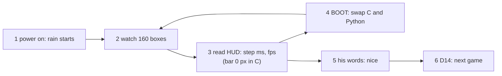
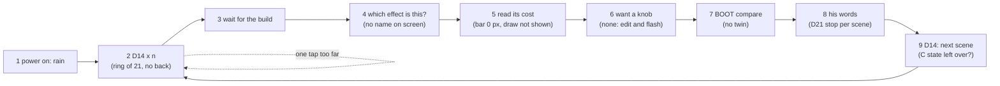

# Jobs and journeys
<!-- Tags as in the brief: E with a pointer, H with its source, D with who and when; an unknown is —. -->

## Who
<!-- One line per persona: who · evidence status (E pointer | H source).
e.g. `- Team leads who assign work · H Lena's belief, no interview yet` -->
- The PO as a player: plays each scene on the board and judges its look and feel · E #794 his words "nice. Alright, I really like it" after the rain, #795
- The PO and the AI as game writers: later take an effect into the engine and a game (RENT first, P583 #784) · E #795 "native effects that we can then later use in the engine"
- His sister, a future player of the area-capture game P585 #786 · H #786, never asked, n = 0; no decision here rests on her <!-- REQUIRED:who -->

## Jobs
<!-- One job story per line, each clause tagged: When …, I want to …, so I can ….
e.g. `- When I assign a task in a meeting [E tickets.csv:6], I want the assignee to see it that day [H Lena], so I can stop chasing people [E tickets.csv:7]` -->
- When the rain showed the C engine on the board [E #794], I want to see ten more native effects, among them fire, smoke, colliding bodies, bodies on fire and water [E #795], so I can enjoy them and judge which are cool [E #795 "cool effects"]
- When I try an effect alone [E #795 "just like with the rain, let's just try the effects themselves"], I want to see what it costs on the board [E #795 Done when: "its cost on screen and in bench.md"], so I can tell which ones fit a game later [H the PO assistant's reading, the council checks it]
- When a game needs an effect later [E #795 "later use in the engine"], I want the effect to be a C piece of the engine that Python starts with a few numbers [E p580-finding.md question 4, Q13 yes 2026-11-02], so I can add it to a game without new C [H, from D12 "every feel number comes from Python"] <!-- REQUIRED:jobs -->

## Today they…
<!-- Per job: what they do instead today (a competitor, a workaround or nothing), tagged.
e.g. `- Job 1 · paste each task into Slack by hand · E tickets.csv:7` -->
- Job 1 · the rain is the one C scene (P593); the games draw their own small effects in Python (gfx.py `Particles`, 40 particles cost 2.27 ms update only) · E games/rain.py, p580-finding.md table rank 2, run46
- Job 2 · the rain's HUD shows the stepper, the step ms and the fps, and bench.md records the run · E games/rain.py docstring, bench.md P593
- Job 3 · no effect exists in C yet; P583 #784 plans effects in C on PIE, first in RENT · E #784, p580-finding.md question 5 <!-- REQUIRED:today -->

## Journeys
<!-- One ### per actor and scenario: the table, then a Mermaid flowchart of the same steps. Never a Mermaid
journey block: it forces a score on every task. "n/a — a one-step job" may replace both.
e.g. `| 2 | opens the app | E analytics, 90 days | never sees the task | not yet | Do they read email? |` -->
Both journeys are drawn from the code and the bench, not from watching him. Nothing was run on the board for them (council/user.md, "What you could not check").

### The PO — tries one effect scene today (the rain) <!-- REQUIRED:journey -->
| step | what they do | evidence | friction or harm | today | open question |
| --- | --- | --- | --- | --- | --- |
| 1 | powers the board, and the rain starts at once | E bench.md:280 "The rain starts at power-on"; games/app.py:40, 52, 59-60 (the index starts at the last game, so the first switch lands on `GAMES[0]`) | none | works | — |
| 2 | watches 160 boxes fall, bounce and respawn | E games/rain.py:28, 33, 98-110 (N 160, seed 593) | the same sequence after every swap, from the fixed seed | works | does a fixed seed get boring? (Q-U3) |
| 3 | reads the HUD line, for example "c step 0.2 ms 24 fps" | E games/rain.py:151, 160-164 | the step bar is 0 px in C mode (`step // 200` with a step of 160 to 170 µs). The draw (13.5 to 14.0 ms) and the HUD (10.6 to 10.9 ms), which set the 24 fps, reach only the serial log | partly | did he read the line at all? (Q-U2) |
| 4 | taps BOOT to swap C and Python | E games/rain.py:118-121 | the only knob: count, gravity and bounce are constants in the file, so a change is an edit and a flash (USER-6) | works | did he press it, and what did he look at? (Q-U1) |
| 5 | says his words | E #794: "nice. Alright, I really like it" | one sentence, n = 1. It names no number and no part of the look (USER-8) | works | — |
| 6 | taps D14 to move on to the next game | E games/app.py:48-49, 59-68 | the switch is silent on screen. A hold of about 5 s powered the board off on 2026-11-02 (USER-1) | works | — |

### The PO — tries ten effect scenes (if each is one more entry in `GAMES`, the shape today's code gives)
| step | what they do | evidence | friction or harm | today | open question |
| --- | --- | --- | --- | --- | --- |
| 1 | powers the board, and the rain starts | E bench.md:280; games/app.py:52, 59-60 | none | works | — |
| 2 | taps D14 n times to reach effect n | E games/app.py:40, 59-68 (`(index + 1) % len(games)`, no back step) | ten more entries make a ring of 21. One tap too far costs the whole ring again (USER-2) | not yet | how many taps does he accept? (Q-U5) |
| 3 | waits while the scene is built | E games/app.py:59-66; bench.md:277 (three games took 16 s instead of 9 s to their first fps line) | — what the panel shows during a switch. The 16 s is time to a log line, not seen on the screen (USER-3) | not yet | — |
| 4 | tries to tell which effect is on screen | E games/app.py:68 (`print("game", ...)` goes to the console); games/rain.py:160-164 (the rain's HUD replaces the name) | no name on the panel, and no "3 of 10" (USER-13) | not yet | — |
| 5 | reads what the effect costs | E games/rain.py:35, 151; bench.md:268-274 | the step bar shows 0 px at C costs, and the draw, which is the larger cost, is not on screen (USER-5) | not yet | is "cheap enough" a number he sets, or the fps he sees? (Q-U10) |
| 6 | wants more fire, less smoke, more bodies | E games/rain.py:27-32 (constants), 118-122 (BOOT is the only input) | no knob. A change is an edit and a flash (USER-6) | not yet | did he wish for a knob in the rain? (Q-U4) |
| 7 | taps BOOT to compare | E bench.md:268-272; games/rain.py:118-121 | most effects have no Python twin, so a C-against-Python swap means writing a second version for it (USER-7) | not yet | what should BOOT mean in an effect scene? |
| 8 | gives his words, scene by scene | E docs/discovery/2026-11-03-engine/brief.md:297 (D21) | ten feel slices are ten "ready to play" stops, serial on his time (USER-10) | not yet | ten turns, a few groups, or one? (Q-U8, Q7 in the brief) |
| 9 | switches to the next scene | E bench.md:276; games/rain.py:44-48 | C state left by the scene before can show as a wrong picture in the next one (USER-12) | not yet | — |

