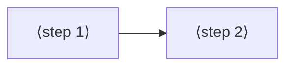

# Jobs and journeys
<!-- Tags as in the brief: E with a pointer, H with its source, D with who and when; an unknown is —. -->

## Who
<!-- One line per persona: who · evidence status (E pointer | H source).
e.g. `- Team leads who assign work · H Lena's belief, no interview yet` -->
- The PO as a player: plays each scene on the board and judges its look and feel · E #794 his words "nice. Alright, I really like it" after the rain, #795
- The PO and the AI as game writers: later take an effect into the engine and a game (RENT first, P583 #784) · E #795 "native effects that we can then later use in the engine"
- His sister, a future player of the area-capture game P585 #786 · H #786, never asked, n = 0; no decision here rests on her <!-- REQUIRED:who -->

## Jobs
<!-- One job story per line, each clause tagged: When …, I want to …, so I can ….
e.g. `- When I assign a task in a meeting [E tickets.csv:6], I want the assignee to see it that day [H Lena], so I can stop chasing people [E tickets.csv:7]` -->
- When the rain showed the C engine on the board [E #794], I want to see ten more native effects, among them fire, smoke, colliding bodies, bodies on fire and water [E #795], so I can enjoy them and judge which are cool [E #795 "cool effects"]
- When I try an effect alone [E #795 "just like with the rain, let's just try the effects themselves"], I want to see what it costs on the board [E #795 Done when: "its cost on screen and in bench.md"], so I can tell which ones fit a game later [H the PO assistant's reading, the council checks it]
- When a game needs an effect later [E #795 "later use in the engine"], I want the effect to be a C piece of the engine that Python starts with a few numbers [E p580-finding.md question 4, Q13 yes 2026-11-02], so I can add it to a game without new C [H, from D12 "every feel number comes from Python"] <!-- REQUIRED:jobs -->

## Today they…
<!-- Per job: what they do instead today (a competitor, a workaround or nothing), tagged.
e.g. `- Job 1 · paste each task into Slack by hand · E tickets.csv:7` -->
- Job 1 · the rain is the one C scene (P593); the games draw their own small effects in Python (gfx.py `Particles`, 40 particles cost 2.27 ms update only) · E games/rain.py, p580-finding.md table rank 2, run46
- Job 2 · the rain's HUD shows the stepper, the step ms and the fps, and bench.md records the run · E games/rain.py docstring, bench.md P593
- Job 3 · no effect exists in C yet; P583 #784 plans effects in C on PIE, first in RENT · E #784, p580-finding.md question 5 <!-- REQUIRED:today -->

## Journeys
<!-- One ### per actor and scenario: the table, then a Mermaid flowchart of the same steps. Never a Mermaid
journey block: it forces a score on every task. "n/a — a one-step job" may replace both.
e.g. `| 2 | opens the app | E analytics, 90 days | never sees the task | not yet | Do they read email? |` -->
### ⟨actor⟩ — ⟨scenario⟩ <!-- REQUIRED:journey -->
| step | what they do | evidence | friction or harm | today | open question |
| --- | --- | --- | --- | --- | --- |
| 1 | ⟨fill⟩ | ⟨tag and pointer⟩ | ⟨fill⟩ | ⟨works, partly, not yet or —⟩ | ⟨fill or —⟩ |

