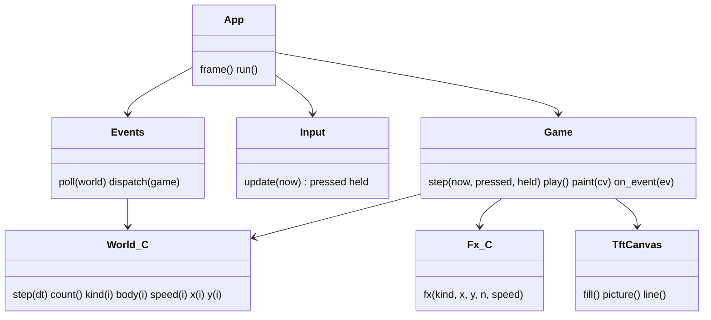
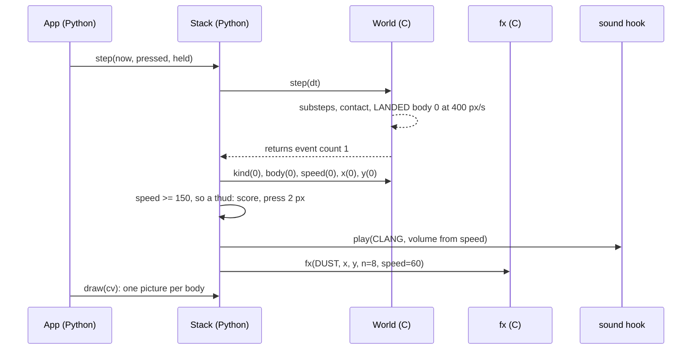
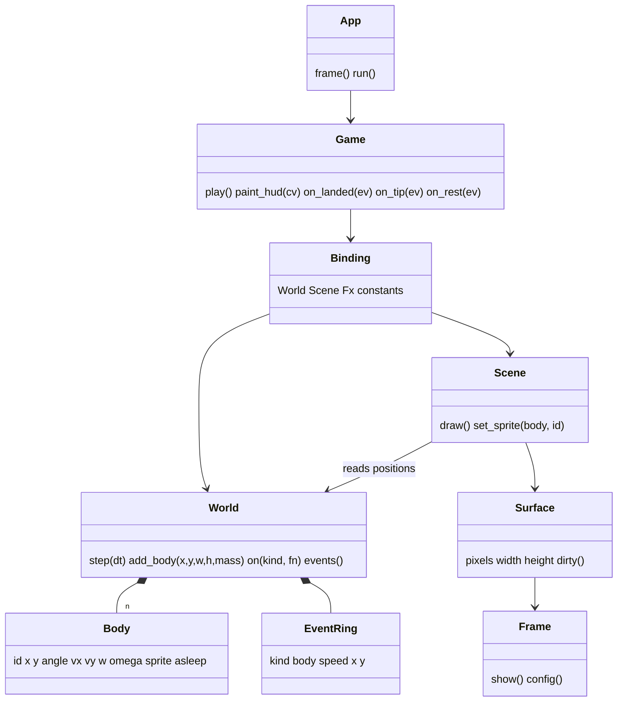
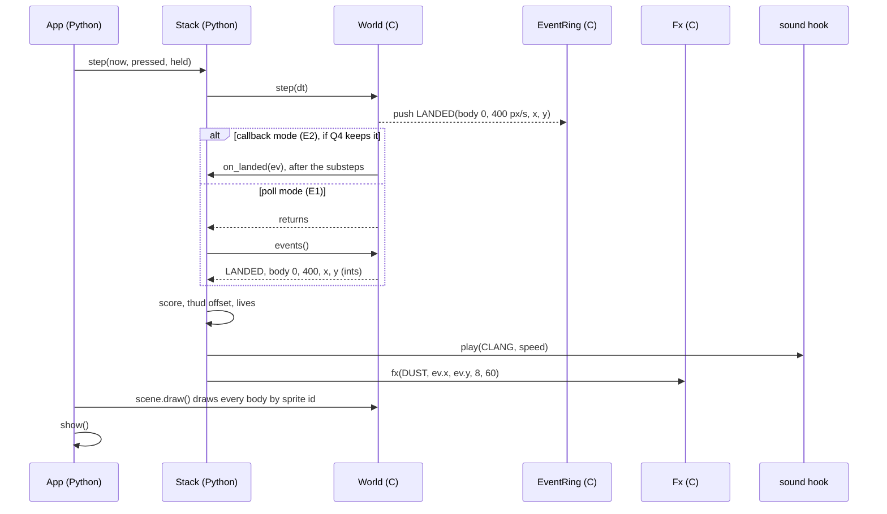
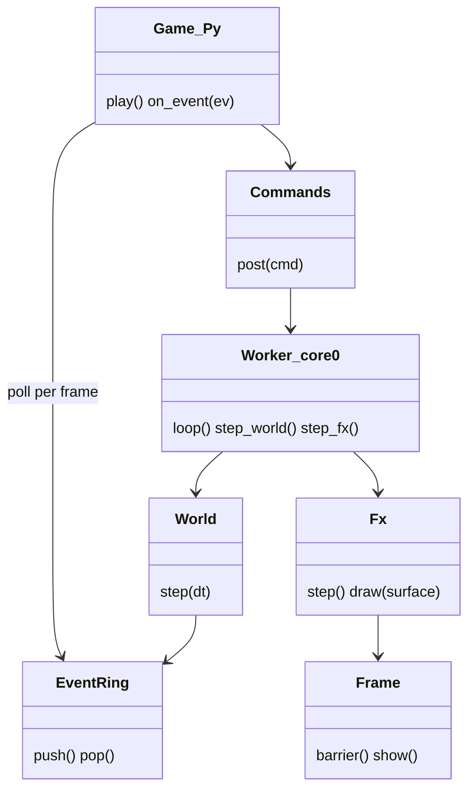
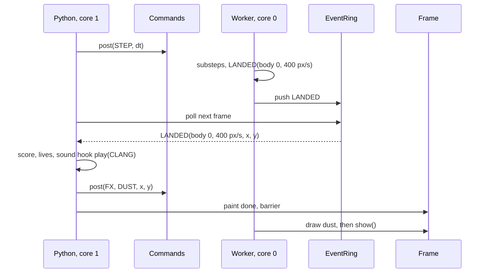

<!-- Resume: invoke product-discovery again; `discovery.py check <this folder>` names the next step. -->
# P586 a small game engine every game shares: discovery brief

<!-- Readiness, its one home. collecting evidence: anything short of the two below. an experiment: the decider chose
a test (a D) before choosing an option. design: the decider confirmed the frame, the jobs and a direction, and accepted
the remaining risk (D rows). An extension may tighten these. Next: design, or a chosen test of kind spike or prototype
→ the design skill the facts name, with this file; otherwise none, and the collection plan says who runs it.
Stands on: the assumptions not retired in risks-and-tests.md; of which those the decider rated high, or — while any
is unrated. check computes both. -->
**Ready for:** an experiment (the probe P589 #790 on the board, first in D19's order; the direction B is chosen, D11, and design follows the probe) <!-- REQUIRED:ready -->
**Stands on:** 10 H, 10 of which would change the decision <!-- REQUIRED:debt -->
**Decision needed:** none now. Q2 to Q12 are answered (D11 to D21). The next decision is the PO's acceptance of the remaining risk after the probe P589 <!-- REQUIRED:decision-needed -->

## Frame
- Request, verbatim (corrections marked): the PO's words of 2026-11-03, verbatim on [#787](https://github.com/xmejkal/spark/issues/787) (E). In short: refactor out the graphics and the physics, at least the C files; a simple game engine the games reuse, that grows with effects, tools and models as needed; an area-capture game built on it (original, not a copy of Xonix, P585 #786) and all games ported to it; map what we need, what exists to reuse, how others do it, the engine's architecture, full collaboration between Python and C, "be able to react both ways"; later physics and joystick control. On the order: "now, be able to react on physical events from python maybe, etc. I'd like the best council to research and analyse and propose and plan with me". Added during the frame (D2, 2026-11-03): "Later we might also add networking and multiplayer rsupport to the engine, or possibly  just first as an mvp separately but then integrate into the engine, also we can offer multiple methods, like ESP-NOW, or some other wayss, pure UDP, we'd see" <!-- REQUIRED:request -->
- Decision · decider: the engine's shape (its modules and their seams, what lives in Python and what in C, how C events reach Python), what its first slice holds, and the order of P584 #785, P587 #788, RENT P582 #783 and P585 #786 on it · the PO <!-- REQUIRED:decision -->
- Outcome and how it is observed (a metric with unit and source, a proof command, or a log): the PO confirms a brief with a needs map, a reuse map, two or three architecture options with a class and a sequence diagram, and proposed cards. Later the engine proves itself when RENT's rigid physics runs on it and Python code reacts to a C event (a landing, a tip-off), at no lower fps than today: stack 24.00 fps in bot run 52 (pixel-games bench.md, P582 section, measured), flappy 20 to 22 fps with framebuffer "double" at the 40 ms pace (bench.md:189, run 44, measured; run 42, with 40 windows and no play, gave 14 to 20 fps, bench.md:187 and the run 42 and run 44 log headers, windows 40 against 4) <!-- REQUIRED:outcome -->
- Already decided (D · who · when · where; include the product's stated non-goals and earlier decisions the request names): the scope on #787 · the PO · 2026-11-03 · #787. The engine comes now, RENT's rigid physics (#783 decisions: overhang whole, tip by centre of weight, rigid thud, 3 lives, topple of rigid pieces) is its first user · the PO · 2026-11-03 · #787 comment. Effects move in C (Q13 yes) · the PO · 2026-11-02 · #771, pixel-games p580-finding.md. A piece enters the engine when a game needs it, never ahead · #787 "Done when". The C layer is where the public graphics library P539 #743 grows, one design · #787 Notes. The games keep their genre's mechanic but are original in name, art and levels · #769, #786. D1 frame (Q0 yes) and D2 networking later, below. <!-- REQUIRED:decided -->
- Open questions: which modules the engine has and which game needs each first; Python or C per module; the event path from C to Python (callback, queue, poll) and its cost per frame; what to reuse (MicroPython game libraries, small C engines) and under which licence; how the C split P587 meets the graphics library P539; where input (buttons, joystick) and sound (P581 #782) plug in; where networking (ESP-NOW, UDP) would plug in later. <!-- REQUIRED:open -->
- Scope · out of scope (proposed): in: the game loop and states, scenes and entities, graphics, effects, rigid 2D physics and collision, input (buttons now, a joystick later), a sound hook, Python and C events both ways, the seams for later networking; the ten games and the area-capture game as its users · out: a spark change, 3D beyond what space3d.py and world3d.py already do, building networking now (D2: later), a copy of any existing game. <!-- REQUIRED:scope -->
- Start and reach (proposed until Q0): start own idea (the PO's) · decider reachable yes · users the PO as player and game writer, n = 1 reachable; his sister is a future player of the area-capture game (#786), never asked, n = 0 · data and connectors: the pixel-games repository (code, tests, bench.md, run logs), the s3lcd fork in it, the web (search and fetch), GitHub (gh), Miro; no analytics or forum data connected · decider as a user n = 1 · must not get worse: today's games and their fps (stack 24, flappy 20 to 22, the games as they play now) <!-- REQUIRED:start-reach -->
- Flags (yes · no · —; asked only when it changes a decision; never legal advice; any date or threshold is read at its source at run time and cited):
  - sold or given away, or personal use: given away as open source (pixel-games is public, MIT) <!-- REQUIRED:flag-sold -->
  - connects to a network or runs software (for example the EU's Cyber Resilience Act): software; no network now, networking later (D2), read at its source only if it decides <!-- REQUIRED:flag-network -->
  - children or food contact: no food contact; a child may play (the sister's game), no decision rests on it now <!-- REQUIRED:flag-children -->
  - market: public on GitHub, worldwide <!-- REQUIRED:flag-market -->
  - radio (unlicensed-device rules; read at their source when it decides): no now; later ESP-NOW or Wi-Fi through the board's own module (D2), read at its source when that card starts <!-- REQUIRED:electronics-firmware:flag-radio -->
  - a Li-ion cell (charging, transport, battery rules): no <!-- REQUIRED:electronics-firmware:flag-li-ion -->
  - mains: no <!-- REQUIRED:electronics-firmware:flag-mains -->
  <!-- EXTEND:flags -->
- Extensions (each active id · the fact that activated it; when none matched, only "none matched: core only · the fact that decided it", naming no extension; list any directive skipped under rule 9): electronics-firmware · "at least the C files", "joystick controll support", "ESP-NOW" (firmware on the ESP32-S3, the C driver, input hardware, radio later); spark-process · "make an epic or update an epic", the item is on spark's board (project 2) <!-- REQUIRED:extensions -->
- The item (its issue, or the proposal in the decider's words) · what is still open elsewhere · the repository's push check, or "no push check here": [P586 #787](https://github.com/xmejkal/spark/issues/787), an epic in Discovery on spark project 2, under #769, slice pixel-games · still open elsewhere: P582 #783 in Build with draft pixel-games PR #10, P469 #637 and P511 #706 in Build, P565 games restyle and P539 graphics library discoveries in pixel-games · pixel-games has no push check: the folder lands by PR <!-- REQUIRED:spark-process:item -->
<!-- EXTEND:frame -->
- Depth: TRIO (default: PO assistant, user, tech lead) | FULL or LIGHT (who asked, when); add "no independent review" if subagents could not start: TRIO plus two researchers (D1, the PO asked for "the best council"): the PO assistant (Opus), the user (Sonnet), the tech lead with the physics lens (Opus), an engine-patterns researcher (Opus), a Python and C events researcher with the later networking seam (Opus); the refuter on Fable 5.1; 6 agents <!-- REQUIRED:depth -->
  <!-- Cost, measured once: the P900 rehearsal's council took 6 agents, 499 calls and about 90M input tokens (2026-10-06). -->
- Search budget: web searches: PO assistant 10, tech lead 8, engine patterns 14, events and networking 12, user 2, refuter 6 <!-- REQUIRED:budget -->
- Appetite (the decider's, asked only when heading for design) | —: — <!-- REQUIRED:appetite -->

## What we found <!-- CLAIMS -->
<!-- One claim per line: `- [★C<n>] claim · E pointer | H source | D who date · caveat: qualifier | none`.
★ marks a claim that a decision, an option or the riskiest assumption rests on. A quote is verbatim, with its pointer.
Say what the evidence can support: an account (what happened to one person), data (how often, in its population and
period), a document (what was specified), the product (what exists, not whether anyone needs it), a benchmark (a
comparison). Model knowledge is H until a source is read. Elsewhere cite a ★ claim as ★C<n>, with its keep: words.
e.g. `- [★C2] 13 of 526 tickets ask for recurring tasks · E tickets.csv:2-14 · caveat: picked by Lena; shows that, not how often` -->
What exists today:
- [★C1] The engine's loop, states and input already exist in Python, and all ten games use them: `gfx.Game` holds TITLE, PLAY and OVER, `step()` with dt clamped at 60 ms, particles and the HUD. `app.App` owns the display, the two buttons, the switch and the 40 ms pace. P584's "one small base class" is this class · E games/gfx.py:277-403, games/app.py:39-112, #785 body (PO-1, PO-2, TL-1, TL-3) · caveat: so P584 is a file split and a tidy, not a new class <!-- REQUIRED:findings -->
- [★C2] RENT's physics module and its events already run in Python, on an unmerged branch: `motion.Bodies` (a fixed pool stepped by one `@native` function) writes the impact speed in px/s into `hit[i]` for one step, and the game reads it after `step()` and calls four moment methods (landing, slab_hit, collapse_start, collapse_hit) · E origin/p582-heavy:games/motion.py:33-57, origin/p582-heavy:games/arcade2.py:222-254, `gh pr view 10 --repo xmejkal/pixel-games` (draft) (PO-3, PO-4, TL-6, EVT-1) · caveat: not on master, and the PO did not accept its feel ("not yet heavy and natural"). It shows a poll works, not that a callback is worse
- [C3] The C driver is one 2,995-line binding file with a separate 592-line frame.c. No C code calls back into Python except file reads for jpg and png · E `wc -l s3lcd/src/*`, s3lcd/src/mpfile.c:65-99, s3lcd/src/frame.h:1-5 (PO-9, EVT-10, ENG-37) · caveat: frame.c includes py/runtime.h, so it is not plain C (EVT-19)
- [C4] "Effects" are two different things today: `gfx.Particles` (40 at most, a visual) and `track.Effects` (timers for game rules, Runner only). Road reads particle state back to decide what to draw · E games/gfx.py:225-258, games/track.py:19-42, games/world3d.py:182-183 (PO-5, TL-5) · caveat: P583's one-way rule ("the game never reads it back") breaks Road unless Road keeps a Python flag

Measured costs:
- [★C5] Python physics costs 57 µs per particle and 114 µs per spring body per update on the board, and 5.69 ms for 30 bodies and 40 particles. `Bodies.step` allocates 544 B per call because each written float is boxed · E bench.md:208-216 (run46, measured), origin/p582-heavy:bench.md:232 (run49, measured) (PO-11, TL-8, TL-12) · caveat: the 114 µs is a `Spring` body in bytecode (probe567), while `fall_bodies` is `@native`. So the only per-body figure for RENT's falling bodies comes from a different function. The @native cost is not measured (TL "could not check")
- [★C6] Stack's pure-play frame is 29.2 ms (step 1.58, paint 22.62, send 3.21, gc 1.78 ms), so 10.8 ms of headroom at the 40 ms pace. In the 9 intervals that hold over or title frames, the slowest frame's step is 0 to 16 ms, and 14 to 16 ms in four of them, which the tech lead attributes to the collapse by interval class · E origin/p582-heavy:bench.md:235-236, run52-p582-bot.log (local and git-ignored, `.gitignore:2:*.log`, so kept on this Mac only), parsed by the tech lead and again by the refuter (42 intervals, 33 of pure play) (TL-9, TL-11) · caveat: a bot played, not the PO. "In the collapse" is an attribution by interval class, not a flag on the frame: a 15 ms step also appears in one pure-play interval. The slowest frames also carry about 9 ms of gc (`slowest 41 = step 14 paint 23 send 3 gc 9`), and the step includes `Pile`'s Python pair scan, which is game logic. So the share a C step would remove is unknown. #783's note estimated 1.6 ms, so the documents disagree (Found on the way F3)
- [★C7] The fps outcome cannot show a gain for stack: the 40 ms pace caps it at 25 fps (calculated), and stack already runs at 24.00 fps with worst gaps of 55 ms on average and 70 ms at most (run 52, measured) · E games/app.py:26, origin/p582-heavy:bench.md:236 (PO-13, USER-19) · caveat: the engine's gain must show in the step ms, the worst gap or a heavier scene (Q11). The worst gap may be paint-bound: one slowest frame is `step 3 paint 42` (refuter part 3)
- [★C8] A Python-to-C call costs 5.5 µs empty, and a canvas call about 98 µs all in, of which about 8 µs is C (measured). From these, one body stepped and drawn from Python costs 183 µs, so 16 bodies fill a 3 ms share of the 10.8 ms headroom (the 3 ms is the tech lead's choice, with no source). A C step with a Python picture call costs 69 µs per body (43 in the same 3 ms). The tech lead reads that only C drawing of the bodies removes the line (calculated, TL-9) · E bench.md:154-163 (PO-12, EVT-17, ENG-28), tech-lead.md TL-9 · caveat: the C step's own time is H, and the reading assumes the call share equals an empty call (H). The 98 µs comes from a runner bench with gc on, and bench.md:160-162 call that price "too high for game conditions". The C-to-Python call is not measured, and the reports disagree on it: the tech lead uses 5.5 µs as a stand-in (TL-14), the events researcher calculates 20 to 60 µs (Q4, A2)
- [★C9] Thin floors tunnel at RENT's speeds: a 40 px drop lands at 400 px/s (16 px per 40 ms step), and a 200 px fall would reach 894 px/s (35.8 px per step, 53.7 px at the 60 ms clamp), against 14 px floors. A step needs 3 to 8 substeps, which at the measured bytecode spring-body cost would be about 7.5 ms for 11 bodies · H calculated by the tech lead from G and HANG in origin/p582-heavy:games/arcade2.py:117-120 and games/gfx.py:326 (PHYS-1) · caveat: calculated, not measured. The 200 px fall has no source in the code (BASE 220 makes it plausible). The 7.5 ms multiplies the `Spring` bytecode cost by substeps of `fall_bodies`, which is `@native`, so it is an upper bound of unknown slack. Today's plane-snap works because each body has one known plane

The events path from C to Python:
- [★C10] MicroPython's scheduler cannot carry game events: its queue holds 8 callbacks on the esp32 port, a full queue drops the new one, and scheduled calls run only between bytecodes, never inside a C call. At most 15 bodies (11 floors and 4 slabs) can hit in one frame, but the collapse releases one floor every 40 ms, so the usual frame carries far fewer · E ports/esp32/mpconfigport.h:73, py/scheduler.c:163-181, docs/library/micropython.rst:204-217 in MicroPython v1.29.0, origin/p582-heavy:games/arcade2.py:128 (RELEASE_MS 40) and :316 (PO-23, TL-14, EVT-4, EVT-5) · caveat: the 15 is a calculated worst case that the game's own rule works against (RELEASE_MS 40, HIT_MS 80). The scheduler is still a poor channel for the other reason: it runs only after the C call returns. It still fits a wake-up from another core (EVT-6)
- [★C11] Floats are boxed in this build (16 B each), and small ints are not. So C events as ints drained into a preallocated `array('i')` allocate 0 B, and a tuple per event allocates 32 B · E ports/esp32/mpconfigport.h:18, py/objfloat.c:55-58, py/mpconfig.h:129, bench.md:155 (EVT-3, the mechanism table) · caveat: the 0 B is read in the source and calculated, not measured on the board. The tech lead marks small-int allocation as H (TL-12)
- [★C12] The two large bindings that call Python from C during an update (Thumby Color's engine and LVGL's) call without an exception guard, so a raise in a handler leaves the C step half done. Thumby boxes five floats and builds a contact object per contact per side. Box2D v3 instead hands contact events to the game as arrays after each step · E TinyCircuits-Tiny-Game-Engine src/physics/engine_physics.c:332-357 at 64b5f0d, lv_binding_micropython gen/gen_mpy.py:2926-2935 at 032dda4b, https://box2d.org/documentation/md_simulation.html read 2026-11-03 (EVT-11, EVT-14, ENG-5, ENG-19) · caveat: the Box2D page was read for its first 100,000 of 166,148 characters, so whether Box2D also offers a callback during the step is unread

Reuse:
- [★C13] One engine gives MicroPython a C core with rigid physics: Thumby Color's Tiny Game Engine. It is GPL-3.0, targets RP2350, Unix and WebAssembly, not the ESP32, and its physics does not turn bodies on contact. MIT engines give loop shapes only: PicoSystem's C loop calls Python `update` and `draw` (RP2040), and 32blit has init, a 10 ms fixed update and render · E `gh api repos/TinyCircuits/TinyCircuits-Tiny-Game-Engine` (GPL-3.0), src/physics/engine_physics.c:210-211, :316-317, picosystem.cpp:86-168, 32blit/engine/engine.cpp:103-146 (ENG-1, ENG-2, ENG-6, ENG-8, ENG-9, PO-15) · caveat: what GPL means for reuse is general knowledge, not legal advice. None of them runs on the S3 as published

Physics libraries:
- [★C14] Three MIT rigid solvers in C exist: Box2D v3 (35,474 lines of .c, float by default, a scalar fallback for Xtensa, events as arrays), Chipmunk2D (10,656 lines, double by default, so an S3 build must set `CP_USE_DOUBLES=0`) and Physac (one 2,134-line header, 64 bodies, its own thread). The S3's FPU is single precision only: the blog's SUM test takes 25 cycles in float and 70 in double, and its cosine test 121 and 1619 · E box2d src/core.h:52-70 at dd8bd3f, chipmunk include/chipmunk/chipmunk_types.h:44-58, physac src/physac.h:23-27, https://developer.espressif.com/blog/2025/10/cores_with_fpu/ read 2026-11-03 (ENG-20, ENG-21, ENG-23, ENG-24, PO-22) · caveat: none was built or timed on the S3. Flash size and step time are —. One search found no ESP32 port of any
- [C15] RENT's tip and topple need angular response to contact, friction and a two-point contact so a box rests flat on a box. A hand-written subset in the style of Box2D-Lite (about a thousand lines) is the usual small path · H the engine-patterns researcher, model knowledge (ENG-25) · caveat: Box2D-Lite was not read

The chip's extra power (D4):
- [★C16] The S3's PIE instructions pay in drawing and compose: fill 5.8 times and copy 9.8 times faster, in cycles per sample on a 16-byte-aligned 128 x 128 RGB565 image, against LVGL's ANSI C, measured by Espressif. The instruction set is a compile-time choice per chip, with a plain C twin beside each fast version (esp-dsp's pattern). They do not pay in a physics step for under 100 bodies or in under about 1,000 particles (H, by count of operations) · E for the first two sentences: council/tech-lead.md CHIP-1 and CHIP-3, graphics-library/council/chip-hardware.md:60, esp-dsp modules/dotprod/include/dsps_dotprod_platform.h:1-40, build.sh:12 (ENG-31). H for the third: the tech lead's count · caveat: 128 x 128 against LVGL's C, not against s3lcd's own fill (ENG-32: "Whether it beats s3lcd's own fill: unknown"). The physics and particle lines are H. The P4 claims come from the earlier chip-hardware report, not re-read
- [★C17] The second core is free of MicroPython: its task runs on core 1. But the paint is Python under a GIL and cannot move, and a C task must never touch a Python object. Core 0 pays only once most of the frame is C · E for the first two sentences: build-s3lcd/sdkconfig:1847, ports/esp32/mphalport.h:51-55, ports/esp32/mpconfigport.h:86, ports/esp32/mpthreadport.c:97-103 (CHIP-4, CHIP-6, EVT-7). H for the third: the tech lead's reading (CHIP-5) · caveat: the games start no Wi-Fi, but what else runs on core 0 is unknown (ENG-35), so "free" is not read from a source. PSRAM contention from core 0 is not probed. P539's brief already lists a second-core worker in the MVP as a proposed no-go

The networking seams (D2):
- [★C18] Today's games are not deterministic across two boards: dt is the wall-clock gap clamped at 60 ms, and effects use unseeded random. The seam costs nothing now if the engine keeps four rules: a fixed-step update, seeded random for state, input as a per-frame record, and state in flat C pools · E games/gfx.py:326, games/gfx.py:244-245, games/app.py:165-171 (NET-8, NET-9), council/events-and-network.md NET-13 · caveat: the four rules are the researcher's synthesis (H). A fixed dt changes how a game feels on a slow frame (Q9)
- [C19] A radio later competes for internal RAM: Wi-Fi takes 10 static RX buffers of about 1.6 KB each from internal DMA RAM, and the largest free internal block is 31,744 B while "double" runs. ESP-NOW's round trip in Espressif's own office test (ESP32 and C3, ESP-IDF v4.4.1, 3 m, 10,000 packets) averaged 4.56 ms, with a 75 ms maximum and 0.11 % loss · E build-s3lcd/sdkconfig:1714-1719, bench.md:186, https://github.com/espressif/esp-now/files/14846115/ESP-NOW.Test.Report.pdf read 2026-11-03 (NET-3, NET-6, NET-7) · caveat: the latency is for the ESP32 and C3 in C firmware, not the S3 in MicroPython. Whether Wi-Fi starts beside "double" is not measured

The process and the player:
- [★C20] The feel changed four times in one day, each as new code: spring press, cut-off slabs, throw, then rigid tip and pivot with lives. Three were the AI's own slices built without his words, and one was a rework after he played once. Slice 1 was played for 3 minutes with no words on the feel. Slices 2 and 3 started by the joint decision D1 of the PO assistant and the tech lead while he was away. Only the fourth change followed his play. He gives feel in words, not numbers, and answers concrete questions about the material with exact rules · E origin/p582-heavy:bench.md:233-234, #783 comments of 2026-11-03 (Prague time, CET: slice 1 played, comment at 00:11, slices 2 and 3 built 07:55, his first feel words 08:30, his material decisions 08:35 and 08:36) (USER-1, USER-2, USER-3, USER-4. PO-25 reads all four as "after the PO played", which these sources do not support) · caveat: one game, one day, n = 1. Three of the four changes were AI guesses with no verdict between them, so they show how fast the AI changed the feel, not how fast he does
- [C21] Each C change is a build and a flash, and deploy traps have hidden void runs (a dropped port, a dark board after a flash). The time of one C cycle is not measured. A natmod avoids the reflash but cannot call firmware symbols, so it cannot draw into the s3lcd frame · E README.md:25-27, bench.md:176, docs/develop/natmod.rst:69-97 in MicroPython v1.29.0 (USER-8, USER-9, PO-10, TL-20, EVT-21) · caveat: a float natmod for xtensawin was not tested
- [★C22] Three claimants share one C layer: the engine (D3), the graphics library P539 (its Q4, C17 or C++17, and Q8, the fork or a new repository, are still queued) and P583's effects. #787 asks for "one design" · E docs/discovery/2026-11-02-graphics-library/brief.md:159-164, #787 Notes (PO-26, TL-21) · caveat: none
- [★C23] D3 reopens a written rule. The earlier council wrote that the C layer "draws, decides nothing". P580 bent it to "decides nothing the game reads". C physics with events breaks it fully. The tech lead offers a wording for the PO: "C computes facts (contact, impact speed, rest, tip), Python decides consequences (score, lives, sound, effects)" · E docs/discovery/2026-11-02-games-restyle/council/tech-lead.md:60, docs/discovery/2026-11-02-games-restyle/brief.md:91, #784 (PO-7, TL-23) · caveat: the wording is a proposal (Q3)
- [★C24] The Mac tests import the game code as plain Python with stubs. On p582-heavy, 42 Mac tests run: test_paint 12, test_motion 13 and test_stack 17. Only the 17 of test_stack cover the pile and the collapse, and the 13 of test_motion cover the bodies' motion. Physics moved into C needs a Python twin or a host build of the C, or loses these tests · E games/fast.py:1-7, origin/p582-heavy:tests/test_stack.py:1-20, the count of `def test_` per file on origin/p582-heavy, #783 comment "42 tests OK" (PO-14, TL-7) · caveat: a twin under CPython uses doubles, so it can drift from the board's float32 (NET-12, A6)
- [C25] Nobody is blocked by the engine today: RENT's slices 1 to 3 ran in Python at 24.00 fps, P585 needs only the base class that exists, and the restyle waits on effects, not on the engine. Build already holds more cards than the limit of 2 · E #783, #786, #784 (PO-24, PO-27) · caveat: whether a rigid pivot topple fits the frame in Python is not measured

Where the reports disagree, each now a question: the cost of a C-to-Python call (TL-14 against the EVT table, Q4 and A2), the order of the cards (the tech lead's "P587 first" against the PO assistant's walking skeleton, Q10), callbacks kept beside a poll in option B (the tech lead) against a poll only (the events researcher, Q4), a fixed internal step (the tech lead) against its cost to today's feel on a slow frame (the events researcher, Q9), a Python twin against a host build for the Mac tests (Q6), the reading of the four feel changes (PO-25 against USER-4 and the refuter, Q1 and Q12), and what the 14 to 16 ms collapse step holds (TL-11 against the refuter, Q11). verification.md lists where the lenses and the refuter agree and split.

## Options <!-- CLAIMS -->
<!-- Two or three per open decision: decision · option · cost · what it would prove · opinion (whose), then the tag
and caveat cells. e.g. `- Q2 what first · fix delivery · two weeks · whether seen tasks get done · opinion (the facilitator's) · H ★C2 · caveat: none` -->
Every option below is a proposal. None is chosen. Each keeps Python for the loop, the states, the rules, the scores and the lives (tech-lead.md part 1b).

The architecture (Q2):
- Q2 architecture · A: Python engine over C kernels. A Python `engine/` package (loop, clock, input, Game and Scene base, an events dispatcher, a World facade) over a C `World` kernel with `step(dt)` and an event buffer, plus P583's `fx()`. Python draws each body from the world's int positions · cost: the least new C (a few hundred lines, H, the tech lead's estimate). A natmod variant needs no reflash (TL-20) · proves: the C step and the event path, with no change to drawing · opinion (the tech lead): the cheapest proof, capped near 43 bodies in a 3 ms share by the per-body picture call · H ★C8 (the 3 ms is the tech lead's choice, and the C step's own time is H) · caveat: the line is calculated, and the C step time is not measured <!-- REQUIRED:options -->
- Q2 · B: C world and scene, Python writes the rules (D3: the PO said it "might make sense"). A C `engine` with a World (rigid bodies, contacts, an event ring), a Scene that draws bodies by sprite id into the s3lcd surface, and P583's Fx, behind one thin binding file. Python keeps the loop, the states, input and the handlers. Events reach Python by a callback per event or by one poll (Q4 open). About 3 C calls per frame, whatever the body count (the tech lead's design intent, H) · cost: the most new C of A and B (world, scene, binding), the rule change of ★C23 (the wording is a proposal), and a twin or host build for the Mac tests (★C24: 42 Mac tests, of which the 17 of test_stack cover the pile and the collapse) · proves: Python reacts to a C event at a fixed cost per frame, and the body count stops costing Python time · opinion (the PO, D3, as a wish): "the core of the engine and the various parts of it to be in C". The tech lead names it "D3 as written" · H ★C8 (the 3 ms is the tech lead's choice, and the C step's own time is H), ★C23 (the wording is a proposal) · caveat: A1, the proposed riskiest, asks whether the feel stays in Python under any C step. It weighs most where each C change needs a reflash, as in B
- Q2 · C: B plus a worker task on core 0 that runs the world step and effects, driven by a command queue. Events return one frame late through a lock-free ring that Python drains · cost: the highest (B, plus the task, a barrier per frame, a second PSRAM frame if the copy moves) · proves: whether core 0 buys frame time · opinion (the tech lead): it buys little until most of the frame is C (CHIP-5), a later rung with a probe first · H ★C17 (what else runs on core 0 is unknown) · caveat: PSRAM contention is not probed. P539's brief lists a second-core worker in the MVP as a proposed no-go. The radio shares core 0 later (D2)

The event path from C to Python (Q4):
- Q4 event path · E1: C writes events as ints (kind, body id, speed in px/s, x, y) into a buffer, and Python drains it once per frame into a preallocated `array('i')`, right after the step · cost: one Python-to-C call per frame (about 5.5 µs, measured) plus the Python loop over the events · proves: 0 B per event and an exception raised in game code after a clean C step · opinion (the events researcher, mechanism A, EVT-24, and the PO assistant, PO-4: the poll already works): the safe default. Box2D v3 does the same (ENG-19) · E bench.md:156 · caveat: 0 B is calculated, not measured on the board (★C11)
- Q4 · E2: C calls a Python handler synchronously for each event inside the step (`world.on(LANDED, handler)`), as Thumby Color and LVGL do · cost: one C-to-Python call per event (5.5 µs stand-in or 20 to 60 µs calculated, not measured) and an exception guard (`nlr_push`) the precedents lack · proves: the reading "react both ways" in its most direct form · opinion (the tech lead): a mode beside the poll in option B. The events researcher: fits a few events, not a storm, and risks re-entry · H ★C12 (the Box2D page was read for 100,000 of 166,148 characters) · caveat: neither precedent guards the call
- Q4 · E3: C schedules a Python callback through `mp_sched_schedule` · cost: none to build · proves: nothing new · opinion: ruled out as the event channel by the PO assistant (PO-23), the tech lead (TL-14) and the events researcher (EVT-5): 8 slots, a full queue drops the event, and it runs only after the C call returns. It fits only as a wake-up from core 0 (option C) · E ports/esp32/mpconfigport.h:73 · caveat: none

The physics source (Q7), all MIT:
- Q7 physics source · S1: own small C solver in the style of Box2D-Lite (oriented boxes, a separating-axis test, two-point contacts, sequential impulses), grown piece by piece as RENT needs it · cost: about a thousand lines (H), written and tuned here · proves: a solver sized to the games, with nothing unused · opinion (the engine-patterns researcher): "the usual small path" (ENG-25). The PO assistant's pre-mortem warns that a general solver becomes the rabbit hole (PO-30 cause 2) · H C15 · caveat: Box2D-Lite was not read
- Q7 · S2: a Box2D v3 subset (float, scalar fallback, events as arrays after the step, bodies by id) · cost: 35,474 lines of .c to trim. Flash size and step time on Xtensa are — · proves: a proven solver with stable stacking · opinion: no report recommends it whole. The engine-patterns researcher lists it as code to take whole or trimmed · E box2d src/core.h:52-70 · caveat: no ESP32 port or benchmark was found, and none was built or timed on the S3 (★C14)
- Q7 · S3: Chipmunk2D, built with `CP_USE_DOUBLES=0` · cost: 10,656 lines. Every step pays software double if the flag is missed · proves: a smaller proven solver · opinion (the engine-patterns researcher): a smaller MIT option with a known float trap · E include/chipmunk/chipmunk_types.h:44-58 · caveat: no ESP32 port found, and none was built or timed on the S3 (★C14)

Where the engine's C lives (Q8, tied to P539's Q4 and Q8):
- Q8 C home · H1: inside the s3lcd fork, as more files after the P587 split · cost: a new line in micropython.cmake per file, no build change · proves: one module, one image, one design with the library · opinion (the tech lead): P587 first, then more files or a second module (TL-19) · E s3lcd/src/micropython.cmake:5-20 · caveat: physics must not include frame.h, or the core takes MicroPython types (TL-18)
- Q8 · H2: a second user C module `engine` beside s3lcd · cost: a top-level micropython.cmake that includes both, and one line in build.sh. The engine reaches the frame through s3lcd.h · proves: a hard seam between the graphics library and the engine · opinion (the tech lead): feasible (TL-17, TL-18) · E build.sh:13-15, s3lcd/src/s3lcd.h:96 · caveat: it answers P539's Q8 in part
- Q8 · H3: a natmod (a `.mpy` with native code) for the physics kernel while the feel is tuned · cost: no reflash per change · proves: a fast feel loop · opinion (the tech lead): fits option A only, because a natmod cannot call firmware symbols or draw into the frame (TL-20, EVT-21) · E docs/develop/natmod.rst:89-97 · caveat: a float natmod for xtensawin was not tested (C21)

The order of the cards (Q10):
- Q10 order · O1: the walking skeleton first: P588 and P589, then P590 (today's `fall_bodies` in C), then P592 (RENT's tip and topple on the C path), then P584, P587, P585 · cost: RENT's material slice waits for the C path · proves: the C path, the binding, the events and the twin in one small slice before any rigid solver · opinion (the PO assistant, PO-32) · H ★C2 (not on master), ★C5 (the @native cost is not measured) · caveat: Build is already over its limit (C25)
- Q10 · O2: RENT first in Python: finish #783's material slice on motion.py and merge PR #10, then move the step to C · cost: the C move rewrites motion code once more · proves: the feel before the engine, at today's cost · opinion (the PO assistant asks it, PO-24 and PO-25: nobody is blocked, the feel changes fast) · E #783 · caveat: whether a rigid pivot topple fits the frame in Python is not measured
- Q10 · O3: the C split first: P587, then the skeleton in the split, P584 in parallel, P585 last · cost: the engine waits for a move of C code with no behaviour change · proves: a clean C layer before new C · opinion (the tech lead, TL-19) · E #788 · caveat: P587 names no physics file yet

The three options, each drawn as a proposal from tech-lead.md part 1b, side by side. None is chosen, and none leads. Each shows the end state of its option. Slice 0 (story-map.md, P590) changes no drawing, so it looks like option A in every case.

Option A, a proposal: Python engine over C kernels. Python polls the events and draws one picture per body.

Option B, a proposal: C world and scene, Python rules. This is the tech lead's B. Its World offers `on(kind, fn)` for callbacks and `events()` for a poll, because Q4 is open. The sequence shows both modes. The poll branch is drawn from tech-lead.md:130 ("or by one poll"), not from the tech lead's diagram.

Option C, a proposal: B plus a worker on core 0. Python posts commands and polls the events one frame late.

The sound hook is a name only until the buzzer exists (P581 #782). The numbers 150 px/s and 80 ms are RENT's thresholds in Python today (origin/p582-heavy:games/arcade2.py:130), not C constants. The first synthesis drew a B that grafted option A's dispatcher (`Events { drain, dispatch }`) onto B's C scene and dropped the callback mode before Q4 was answered. These diagrams replace it.
- Proposed no-gos and rabbit holes (proposals until the decider confirms): no-gos: a general rigid-body solver ported whole before RENT needs its pieces (PO-30 cause 2, PO-33). Code copied from GPL engines such as Thumby Color's (ENG-1). A worker on core 0 before a probe shows a gain (CHIP-5, P539's proposed no-go). Feel numbers (gravity, bounce, tip angle, thresholds) as C constants (PO-6, PO-30 cause 1). Rabbit holes: stable stacking at a 40 ms step with a 60 ms clamp (PO-30, PHYS-1). A binding that crosses per body or per attribute every frame (PO-29, ★C8: the 3 ms is the tech lead's choice, and the C step's own time is H). Designing the networking sync model before a networking card (D2, NET-13) · H the synthesis, from the reports named in each · caveat: proposals until the PO confirms them <!-- REQUIRED:nogos -->

## Riskiest assumption and its test
- Riskiest: A1, restated after the refuter: the PO's material rules for RENT (his decisions on #783, 2026-11-03) split into a C mechanism that reports facts (contact, impact speed, rest, tip) and Python reactions or numbers, so a later feel note of his needs no C change. It matters for every option, because A, B and C all step in C. It matters most where a C change needs a reflash (B, C, or A without a natmod: C21, A8). With A and a natmod, A1 matters less (refuter part 5). It rests on ★C23 (the rule D3 reopens, and the wording is a proposal), PO-6 (he accepted numbers from Python for effects) and ★C20 as restated: each of the four changes was new code, but three were the AI's own slices built without his words. So the four past changes are not a sample of his feel notes, and they no longer show that A1 has the least evidence. The rival (USER-2, USER-4, refuter part 3): the churn came from slices built without his words, and the remedy is to ask before a slice (Q12), not a property of the engine. Under the rival, A1 is less risky than it looked. The other candidates: A5, because the slowest frames may be paint-bound or gc-bound, so a C step may not change the worst gap (★C6: a bot played, and the share a C step would remove is unknown. ★C7: the worst gap may be paint-bound), and A2 and A3, the step cost (the tech lead's, probe P589) · D6 (the PO chose A1 as the riskiest, first proposed by the PO assistant, PO-28) <!-- REQUIRED:riskiest -->
- Test · kind · pass line, dated before any result · proposed | D<n>: P588: list every dated feel note of the PO on RENT first (#774, #783, bench.md) and fix the count before any sort. Then sort each note, assuming the engine's rigid C mechanism exists (rigid boxes, contacts, the tip at the centre of weight), as "Python number or reaction" or "new C mechanism". A note that needs a fact the draft API lacks (for example a lean or overhang fact) counts as new C. He reads the table and marks each sort he disagrees with. Desk only, no board · kind: data mining of his own dated words, desk only · pass line: at most 1 in 4 notes needs a new C mechanism, and he disagrees with at most 1 sort, set by the PO on 2026-11-03 before any result · D7 (replaces D6's table of #783 rules, whose line let a table pass with every rule in C, refuter second pass) <!-- REQUIRED:test -->

## Questions
<!-- A queue; the first open question is asked alone. Each: Q<n> · question · decides: … · options · unblocks ·
opinion (whose) · kind: decision | account (a past-tense question about the decider's own use; the answer is E,
account, n = 1) · status: queued | asked <date> | answered D<n>.
If the decider cannot be asked, the queue stays here, and whatever rests on it stays H. -->
- Q0 · Is this frame right: the decision, the start and reach, the extensions and the depth? · decides: the frame · status: answered D1 <!-- REQUIRED:q0 -->
- Q1 · How important is each assumption, and what pass line must the riskiest test meet? · decides: importance and pass lines · status: answered D5 (all high), D6 (A1 riskiest) and D7 (the test and pass line, replacing D6's) <!-- REQUIRED:q1 -->
- Q2 · Which shape for the engine? Example: floor 3 lands in RENT. In A, C steps floor 3 and Python draws it every frame. In B, C steps floor 3 and draws it from its sprite id, and Python gets the event "floor 3 landed". In C, a task on the other core steps the world, and Python gets the event one frame later. The three are drawn side by side under Options. P590 (slice 0) serves all three: it moves the step into C and changes no drawing, which is A's shape and the first rung of B or C. The 3 ms share that caps A near 43 bodies is the tech lead's choice, not a measured limit (★C8: the 3 ms is the tech lead's choice, and the C step's own time is H) · decides: the architecture and how much new C · options: A Python engine over C kernels, B C world and scene with Python rules, C as B plus a worker on core 0 · unblocks: P590, P592 · opinion (the PO, D3): it "might make sense" for the core to be in C, which is B. The tech lead: A is the cheapest proof, C a later rung · kind: decision · status: answered D11
- Q3 · Which rule replaces "the C layer draws, decides nothing the game reads"? Example: C says "floor 3 landed at 400 px/s", and Python decides "that is a thud, no life lost, 8 dust particles". Under the tech lead's wording C never decides the thud · decides: whether C physics with events is allowed, what never moves to C, and whether every feel number comes from Python · options: "C computes facts, Python decides consequences" (the tech lead's wording), keep today's rule, his own wording · unblocks: P588, P590 · opinion (the tech lead, TL-23, and the PO assistant, PO-7): a new rule is needed before design · kind: decision · status: answered D12
- Q4 · How does a C event reach the game? Example: in a collapse at most 15 floors and slabs can hit in one frame, but the collapse releases one floor every 40 ms, so most frames carry far fewer. The 15 is a worst case (★C10). With a buffer, Python reads the rows of ints once after the step. With callbacks, C calls Python once per event in the middle of the step, and a mistake in one handler stops the step half done · decides: the binding's shape, its cost per event and how a game extends a body (subclass, callback slot or a Python object that holds an id) · options: E1 int buffer drained once per frame, E2 a synchronous callback from C, both · unblocks: P590 · opinion (the events researcher and the PO assistant): E1. The tech lead: both modes in B. E3, the scheduler, is ruled out by three reports · kind: decision · status: answered D13
- Q5 · Does RENT's first engine slice hold only today's falling bodies, or also the rigid tip? Example: slice 0 moves the 25 lines of `fall_bodies` to C and changes nothing you see. The tip and topple come next on that path, or are built first in Python on motion.py · decides: slice 0's scope and whether feel work waits on C · options: falling bodies only, with the tip next (PO-32), the tip in Python first, the tip in C at once · unblocks: P590, P592, #783 · opinion (the PO assistant): falling bodies only · kind: decision · status: answered D14
- Q6 · How do the physics tests keep running on the Mac? Example: today the 17 tests of test_stack.py (the pile and the collapse) and the 13 of test_motion.py run in seconds on the Mac, of 42 Mac tests in all (★C24: only the 17 of test_stack cover the pile and the collapse). With the step in C they need a Python twin of the step (which can drift by float rounding), a Mac build of the same C, or the board · decides: the test cost of every C piece · options: a Python twin, a host build of the C, board-only tests · unblocks: P590 · opinion (the PO assistant): a twin. The tech lead: a twin or a host build · kind: decision · status: answered D15
- Q7 · Where does the rigid physics come from? Example: for a floor that tips over its edge, write about a thousand lines ourselves, trim the 35,000 lines of Box2D v3, or build Chipmunk2D with floats · decides: flash, memory per body and the work before RENT runs on the engine · options: S1 own small solver, S2 a Box2D v3 subset, S3 Chipmunk2D · unblocks: P591, P592 · opinion (the engine-patterns researcher): S1 is the usual small path. The PO assistant warns a general solver is the rabbit hole · kind: decision · status: answered D16
- Q8 · Where does the engine's C live, and do P539's Q4 (C17 or C++17) and Q8 (the fork or a new repository) get answered first? Example: the step file sits in s3lcd/src beside frame.c after the P587 split, or in a new engine/ module that takes the frame through s3lcd.h · decides: the build change and one design with the graphics library · options: H1 inside the fork, H2 a second module, H3 a natmod while the feel is tuned (option A only) · unblocks: P590, P587 · opinion (the tech lead): P587 first, then either · kind: decision · status: answered D17
- Q9 · Does the world step on a fixed internal step with substeps, apart from the 40 ms pace? Example: a floor that has fallen 200 px (an assumed height, ★C9: calculated, not measured) moves 54 px in one 60 ms frame, past a 14 px floor. A fixed 10 ms step runs 6 small steps instead, and the same inputs give the same result on every run · decides: tunnelling, repeatable tests and the networking seam · options: fixed step with substeps, today's clamped dt, swept tests on today's dt · unblocks: P592 · opinion (the tech lead): a fixed step. The events researcher: it changes how today's games feel on a slow frame · kind: decision · status: answered D18
- Q10 · In which order do the cards go? Example: the walking skeleton first, RENT's material in Python first, or the C split P587 first · decides: the order of P584 #785, P587 #788, P582 #783, P585 #786 and the new cards · options: O1 skeleton first, O2 RENT first, O3 C split first · unblocks: the order of Ready · opinion (the PO assistant): O1. The tech lead: O3 · kind: decision · status: answered D19
- Q11 · What does the engine prove itself by, since stack already sits at the 25 fps cap? Example: stack shows 24 fps before and after, but the slowest frame's step drops from 16 ms to 2 ms. Split folded in here: the tech lead attributes the 14 to 16 ms to the collapse physics (TL-11). The refuter finds about 9 ms of gc in the same slowest frames, a 15 ms step in one pure-play interval, and a slowest frame of paint 42 ms in another, so the share a C step would remove is unknown (★C6: a bot played. ★C7: the worst gap may be paint-bound) · decides: the outcome metric and A5's pass line · options: the step ms in the `time` line, the worst gap, a heavier scene at the same fps · unblocks: P590, P592 · opinion (the PO assistant, PO-13): not fps · kind: decision · status: answered D20
- Q12 · When the AI built slices 2 and 3 while you were away, what would you have wanted it to wait for? Example: slice 1 ran for 3 minutes with no words from you on the feel. Slices 2 and 3 were built anyway, and your words after playing replaced them in part · decides: whether an engine slice waits for his feel words before the next one, and so whether A1's risk sits in the engine or in the way of working (the refuter's rival, ★C20: three were the AI's own slices) · options: wait for his words, go on and mark the slice as not yet judged, ask one concrete material question first · unblocks: Q1's choice of the riskiest, P592 · opinion (the user lens, Q-U4 and USER-4): ask before the slice · kind: account · caveat: he ordered the AI to go on in auto mode (#783, 2026-11-03 00:11 CET), so a wait he wanted is not shown · status: answered D21

## Decisions
<!-- D<n> · what · who · when · where recorded · options considered.
A yes covers only the actions and choices it names. A standing yes names its kind of action and its source.
Name what a D confirms in its words: the frame, the jobs, a direction, the remaining risk, a test, items.md. -->

- D1 · the frame confirmed (Q0 yes): scope, start and reach, extensions, 6-agent council · the PO · 2026-11-03 · this session, AskUserQuestion · options: as written, FULL, change scope
- D2 · networking and multiplayer later (ESP-NOW, plain UDP, others), possibly first as a separate MVP that the engine absorbs; the architecture leaves a seam for it, nothing is built now · the PO · 2026-11-03 · this session, his message during the frame
- D3 · direction wish: the engine's core and its parts in C, highly optimized, with a MicroPython binding that lets the games use it easily, clearly and readably, and that is easy to extend; the PO's words: "Actually, it might make sense for the core of the engine and the various parts of it to be in C and higly optimised but the micropython have great binding and access to it, so the games really can interact with it easily and clearly and readably and its nicely extendable, etc" · the PO · 2026-11-03 · this session · his words say it "might make sense": the council tests it as one option beside others; it is not a chosen design (wording corrected after the refuter, 2026-11-03)
- D4 · wish: the engine uses each chip's extra power when it recognizes it (the S3's PIE instructions now, the P4's larger set later, the second core), so it detects possible optimizations and uses them; the PO's words: "And it would be great if it could use the s3 instructions when it recognizes it, the p4 will also have some more, etc, so if it can detect possible optimizations and use the second core or the extra instructions, etc.." · the PO · 2026-11-03 · this session · passed to the tech lead and the engine-patterns researcher while they ran; not yet a chosen design
- D5 · importance: all four groups of assumptions are high (feel and value A1 A5, speed A2 A3, build and tests A4 A6 A8, later and licence A7 A9 A10) · the PO · 2026-11-03 · this session, AskUserQuestion Q1a (multi-select) · options: the four groups
- D6 · the riskiest is A1, and its test is the desk table P588: his own RENT rules from #783 sorted as C mechanism, C fact or Python reaction or number, and he marks the sorts he disagrees with; pass line: no number of his has to live in C, no rule needs a fifth fact, and he disagrees with at most 1 sort · the PO · 2026-11-03 · this session, AskUserQuestion Q1b · options: A1 desk table, A2 and A3 board probe P589, A5 split of the worst frames · confirms a test, not an option
- D7 · P588's test and pass line replace D6's: P588: list every dated feel note of the PO on RENT first (#774, #783, bench.md) and fix the count before any sort. Then sort each note, assuming the engine's rigid C mechanism exists (rigid boxes, contacts, the tip at the centre of weight), as "Python number or reaction" or "new C mechanism". A note that needs a fact the draft API lacks (for example a lean or overhang fact) counts as new C. He reads the table and marks each sort he disagrees with. Desk only, no board. Pass: at most 1 in 4 notes needs a new C mechanism, and he disagrees with at most 1 sort · the PO · 2026-11-03 · this session, AskUserQuestion Q1c, asked again because the refuter's second pass showed D6's line let a table pass with every rule in C · options: sort feel notes, rules plus a bound, skip to the probe P589 · D6's choice of A1 as the riskiest stands
- D8 · the understanding confirmed (the jobs, the findings, options A, B and C open, P588 first); yes to file P588 to P592 under #787 (Slice pixel-games), open the PR for this folder, comment on #787, and run P588 with him now · the PO · 2026-11-03 · this session, AskUserQuestion handoff · options: file all and PR and run P588, file spikes only, PR only, understanding off · confirms the frame, the jobs and items.md; not a direction among A, B and C
- D9 · P588 result: the PO agreed with all 17 sorts in p588-feel-notes.md, so A1 passes D7's line (4 of 17 new C against 4.25, 0 disagreements against 1). The narrow margin and its caveats stay: the split rule (n = 14 would fail), the 4 new-C notes are in the team's words, the team wrote the draft API. The 4 new-C notes add a lean fact, turned-box contact and sliding friction to the C mechanism · the PO · 2026-11-03 · this session, AskUserQuestion P588 marks 1 and 2 · confirms a test result, not an option
- D10 · yes to the card changes in items.md for #785, #788, #783, #786, #784 · the PO · 2026-11-03 · recorded on #787 · confirms items.md changes
- D11 · direction (Q2): option B, a C world and scene with Python rules, is the goal; P590 builds option A's first rung (the step in C, drawing unchanged), then drawing moves to C · the PO · 2026-11-03 · this session, AskUserQuestion Q2 · options: A, B, C · confirms a direction
- D12 · the rule (Q3): "C computes facts (contact, impact speed, rest, tip). Python decides consequences (score, lives, sound, effects)." Every number tuned by feel comes from Python · the PO · 2026-11-03 · this session, AskUserQuestion Q3 · options: facts in C, keep today's rule, facts and tuning in C
- D13 · the event path (Q4): E1, C writes events as ints into a buffer and Python reads it once per frame after the step · the PO · 2026-11-03 · this session, AskUserQuestion Q4 · options: E1 buffer, E2 callbacks, both
- D14 · slice 0 (Q5): P590 holds only today's falling bodies in C, with no visible change; the rigid tip (P592) is the next slice on the C path, the topple after it · the PO · 2026-11-03 · this session, AskUserQuestion Q5 · options: falling only, tip in Python first, tip in C at once
- D15 · the Mac tests (Q6): a Mac build (clang) of the same C; the core holds no MicroPython or display types · the PO · 2026-11-03 · this session, AskUserQuestion Q6 · options: Mac build, Python twin, board only
- D16 · the physics source (Q7): our own small solver, behind a swappable interface (step, bodies by id, the event buffer) so that Box2D or Chipmunk2D can replace it later; ideas taken from Box2D-Lite, Box2D v3 and Chipmunk2D; chip fast paths (the S3's PIE is integer SIMD, so its path needs fixed-point; P589 measures float against fixed-point). The PO's words: "I don't want to reinvent the wheel and we want to keep it possible to switch to another, but lets start with our own one, that can really use the s3 and other specific features of the chips. And we definitelly can get inspired by whats already out there" · the PO · 2026-11-03 · this session, his message after Q7 · options: S1 own, S2 Box2D v3 subset, S3 Chipmunk2D
- D17 · the C home (Q8): H2, an own `engine` C module beside s3lcd: core/ in plain C (Mac and board), port/s3/ for fast paths, one thin binding file; it reaches the screen only through s3lcd.h · the PO · 2026-11-03 · this session, AskUserQuestion Q8 · options: H2 own module, H1 inside the fork, H3 natmod
- D18 · the time step (Q9): a fixed 10 ms step, as many steps as the frame needs, with a cap (about 8) so a slow frame cannot snowball · the PO · 2026-11-03 · this session, AskUserQuestion Q9 · options: fixed step, today's clamped dt, swept tests
- D19 · the order (Q10): O1 walking skeleton: P589, P590, P592 (the PO plays), P584, P587, P585 · the PO · 2026-11-03 · this session, AskUserQuestion Q10 · options: O1, O2 RENT in Python first, O3 C split first
- D20 · the proof (Q11): P590 passes when the step ms in the time line drops and fps stays the same; P592 passes when a heavier rigid collapse keeps fps at 24 or more; both measured by the bot on the board · the PO · 2026-11-03 · this session, AskUserQuestion Q11 · options: step ms and a heavier scene, worst gap only, fps only
- D21 · feel slices (Q12): a slice that changes the feel stops at "ready to play"; the next feel slice starts only after the PO played it and gave his words; work that changes no feel goes on · the PO · 2026-11-03 · this session, AskUserQuestion Q12 · options: wait for his words, ask one question then go, go on and mark not judged

## Found on the way <!-- CLAIMS -->
<!-- Outside this item's scope. Each is a separate proposal, never folded in. Same line format as What we found. -->
- [F1] A tap in the first 900 ms of game over is ignored, and short-round games like RENT spend a share of each round in this lock · E games/gfx.py:287-288 (USER-17) · proposal: P578, already proposed in the restyle discovery · caveat: whether he met it is — (Q-U7) <!-- REQUIRED:found -->
- [F2] Road reads particle state back to decide what to draw, so P583's one-way effects rule breaks Road when particles move to C · E games/world3d.py:182-183 (TL-5) · proposal: a note on P583 #784 that Road keeps a Python flag · caveat: none
- [F3] #783's note estimates RENT's physics at about 1.6 ms for 14 floors, and run 52 measured 14 to 16 ms in the collapse frames · E #783 body, origin/p582-heavy:bench.md:236 (TL-11) · proposal: correct the note on #783 · caveat: the estimate left out the pile loop, the pair scan and the bursts, so the documents measure different things
- [F4] The game switch is a one-way cycle on D14, and an eleventh game adds one more press · E games/app.py:70-79 (USER-16) · proposal: a game picker card after P585, if Q-U6 shows the cycle is slow · caveat: whether the PO or his sister finds it slow is —

## Board actions <!-- REQUIRED:spark-process:board-actions -->
<!-- Each action on the board or the issue (stage, waiting flag, comment, filing): taken, with its D, or pending.
None is taken without a D. e.g. `- move #16 to Discovery · pending` -->
- comment on #787 with the brief's link, the options and the queue · taken after the PR opens, D8
- set Waiting on the PO on #787 · not taken: Q1 is answered, and P588 runs with him in this session (D8)
- file P588 to P592 (items.md) as sub-issues of #787 · taken: #789 to #793, Idea, Slice pixel-games, D8
- apply the proposed changes to #785, #788, #783, #786, #784 (items.md) · taken, D10
<!-- EXTEND:brief-sections -->

## Hand-off
<!-- Written only after the decider confirms the understanding (a D); copies only confirmed constraints. Holds: outcome ·
who · success and its proof · constraints (appetite, confirmed no-gos, rabbit holes) · what they said (D) against what
we assume (H) · links to the journeys and the map · riskiest assumptions and their tests · options considered. -->
Outcome: an engine that every game shares, grown from gfx.Game and app.App, with RENT's rigid physics as its first user and Python reacting to C events (D1, D8). Who: the PO as game writer and player, n = 1 (his sister n = 0). Success and proof: the Outcome line in the Frame, with Q11 still open on the metric. Constraints: networking is a seam only now (D2), a C core with a readable binding is a wish (D3), chip fast paths are a wish (D4), no GPL code (A10, proposed). Said (D): D1 to D8. Assumed (H): A1 to A10, all high (D5). Riskiest: A1, tested first by P588 #789 with D7's pass line. Options considered: A, B and C, all open (Q2), with Q3 to Q12 queued. Journeys: jobs-and-journeys.md. Map: story-map.md, proposed, not applied <!-- REQUIRED:handoff -->

## Files
[Jobs and journeys](jobs-and-journeys.md) · [Story map](story-map.md) · [Risks and tests](risks-and-tests.md) · [Verification](verification.md) · [Items](items.md) · council/
