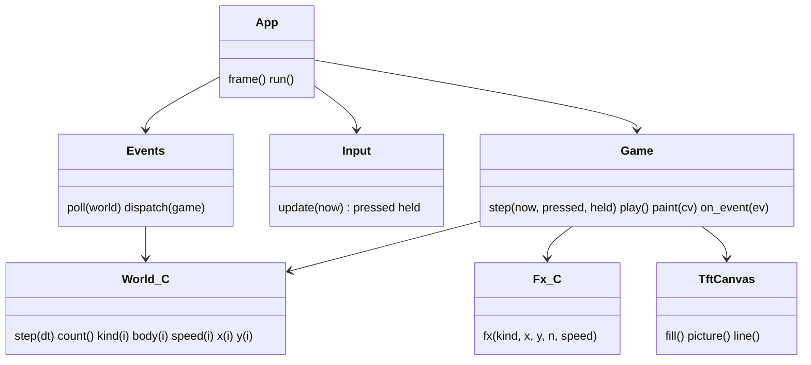
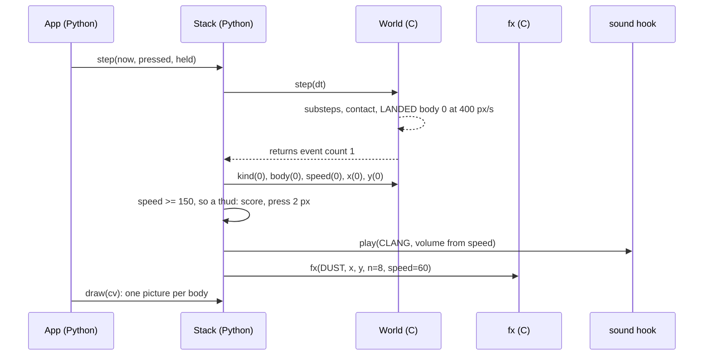
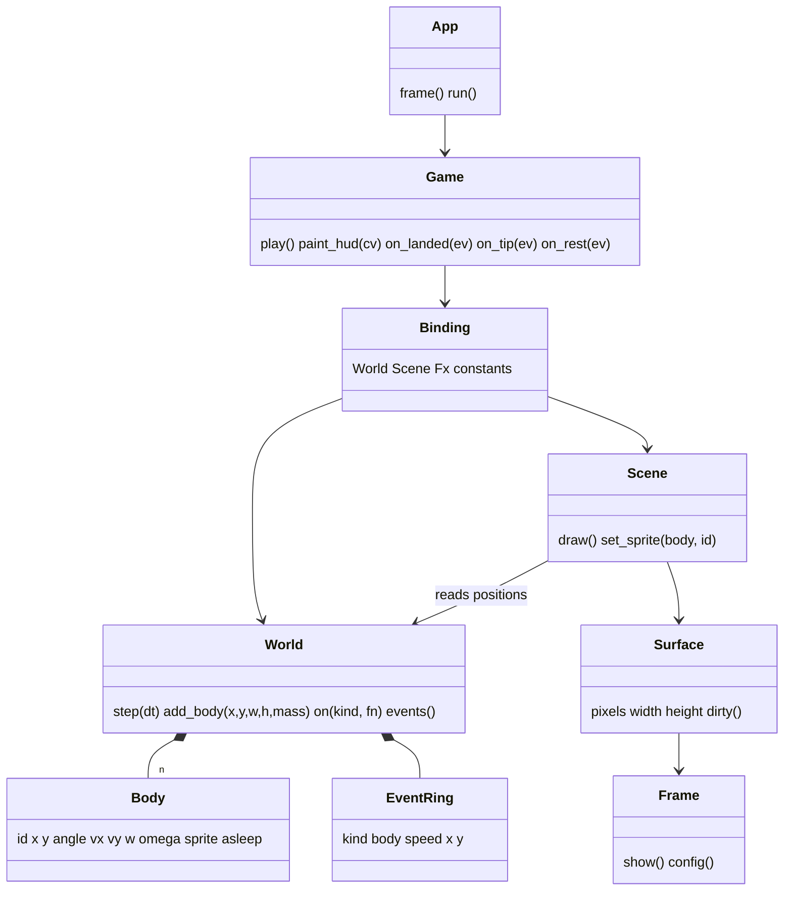
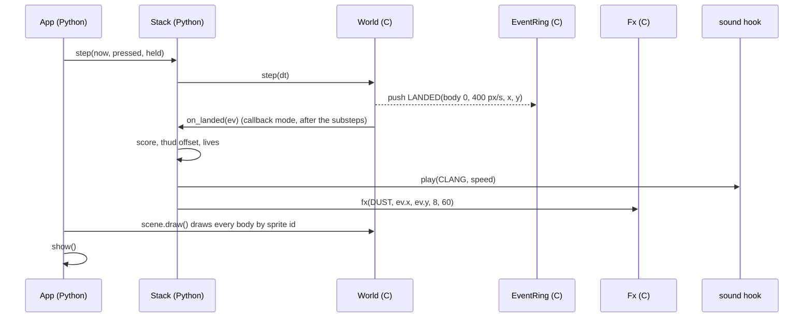
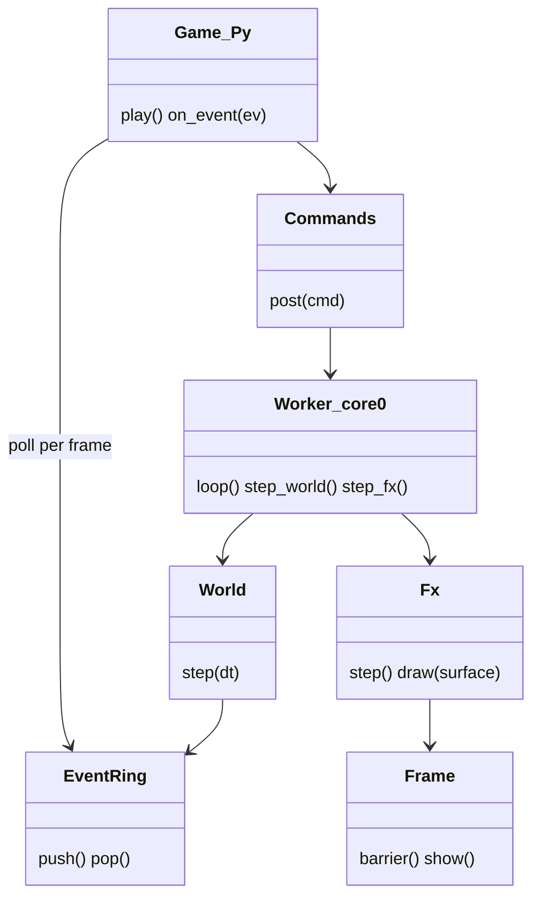
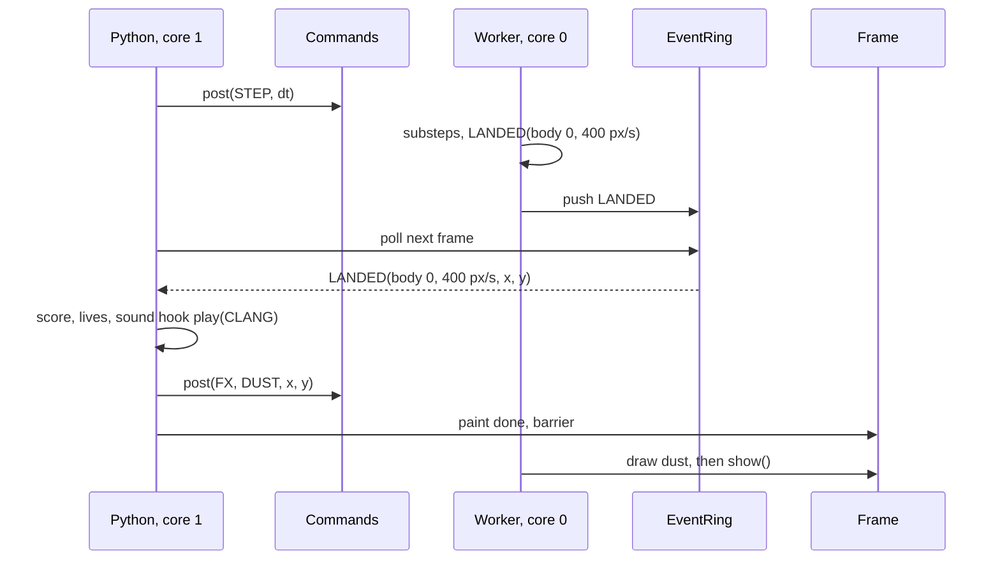

# P586 council: tech lead (feasibility, technical direction, electronics-firmware:physics)

Seat: tech lead, Opus. Read 2026-11-03 on branch p586-discovery (= master) and origin/p582-heavy (21c0b09). Tags: E evidence with a pointer, H a hypothesis with its source, D a decision with who and when, — unknown. Number provenance: stated, datasheet-typ, datasheet-max, calculated, simulated, measured, field. All arithmetic ran in python3 in this session, and its inputs are listed beside each result. No board, no serial port, no web search.

## 1. Findings

### A. The ten games' shared shape (question 1)

- **TL-1** · Every game already shares one loop, one state machine and one input path. `App.frame` reads two buttons, calls `game.step(now, pressed, held)`, then `out.draw(game)` (app.py:75-91). `Game.step` owns TITLE, PLAY, OVER, the dt clamp at 60 ms and the particle update (gfx.py:323-338). The pace is a fixed 40 ms deadline that never catches up (app.py:26, app.py:164-175). · E · app.py, gfx.py · supports: the engine's loop, states and clock exist in Python today, so step 0 is a move, not a new design.
- **TL-2** · Input is shared and small. `buttons.Button` counts edges in a pin IRQ (a soft interrupt) and the frame reads the count once (buttons.py:29-43). Games see only `pressed` and `held`. Six games read `pressed` only, Runner, Cave and Road read `held` (arcade.py:141-146, arcade2.py:228, world3d.py:106 and 123). · E · buttons.py, games · supports: input stays Python. The IRQ counter read per frame is the same shape as a C event ring read per frame.
- **TL-3** · The table, game by part. "inline" means hand-written Euler in `play()`.

| game | loop and states | input used | drawing | effects | physics | timing |
| --- | --- | --- | --- | --- | --- | --- |
| Flappy | Game base (gfx.py:277) | pressed (arcade.py:40) | pictures layers and sprites, else fills (arcade.py:71-110) | fx.burst (arcade.py:42) | inline gravity (arcade.py:43-44), box hit test (arcade.py:62-64) | self.dt |
| Runner | Game base | pressed, held (arcade.py:138-146) | pictures pose and layers, Track.paint (arcade.py:199-241, track.py:223) | fx.burst, track.Effects timers (arcade.py:143-175, track.py:19-42) | inline jump (arcade.py:146-153), swept hit test (track.py:211-221) | self.dt, base_speed |
| Snake | Game base | pressed (arcade.py:265) | fills only (arcade.py:287-310) | pop | none, grid tick by self.acc (arcade.py:267-271) | own tick period |
| Stack (master) | Game base | pressed (arcade2.py:85) | pictures, draw_cut, own draw_over and draw_title (arcade2.py:109-200) | fx.burst (arcade2.py:73, 95-96) | inline spring and slabs (arcade2.py:68-77) | self.dt, hitstop frames |
| Stack (p582-heavy) | overrides step for the collapse (arcade2.py:174-183 on that branch) | pressed | as above | fx.burst at landing, slab_hit, collapse_hit | motion.Spring, motion.Bodies, Pile with pile_under (motion.py:12-83, arcade2.py:14-101 on that branch) | self.dt |
| Cave | Game base | held (arcade2.py:228) | fills with clip (arcade2.py:248-275) | fx.add trail (arcade2.py:237) | inline climb (arcade2.py:228-229) | self.dt |
| GravityPong | Game base | pressed (arcade2.py:291) | fills (arcade2.py:315-329) | fx.burst (arcade2.py:311) | inline ball, wall and paddle bounce (arcade2.py:297-312) | self.dt |
| Tunnel | Game base | pressed (world3d.py:24) | lines and fills, 8 cv.line calls in the file | fx.add (world3d.py:40) | none, depth scroll | self.dt |
| Road | Game base | pressed, held (world3d.py:100-123) | lines and fills | fx.add, and reads fx.p back (world3d.py:124, 182-183) | none | self.dt |
| Starfire | Game base | pressed (space3d.py:55) | lines and fills, 7 cv.line calls | fx.burst (space3d.py:44, 67) | none, 3D projection | self.dt |
| CubeTiming | Game base | pressed (space3d.py:161) | lines and fills | fx.burst, pop (space3d.py:148) | none, a yaw angle | self.dt |

  · E · the pointers in the table · supports: what repeats is the loop, states, HUD, title and game-over cards, input, particles and dt. What differs is each game's rules and drawing. Only two games have bodies that bounce (Pong, Stack), and only Stack on p582-heavy has a reusable physics module.
- **TL-4** · Drawing has two backends with one Canvas API. `gfx.Canvas` records tuples for the st7789 path and `render.Dirty` diffs them (gfx.py:55-222, render.py:103-148). `lcd.TftCanvas` draws at once into the s3lcd frame (lcd.py:45-123). `app.BACKEND = "s3lcd"` is the path in use (app.py:38). P584 #785 already names the st7789 path and render.py as serving only the old backend. · E · gfx.py, render.py, lcd.py, #785 body · supports: the engine needs one drawing seam (`TftCanvas` today), and the recording Canvas is a candidate for removal, not for the engine.
- **TL-5** · Effects are two unrelated things. `gfx.Particles` is a 40-slot list of lists stepped by the @native `advance` (gfx.py:225-258). `track.Effects` is a timer list for game rules such as SLOW and X2 (track.py:19-42). Only the first is a visual effect. Road reads particle state back to decide what to draw (`fire_on` reads `self.fx.p[-1][5]`, world3d.py:182-183). · E · gfx.py, track.py, world3d.py · supports: moving particles to C under P580's "the game never reads anything back" breaks Road unless Road keeps a Python flag. `track.Effects` is game logic and stays Python.
- **TL-6** · RENT already raises physics events by polling. `fall_bodies` writes the impact speed into `hit[i]` as an int, for one step only (motion.py:48-58). Stack reads `b.hit[0]` after `step()`. Then it starts the landing, the dust burst and the score (p582-heavy arcade2.py:225-254). In the collapse it scans `b.hit[j]` with an 80 ms rate limit (p582-heavy arcade2.py:315-331). · E · `git show origin/p582-heavy:games/motion.py`, `:games/arcade2.py` · supports: the path "C raises an event, Python reacts" has a working Python prototype. Its shape can move to C unchanged: an int flag per body, read after the step, rate-limited by the game.
- **TL-7** · Tests exist for behaviour on the Mac only on p582-heavy (tests/test_motion.py, tests/test_stack.py). master has tests/test_paint.py and a framebuf stub only. · E · `git ls-tree origin/p582-heavy tests/`, `ls tests` · supports: a C physics module needs a host build or a Python twin to keep Mac tests. Without one, every behaviour test needs the board.

### B. What D3 would take, and where Python per object per frame costs too much (question 2)

- **TL-8** · The measured per-object costs on the board. Python particle update: 56.8 µs (run46, 2.27 ms over 40). Python spring body update: 114.0 µs (run46, 5.69 minus 2.27 ms, over 30). Both are bytecode Python, not @native (probe567.py:44-67). `TftCanvas.fill` 8 x 8 40.3 µs after the P550 cut. `pictures.draw` 16 x 24 69.43 µs in "double". Raw `fill_rect` from Python 5.61 µs. Raw keyed `blit_buffer` 16 x 24 warm 23.76 µs. An empty Python call 5.5 µs with gc off (run26). · E, measured · bench.md P550 and P567 · supports: the inputs of TL-9.
- **TL-9** · The line, calculated. Stack's pure-play frame in run 52 is step 1.58 + paint 22.62 + send 3.21 + gc 1.78 = 29.2 ms. So the headroom at the 40 ms pace is 10.8 ms. Source: run52-p582-bot.log, 33 pure-play intervals, parsed here. It matches bench.md's 24.00 fps. Per object per frame: Python step plus picture 183.4 µs, so 16 bodies fill a 3 ms budget and 58 fill all the headroom. C step with the picture still drawn from Python 69.4 µs, so 43 in 3 ms. C step plus one Python callback per event 74.9 µs, 40 in 3 ms. C step and C draw with one Python call per frame: the call is 5.5 µs, and the pixels cost about 18 µs per 16 x 24 sprite (23.76 minus 5.5, H: the call share assumed equal to an empty call). · E inputs, calculated · this session's script · supports: the line sits near 15 to 20 Python-stepped bodies per frame on Stack's headroom, and near 0 for the scrolling games (TL-10). Above that, the step must leave Python. The picture call (69 µs) is the next cost. C physics alone moves the line from 16 to about 43. Only C drawing of the bodies removes the line.
- **TL-10** · The scrolling games have no headroom for any per-object Python. Flappy and Runner paint 39 to 43 ms in the PSRAM frame at a 40 ms pace, 20 to 22 fps (bench.md P556 pace bullet). · E, measured · bench.md P556 · supports: the engine's first user must be Stack. Physics or effects for Flappy or Runner wait for a smaller paint (kept background, P554, P537 slice 2).
- **TL-11** · Two documents disagree on RENT's physics cost. #783 notes: "114 µs per body per update, so 14 floors cost about 1.6 ms" (calculated). Run 52 measured the step of the slowest frames at 14, 14, 15 and 16 ms. All four are in intervals with game-over frames, so in the collapse (run52-p582-bot.log, the `slowest` field, parsed here). The average pure-play step is 1.58 ms. · E both · #783 body, run52 log · supports: the collapse, not play, is where Python physics already costs 35 to 40 % of the 40 ms frame. The 1.6 ms estimate left out Pile's per-floor Python loop, `pile_under`'s pair scan (55 pairs at 11 floors, calculated) and the bursts. The split inside those 16 ms is —.
- **TL-12** · Python physics allocates every frame. `Bodies.step` over 5 bodies allocates 544 B per call and `Spring.step` 112 B, because each float written is boxed (run49, bench.md P582). At 24 fps that is 13,056 B/s from one pool (calculated). gc runs every 5 frames, 1.78 ms per frame on average (app.py:29, run 52). · E measured, calculated · bench.md P582, app.py · supports: a C world whose state never becomes a Python float removes that garbage. Event payloads must be small ints, as `hit[i] = int(v)` already is (motion.py:56). Small ints do not allocate in MicroPython (H, model knowledge, not checked in the source).
- **TL-13** · What moves to C first, by these numbers. First, the rigid-body step and contact for Stack (TL-11, PHYS-1). Second, particles (P580 rank 2: 2.27 ms for 40 today, about 0.2 ms in C, H). Third, C draws the bodies by id, so a body costs no Python call per frame. What stays Python: the loop, states, input, scores, lives, rules, `track.Effects`, the HUD logic, each game's paint of its own scene. · H, the seat's reading of TL-8 to TL-12 · supports: the first slice is small, one module and Stack.
- **TL-14** · The event path and its cost per frame. Poll: one call per frame returns a count, the game reads ints from a preallocated buffer or attribute arrays. Cost about 5.5 µs plus the handler (measured empty call). Callback during `step()`: C calls a Python callable per event with `mp_call_function_n_kw` (py/runtime.h:212, local v1.29.0 checkout). The cost is 5.5 µs plus the handler per event. A raise inside the handler unwinds through C in the middle of the step. Scheduler: `mp_sched_schedule` queues at most 8 callbacks on the esp32 port (ports/esp32/mpconfigport.h:73). A collapse frame with 11 floors and 4 slabs that hit (15 events) overflows it. · E for the depth and API, measured for the call cost, H for the unwind risk · local MicroPython checkout · supports: poll or synchronous callback for physics events. The scheduler fits only events raised outside the MicroPython task (another core, an ISR) and needs coalescing there.

### C. Memory (question 2)

- **TL-15** · Internal DMA RAM is the scarce pool. Largest internal DMA block 188,416 B at boot, 31,744 B while "double" runs (bench.md P556 slice 1a, run41). P580 proposes an 18.4 KB effects arena from that block, which leaves 13,312 B (calculated: 31,744 minus 18,432). · E measured, calculated · bench.md P556, p580-finding.md Q4 · supports: effects scratch competes for internal RAM. Physics state needs no DMA-capable memory.
- **TL-16** · Physics state is small. 64 bodies with 12 float32 fields is 3,072 B, and a 256-entry event ring of 12 B is 3,072 B (calculated). PSRAM free is about 6.8 MB with 1.5 MB of art in the pool (bench.md P556 run41 6,813,040 B, P567 6,747,500 B after deinit). The data cache is 32 KB (build-s3lcd/sdkconfig:1609), so a 6 KB world stays cached even in PSRAM (H). Free internal non-DMA RAM while running is —. · E, calculated, H · bench.md, sdkconfig · supports: memory does not limit a C world. The cheapest check is `esp32.idf_heap_info(esp32.HEAP_DATA)` printed once in a run.

### D. Build (question 2)

- **TL-17** · Today one C module builds into one image. build.sh passes `USER_C_MODULES="$HERE/s3lcd/src/micropython.cmake"` (build.sh:13-15), and that file lists 14 sources in one INTERFACE library (s3lcd/src/micropython.cmake:5-20). MicroPython v1.29.0's own example takes a top-level micropython.cmake that `include()`s one file per module (examples/usercmodule/micropython.cmake in ~/esp/micropython-v1.29.0). · E · build.sh, micropython.cmake, local checkout · supports: a second module needs a top-level cmake that includes s3lcd and engine, one line change in build.sh, and its own INTERFACE library.
- **TL-18** · A second module can reach the frame. `s3lcd.h` exposes `s3lcd_obj_t` with its `frame_t frame` (s3lcd.h:96), and `s3lcd_type` is defined without `static` (s3lcd.c:2782-2784). So an engine module can take the ESPLCD object, check its type and draw into `frame.pixels` with `frame_dirty`. But frame.h includes FreeRTOS, esp_lcd and py/obj.h (frame.h:13-17). · E · s3lcd.h, s3lcd.c, frame.h · supports: physics must not include frame.h, or the core stops being free of MicroPython types (P539 Q-d, the Arduino wish). Only the part that draws needs the frame.
- **TL-19** · P587 #788 is a move inside the same module: frame, drawing and effects in their own files, s3lcd.c only binding (#788 body). It needs no build change beyond new lines in micropython.cmake. A separate `engine` module is a different decision from the split. · E · #788 · supports: P587 first, then a second module or more files in the first, as the decider chooses.
- **TL-20** · A natmod (a `.mpy` with native code, no reflash) can hold pure-compute physics but cannot call firmware symbols outside `mp_fun_table` (docs/develop/natmod.rst:89-97 in the local checkout). It has no static BSS and no initialised data (natmod.rst:69-81). · E · local docs · supports: physics as a natmod is feasible and avoids a reflash per change. Drawing from a natmod into the s3lcd frame is not, so it fits only architecture A.

### E. Fit with the graphics library P539 and effects P580/P583 (question 3)

- **TL-21** · P539's layering is still open. Q4 (C17 with function-pointer ports, or C++17 templates with a C facade) and Q8 (inside the fork or a new repository) are queued (docs/discovery/2026-11-02-graphics-library/brief.md:160, 164). Q4 names the exact seam question: whether P537's `scene.c` depends on `frame_t` or on the core's surface (brief.md:160). · E · P539 brief · supports: the engine's C language, file layout and repository wait on the same two answers, or the engine answers them first. One design means one answer.
- **TL-22** · The seam, as the code stands. Three layers: (1) present (frame.c, the send, DMA, marks), (2) surface and draw (primitives, blits, P537 `scene.c`, P580 `fx.c`, all needing only pixels, width, height and `frame_dirty`, p537-finding.md "What the layer holds", p580-finding.md Q4), (3) world (bodies, contacts, events), which needs no pixel at all. The graphics library is layers 1 and 2. The engine adds layer 3 and a binding. A body is drawn by layer 2 from a sprite id, so layer 3 never includes a graphics header. · H, the seat's reading of p537 and p580 · supports: one design with a hard seam at "surface" between library and engine, and a second seam at "event ring" between world and Python.
- **TL-23** · The rule TL-15 of the earlier council ("the layer draws and decides nothing") is already bent by P580 to "draws, decides nothing the game reads" (p580-finding.md Q4, the PO's yes Q13 on #784). C physics with events breaks it fully: C decides that a landing happened, and Python reads it. · E for the two wordings, H that D3 needs a third · p580-finding.md, #784 notes · supports: the decider names the new rule. A candidate wording, for the decider: "C computes facts (contact, impact speed, rest, tip), Python decides consequences (score, lives, sound, effects)".
- **TL-24** · The rigid topple needs rotation, and the driver has a rotated flat polygon but no rotated textured blit. #783's decision: floors "topple as rigid pieces that pivot on their edges" (#783 comment 2026-11-03T07:35). `fill_polygon(polygon, x, y, color, alpha, angle, cx, cy)` exists in C (s3lcd.c:2557-2573). `blit_buffer` has no angle. #783's notes: "No rotation at draw time (the driver blits only): tumbling uses painted turned frames". · E · #783, s3lcd.c · supports: RENT's topple can draw as rotated flat shapes now, or as pre-painted turned frames. A textured rotate blit is a new C primitive (P537's "rotate and zoom (later)").

### F. Physics lens

- **PHYS-1** · Thin floors tunnel at RENT's speeds without substeps. Inputs: G = 2000 px/s² and HANG = 40 px (stated, p582-heavy arcade2.py:120), floor height 14 px (stated, LEVEL_H, arcade2.py:117), frame 40 ms (stated, app.py:26) and the 60 ms clamp (stated, gfx.py:326). v = sqrt(2 G h). A 40 px drop lands at 400 px/s, 16 px per 40 ms step, 24 px per 60 ms step. A 200 px topple fall reaches 894 px/s, 35.8 px per 40 ms step, 53.7 px per 60 ms step. To keep each step under half a floor (7 px) a step needs 3 to 8 substeps (calculated). In Python 11 bodies x 6 substeps x 114 µs = 7.5 ms (calculated). · calculated · this session's script · supports: plane-snap works today only because each body has one known plane (motion.py:48). Pivoting rigid pieces against each other need substeps or swept tests, and that cost is the strongest reason for C.
- **PHYS-2** · The step is variable and clamped. `self.dt = min(ticks_diff, 60) / 1000` (gfx.py:326). `motion.Spring` is stable for k up to about 270 and damping up to about 16 at 60 ms (motion.py:13-15, stated). · E · gfx.py, motion.py · supports: a C world should take a fixed internal step with an accumulator, so the result does not depend on frame time. A fixed step is also the seam D2 needs for lockstep networking (H, common practice).
- **PHYS-3** · The impact speed event is a fact with a unit. `hit[i]` is px/s, written once per bounce, and a sleeping body fires none (motion.py:56-64). Stack filters at 150 px/s and 80 ms (p582-heavy arcade2.py:130). · E · motion.py, arcade2.py · supports: the C event carries kind, body id, impact speed in px/s as an int, and contact x, y as ints. Thresholds stay in Python, as spark's rule "facts, not behaviour" asks.
- **PHYS-4** · The tip rule needs only arithmetic. A floor tips when its centre of mass passes the support edge (#783 decision). For a uniform rectangle the centre is x + w/2, and the test is centre < support_left or centre > support_right, evaluated once per landing (calculated, statics). · calculated · #783 · supports: the tip test is cheap in Python. The pivot motion after it (angle, angular speed about the edge, the hit on the street) is what costs per frame.

### G. Using each chip's extra power (D4, added by the coordinator)

- **CHIP-1** · Where a per-chip fast path pays. Fill and copy: PIE 5.8 x and 9.8 x aligned (Espressif's esp_lvgl_port table, measured by Espressif, council/chip-hardware.md HW-S3-8). Full-frame ceiling at 240 MHz: fill 0.37 to 0.06 ms, copy 1.10 to 0.11 ms (HW-S3-9, calculated). Keyed blit and alpha compose: about 3.4 x on the compose (p580-finding.md table, H). Heat and ripple kernels: about 10 x on the kernel (p580, H). Particles: no, PIE pays only past about 1,000 (p580 rank 2, H). Physics step for under 100 bodies: no, scalar C is already microseconds (H, by count of operations). The send: no, a full frame is 31 ms of wire time at the real 40 MHz (bench.md P533 slice 3), and PIE cannot shorten wire time (HW-S3-23). · E and H as marked · p580-finding.md, chip-hardware.md · supports: the fast paths belong in layer 2 (draw and compose), not in the world.
- **CHIP-2** · The "double" copy has a PSRAM floor. The copy of a full frame takes 3.4 ms (bench.md P556 run41, measured). A PSRAM read costs about 34 ns/px (p580, from run46, calculated). 76,800 px x 34 ns = 2.61 ms (calculated). · calculated · bench.md, p580 · supports: a PIE copy can save at most about 0.8 ms of the 3.4 ms, because the read from PSRAM bounds it.
- **CHIP-3** · The choice is compile time per port. The firmware is built per chip (build.sh:12 `BOARD=ESP32_GENERIC_S3`). S3 `.S` files do not run on the P4, which has a different ISA (`esp.*` on RISC-V, HW-P4-1). `SOC_CPU_HAS_PIE` is a compile-time fact (HW-ESP-3). P580's pattern is `#if defined(CONFIG_IDF_TARGET_ESP32S3) && FX_PIE` with a plain C twin (p580 Q4). Runtime checks already exist where one image varies: the frame falls back to "strips" when no 153,600 B internal block exists (bench.md P533 slice 3), and app.py decides gc by free heap (app.py:146). · E · build.sh, chip-hardware.md, p580, bench.md · supports: compile time for instruction sets, runtime for memory. On the P4 the fast path is a driver call (PPA fill, blend, key, 90-degree rotate, scale, HW-P4-4), so the seam is an accelerator port that may decline (P539 Option A), not a set of `#if` blocks.
- **CHIP-4** · The second core is free now. `CONFIG_FREERTOS_UNICORE` is not set (build-s3lcd/sdkconfig:1847), so MicroPython's task runs on core 1 (ports/esp32/mphalport.h:51-55). No Wi-Fi runs now. ESP-NOW or UDP later (D2) would share core 0 with the radio. · E · sdkconfig, mphalport.h · supports: a C worker pinned to core 0 is possible today and gets more crowded with D2.
- **CHIP-5** · What core 0 could take, with numbers. The send already runs in hardware DMA in "double". Only the 3.4 ms copy is CPU work (bench.md P556), and moving it needs a second PSRAM frame (153,600 B, calculated 320 x 240 x 2) so Python can paint while it copies. Physics in C: microseconds to about 1 ms (H), too small to pay for a hand-off. Effects: a heat strip costs 1.8 ms on PIE or 5.9 ms in C (p580 rank 1, H), the largest C job. The paint, 22.6 ms on Stack and 39 to 43 ms on Flappy, is Python and cannot move, because MicroPython holds a GIL (`MICROPY_PY_THREAD_GIL (1)`, ports/esp32/mpconfigport.h:86). · E and H as marked · bench.md, p580, local checkout · supports: the second core pays only once a large share of the frame is C (a retained scene drawn in C, or heavy effects). For RENT's first slice it pays nothing measurable.
- **CHIP-6** · What core 0 costs. The C side must not touch any MicroPython object or heap without the GIL (E, the GIL above). Results come back by a lock-free ring polled per frame or by `mp_sched_schedule`, depth 8 (TL-14). Effects that draw into the frame need a barrier per frame: after the Python paint, before `show()` (H). PIE state is 208 B per context switch (HW-S3-16). On the P4 PIE in an ISR or critical section aborts (HW-P4-3), and frame.c's done callback runs as an ISR (frame.h:77, `frame_on_color_done`). On the S31 PIE runs only on core 1 (HW-P4-10), so a PIE worker on core 0 is a portability trap. Both cores share the octal PSRAM at 80 MHz (sdkconfig:1541, 1549) and the 32 KB data cache (H for sharing), and the PSRAM paint already costs 8 to 10 ms more than internal (bench.md P556 slice 0). · E and H as marked · chip-hardware.md, sdkconfig, bench.md · supports: a second-core worker is a later rung with a probe first. The P539 discovery already lists "a second-core worker task in the MVP" as a proposed no-go (graphics brief.md:145).

## 1b. Candidate architectures

Three shapes. None is chosen. Each keeps Python for rules, scores, lives and the loop.

### Option A: Python engine, C kernels

Modules: `engine/` in Python (App loop, Clock, Input, Game and Scene base, Events dispatcher, World facade). C: today's s3lcd plus a `World` kernel (natmod or user module) with `step(dt)` and an event buffer, plus P583's `fx()`. Python draws the bodies from the world's int positions.

Python/C line: per frame, Python calls `world.step(dt)`, reads N events, and draws each body (one picture call per body, 69 µs).

Cost: lowest C (a few hundred lines, H). Risk: the per-body picture call (TL-9 caps it near 43 bodies in 3 ms). Proves: the event path and the C step, with no change to drawing. A natmod variant avoids reflashing (TL-20).

### Option B: C world and scene, Python rules (D3 as written)

Modules: C `engine` (World with rigid bodies, contacts and an event ring, Scene with sprite ids drawn into the s3lcd surface, Fx from P583), a thin binding file, and the Python `engine/` package for the loop, states, input and handler registry. Bodies carry a sprite id, so C draws them. Python draws the HUD and anything game-specific.

Python/C line: per frame Python calls `world.step(dt)` and `scene.draw()`. Events reach Python either by a synchronous callback per event (`world.on(LANDED, handler)`) or by one poll. About 3 C calls per frame, whatever the body count.

Cost: the most new C of A and B (world, scene, binding), and the TL-23 rule change. Risk: two event delivery modes to keep, exceptions through C mid-step if callbacks, and the Mac tests need a host build of the C core. Proves: Python reacts to a C event at a fixed cost per frame, and the body count stops costing Python time.

### Option C: C engine with a worker on core 0

Modules: as B, plus a FreeRTOS task pinned to core 0 that runs the world step and effects (and later the frame copy), driven by a command queue from Python. Events return through a lock-free ring that Python polls per frame, or through `mp_sched_schedule` with coalescing (depth 8).

Python/C line: Python posts commands (spawn, release, input) and reads events one frame late. C never touches MicroPython objects.

Cost: the highest (B plus the task, the barrier per frame, a second PSRAM frame if the copy moves). Risk: a one-frame event delay, PSRAM and cache contention, the P4 and S31 PIE rules (CHIP-6), radio on core 0 later (D2). Proves: whether core 0 buys frame time. CHIP-5 says it buys little until most of the frame is C.

## 2. What I could not check, and why

- The cost of a Python callback called from C (`mp_call_function_n_kw`) on the board. I used the 5.5 µs empty call from run26 as a stand-in (TL-14). Cheapest rung: a 20-line C function in the module that calls a passed callable 1,000 times, timed with `ticks_us`. It cannot show the cost of the handler's own work or of a raise.
- The split of the 14 to 16 ms collapse step in run 52 (TL-11). The log holds only totals. Cheapest rung: the existing bench bot with `ticks_us` around `Pile.step`, `move_slabs` and `fx.update`. It cannot show what a C world would cost.
- @native against bytecode for the physics loops. run46's 114 µs is bytecode (probe567.py:44-67), while `fall_bodies` and `advance` are @native. Cheapest rung: probe567's `physics()` once with `@micropython.native`. It cannot show viper or C.
- Free internal non-DMA RAM while a game runs (TL-16). Not logged. Cheapest rung: one `esp32.idf_heap_info(esp32.HEAP_DATA)` line in a run.
- A C world's real step time. All C physics numbers are H. Cheapest rung: a host build of a 64-body SoA step on the Mac for correctness, and one `ticks_us` bracket on the board for time. The Mac cannot show Xtensa timing.
- Whether a natmod with float code links and runs on this image (TL-20). The docs name xtensawin and floats, not tested. Cheapest rung: build the features2 example for xtensawin and import it.
- Sound (P581 #782). I did not read the card. The hook in the diagrams is a name only. Its cost and whether it runs from C (I2S DMA) are —.
- Small-int allocation (TL-12) rests on model knowledge. Cheapest rung: `gc.mem_alloc()` around 200 reads of an int attribute, as probe582 does.
- Core 0 effects on PSRAM bandwidth (CHIP-6). No probe exists. Cheapest rung: a C task on core 0 that streams PSRAM reads while the bench bot runs Stack, compared with the paint time in the `time` line. It cannot show the cost of a real worker's synchronisation.
- P4 and S31 claims come from the chip-hardware report, not re-read at the source.

## 3. Questions for the decider

- Which rule replaces "draws, decides nothing the game reads": for example "C computes facts (contact, impact speed, rest, tip), Python decides consequences"? · decides: whether C physics with events is allowed at all, and what never moves to C (TL-23).
- How do C events reach a handler: one poll per frame, a synchronous callback per event, or both? · decides: the binding's shape, the cost per event, and how a raise in a handler is handled (TL-14).
- Does the engine's C live in the s3lcd module (more files after P587) or in a second `engine` module beside it? · decides: the build change (TL-17, TL-18) and whether physics stays free of frame.h and MicroPython types.
- Do P539's Q4 (C17 or C++17) and Q8 (fork or new repository) get answered before the engine's first C, or does the engine's first slice answer them? · decides: one design for library and engine (TL-21).
- Does the world take a fixed internal step with substeps, independent of the 40 ms pace and the 60 ms clamp? · decides: tunnelling (PHYS-1), repeatable tests, and the lockstep seam for D2 (PHYS-2).
- For RENT's pivoting floors: rotated flat polygons from C now (the existing `fill_polygon`), pre-painted turned frames, or a new rotated blit? · decides: the first drawing work and the art budget (TL-24).
- Does Road keep Python particles, or gain a Python flag, when particles move to C? · decides: whether "the game never reads effects back" holds for all ten games (TL-5).
- Is a second-core worker in scope before a probe shows a gain? · decides: whether Option C is a candidate now or a later rung (CHIP-5, CHIP-6).
- Is a natmod (no reflash) acceptable for the physics kernel during development? · decides: the iteration cost of Option A (TL-20).

## 4. Searches

none. Every fact came from the repository, the local MicroPython v1.29.0 checkout, the build's sdkconfig, the earlier council reports and the spark issues.
