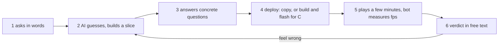
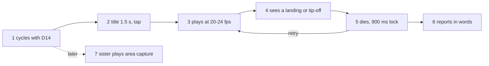

# Jobs and journeys
<!-- Tags as in the brief: E with a pointer, H with its source, D with who and when; an unknown is —. -->

## Who
<!-- One line per persona: who · evidence status (E pointer | H source).
e.g. `- Team leads who assign work · H Lena's belief, no interview yet` -->
- The PO as game writer, who asks an AI assistant for a new game or a physics change in words and judges it by playing · E his words on #787 and his material decisions on #783 (2026-11-03), council/user.md USER-1 to USER-7 · n = 1 <!-- REQUIRED:who -->
- The PO as player, who plays the ten games on his board and reports in free text · E bench.md:36, :57, :92, :115 (his dated verdicts), council/user.md USER-12, USER-13 · n = 1
- His sister, a player of the simple area-capture game (P585 #786) · H the PO's one sentence in #786 ("a simple one that his sister can play at once"), no quote, no play log, no age · n = 0 (council/user.md USER-24)

## Jobs
<!-- One job story per line, each clause tagged: When …, I want to …, so I can ….
e.g. `- When I assign a task in a meeting [E tickets.csv:6], I want the assignee to see it that day [H Lena], so I can stop chasing people [E tickets.csv:7]` -->
- When I want a new game or a new physical feel [E #787, #783 comments 2026-11-03], I want to say it in words about what I see (the steel tips, it thuds) and get it built from shared parts [E #783 "The PO's decisions on the material" (USER-3), #787 "a simple game engine"], so I can play it the same day and judge it [H the synthesis, from USER-4: work went on without his words and was partly thrown away] <!-- REQUIRED:jobs -->
- When a physical moment happens in a game, a landing or a tip-off [E #787 "The PO's words on the order"], I want the game's Python code to react to it, even when the physics runs in C [E #787: "be able to react both ways", D3], so I can add dust, a clang, a score or a lost life without touching C [H the synthesis, from PO-6: "numbers from Python, never constants in C"]
- When I play [E bench.md dated verdicts (USER-12)], I want heavy, natural movement that does not freeze [E #774 comment "heavy, natural movement and bigger effects". H the synthesis for "does not freeze": bench.md:36 "froze sometimes" is from the first P533 day and was about tearing and the old send, not physics], so I can enjoy the games as they grow [H the synthesis]
- When my sister picks up the board [H #786 body], I want a game she can play at once [E #786 body: "a simple one that his sister can play at once"], so I can share the games with her [H the synthesis, her view is —, n = 0]

## Today they…
<!-- Per job: what they do instead today (a competitor, a workaround or nothing), tagged.
e.g. `- Job 1 · paste each task into Slack by hand · E tickets.csv:7` -->
- Job 1 · the AI writes each game's physics inline in its own `play()`, and RENT's on an unmerged branch (motion.py), the feel changed four times in one day, each time as new code, and three of the four were AI slices built without his words · E council/tech-lead.md TL-3 table, origin/p582-heavy:games/motion.py:12-83, origin/p582-heavy:bench.md:233-234, #783 comments 2026-11-03 (USER-4, ★C20) <!-- REQUIRED:today -->
- Job 2 · RENT reads a Python `hit[]` array after the step and calls four moment methods, no C code calls back into Python except file reads for jpg and png · E origin/p582-heavy:games/arcade2.py:222-254 (PO-4, TL-6), s3lcd/src/mpfile.c:65-99 (EVT-10, ENG-37)
- Job 3 · stack plays at 24.00 fps with worst gaps of 50 to 70 ms, flappy at 20 to 22 fps in run 44 (run 42 gave 14 to 20 in "double" with no play, bench.md:187), he reports "froze", "stepped", "stucky" in free text · E origin/p582-heavy bench.md run 52, bench.md P556 section, bench.md:36, :92 (USER-18, USER-19)
- Job 4 · no game is made for her, she has not been observed · — (USER-24)

## Journeys
<!-- One ### per actor and scenario: the table, then a Mermaid flowchart of the same steps. Never a Mermaid
journey block: it forces a score on every task. "n/a — a one-step job" may replace both.
e.g. `| 2 | opens the app | E analytics, 90 days | never sees the task | not yet | Do they read email? |` -->
The user lens (council/user.md) read both journeys from the issues, the bench log and the code. Nobody watched them. Nothing ran on the board for this discovery.

### The PO as game writer — gets a new game or a physics change written, deployed and played <!-- REQUIRED:journey -->
| step | what they do | evidence | friction or harm | today | open question |
| --- | --- | --- | --- | --- | --- |
| 1 | asks in words for a game or a feel ("heavy and natural", "the real physics for the weight and material") | E #783 comment "The PO's words after playing P582" (USER-2), #774 comment (USER-13) | he gives a verdict and a complaint, not a target or a number (USER-1) | works | — |
| 2 | the AI guesses the physics and builds a slice | E commits 37c3a03, 1c9c04a, 041f37c (USER-2) | the AI built three slices before he saw that the material was wrong | partly | would a concrete question first have saved the slices? (Q-U4) |
| 3 | answers concrete questions about what the material does (tips at the centre of weight, thuds 1 to 2 px, 3 lives) | E #783 comments "The PO's decisions on the material" and "on a tip-off" (USER-3) | — | works | — |
| 4 | the AI deploys: a copy of Python files today, a build and a flash for any C change | E README.md:25-27, bench.md P562 section (USER-8) | a dropped port left old files and void runs, a fresh flash once gave a dark board (USER-9), time per C cycle is — | partly | how long did he wait per build, and how often did it fail? (Q-U5) |
| 5 | plays for a few minutes, a bot measures fps | E origin/p582-heavy bench.md P582 section (USER-4, USER-5) | short rounds give few clean intervals (0 in 3 minutes on slice 1, USER-6), the bot cannot judge feel | partly | — |
| 6 | gives his verdict in free text, the AI finds the cause | E bench.md:52 (USER-14) | if he is away, work goes on without his words (USER-4) | partly | what should the AI wait for? (Q-U4) |

### A player — plays a game and reports
| step | what they do | evidence | friction or harm | today | open question |
| --- | --- | --- | --- | --- | --- |
| 1 | powers on and cycles to a game with D14, one way, no menu | E games/app.py:70-79, :121-124 (USER-16) | nine presses from flappy to gravity pong, a long hold powered the board off | partly | does a cycle stay enough for eleven games? (Q-U6) |
| 2 | sees the shared title for 1.5 s and taps to play | E games/gfx.py:287-288, :331-336 (USER-17) | — | works | — |
| 3 | plays at 20 to 24 fps on a 40 ms pace | E games/app.py:26, bench.md P556 and P568 sections (USER-18) | worst gaps of 50 to 70 ms show as "froze" (USER-19) | partly | — |
| 4 | sees a physical moment: a landing, a tip-off | E #783 decisions (dust, clang, rigid thud) (USER-21, USER-22) | the clang has no speaker yet (P581 #782) | not yet | which events does he want to see besides the motion? (Q-U11) |
| 5 | dies, a tap in the first 900 ms of game over is ignored | E games/gfx.py:287-288 (USER-17) | the lock is a share of each short round | partly | did the lock annoy him? (Q-U7) |
| 6 | reports in his words ("stepped", "stucky", "super cool") | E bench.md:92, :115, P564 (USER-12) | free text, two ideas in one sentence (USER-14) | works | — |
| 7 | his sister plays the simple area-capture game | H #786 body | n = 0, nothing is known of her skill (USER-24) | not yet | which game did she play, and what did she do? (Q-U10) |

