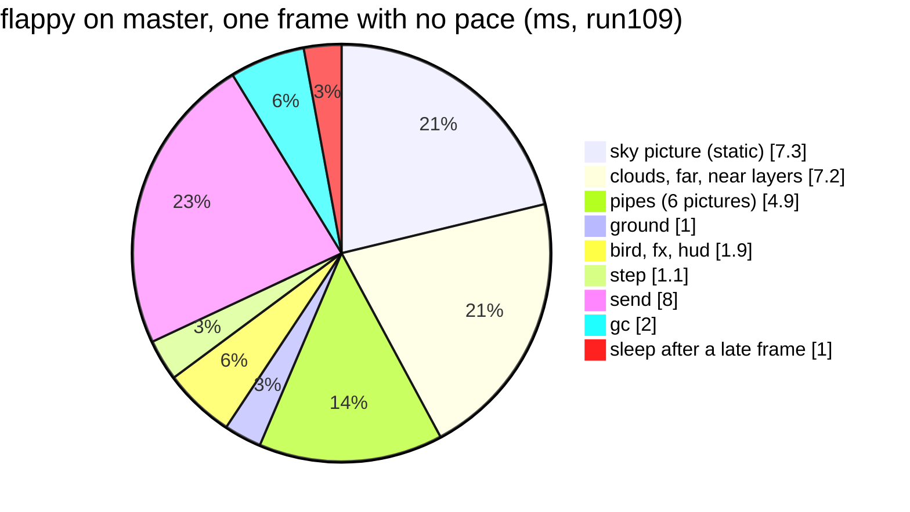

# P612: where flappy's frame time goes, and the way to 25 to 30 fps (spike finding, 2026-11-05)

Spark issue [#817](https://github.com/xmejkal/spark/issues/817), with P604 [#805](https://github.com/xmejkal/spark/issues/805) folded in. The bench rows are in `bench.md`, section P612. Tags: E evidence with a pointer, H a hypothesis and where it comes from. Image 481959b8587c1502, `games/*.py` at 184fa2e (the board's files match master byte for byte). The probes are in `probes/`, and each one's header says how to run it. Each run is about 47 s. In flappy an autopilot flaps, and `die` is off. The run logs are git-ignored (`*.log`) and stay in the PO's clone of this repository. `bench.md` holds their numbers.

Words: the pace is `FRAME_MS`, the time from one frame's start to the next. "No pace" is `FRAME_MS` 0, where a late frame still sleeps 1 ms (`app.py:180`). The dt cap is the 60 ms limit on a step's time (`gfx.py:341`). Step, paint, send and gc are the parts of the app's `time` line.

## Short version

> 1. The card's premise changed. P602 measured flappy with fire at 21 to 23 fps, not 16 to 17. The PO then took the fire out of flappy. Today flappy has no fire, and it runs at 24 to 25 fps because the 40 ms pace holds it there.
> 2. With no pace, flappy on master runs at 28 fps, a 35.7 ms frame (E: run109). Python's own work is 1 to 3 ms of it, not measured as one number. About 22 ms paints pictures through PSRAM, 6 to 8 ms is the send, and 2 ms is the gc. So moving Python to C saves little in flappy. Painting fewer pixels saves the most.
> 3. For 30 fps (33.3 ms), flappy must lose about 3 ms. Two ways, each a proposed card: paint the sky and its three scrolling layers in one C pass (H: about 5 ms), and drop the 1 ms sleep after a late frame, with a pace per game.
> 4. With P602's fire, flappy runs at 21 fps (E: run110). The fire costs 16.6 ms a frame: 8.85 ms in the step (scroll and step of the field), 7.78 ms in the paint (the blend). On the S3's PIE, the research estimates 4 to 9 ms for the whole fire (H). That reaches 25 fps, and 30 only with the one-pass background too. If P583 #784 names the fire's two kernels, it fits as the PIE build card.
> 5. P604: the HUD strip's redraw is not the cause. With no redraw at all but the glyph cache filled once, the rain paints even slower, 14.4 ms against 9.1 (E: run113). The rain's paint slows as the heap holds more small objects. The mechanism is H: after each gc, MicroPython's allocator searches the heap for a free block from its start. A proposed card removes the paint's allocations and shows it.

## Where flappy's time goes (no pace, run109)

The parts sum to 34.4 ms against the 35.7 ms frame. The loop's own Python holds the rest.

| part | ms a frame | source |
| --- | --- | --- |
| sky picture, painted every frame (`lcd.py:182`) | 7.3 | E: run109 `avg static` |
| clouds, far, near (keyed pictures that scroll) | 2.43, 2.68, 2.06 | E: run109 `part` lines |
| pipes, 6 pictures clipped by the driver | 4.85 | E: run109 |
| ground | 1.04 | E: run109 |
| bird | 0.27 | E: run109 |
| fx, hud | 0.4, 1.2 | E: run109 `avg` |
| step (input, physics, the game's Python) | 1.1, of which `play` 0.44 | E: run109 |
| send | 7.9 to 8.3 with no pace, 6.2 to 6.6 at a 33 ms pace, 3.3 to 3.7 at 40 ms | E: run109, run111, run92 |
| gc (a timed collection every 5 frames) | 2.0 | E: run109 |

- At a shorter pace, the send grows. Its cause is not split. One guess: at 40 ms the panel's transfer of the previous frame ends during the sleep, and with less sleep `show()` waits for it (H). Another guess: the DMA and the paint share the PSRAM bandwidth (H). Also unexplained: run109 and run111 take the same late-frame path (`app.py:178-180`), but their sends differ by 1.5 ms.
- A full frame over SPI at 60 MHz (`app.py:37`) is 153,600 B, about 20.5 ms (H: arithmetic). It runs beside the paint, so it limits the frame rate near 48 fps, not near 30.
- Flappy scrolls the whole screen, so painting only what changed (dirty rectangles) does not help flappy. It helps still scenes.
- Each Python call into C costs 2.60 µs (E: bench.md P589). Flappy makes about a dozen picture calls a frame, about 30 µs. The calls are not the cost. The pixels are.

## At a 33 ms pace (run111) and with the fire (run110)

| run | pace | fps | step | paint | send | gc | play frames at the dt cap |
| --- | --- | --- | --- | --- | --- | --- | --- |
| run92 (P602, before) | 40 ms | 24 to 25 | 0.7 to 1.0 | 20.7 to 22.0 | 3.3 to 3.7 | 1.9 to 2.0 | 0 to 1 of about 125 |
| run109 | none | 28 | 1.1 | 22.2 to 22.6 | 7.9 to 8.3 | 2.0 | 1 of 1,215 |
| run111 | 33 ms | 28 | 1.2 | 22.3 to 22.5 | 6.2 to 6.6 | 2.0 | 1 of 1,212 |
| run110, P602's fire | none | 21 | 10.1 | 30.1 to 30.4 | 3.3 | 2.1 | 32 of 907 |

- run110 repeats run93 with P602's wiring and constants copied from 324c23d. Its fire costs 8.85 ms in the step and 7.78 ms in the paint, against run93's 8.19 to 8.51 and 7.58 to 7.72. The fire alone takes flappy from 28 to 21 fps.
- With the fire, the frame is about 46 ms. For 25 fps it must lose about 6 ms, for 30 fps about 13 ms.

## What moves to C, ranked by the ms it saves

| rank | change | saves (flappy) | kind |
| --- | --- | --- | --- |
| 1 | the fire's step and blend on PIE, with a plain C twin (P583 #784) | 7 to 12 ms with fire (H: research) | C, S3 only, C twin elsewhere |
| 2 | one C pass paints the still sky and the three scrolling layers, each pixel written once | about 5 ms (H: arithmetic below) | C |
| 3 | no 1 ms sleep after a late frame, and a pace per game | about 1 ms, and 30 fps where a game fits | Python |
| 4 | a rain paint that allocates nothing a frame (P604) | 3.6 ms in the rain, not measured in flappy | Python first |

Rank 2's arithmetic (H): the sky writes 76,800 px. The three layers are strips of 640 x 100, 640 x 90 and 640 x 62 px (`art_index.py:77-79`), and they show about 80,640 px more. That is about 157,000 px for 14.5 ms, about 92 ns a pixel, near P580's 55 ns a PSRAM write plus 34 ns a read. One pass writes 76,800 px and reads about 157,000: 76,800 x 55 ns plus 157,000 x 34 ns is about 9.6 ms. It saves about 5 ms.

The gc costs 2.0 ms a frame, and the rain's paint right after a gc is about 3 ms slower than four frames later (E: run112, all variants). Fewer allocations a frame can cut both. Rank 4 tests this.

## PIE, and chips without it

- `p580-finding.md` holds PIE's lanes, its `.S` kernels and the esp-dsp fallback. This spike adds only the fire's numbers.
- The step's plain path vectorizes in 8 x u16 lanes, about 0.5 to 1 ms (H). Sway and fast cells read a different neighbour per cell. PIE has no gather, so they stay scalar, 1.5 to 4 ms (H). With one sway per block of 16 cells, the loop vectorizes, and the look changes a little (a decision for the PO).
- The blend splits. The palette and alpha lookups stay scalar, about 0.5 ms. The compose runs on PIE, about 2.3 ms (H: P580's 100 ns a pixel over about 22,500 lit pixels). P580's 100 ns already counts the PSRAM read and write (`p580-finding.md:15`, H there). If it is low, the compose is about 5 ms, the pessimistic bound.
- Fallback: one public C name, two bodies. esp-dsp picks its `_aes3` or its `_ansi` function at build time (E: [dsps_dotprod.h](https://raw.githubusercontent.com/espressif/esp-dsp/master/modules/dotprod/include/dsps_dotprod.h), master, read 2026-11-05). For us: for the target `esp32s3` only, `micropython.cmake` adds the `.S` file. The ESP32 and the RISC-V C3 and C6 build the C twin. The C twin is also the Mac tests' oracle, compared bit for bit.
- P583 #784 fits, with three additions: name `fx_fire_step` (plain path) and `fx_fire_blend` as slice 0's kernels, add the build rule and the bit-exact test, and decide sway and fast cells. A comment on #784 proposes this.
- The PO's "try" of PIE is code, and this card says "No code". So the try is P583's slice 0.

## How other engines do it

| engine | what runs in native code | what the script does a frame | paints what changed | stated rate |
| --- | --- | --- | --- | --- |
| [Thumby Color engine](https://github.com/TinyCircuits/TinyCircuits-Tiny-Game-Engine) (MicroPython, README read 2026-11-05) | "Core engine features are written in C", a node tree that ticks and draws | builds the scene, sets callbacks | not stated | not stated |
| [Playdate SDK](https://sdk.play.date/inside-playdate/) (Lua or C, read 2026-11-05) | the sprite list and its drawing | calls `sprite.update()` | "redraws all of the dirty rects", and "unchanged lines aren't sent to the display" | 30 fps default, 50 maximum |

Three ideas they share that fit us: Python decides and C paints, send only what changed where a scene holds still, and make no per-pixel or per-particle Python call. Playdate also names the garbage collector as Lua's main source of "sporadic hits", the same as our gc's 2 ms.

## P604: why the rain's paint slows (run112, run113)

| variant | rain's paint, 150 traced frames | glyphs | strip buffer |
| --- | --- | --- | --- |
| R3a, the label redrawn every 500 ms (as today) | 12.7 ms | 13 | 0x3c1dfae0 |
| R3b, the label drawn once (as P599's E10) | 9.1 ms | 1 | 0x3c1dfae0 |
| R3c, the label formatted every 500 ms, the strip never redrawn | 9.8 ms | 1 | 0x3c1dfb00 |
| R3d, no redraw, the glyph cache filled once at the start (24 glyphs) | 14.4 ms | 24 | 0x3c1dfb70 |

- R3d answers it. With no redraw at all, the rain paints slower than with redraws. So the redraw path is not the cause. It matters only because it fills the glyph cache, which keeps more small objects on the heap.
- In the traces, the frames that hold a redraw are no slower than the others (12.8 against 12.6 ms in R3a). The slowdown sits in every frame, and it is largest right after each timed gc.
- The label's formatting adds at most 0.7 ms (R3c against R3b, one run each, noise not measured).
- Ruled out: where the strip lands. All four buffers lie at 0x3C1D_xxxx, in PSRAM (H: the S3's external memory map starts at 0x3C00_0000, TRM page not read).
- The mechanism is H: MicroPython's allocator searches for a free block from where its last search ended, and a gc starts that search over (H: `py/gc.c`, not read in this spike). More small live objects make each search longer. Whether the rain's paint allocates at all is not measured (H). `TftCanvas.fill` and `Stepper.paint` were written to allocate nothing (`lcd.py:77-98`, `rain.py:71-75`). So P631 first reads `gc.mem_alloc()` around the paint. Then a paint with no allocation, with the strip still redrawn, is the proof.

## Proposed cards (Idea, under P609 #812)

1. P629: flappy paints its sky and three scrolling layers in four passes → one C call composes them, and each pixel is written once. Done when: measured, flappy runs at 30 fps at a 33 ms pace.
2. P630: a late frame sleeps 1 ms, and all games share one pace → no sleep when late, and a pace per game. The USB REPL is tested.
3. P631: more small objects on the heap slow the rain's paint by up to 5.3 ms → a paint with no allocation. Measure it with the strip still redrawn.
4. P583 #784 gains the fire's two kernels as slice 0 (a comment, not a new card).

## Not checked

- No probe split the fire's 8.85 ms into its scroll and its step.
- The PIE numbers are estimates. P583's slice 0 measures them.
- The send's growth at a shorter pace is not split into its causes.
- Python's own share of the frame is not measured as one number.
