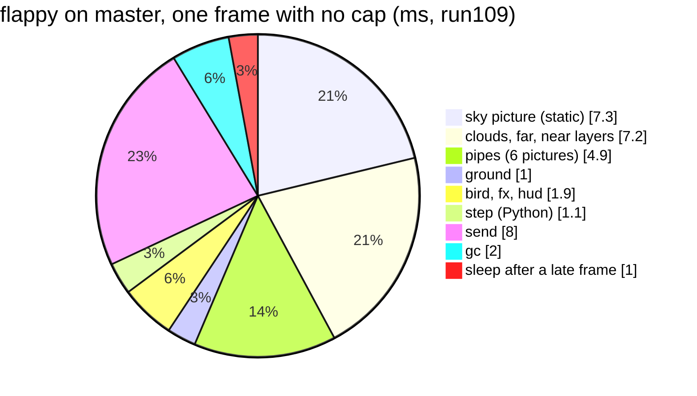

# P612: where flappy's frame time goes, and the way to 25 to 30 fps (spike finding, 2026-11-05)

Spark issue [#817](https://github.com/xmejkal/spark/issues/817), with P604 [#805](https://github.com/xmejkal/spark/issues/805) folded in. The bench rows are in `bench.md`, section P612. Tags: E evidence with a pointer, H a hypothesis and where it comes from. Image 481959b8587c1502, `games/*.py` at 184fa2e (the board's files match master byte for byte). The probes are in `probes/`, run with `mpremote run`, with FIRE, CAP or REDRAW set per run. Each run is about 47 s with an autopilot that flaps, and `die` off.

## Short version

> 1. The card's premise changed. P602 measured flappy with fire at 21 to 23 fps, not 16 to 17. The PO then took the fire out of flappy. Today flappy has no fire, and it runs at 24 to 25 fps because the 40 ms frame pace caps it there.
> 2. With no cap, flappy on master runs at 28 fps (E: run109). Of its 35 ms frame, Python's own work is about 1.5 ms. About 22 ms paints pictures through PSRAM, 6.5 to 8 ms is the send, and 2 ms is the gc. So moving Python to C saves little in flappy. Moving fewer pixels saves the most.
> 3. For 30 fps (33 ms), flappy must lose about 3 ms. Three ways, each a proposed card: draw the sky and its three cloud and hill layers in one C pass (H: 3 to 6 ms), drop the 1 ms sleep after a late frame (E: `app.py:180`), and let each game pick its own frame pace.
> 4. With P602's fire, flappy runs at 21 fps (E: run110). The fire costs 16.7 ms a frame: 8.9 ms to scroll and step, 7.8 ms to blend. On the S3's PIE, the research estimates 4 to 9 ms for the whole fire (H). That reaches 25 fps, and 30 only with the background pass too. If P583 #784 names the fire's two kernels, it fits as the PIE build card.
> 5. P604: the HUD strip's redraw makes the rain's paint 3.6 ms slower on average (E: run112). The strip lands in PSRAM in both cases, and the label's formatting alone does not slow it. So the cause sits in the strip's redraw path. The gc's 5-frame period exists with and without the redraw. A proposed card looks further.

## Where flappy's time goes (no cap, run109)

| part | ms a frame | source |
| --- | --- | --- |
| sky picture, drawn every frame (`lcd.py:182`) | 7.3 | E: run109 `avg static` |
| clouds, far, near (keyed pictures that scroll) | 2.43, 2.68, 2.06 | E: run109 `part` lines |
| pipes, 6 pictures clipped by the driver | 4.85 | E: run109 |
| ground | 1.04 | E: run109 |
| bird | 0.27 | E: run109 |
| fx, hud | 0.4, 1.2 | E: run109 `avg` |
| step (input, physics, the game's Python) | 1.1, of which `play` 0.44 | E: run109 |
| send | 8.0 with no cap, 6.5 at a 33 ms pace, 3.3 to 3.7 at 40 ms | E: run109, run111, run92 |
| gc (a timed collection every 5 frames) | 2.0 | E: run109 |

- At a shorter pace, the send grows. At 40 ms the panel transfer of the previous frame ends during the sleep. With less sleep, `show()` waits for it (H: from `lcd.py:40-43`, "show() waits for all but the last"). Another cause can be the DMA and the paint on the same PSRAM bandwidth (H). Not split.
- A full frame over SPI at 60 MHz is 153,600 B, about 20.5 ms (H: arithmetic). It runs beside the paint, so it caps the frame rate near 48 fps, not near 30.
- Flappy scrolls the whole screen, so drawing only what changed (dirty rectangles) does not help flappy. It helps still scenes.
- Each Python call into C costs 2.60 µs (E: bench.md P589). Flappy makes about a dozen picture calls a frame, about 30 µs. The calls are not the cost. The pixels are.

## At a 33 ms pace (run111) and with the fire (run110)

| run | pace | fps | step | paint | send | gc | frames at the 60 ms cap |
| --- | --- | --- | --- | --- | --- | --- | --- |
| run92 (P602, before) | 40 ms | 24 to 25 | 0.7 to 1.0 | 20.7 to 22.0 | 3.3 to 3.7 | 1.9 to 2.0 | 0 to 1 of about 125 |
| run109 | none (1 ms) | 28 | 1.1 | 22.5 to 22.6 | 7.9 to 8.0 | 2.0 | 1 of 1,215 |
| run111 | 33 ms | 28 | 1.2 | 22.3 to 22.5 | 6.5 to 6.6 | 2.0 | 1 of 1,212 |
| run110, P602's fire | none (1 ms) | 21 | 10.1 | 30.3 | 3.3 | 2.1 | 32 of 907 |

- run110 repeats run93 with P602's wiring and constants copied from 324c23d. Its fire costs 8.85 ms to update and 7.78 ms to draw, against run93's 8.19 to 8.51 and 7.58 to 7.72. The fire alone takes flappy from 28 to 21 fps.
- With the fire, the frame is about 46 ms. For 25 fps it must lose about 6 ms, for 30 fps about 13 ms.

## What moves to C, ranked by the ms it saves

| rank | change | saves (flappy) | kind |
| --- | --- | --- | --- |
| 1 | the fire's step and blend on PIE, with a plain C twin (P583 #784) | 7 to 12 ms with fire (H: research) | C, S3 only, C twin elsewhere |
| 2 | one C pass draws the still sky and the scrolling layers, each pixel written once | 3 to 6 ms (H: 4 full-screen layers today, P580's 55 ns a PSRAM write) | C |
| 3 | no 1 ms sleep after a late frame, and a frame pace per game | about 1 ms, and 30 fps where a game fits | Python |
| 4 | the HUD strip's redraw (P604's rest) | 3.6 ms in the rain and the fire scene, little in flappy | first a cause |

The gc costs 2.0 ms a frame, and the paint right after a gc is about 3 ms slower than four frames later (E: run112, all three variants). Fewer allocations a frame can cut both. That needs its own count first, so it is not a card yet.

## PIE, and chips without it

- `p580-finding.md` holds PIE's lanes, its `.S` kernels and the esp-dsp fallback. This spike adds only the fire's numbers.
- The step's plain path vectorizes in 8 x u16 lanes, about 0.5 to 1 ms (H). Sway and fast cells read a different neighbour per cell. PIE has no gather, so they stay scalar, 1.5 to 4 ms (H). With one sway per block of 16 cells, the loop vectorizes, and the look changes a little (a decision for the PO).
- The blend splits. The palette and alpha lookups stay scalar, about 0.5 ms. The compose runs on PIE, about 2.3 ms (H: P580's 100 ns a pixel over about 22,500 lit pixels). If P580's figure leaves out the PSRAM cost, it is about 5 ms.
- Fallback: one public C name, two bodies. esp-dsp picks its `_aes3` or its `_ansi` function at build time (E: [dsps_dotprod.h](https://raw.githubusercontent.com/espressif/esp-dsp/master/modules/dotprod/include/dsps_dotprod.h), master, read 2026-11-05). For us: for the target `esp32s3` only, `micropython.cmake` adds the `.S` file. The ESP32 and the RISC-V C3 and C6 build the C twin. The C twin is also the Mac tests' oracle, compared bit for bit.
- P583 #784 fits, with three additions: name `fx_fire_step` (plain path) and `fx_fire_blend` as slice 0's kernels, add the build rule and the bit-exact test, and decide sway and fast cells. A comment on #784 proposes this.
- The PO's "try" of PIE is code, and this card says "No code". So the try is P583's slice 0.

## How other engines do it

| engine | what runs in native code | what the script does a frame | draws what changed | stated rate |
| --- | --- | --- | --- | --- |
| [Thumby Color engine](https://github.com/TinyCircuits/TinyCircuits-Tiny-Game-Engine) (MicroPython) | "Core engine features are written in C", a node tree that ticks and draws | builds the scene, sets callbacks | not stated | not stated |
| [Playdate SDK](https://sdk.play.date/inside-playdate/) (Lua or C) | the sprite list and its drawing | calls `sprite.update()` | "redraws all of the dirty rects", and "unchanged lines aren't sent to the display" | 30 fps default, 50 maximum |

Three ideas they share that fit us: Python decides and C draws, send only what changed where a scene holds still, and make no per-pixel or per-particle Python call. Playdate also names the garbage collector as Lua's main source of "sporadic hits", the same as our gc's 2 ms.

## P604: the HUD strip's redraw (run112)

| variant | rain's paint, 150 traced frames | strip buffer |
| --- | --- | --- |
| R3a, the label redrawn every 500 ms (as today) | 12.7 ms | 0x3c1dfae0, PSRAM |
| R3b, the label drawn once (as P599's E10) | 9.1 ms | 0x3c1dfae0, PSRAM |
| R3c, the label formatted every 500 ms, the strip never redrawn | 9.8 ms | the same |

- Ruled out: where the strip lands, because R3a and R3b show the same PSRAM address (`uctypes.addressof`). Also ruled out: the label's text formatting (R3c), and the gc's 5-frame period, which shows in all three runs.
- The slowdown does not decay in the frames after a redraw. It sits 3 to 5 ms higher from the trace's start, while the glyph cache holds 13 glyphs against 1 (E: run112 `heap` lines).
- What is left: the redraw path itself, `TftCanvas.text` into a `Strip` through a `FrameBuffer` (`lcd.py:47-64`, `gfx.py:140-155`). A proposed card looks there.
- The S3's address map puts external memory at 0x3C00_0000 to 0x3DFF_FFFF (H: from the ESP32-S3 TRM's system and memory chapter, page not read in this spike).

## Proposed cards (Idea, under P609 #812)

1. P629: flappy draws its sky and three scrolling layers in four passes → one C call composes them, each pixel written once. Done when: measured, flappy runs at 30 fps at a 33 ms pace.
2. P630: a late frame still sleeps 1 ms, and all games share one 40 ms pace → a late frame does not sleep, and each game has its own pace. The USB REPL is tested.
3. P631: the HUD strip's redraw slows the rain's paint by 3.6 ms, cause in the redraw path → a finding on what the redraw changes, or a label drawn in C.
4. P583 #784 gains the fire's two kernels as slice 0 (a comment, not a new card).

## Not checked

- No probe split the fire's 8.85 ms update into its scroll and its step.
- The PIE numbers are estimates. P583's slice 0 measures them.
- The send's growth at a shorter pace is not split into its causes.
