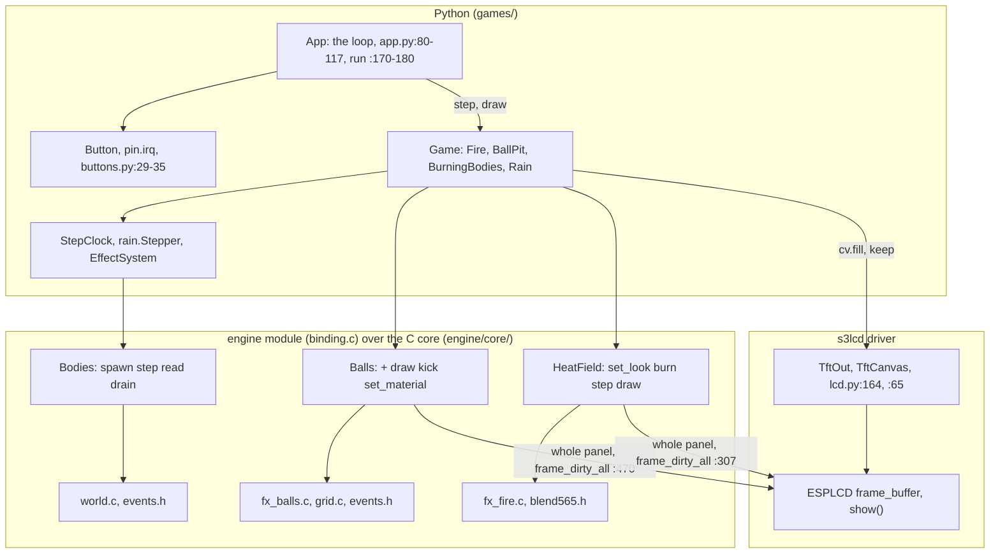
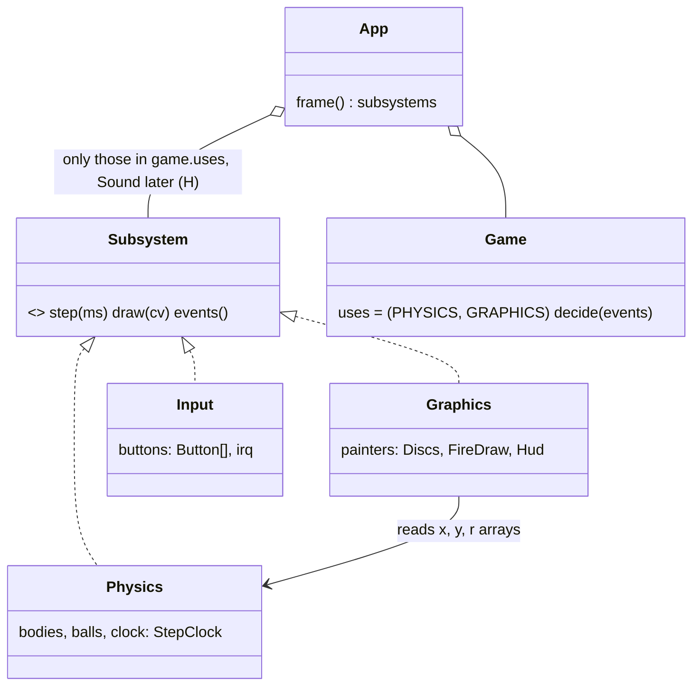
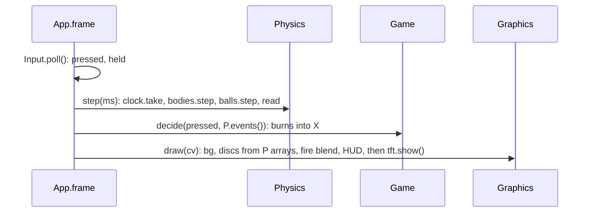
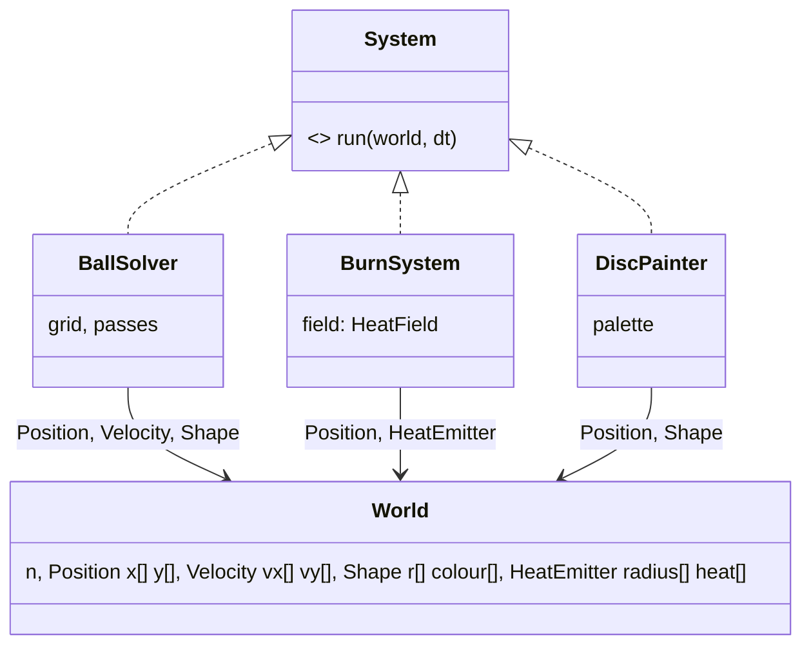
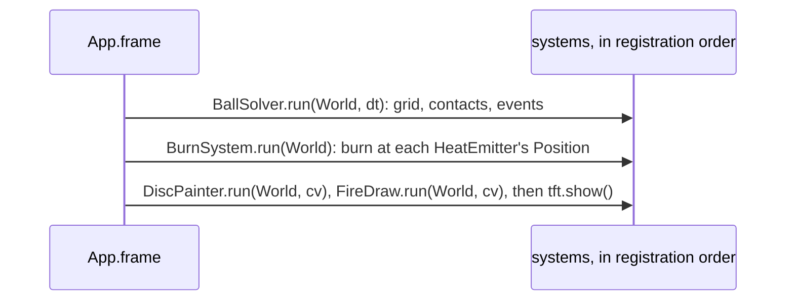
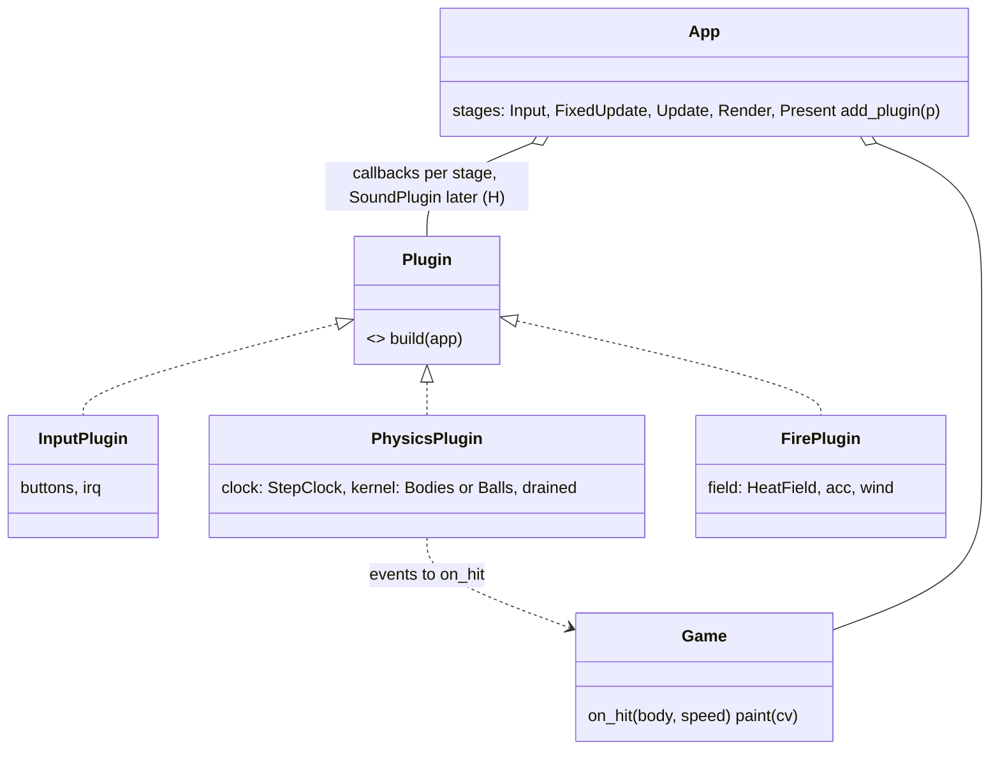
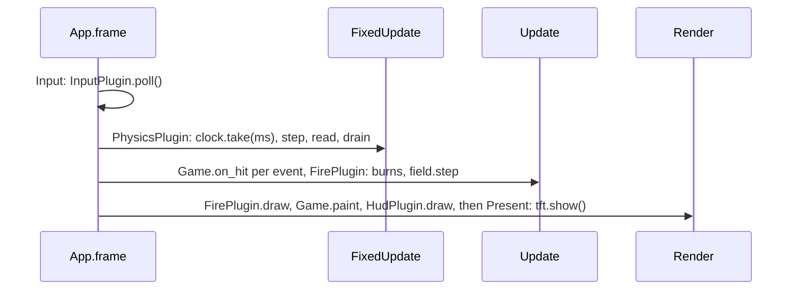

# Engine layers a game turns on and off: three options (P628 #841)

A proposal for the PO to pick. Its teaching half is [the deep dives](../../engine-deep-dives.md).

Paths are relative to the root of `firebeetle-games`, master `184fa2e`, 2026-11-05. H marks a hypothesis.
The PO's words (P628): it "feels weird" that the parts "all kinda use the same structure". He wants to "turn on and
off the various layers". Examples: "only use the pretty graphics, or only use the physics or the sounds".

## Today's structure

What a game does today to use a layer. It imports `engine` and makes the C object in `setup`. It owns a `StepClock`.
It calls step, read and drain in `play`, and the C draw in `paint` (`balls.py:76-88`, `:101-119`, `:133-139`). The same
lines exist in `burning.py:63-70`, `:97-107` and `rain.py:44-65`. That is P622 #829, the glue in copies. Turning a layer
off means deleting those lines by hand. The input layer is a plugin in all but name: `App` owns two `Button`s and the
interrupt hook (`app.py:52-53`, `:161-162`).

Patterns in use, by Nystrom's names (https://gameprogrammingpatterns.com/contents.html): Game Loop with a fixed
`FRAME_MS` (`app.py:174-177`). Update Method in `Game.step` and `Effect.update`. Event Queue in `events.h`. Strategy
in `Effect`. Component in `Body.effect` (`effects.py:67-71`).

## Option A. Subsystems, as Godot's servers

Godot's servers are "low-level APIs to control rendering, physics, sound, etc.": `RenderingServer`, `PhysicsServer2D`,
`AudioServer`. The scene tree sits on top and "uses them directly", and a game bypasses it at will. Source: https://docs.godotengine.org/en/stable/tutorials/performance/using_servers.html

- **Python.** One `Subsystem` interface with `step`, `draw`, `events`. `App.frame` calls only the subsystems a game
  names in `uses`. `Game.play` shrinks to decisions. The clocks move out of the games (P622's wish).
- **C.** The split that matters: `fx_balls_draw` leaves `fx_balls.c` for a painter `fx_discs.c` that takes
  `(x, y, r, colour, n)` (`fx_balls.c:332-353`). Then "physics only" works with a Python painter, and "graphics
  only" draws discs from any arrays. `binding.c` splits into one file per subsystem.
- **Driver and loop.** The driver is unchanged at first. Later each painter takes a rect and a blend mode instead of
  `frame_dirty_all` (`binding.c:307`, `:470`), so two C painters stack. `App.frame` runs the subsystems in a fixed order.
- **Cost.** Medium. Two new Python classes, one C file moved, binding split in two or three. Every game changes once.
- **First stage.** Move `fx_balls_draw` into `fx_discs.c` with the same body, called from `Balls.draw` with its own
  arrays. No behaviour changes, the Mac tests hold, and `BallPit` runs as before.

## Option B. Entity-component-system, as Unity DOTS and Bevy

Nystrom's Component splits one entity into `InputComponent`, `PhysicsComponent` and `GraphicsComponent`, and the
container holds the shared state, "like position and velocity". Source: https://gameprogrammingpatterns.com/component.html
An ECS goes one step further: a component is a parallel array, and a system is a function over the arrays.

- **Python.** `World.add_system(BallSolver())` turns a layer on. A game adds components to entities instead of
  owning a `Balls` and a `Stepper`. `EffectSystem` already names this pattern (`effects.py:82-85`).
- **C.** The biggest rewrite. `fx_balls_t` and `world_t` each own their arrays (`fx_balls.h:38-40`, `world.h:14-16`).
  An ECS puts the arrays in one `World` block, and each solver takes pointers. To keep the "no pointer in a block" rule,
  the systems must find the arrays from `cap`, as today's macros do.
- **Driver and loop.** Same as option A. Order bugs live in the registration order, as Nystrom warns for shared state.
- **Cost.** High. Every C type changes its layout, and every test fixture with it (`tests/world_lib.py`, `balls_lib.py`).
- **First stage.** Keep the C as is. In Python, make `Body` a list of components and let `EffectSystem.update` run every
  component (`effects.py:99-104`). That alone gives P611's second effect. The rest waits. Where it pays: P616 "balls
  on fire" becomes "a HeatEmitter on a few ball entities".

## Option C. A layered loop with plugins, as Bevy

Bevy plugins are "collections of code that modify an App". A game leaves one out by not adding it, for example the
`UiPlugin`. Systems run in schedules such as `Startup` and `Update`. Source: https://bevy.org/learn/quick-start/getting-started/plugins/
Unity orders a frame the same way: `FixedUpdate` zero or more times, the physics step, `Update`, then rendering. Source: https://docs.unity.com/en-us/engine/current/manual/scripting/managing-update-order/execution-order

- **Python.** `App` gets five stage lists and `add_plugin`. A game lists its plugins in one line:
  `plugins = (PhysicsPlugin(Balls, ...), FirePlugin(LOOK))`. `BurningBodies.play` (`burning.py:97-107`) and
  `Fire.play` (`fire.py:130-149`) become plugin callbacks. `Game.play` keeps the decisions only.
- **C.** Nothing in stage one. The `fx_discs.c` split of option A comes as stage two, so `PhysicsPlugin(Balls)` runs
  without its painter.
- **Driver and loop.** Nothing in the driver at first. The Render stage already is `TftOut.draw` plus `Game.draw`
  (`lcd.py:176-190`, `gfx.py:369-388`). `App.frame` runs the stages in order (`app.py:80-117`), one time sum per stage.
- **Cost.** Low to medium, Python only. The three games with glue lose about 30 lines each (H, from `balls.py:76-119`,
  `burning.py:61-107`, `rain.py:87-116`).
- **First stage.** Make `PhysicsPlugin` from `rain.Stepper` plus its `StepClock`, and let `Rain` and `BurningBodies`
  use it. Both games run as before, and `tests/test_rain.py` and `test_burning.py` hold.

## How the options answer the PO's asks

| Ask | A. Subsystems | B. ECS | C. Plugins in the loop |
| --- | --- | --- | --- |
| "only the pretty graphics" | `uses = (GRAPHICS,)` | add `FireDraw` only | `plugins = (FirePlugin,)` |
| "only the physics" | needs the `fx_discs.c` split | needs the split too | stage one: `Rain` paints in Python already |
| "or the sounds" | a `Sound` subsystem (H, no driver yet) | a `SoundSystem` (H) | a `SoundPlugin` in Update (H) |
| controls by interrupt | `Input` subsystem on `Button.watch` | an `InputSystem` | `InputPlugin` on `Button.watch` |
| P616 balls on fire | new glue | one component | `FirePlugin` plus `PhysicsPlugin(Balls)` |

## Recommendation

Start with option C, then take option A's C split as its stage two. Reasons:

1. Stage one is Python only and removes the copies P622 #829 names. Nothing in C or in the driver moves, so the bench
   numbers stay comparable to run89 and run99.
2. The PO's asks are answered by one line per game, the plugin list. Graphics only and physics only work after stage
   one for the rain and the fire. The ball pit needs the `fx_discs.c` split, which is option A's first stage.
3. Nystrom's Game Loop and Update Method are already in the code. The stage names are Unity's and Bevy's.
4. Option B is the right end state for many effects on many bodies, but it rewrites every C block and every test
   fixture. Its first stage, components as a list on `Body`, fits into option C unchanged.
5. Open for the council (H): the sound driver, the rect per painter in s3lcd, and one `StepClock` per plugin or in `App`.

## Not checked

- Bevy: I read only the plugins page, which shows leaving a plugin out, not `FixedUpdate` or `.disable::<Plugin>()`.
- The line counts per game in option C are an estimate from the cited ranges, not a diff.
- No sound code exists in the repository, so every sound row is H.
