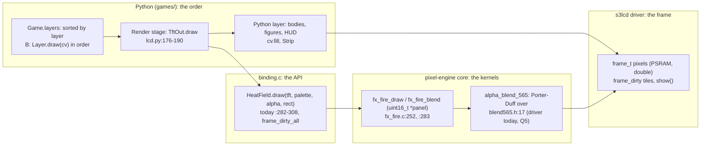

<!-- Resume: invoke product-discovery again; `discovery.py check <this folder>` names the next step. -->
# P638 ordered effect layers: discovery brief

<!-- Readiness, its one home. collecting evidence: anything short of the two below. an experiment: the decider chose
a test (a D) before choosing an option. design: the decider confirmed the frame, the jobs and a direction, and accepted
the remaining risk (D rows). An extension may tighten these. Next: design, or a chosen test of kind spike or prototype
→ the design skill the facts name, with this file; otherwise none, and the collection plan says who runs it.
Stands on: the assumptions not retired in risks-and-tests.md; of which those the decider rated high, or — while any
is unrated. check computes both. -->
**Ready for:** an experiment: P639's slice 0 (design A) is the prototype test of A1 (D5), then design B (D8) <!-- REQUIRED:ready -->
**Stands on:** 6 H, — of which would change the decision <!-- REQUIRED:debt -->
**Decision needed:** which layer design pixel-games builds first, and in which stages <!-- REQUIRED:decision-needed -->

## Frame
- Request, verbatim (corrections marked): "Remember that we'll also need to add fron layer effects, so like when things are on fire, i can only see the flames as if from behind it, but when somehthing is on fire, it cannot only be around it. And probably ew'll want to generalize this to adding layers to the effects so that we can intertwine multiple layers and even a python ldrawn layer in between two C layers etc, we'll dop ome good analysis and research and get inspired and design and plan this and add it to our low level pixel pack" (the PO, 2026-11-05, spark #853). Follow-up: "well, not necessarily the engine, split it into what belongs where, you know like something goes to the graphycs , some maybe to the driver or the binding, the python parts,,, lets stick to good reusable and changable architecture and industry standards for naming and such" (the PO, 2026-11-05, #853 comment). <!-- REQUIRED:request -->
- Decision · decider: which of the layer designs below pixel-games builds, and in what order of stages · Petr, the PO <!-- REQUIRED:decision -->
- Outcome and how it is observed (a metric with unit and source, a proof command, or a log): a burning body shows flames in front of it as well as behind it, judged by the PO on the board (P639 #854), and the burning scene keeps its fps at 23 or more (24 to 25 today, E bench.md:565-572, run117), read from the scene's 5 s log lines <!-- REQUIRED:outcome -->
- Already decided (D · who · when · where; include the product's stated non-goals and earlier decisions the request names): D-P628 · the PO · 2026-11-05 · plugins in the loop first (option C), then option A's C split (docs/discovery/2026-11-05-p628-engine-layers/README.md:185-187). D-P633 · the PO · 2026-11-05 · the stages FixedUpdate, Update, LateUpdate run in Game.step, and the render stays the game's (games/plugins.py:5-10). D12 · "C steps and paints, Python decides" (docs/engine-walkthrough.md:18). D-no-paid · the PO · 2026-10-31 · no paid Wokwi runs. No-goal: spark exports facts, never behaviour (AGENTS.md). <!-- REQUIRED:decided -->
- Open questions: Q0 to Q9 in the queue below, Q0 first. Q2: must the body stay visible through the front flames (two passes), or may hot flames cover it (one pass)? Q3: is "our low level pixel pack" pixel-engine, with the split of the follow-up? <!-- REQUIRED:open -->
- Scope · out of scope (proposed): in: the order of draw layers in one frame, C and Python mixed, where each part lives (driver, C core, binding, Python), its board cost, prior art and a staged plan. Out: new effects, the figures of P635 themselves, PIE kernels (P583 #784), sound, a scene graph. <!-- REQUIRED:scope -->
- Start and reach (proposed until Q0): start existing product (pixel-games plus the pixel-engine and s3lcd submodules) · decider reachable yes · users the PO himself, on the board · data and connectors: the repositories and bench.md on disk, GitHub through gh; no analytics, none needed · decider as a user n = 1 · must not get worse: the three scenes' fps (bench.md:565-572), partial send (P533 slice 5), the Mac tests of the C core <!-- REQUIRED:start-reach -->
- Flags (yes · no · —; asked only when it changes a decision; never legal advice; any date or threshold is read at its source at run time and cited):
  - sold or given away, or personal use: personal use, and public code under MIT (engine/LICENSE, engine/driver/LICENSE) <!-- REQUIRED:flag-sold -->
  - connects to a network or runs software (for example the EU's Cyber Resilience Act): runs software on one board, no network in this change · — for the Act, not needed for this decision <!-- REQUIRED:flag-network -->
  - children or food contact: no <!-- REQUIRED:flag-children -->
  - market: none, a hobby project <!-- REQUIRED:flag-market -->
  <!-- EXTEND:flags -->
- Extensions (each active id · the fact that activated it; when none matched, only "none matched: core only · the fact that decided it", naming no extension; list any directive skipped under rule 9): none matched: core only · the item is a software design question inside one repository, with no hardware, part or electrical change, so no extension's trigger fact is present <!-- REQUIRED:extensions -->
<!-- EXTEND:frame -->
- Depth: TRIO (default: PO assistant, user, tech lead), but one agent (Fable, 2026-11-05) wrote all three lens reports in council/, so no independent review; the refuter (step 6) is the first second pair of eyes <!-- REQUIRED:depth -->
  <!-- Cost, measured once: the P900 rehearsal's council took 6 agents, 499 calls and about 90M input tokens (2026-10-06). -->
- Search budget: 8 web searches in total; used: 6 sources read through 9 fetch calls (3 were redirects), no search query <!-- REQUIRED:budget -->
- Appetite (the decider's, asked only when heading for design) | —: — <!-- REQUIRED:appetite -->

## What we found <!-- CLAIMS -->
<!-- One claim per line: `- [★C<n>] claim · E pointer | H source | D who date · caveat: qualifier | none`.
★ marks a claim that a decision, an option or the riskiest assumption rests on. A quote is verbatim, with its pointer.
Say what the evidence can support: an account (what happened to one person), data (how often, in its population and
period), a document (what was specified), the product (what exists, not whether anyone needs it), a benchmark (a
comparison). Model knowledge is H until a source is read. Elsewhere cite a ★ claim as ★C<n>, with its keep: words.
e.g. `- [★C2] 13 of 526 tickets ask for recurring tasks · E tickets.csv:2-14 · caveat: picked by Lena; shows that, not how often` -->
- [★C1] One C call paints the whole panel into the driver's frame and marks every tile dirty: `heat_field_draw` runs `fx_fire_blend` or `fx_fire_draw` on `tft->frame_buffer`, then `frame_dirty_all(&tft->frame)`; the ball pit's draw does the same after filling the background · E `engine/binding.c:282-308`, `:469-470`; `engine/core/fx_balls.c:332-337` · caveat: the product as it is; an opaque C layer cannot go over another C layer today, but a blended one can (★C3 (not zero where nothing burns)) <!-- REQUIRED:findings -->
- [★C2] The order of the layers is the call order: `Game.draw` runs `paint`, `fx.draw`, `hud`, `draw_over`, and the burning scene's `paint` is the fire, then one `fill` per body · E `games/gfx.py:385-394`, `games/burning.py:126-128` · caveat: P633 left this open on purpose, `games/plugins.py:9-10`
- [★C3] A blended C layer stacks over what the frame holds: `fx_fire_blend` reads the frame's pixel and skips a pixel of alpha 0 · E `engine/core/fx_fire.c:294-299`, `:310-313`; the blend is straight-alpha "over" in `engine/driver/src/blend565.h:17-32` · caveat: the kernel still interpolates every pixel in LINEAR, so its cost is not zero where nothing burns
- [★C4] One opaque full-panel pass costs 4 to 7 ms on the board, and a lit full-panel blend 11.5 to 13.3 ms: the opaque nearest draw 4.26 to 4.27 ms, linear 6.41 ms (burning, run89), the sky picture's blit 7.3 ms (flappy, run109), the linear blend over the sky 11.51 to 13.32 ms (fire picture, run90) · E `bench.md:429-430`, `:484`, `:433` · caveat: one run each, 40 ms pace, this image; the card's "about 5 ms" is not a sentence in P612's finding (F1)
- [★C5] The burning scene has about 14 ms free a frame, and 12 Python figures take 3.4 ms of it · E `bench.md:535-537`, `:552` · caveat: run116 with the probe's extra heap, gc 3.6 ms there
- [★C6] A second buffer costs a second pass: P603 part 2 blended straight into the frame and the paint fell about 16 ms, "because the frame no longer gets a second full-panel pass" · E `bench.md:366`, `:371`, `:373` · caveat: the part 1 path also blended every pixel with a bounds check (`bench.md:167`), so 16 ms is the upper bound of a surface's cost
- [C7] Per-pixel costs: PSRAM write 55 ns, read 34 ns, alpha compose in C 337.5 ns into the PSRAM frame · E `p580-finding.md:15` (run46) · caveat: a full-panel write is about 4.2 ms and a read-plus-write pass about 6.8 ms by arithmetic (H), matching ★C4 (one run each)'s 4.26
- [C8] A cached Python surface exists: `Strip`, drawn when its key changes and blitted every frame by `blit_buffer`'s memcpy path · E `games/lcd.py:47-62`, `:107-118`; `engine/driver/src/s3lcd.c:573-600` · caveat: none
- [C9] The frame is the driver's: PSRAM "double" mode, 16 px dirty tiles set by `frame_dirty(x0, y0, x1, y1)`, which every driver draw calls with its rect · E `engine/driver/src/frame.h:20-24`, `:40-58`, `:62-73`; `games/lcd.py:38`, `:43` · caveat: none
- [C10] The C kernels take a bare `uint16_t *panel` and know no driver; only the binding knows `s3lcd_type` and `frame_dirty_all` · E `engine/core/fx_fire.h:66-73`; `engine/binding.c:16`, `:21`, `:285`, `:307` · caveat: none
- [C11] P628 already proposed the C piece: "Later each painter takes a rect and a blend mode instead of `frame_dirty_all` ... so two C painters stack" · E `docs/discovery/2026-11-05-p628-engine-layers/README.md:82-83` · caveat: a proposal, not built
- [C12] Blended fire holds the pace: fire picture 23 to 24 fps against 24 to 25 opaque · E `bench.md:431-433` · caveat: the fire scene with its base on; the burning scene was never run blended
- [C13] Names, read 2026-11-05: Godot `CanvasLayer.layer` "Lower values are drawn behind higher values" (the refuter's fetch), `z_index` "A node with a higher Z index will display in front of others"; Unity "renders sublayers in numerical order, so lower values render behind higher values"; the painter's algorithm "from the farthest to the closest object"; the W3C source-over "co = αs x Cs + αb x Cb x (1 – αs)" (Porter-Duff "over", straight alpha) · E the URLs in `council/po-assistant.md:10-13` (EX-4 to EX-7) · H Bevy `SortedPhaseItem` "The smallest values are drawn first" (read by the refuter on docs.rs, URL not recorded) · caveat: names and the model; none says how its engine stores a layer
- [C14] The first user is one story, P639, "Waits for P638's design"; no card needs "a Python layer between two C layers" yet · E spark #854, read 2026-11-05 · H no card found (council/po-assistant.md RA-1) · caveat: n = 1, the PO's scenes

## Options <!-- CLAIMS -->
<!-- Two or three per open decision: decision · option · cost · what it would prove · opinion (whose), then the tag
and caveat cells. e.g. `- Q2 what first · fix delivery · two weeks · whether seen tasks get done · opinion (the facilitator's) · H ★C2 · caveat: none` -->
- Q4 how a scene stacks layers · **A. Call order** (the painter's algorithm as written code): `BurningBodies.paint` draws the bodies, then `FirePlugin.draw` with the blend (`ALPHA`), base off. No new API, no C. Flames go in front; "behind" where a body is coal is lost under full alpha (Q2) · cost: a day, Python only (H); per frame the blend in place of the opaque draw, about +5 to +7 ms (H from ★C4 (one run each): 11.5 to 13.3 against 6.4 in the fire scene, fewer lit pixels in burning) · proves: whether the look is wanted (A1) and the fps line (P639) · opinion (the agent's): the walking skeleton, and nothing else if the PO stops at P639 · E `games/burning.py:126-128`, `engine/core/fx_fire.c:294-299` (★C2, ★C3) · caveat: the blend is not zero where nothing burns (★C3), and it does not give "any order" for two C layers (★C1 (a blended one can)) <!-- REQUIRED:options -->
- Q4 · **B. A layer list that draws in place** (Godot's `CanvasLayer.layer` and `z_index`, Unity's Sorting Layers, the painter's algorithm; each layer a Porter-Duff "over" into the one frame): Python holds `Game.layers`, each with `layer` (an int, lower behind) and `draw(cv)`; the Render stage draws them sorted. A C effect's `draw` gains a rect and a blend mode (OPAQUE and BLEND; SDL names them `SDL_BLENDMODE_NONE` and `SDL_BLENDMODE_BLEND`, H not read) and marks that rect with `frame_dirty`, not the whole frame. The ball pit's background fill leaves `fx_balls_draw` (P628's `fx_discs.c`) · cost: Python one class and the Render loop; binding one rect argument and `frame_dirty` per draw; C a rect in `fx_fire_draw` and `fx_fire_blend`; a few days (H). Per frame: 0 extra passes, each layer pays its own pixels (★C3 (not zero where nothing burns), C7) · proves: a Python layer between two C layers runs (P616's balls under fire, figures, fire over them) · opinion (the agent's): the design · E `engine/binding.c:282-308`, `engine/driver/src/frame.h:62-73` (★C1 (a blended one can), ★C3, C9, C10, C11) · caveat: a sort and a class the other scenes must adopt, or two orders exist (council/po-assistant.md RA-5)
- Q4 · **C. Surfaces per layer and a compositor** (a render target per layer, H name; composited back to front by one C kernel, Porter-Duff "over"): each C effect paints its own 153,600 B RGB565 surface plus coverage; a compositor pass reads every surface and writes the frame; a Python layer draws into a `Strip`-like surface (C8) · cost: +1 compose pass per live layer: an opaque copy about 6.8 ms (H, C7), an alpha composite 11.5 to 13.3 ms with skips (★C4 (one run each)) and up to 25.9 ms without (C7's 337.5 ns × 76,800 px, H), 16 ms measured once (★C6 (upper bound)); +150 KB PSRAM per layer · proves: a layer can be cached across frames (a still sky, a HUD) and filtered on its own (P610 blur) · opinion (the agent's): a rabbit hole for per-frame effects on this board, the right swap for a cached static layer · E `bench.md:433`, `:535-537`, `:366` (★C4, ★C5 (run116), ★C6) · caveat: the sky blit already is this for one static layer (★C4's 7.3 ms)
- Proposed, pending Q3, Q5 and Q8: where each part lives, all options (the PO's split, #853 comment): the s3lcd driver owns the frame, its pixels, the dirty tiles and `show()` (the framebuffer and the present) · pixel-engine's C core owns the effect kernels and, proposed, the compositing kernel (`alpha_blend_565`, today in the driver's `blend565.h`, Q5) · the binding owns the Python API (`HeatField.draw(tft, palette, alpha, rect)`), the type checks and `frame_dirty` · the Python side owns the layer list, its order, the Render stage and Python-drawn layers · swaps: another esp_lcd panel or `FRAMEBUFFER` mode in the driver (C9); a PIE `.S` twin per kernel (P583); another display type behind the binding's buffer check (`engine/binding.c:285`); `render.StOut` for the Mac · E `engine/driver/src/frame.h:20-24`, `engine/core/fx_fire.h:66-73` (C9, C10) · caveat: the names "render target" and "present" are H (not read)
- Proposed no-gos and rabbit holes (proposals until the decider confirms): a surface per per-frame effect (option C for the fire); a z number as a float with a sort every frame (ints and a sort at setup are enough, H); drawing the field twice a frame for "behind and in front" before Q2 is answered (a second full step costs 6 to 8 ms, `bench.md:429`); moving the blend into the driver's `blit_buffer` path (it blends every pixel with a bounds check, `bench.md:167`) · H the agent's, from `bench.md:429`, `:167` · caveat: proposals until the PO confirms <!-- REQUIRED:nogos -->

## Riskiest assumption and its test
- Riskiest: A1 · one heat field blended over the body, after the body is painted, reads as "on fire" to the PO and not as a body lost behind flames · D4 (rated high by the PO) <!-- REQUIRED:riskiest -->
- Test · kind · pass line, dated before any result · proposed | D<n>: option A built as P639's slice 0 · a prototype test, n = 1 (the PO plays it on the board; a Mac PNG through `tools/render_scene.py` first) · pass line, set 2026-11-05: the PO says it looks on fire in his words, and the scene's draw ms stays at 13.5 or less (run90's lit blend 11.51 to 13.32, `bench.md:433`; run117 burning 6.40 to 6.44, `bench.md:570-571`), beside the fps line at 23 or more. The fps alone cannot fail, because FRAME_MS 40 caps it at 25 (`bench.md:435`) · D5 <!-- REQUIRED:test -->

## Questions
<!-- A queue; the first open question is asked alone. Each: Q<n> · question · decides: … · options · unblocks ·
opinion (whose) · kind: decision | account (a past-tense question about the decider's own use; the answer is E,
account, n = 1) · status: queued | asked <date> | answered D<n>.
If the decider cannot be asked, the queue stays here, and whatever rests on it stays H. -->
- Q0 · Is this frame right: the decision, the start and reach, the extensions and the depth? · decides: the frame · status: answered D1, D2, D3 <!-- REQUIRED:q0 -->
- Q1 · How important is each assumption, and what pass line must the riskiest test meet? · decides: importance and pass lines · status: answered D4, D5 <!-- REQUIRED:q1 -->
- Q2 · When a body burns, must it stay visible through the front flames, or may the hottest flames cover it? · decides: one draw pass or two (option A's cost) · options: cover · stay visible · unblocks: P639's slice 0 · opinion (the writer's): cover first, it costs nothing · kind: decision · status: answered D6
- Q3 · Is "our low level pixel pack" pixel-engine with the follow-up's split (driver, C core, binding, Python)? · decides: where the layer list lives · options: yes · a new package · unblocks: items.md · opinion (the writer's): yes, the follow-up says so · kind: decision · status: answered D7
- Q4 · Which design: A the call order, B the layer list drawing in place, C surfaces with a compositor? · decides: the plan's stages and the C work · options: A · B · A then B · C · unblocks: P639 and items.md · opinion (the agent's): B with A as slice 0 · kind: decision · status: answered D8
- Q5 · Does the compositing kernel (`blend565.h`) stay in the s3lcd fork or move to pixel-engine's core? · decides: the repository split after P632 and the Mac test's home · options: driver · core · opinion (the tech lead, council/tech-lead.md Q5): the core, since the driver only forwards it · kind: decision · status: answered D9
- Q6 · Appetite for the first slice: P639 alone, or the layer list with it? · decides: the size of the next card · options: P639 alone · P639 plus slice 1 · opinion (the agent's): P639 alone · kind: decision · status: answered D10
- Q7 · Did you see the fire's picture mode over the sky (run90) as "in front" the way you want for a body? · decides: whether A1 already has an account · kind: account · status: answered D11
- Q8 · Does the layer list live in pixel-engine's Python side (beside `plugins.py`) or in pixel-games? · decides: where the list lives and who tests it · options: pixel-engine · pixel-games · unblocks: slice 1 · opinion (the PO assistant and the tech lead, council/): pixel-engine, by the PO's split · kind: decision · status: answered D12
- Q9 · Which scene will next want two C layers with a Python layer between? · decides: whether slice 2 starts (A5) · options: a named scene · none yet · unblocks: slice 2 · opinion: — · kind: decision · status: answered D12

## Decisions
<!-- D<n> · what · who · when · where recorded · options considered.
A yes covers only the actions and choices it names. A standing yes names its kind of action and its source.
Name what a D confirms in its words: the frame, the jobs, a direction, the remaining risk, a test, items.md. -->
- D1 · the frame's decision and outcome confirmed: the PO picks how a frame stacks its drawings; the first test is a burning body with flames in front and behind, at 23 fps or more · the PO · 2026-11-05 · chat, "Yes, that is the goal" · options: yes, another first test, a bigger goal
- D2 · the scope confirmed as written in the Frame (in and out) · the PO · 2026-11-05 · chat, "Yes, that size is right" · options: yes, move an item in, move an item out
- D3 · the depth confirmed: one agent wrote the three lenses, the refuter and the review checked them, no independent council · the PO · 2026-11-05 · chat, "Enough, go on" · options: enough, three independent agents
- D4 · importance: A1, A2, A3 and A5 would each change the pick if wrong (all high); A4 and A6 not rated by the PO · the PO · 2026-11-05 · chat · options: any of A1, A2, A3, A5
- D5 · the test of A1 confirmed with its pass line: design A as P639's slice 0, a Mac PNG first, then the board; pass if the PO says in his words that the person looks on fire, the draw takes 13.5 ms or less a frame, and the fps stays at 23 or more · the PO · 2026-11-05 · chat · options: look and speed, look only, speed only
- D6 · Q2: the hottest front flames may cover the body; cooler flames let it show through; one pass · the PO · 2026-11-05 · chat · options: may cover, always shows through
- D7 · Q3: "our low level pixel pack" is pixel-engine, split by job (driver, C core, binding, Python) · the PO · 2026-11-05 · spark #853 comment of 15:06 UTC ("Yes, pixel-engine", then "split it into what belongs where") · options: yes, a new package
- D8 · Q4, a direction: design A first (P639's slice 0), then design B, the layer list that draws in place; C is not built · the PO · 2026-11-05 · chat · options: A then B, A only, B now, C
- D9 · Q5: the blend function (`alpha_blend_565`) moves from the s3lcd driver to pixel-engine's C core · the PO · 2026-11-05 · chat · options: core, driver
- D10 · Q6, appetite: the next card is P639 alone (design A); the layer list is its own later card · the PO · 2026-11-05 · chat · options: P639 alone, P639 plus the list
- D11 · Q7, an account (E, n = 1): the fire's picture mode over the sky (run90) is the "in front" look the PO wants for a body · the PO · 2026-11-05 · chat, "Yes, like that" · options: yes, different, not remembered
- D12 · Q8 and Q9: the layer list lives in pixel-games `games/` beside `plugins.py`; P635's burning people (slices 1 to 3) are the next scene that needs a Python layer between two C layers · the PO · 2026-11-05 · chat · options: pixel-games, pixel-engine; P635, P616, none yet
- D13 · the jobs confirmed: jobs 1 to 4 in jobs-and-journeys.md · the PO · 2026-11-05 · chat, "Yes, those four" · options: yes, change one
- D14 · items.md confirmed for filing: P639 #854 takes design A, and three new cards (the layer list, the C rectangle, the blend function in the core) plus the #853 number fix · the PO · 2026-11-05 · chat · options: each of the four, multi-select

## Found on the way <!-- CLAIMS -->
<!-- Outside this item's scope. Each is a separate proposal, never folded in. Same line format as What we found. -->
- [F1] The card's note "each full-panel pass through PSRAM costs about 5 ms (P612)" has no such sentence in P612's finding; P612:70's arithmetic gives 4.2 ms for a write and 6.8 ms for a read and a write, so the card rounds it. The measured passes are 4.26 to 7.3 ms opaque and 11.5 to 13.3 ms for a lit blend (★C4 (one run each)) · E `docs/discovery/2026-11-05-p612-frame-time/README.md:70`, `bench.md:429-430`, `:484` · caveat: a wording fix on #853, not a finding against the card <!-- REQUIRED:found -->
- [F2] `FireLayer.draw` needs `hasattr(cv, "tft")`, so a C layer draws nothing on the Mac stand-in and a Mac PNG cannot show a layer order with C in it unless `tools/render_scene.py` fakes it · E `games/fire.py:268-271`, `games/render.py:120` · caveat: `render_scene.py` not read
- [F3] The `simple-english` lint hook flags the discovery skill's own format (the `·` separators, the `—` unknown marker, the PO's verbatim contractions) in every file of this folder · H the writer's account of the hook's output, 2026-11-05 · caveat: a tooling clash, for the retro inbox
- [F4] Two writers worked in this folder at once (commits `1d0a95b`, `3197fc2` at 17:44 beside this agent's run); this agent filled only the slots still open and left the frame, the jobs and Q2, Q3 as the other writer wrote them · E `git log` in the worktree, 2026-11-05 · caveat: for the retro inbox

<!-- EXTEND:brief-sections -->

## Hand-off
<!-- Written only after the decider confirms the understanding (a D); copies only confirmed constraints. Holds: outcome ·
who · success and its proof · constraints (appetite, confirmed no-gos, rabbit holes) · what they said (D) against what
we assume (H) · links to the journeys and the map · riskiest assumptions and their tests · options considered. -->
Outcome: a burning body shows flames in front and behind, judged by the PO on the board, at 23 fps or more (D1). Who: the PO, as the scene author (D13). Success and its proof: D5's pass line on P639. Constraints: P639 alone next (D10); hot flames may cover the body (D6); C (a surface per layer) is not built (D8). Said (D): D1 to D14. Assumed (H): A4 (a rect draw costs no more) and A6 (surfaces too costly), not rated. Next: P639 #854 builds design A; then P640 #858 the layer list in `games/` (D12), P641 #859 the C rectangle for P635 (D12), P642 #860 the blend in the C core (D9). See [jobs](jobs-and-journeys.md), [map](story-map.md), [risks](risks-and-tests.md). <!-- REQUIRED:handoff -->

## Files
[Jobs and journeys](jobs-and-journeys.md) · [Story map](story-map.md) · [Risks and tests](risks-and-tests.md) · [Verification](verification.md) · [Items](items.md) · council/
