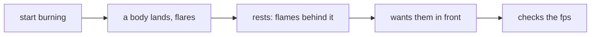

# The user: the journey as the PO walks it today

Written 2026-11-05 by the one discovery agent (Fable 5.1), as one of three reports. The user is the PO (n = 1), who
plays the scenes on the FireBeetle board and writes the scenes with the AI. Paths relative to pixel-games at `4751ca9`.

## Findings

- U-1 · What he sees. In the burning scene the field is painted first and each body as a filled square over it, so a
  body always covers the flames where they overlap · E `games/burning.py:126-128` (`super().paint(cv)` then
  `self.physics_plugin.draw(cv, BODY, COALS)`) · his words: "i can only see the flames as if from behind it" · E spark
  #853 · supports only: an account, one person.
- U-2 · What he liked before. The flare on a hard landing: "Oh, nice!!!" (2026-11-04) · E `games/burning.py:46`
  (the comment records it) · and he picked the alpha curve on the panel, "full from heat 96" · E `games/fire.py:92-93` ·
  supports only: he judges a look on the panel and by a Mac render of curves, not from numbers.
- U-3 · How a scene writer orders layers today: by writing the calls in `paint` in the order wanted · E
  `games/burning.py:126-128`, `games/balls.py:133-137` · there is no list to read the order from, so a new scene copies
  a `paint` · H from the code shape · supports only: the writer's step, not his feelings about it.
- U-4 · What he can supply: a yes or no on the panel, within one play, and feel numbers he tunes (the LOOK tuples,
  `fire.py:52-62`, `burning.py:44`). What he cannot: fps or ms, which the HUD and the 5 s report lines give him
  (`fire.py:213-219`) · E those lines · supports only: the test he can run is a look test with the fps line beside it.
- U-5 · Where he may come to harm. A field blended over the body covers the body under the hottest cells (alpha full
  from heat 96, `fire.py:94-95`). the coal colour is dark on purpose "so its flames show around it" (`burning.py:35`).
  If the whole body turns to flame he loses the thing that burns · H my reading of the two constants · supports only: a
  candidate question for him, not a finding about his taste.
- U-6 · Friction a writer meets: a C layer demands an `s3lcd` display (`binding.c:285-286`), so on the Mac stand-in
  (`render.StOut`) a C layer draws nothing and the order cannot be seen in a Mac PNG unless the tool fakes it · E
  `games/fire.py:270` (`hasattr(cv, "tft")`), `games/render.py:120` · supports only: the Mac look test needs
  `tools/render_scene.py`'s own fire path (not read here).

## Journey: the PO sees a burning body, today

| step | what he does | evidence | friction or harm | today | open question |
| --- | --- | --- | --- | --- | --- |
| 1 | starts the burning scene on the board | E `burning.py:62-79` | none | works | — |
| 2 | watches a body land and flare | E `burning.py:118-124`, his "Oh, nice!!!" `:46` | none | works | — |
| 3 | looks at a resting body burning | E `burning.py:126-128` | the flames stop at the body's edge. "as if from behind it" | partly | Q3: one field over it, or two? |
| 4 | wants flames across the body | E spark #853 | nothing he can set. the order is in code | not yet | Q2: which design |
| 5 | reads the fps on the HUD | E `fire.py:213-214` | must stay within 2 fps (P639) | works | — |

## What I could not check

- Nothing he said about the look of a front blend exists yet. U-5 is my guess about a harm, to be asked.
- Whether he writes scenes himself or only with the AI: the friction in U-3 is then not his.

## Questions for the decider

- Q3 · When the body burns, should the body stay visible under the flames (two fields, or a lower alpha in front), or
  may the flames cover it? · decides: one field or two, and whether the alpha table gets a second curve.

## Searches

none.
