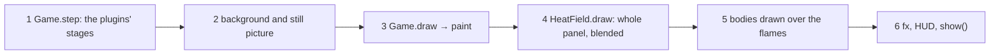
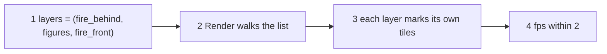

# Jobs and journeys
<!-- Tags as in the brief: E with a pointer, H with its source, D with who and when; an unknown is —. -->

## Who
<!-- One line per persona: who · evidence status (E pointer | H source).
e.g. `- Team leads who assign work · H Lena's belief, no interview yet` -->
- Petr, the PO: he writes the scenes and plays them on the board, n = 1 · E spark #853 (the request), bench.md:555-580 (he judges each run) <!-- REQUIRED:who -->
- The scene author: today the PO and the agent that writes a scene from his words. This is who lists a scene's layers · E games/burning.py:62-75 (a scene lists its plugins in setup)
- A later pixel-engine user who imports the engine without pixel-games · H engine/README.md:1-5 says "A small game engine in C", but no second user exists

## Jobs
<!-- One job story per line, each clause tagged: When …, I want to …, so I can ….
e.g. `- When I assign a task in a meeting [E tickets.csv:6], I want the assignee to see it that day [H Lena], so I can stop chasing people [E tickets.csv:7]` -->
- Job 1 · When a body burns [E games/burning.py:118-124, the flare burns heat at the body], I want flames drawn in front of it as well as behind it [E the PO, #853: "it cannot only be around it"], so it looks on fire and not lit from behind [E P639 #854, Done when] <!-- REQUIRED:jobs -->
- Job 2 · When I write a scene [E games/burning.py:67-74], I want to list its draw layers in the order the frame paints them, C and Python mixed [E the PO, #853: "even a python ldrawn layer in between two C layers"], so a Python-drawn figure can stand between the flames behind it and the flames in front [E P635 #850, Done when: silhouette figures catch fire]
- Job 3 · When I add a layer [E games/burning.py:74], I want the frame to pay for that layer's pixels only [H the writer, from P612's numbers], so the scene keeps its fps within 2 [E P639 #854, Done when]
- Job 4 · When I read the engine's code [E the PO, #853 comment: "split it into what belongs where"], I want each part in the place its job names, with an industry name [E the PO, #853 comment: "industry standards for naming"], so a part can be swapped without touching its callers [E CLAUDE.local.md, "strategies, settings and modules that can be swapped"]

## Today they…
<!-- Per job: what they do instead today (a competitor, a workaround or nothing), tagged.
e.g. `- Job 1 · paste each task into Slack by hand · E tickets.csv:7` -->
- Job 1 · nothing: BurningBodies.paint draws the field first, then the bodies over it, so flames never cover a body · E games/burning.py:126-128 <!-- REQUIRED:today -->
- Job 2 · each scene's paint calls the C draws and the Python draws by hand in the order it writes them; plugins.py says the order "is open (P638)" · E games/plugins.py:9-10, games/fire.py:194-200
- Job 3 · one C draw writes or blends the whole panel and marks all tiles to send (frame_dirty_all) · E engine/binding.c:303-307
- Job 4 · the binding knows the driver's type and reads its frame buffer; the core takes a bare pixel pointer · E engine/binding.c:16-21, :285-289; engine/core/fx_fire.h fx_fire_draw's signature

## Journeys
<!-- One ### per actor and scenario: the table, then a Mermaid flowchart of the same steps. Never a Mermaid
journey block: it forces a score on every task. "n/a — a one-step job" may replace both.
e.g. `| 2 | opens the app | E analytics, 90 days | never sees the task | not yet | Do they read email? |` -->
### The scene author — one frame of the burning scene today <!-- REQUIRED:journey -->
| step | what they do | evidence | friction or harm | today | open question |
| --- | --- | --- | --- | --- | --- |
| 1 | App.frame runs Input, then Game.step with FixedUpdate, Update, LateUpdate | E games/app.py:80-98, games/gfx.py:339-356 | none | works | — |
| 2 | TftOut.draw fills the background and the still picture with tracking off | E games/lcd.py:176-183 | none | works | — |
| 3 | Game.draw calls the scene's paint | E games/gfx.py:375-386 | the order inside paint is the scene's own code | partly | Where does the layer list live (Q8)? |
| 4 | Fire.paint calls FirePlugin.draw, which blends the whole field into the frame and marks all tiles | E games/fire.py:194-200, :129-136, engine/binding.c:282-307 | a whole-panel pass, and partial send loses its gain | works | Can a C draw take a rect? |
| 5 | BurningBodies.paint then draws the bodies as boxes over the field | E games/burning.py:126-128 | the flames end at the body's edge: Job 1's gap | not yet | Q2 |
| 6 | Game.draw draws fx, the HUD and the game-over box, then show() sends | E games/gfx.py:387-394, games/lcd.py:188 | none | works | — |

### The scene author — one frame as the PO asks for it (P639, then P635)
| step | what they do | evidence | friction or harm | today | open question |
| --- | --- | --- | --- | --- | --- |
| 1 | lists the layers in order: flames behind, the figure, flames in front | E the PO, #853 | no list exists | not yet | Q8 |
| 2 | the Render stage walks the list, C and Python draws alike | H the writer, from P633's stage loop (gfx.py:352-356) | a C draw after a Python draw must blend over it, not overwrite | not yet | Q2 |
| 3 | a layer that covers a part of the screen marks only its tiles | H the writer, from frame.h:62-72 | today every C draw marks all | not yet | — |
| 4 | the scene's fps stays within 2 | E P639 #854 Done when | each full-panel pass costs 4 to 13 ms (★C4) | — | A2 |

