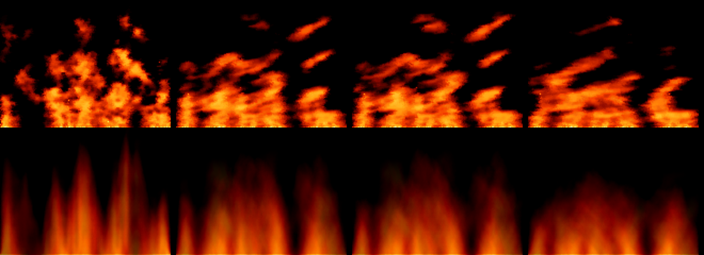

# P647: why the flames rise in fixed columns, and the flow that breaks them up (spike finding, 2026-11-06)

Spark issue [#869](https://github.com/xmejkal/spark/issues/869). The prototype is on the branches `p647-motion` in
pixel-engine and in this repository (draft [#44](https://github.com/xmejkal/pixel-games/pull/44)). Tags: E evidence
with a pointer, H a hypothesis and where it comes from. All clips ran on the Mac through the C fire, with no board time.

## Short version

> 1. The cause has two parts. The cooling map and the fast map scroll only up. Cell x always reads cooling map
>    column `x & 255` (the fast map `(x + 128) & 255`), so the cold gaps stay in the same columns (E:
>    `engine/core/fx_fire.c`, the row loop). And the heat rises straight up from 12 hot spots, which walk 1 cell a
>    step and jump in 1 step of 64 (E: `games/fire.py`, `SPOTS`, `SPREAD`).
> 2. Two flows, each a setting, break the columns up: bend (domain warping) and wander (texture panning). Fixed
>    columns show as bright spikes in a 100-frame average, and both flows blur them (E: the picture below).
> 3. The PO picked the light flow: bend 1, wander 512, every number a setting, less bend where in doubt. Story
>    P650 [#872](https://github.com/xmejkal/spark/issues/872) puts it on the board.
> 4. The PO saw the motion as a fluid that also moves water and other materials. That is P649
>    [#871](https://github.com/xmejkal/spark/issues/871), one flow (physics) and one field renderer (graphics). P650
>    is refined after P649's discovery, and P649's MVP can replace it.

## The two flows

| Setting | Range | What it does |
| --- | --- | --- |
| bend | 0 to 8 cells | Row y reads the maps and the heat shifted by a sine wave that travels up. |
| rows, steps | 1 to 256, 1 to 1000 | The wave's length in rows and the steps one wave takes (init: 40, 50). |
| width | 1 to 256 columns | Each stretch of `width` columns sits at its own place in the wave (init: 16). |
| wander | 0 to 1023 | The cooling map drifts one way and the fast map the other, up to wander / 256 cells a step. |

The PO's notes shaped them. Round 1 bent every column with one wave, and the PO said: "the flames should not always
bent the same all at once". Round 2 gave each stretch of columns its own phase, read from the cooling map. Round 3
made every number a setting and the wander faster, after "less bend, the wander can be more".

From the left: none, wander 512, light (bend 1, wander 512), strong (bend 2, wander 1023). All on seed 595.

## Cost (H, from the code, not measured)

- Wander: one random draw a step and one add in each map read. The rows stay byte lines.
- Bend: about six table reads and a few adds per cell. The shift differs per cell, so P601
  [#802](https://github.com/xmejkal/spark/issues/802)'s 16-byte vectors no longer fit the step as it is.
- What neither fixes: the flames do not cross or merge. A velocity field per cell can fix that (P649).

## Sources

- Inigo Quilez, "Domain warping", https://iquilezles.org/articles/warp/: bend, written again from the description.
- Texture panning, as in Unreal's Panner material node: wander.
- Fabien Sanglard, "How DOOM fire was done", https://fabiensanglard.net/doom_fire_psx/: sideways spread and wind.
- For P649: Jos Stam, "Real-Time Fluid Dynamics for Games", GDC 2003. Bridson, Hourihan and Nordenstam,
  "Curl-Noise for Procedural Fluid Flow", ACM TOG 26(3), 2007.
