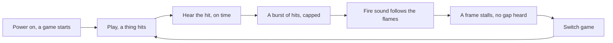
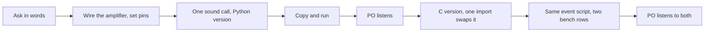

# Jobs and journeys
<!-- Tags as in the brief: E with a pointer, H with its source, D with who and when; an unknown is —. -->

## Who
<!-- One line per persona: who · evidence status (E pointer | H source).
e.g. `- Team leads who assign work · H Lena's belief, no interview yet` -->
- The PO as player: plays the games on the board, the decider, n = 1 · E council/user.md USER-17 to USER-22 (bench.md:303, bench.md:713) <!-- REQUIRED:who -->
- A visitor at the showcase: plays the board once, in a room that no source names · H issue #875 (USER-7), n = 0
- The game author: the AI agent writes the game, and the PO gives the words and the verdict · E council/user.md USER-11 (quotes from #774 and #783)

## Jobs
<!-- One job story per line, each clause tagged: When …, I want to …, so I can ….
e.g. `- When I assign a task in a meeting [E tickets.csv:6], I want the assignee to see it that day [H Lena], so I can stop chasing people [E tickets.csv:7]` -->
- Job 1 · When a thing lands or hits in a game [E USER-2, USER-3], I want to hear it at that moment [E #997 "just add sound to the games"], so I can feel its weight and its material [H USER-19, from words about pictures] <!-- REQUIRED:jobs -->
- Job 2 · When the fire burns on the screen [E #997], I want to hear a generated sound that follows it [E #997 "autogenerated realistic sound effects"], so I can show a fire that feels real [H USER-7, USER-19]
- Job 3 · When an author adds a sound to a game [H USER-11], I want one small call that stays the same for both versions [E #997 "so we can just swap it for a more optimized one"], so I can swap Python for C and leave the game alone [E #997, D2]
- Job 4 · When both versions exist [E D2], I want one bench row per version [E #997 "something like some benchmark, like with the graphics"], so I can see what the C version buys [H USER-15, a row shows cost and not sound]

## Today they…
<!-- Per job: what they do instead today (a competitor, a workaround or nothing), tagged.
e.g. `- Job 1 · paste each task into Slack by hand · E tickets.csv:7` -->
- Job 1 · nothing: the games are silent, and "a clang" exists only as a named wish · E USER-1, USER-2 (docs/discovery/2026-11-03-engine/p588-feel-notes.md) <!-- REQUIRED:today -->
- Job 2 · nothing: the fire is judged by eye, on Mac sheets and on the board · E USER-18, bench.md:713
- Job 3 · nothing for sound. The nearest pattern is the plugin stages and a Python twin of each C piece · E games/plugins.py:1-30 (USER-12)
- Job 4 · `bench.md` has graphics and physics rows and no sound row · E `/usr/bin/grep -rniE "i2s|audio|sound" bench.md` returned no lines on 2026-11-09 (EX-1)

## Journeys
<!-- One ### per actor and scenario: the table, then a Mermaid flowchart of the same steps. Never a Mermaid
journey block: it forces a score on every task. "n/a — a one-step job" may replace both.
e.g. `| 2 | opens the app | E analytics, 90 days | never sees the task | not yet | Do they read email? |` -->
### The player — a person plays a game and hears it <!-- REQUIRED:journey -->
| step | what they do | evidence | friction or harm | today | open question |
| --- | --- | --- | --- | --- | --- |
| 1 | powers the board, and the Fire starts by itself | E games/app.py:6-8 (USER-8) | a sound at power-on has no mute and no volume | not yet | Who is in the room? (Q-U10) |
| 2 | plays, and a body or a ball hits something | E games/effects.py:91-97, games/balls.py:45 (USER-3) | no sound today | not yet | Which moment gets the first sound? (Q-U1) |
| 3 | hears the hit at the moment it sees it | H ★C4, RA-5 | the poll and the buffer add about 104 to 168 ms, calculated | not yet | What delay does the PO accept? (A3) |
| 4 | a ball pit pours, and many hits arrive at once | E games/balls.py:151-153 (USER-4) | a burst can be a roar or a buzz, and no cap on sounds exists | not yet | One rumble, or each ball rings? (Q5) |
| 5 | watches the fire and hears it follow the flames | H USER-5, ★C13 | no read-back from the heat field | not yet | Which inputs move the sound? (Q-U11) |
| 6 | a frame stalls for 40 to 105 ms | E ★C1 | a dry buffer plays silence, a gap or a click (★C6) | not yet | How much of a gap does the PO notice? (Q-U7) |
| 7 | switches game with the D14 button | E games/app.py:55-58 (USER-8) | both buttons are in use, so no input is free for a mute | not yet | Is a mute wanted, and on which button? (Q-U6) |

### The game author — adds a sound to a game, and later swaps the Python version for the C version
| step | what they do | evidence | friction or harm | today | open question |
| --- | --- | --- | --- | --- | --- |
| 1 | the PO asks for a sound in words | E USER-11, USER-17 | the PO names what they want to hear and never the code | works | What does "the clang" sound like? (Q-U2) |
| 2 | the author wires the amplifier and sets its pins | E ★C19, D5 | three pin maps disagree | partly | Is the display on the GDI cable? (collection plan) |
| 3 | the author adds one sound call in the game, on the Python version | H FEAS-10, USER-12 | no sound interface exists yet | not yet | Which interface shape? (Q5) |
| 4 | the author copies the files and runs the game | E README.md:23-30 (USER-13) | a silent board does not say if the image, the pin, the amplifier or the level is wrong | partly | Does the board need a self-test beep? (Q-U8) |
| 5 | the PO listens and gives a verdict | E USER-19, USER-22 | the PO has never judged a sound on this board | not yet | Does the PO compare by ear as they compare sheets? (Q-U3) |
| 6 | the author adds the C version and swaps it with one import | E games/plugins.py:1-30, README.md:23-30 (USER-12, USER-13) | a C change is a new image and a flash | not yet | What is the naive version? (Q2) |
| 7 | the same event script runs on both, and two rows land in `bench.md` | E ENG bench.md:179-262 (FEAS-14), ★C6 | no underrun source, and no latency column | not yet | What counts as done? (Q4) |
| 8 | the PO listens to both versions | H USER-15, Q-U9 | two versions can measure the same and sound different | not yet | Does the PO expect to hear a difference? (Q-U9) |

