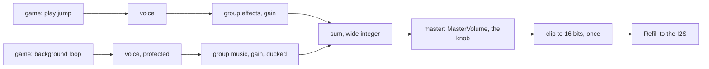

# P767: how to mix many sounds (finding for spark issue 1057)

Date: 2026-11-11. This is a finding with sources. It is not a design and it holds no code. Two parts carry the
detail and the sources: [a-mixing.md](a-mixing.md) (questions 1 and 2) and
[b-reuse-cost-sources.md](b-reuse-cost-sources.md) (questions 3 to 5). Tags: [source] says what a page says,
[repo] says what the code or a run shows, [inference] is reasoning. "Not confirmed" marks what nobody read or ran.

## Short version

- Q1, how they mix. Each system has voices (one playing sound each), a few groups with one loudness each, one
  master, and a rule for the full case. SoLoud "finds the oldest voice and kills it" and can protect a voice.
  Recommendation: a small fixed number of voices, groups `music` and `effects`, the master that exists, one clip
  at the end.
- Q2, how a game starts a sound. A direct call is the base in miniaudio, Godot and SDL_mixer. Recommendation:
  `play(name)` for an event sound, and one call for the looping background. A fade is a gain ramp. Ducking (the
  background gets quieter under an event sound) is a plain rule. A table from event names to sounds can come later.
- Q3, what to reuse. No mixer library's code. Reuse the design and the names of SoLoud and of CircuitPython's
  `audiomixer`, and write the sum as our own small C function. The libraries' size and fit are not confirmed.
- Q4, the cost. One C voice renders a 16 ms block in at most 413 to 979 us (run145b to run149d). One Python voice
  took 20.9 to 22.7 ms, which is too slow. No run summed N sampled voices. Six measurements come first.
- Q5, the sounds. The repository holds a CC0 fire recording and `engine.SoundBank`. Kenney's "Interface Sounds"
  pack is CC0. jsfxr generates jump, press and fall sounds. On Freesound, each sound has its own license.

## The picture

[inference] This is the shape the sources share. Today's code has the last three boxes and one voice.

## Where the two parts differ, and one recommendation

| Point | Part A (SoLoud, Godot) | Part B (CircuitPython) | Recommended [inference] |
|---|---|---|---|
| Who picks the voice | The mixer: a free one, else the oldest | The caller: `voice=0` | The mixer picks |
| Word for loudness | gain | level (0 to 1) | gain: the repo has `GAINS` |
| Background sound | Its own call, a handle for fades | `play(..., loop=True)` | Its own call, a handle |

The mixer picks the voice so that a game holds no table of voices. This is the open choice for the plan.

## Names to take over (one word for one thing)

| Name | Meaning here | From |
|---|---|---|
| sound | The samples, held in a bank | the repo (`Mixer.play(sound)`) |
| voice | One sound that plays now, with its position | SoLoud, FMOD, CircuitPython |
| group | Voices that share one gain: `music`, `effects` | SDL_mixer, miniaudio |
| gain | The loudness factor of a voice or a group | SDL_mixer, miniaudio, the repo |
| master | The last gain, the knob's | Godot, the repo (`MasterVolume`) |
| protect | A voice that the full case never takes | SoLoud |
| fade, duck, loop | A gain ramp, a lowered group, a repeat | miniaudio, Godot, SDL_mixer |

## Checked by a second read (2026-11-11)

- SoLoud's concepts page: the voice definition, the default of 16, "finds the oldest voice and kills it",
  `setProtect()`, float mixing and "The roundoff clipper is used by default." All as part A quotes them.
- CircuitPython's `audiomixer` page: the constructor, `play(sample, *, voice=0, loop=False)` and the `MixerVoice`
  members, as part B quotes them.
- `bench.md`: the rows of run145b (5b, 413 us), run149d (979 us), run152 (1220 us) and run155 (116 us) exist.
  Row 5c of run145b says "hung". The 20.9 to 22.7 ms of the Python voice stand in the text below that table.

## What stays unknown

- No source gave a number of voices, a ducking share or a fade time for this board. They are set by a
  measurement and by the owner's ear.
- Not confirmed: the size, the float need and a build with no operating system for SoLoud, miniaudio and
  SDL_mixer. The licenses of Espressif's `esp_audio_render` and `esp_audio_effects`. FMOD from full pages, and
  all of Wwise. Kenney's other packs. Who owns the output of jsfxr.
- Not measured: `Mixer.render` alone, and every sum of N sampled voices in Python, viper and C. The list of six
  measurements is in part B, question 4.
