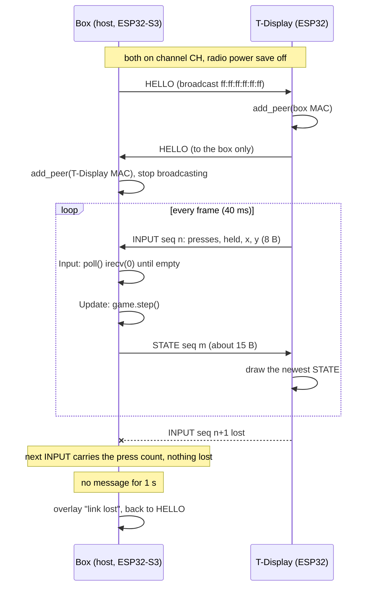

# P831: what two boards talking over ESP-NOW would mean for the game box

Spike P831 ([spark #1192](https://github.com/xmejkal/spark/issues/1192)), for the epic P652 (the demo grows from one box
to two boards). On 2026-11-16 the PO asked: "even best would be experimenting with using esp-now for two board
communication. What would it mean actually, can you analyze and present how it would have to be done?" His full words
are on the card. Nothing here was run on a board. Each number has its source; the ones nobody measured say so.

> **TL;DR.** ESP-NOW fits the box well. It sends small packets straight from one ESP32 to another, with no router,
> in a few milliseconds. The box's firmware already has it. The free T-Display in the drawer can be the second board
> with no wiring. The first step is a 60 s ping-pong between the two boards (no change to the games). After it, a
> remote BOOT button lets every game the box already has be played from the second board with no change to any game.

The radio runs on the other CPU core than the games, and a game needs about 8 to 16 bytes per frame, so the cost in a
40 ms frame should be small. Nobody has measured that cost on this box, and the ping-pong measures it. Two risks need
the bench: Wi-Fi takes internal RAM that the display's frame buffer also uses, and a home Wi-Fi on the same channel
loses packets. The box stays the one that decides the game (the host); the second board sends its buttons and shows
what the host sends.

## 1. What ESP-NOW is

ESP-NOW is Espressif's own protocol for sending short messages between ESP32 chips over the 2.4 GHz Wi-Fi radio. The
boards need no access point and no connection; each sends to the other's MAC address (the radio's 6-byte hardware
address) [1][2]. Each message is one Wi-Fi frame (a "vendor-specific action frame") that the radio acknowledges [2].

| limit | value | source |
| --- | --- | --- |
| message size | 250 B (v1), 1470 B (v2). The box's build uses ESP-IDF 5.5.2, so `espnow.MAX_DATA_LEN` is 1470 there | [1], [2], [8] |
| v1 and v2 together | a v2 board receives both; a v1 board takes v2 packets of 250 B or less | [2] |
| radio rate | 1 Mbps by default; MicroPython sets it with `config(rate=...)` (`RATE_1M` to `RATE_54M`, and the long-range `RATE_LORA_250K`, `RATE_LORA_500K`) | [1], [2], [8] |
| latency, measured | one way, 12 B: 5.6 ms, 128 B: 5.8 ms (Electric UI, IDF example code, default settings). Round trip, 127 B at 1 kHz, to a PC at 24 Mbps: 1.1 to 1.4 ms on average | [3], [4] |
| loss, measured | depends on the room more than on the rate: "WiFi activity" is "a much more significant factor". At 24 Mbps, losing 3 or more packets in a row was "less than 0.1 %" | [4] |
| range | far more than a desk: near 100 % delivery to 150 m in an open field (Espressif's outdoor test); a DevCon talk quotes about 200 m indoors | [5], [6] |
| peers | up to 20 registered peers; at most 17 encrypted (7 by default) | [2] |
| channel | both boards must be on the same Wi-Fi channel; peer channel 0 means "the current channel" | [1], [2] |
| delivery | "success" means the other radio got the frame, not that the program read it; Espressif recommends sequence numbers and the program's own checks | [2] |
| chips | ESP32 and ESP32-S3 both run it (the IDF example lists both). Espressif's DevCon talk ran ESP32 nodes in MicroPython against an ESP32-S3 central | [7], [6] |

## 2. What two boxes could do

The box plays at about 22 to 24 fps with `FRAME_MS = 40` (bench.md, P573). So "per frame" below means 25 messages a
second at most. Each message has a 4-byte header (section 3). All three ideas fit easily in one packet.

| idea | size | what crosses the air each frame | bytes | what changes |
| --- | --- | --- | --- | --- |
| A. Remote BOOT button | small | second board → box: press count, held, two stick axes | 8 | App only: the remote's press counts as a BOOT press. Every game works as it is |
| B. Second screen | medium | A, plus box → second board: game name, score, lives, best | 8 + about 14 | A, plus a small screen program on the second board |
| C. Pong across two screens | big | second board → box: its input; box → second board: ball x, y, both paddles, both scores, phase | 8 + about 16 | a new two-player game on the box (BUBBLE's pong is the base), a drawing program on the second board, a view scaled from 240 x 320 to the T-Display's 135 x 240 |

A ghost race (each board runs its own game and shows the other's runner as a ghost) needs a second full box: the
T-Display has no PSRAM and no pixel engine, so it cannot run the box's games. All three FireBeetle 2 boards are in
use. So the ghost race is left out here.

## 3. How it would have to be done

### The Link class

One small class with one job: one ESP-NOW peer. It would live in pixel-games as `games/link.py`. It is not written yet.

```python
class Link:
    """One ESP-NOW peer: open the radio, find the other board, send without waiting, read without waiting."""
    def open(self, channel): ...     # STA active, fixed channel, radio power save off, ESPNow active, broadcast peer
    def hello(self, now): ...        # until paired: a HELLO broadcast every HELLO_MS
    def send(self, kind, payload): ...  # header + payload, e.send(peer, msg, False): never waits for the ack
    def poll(self, now): ...         # irecv(0) until empty; keeps the newest message of each kind; notes when it heard
    def alive(self, now): ...        # heard from the peer within GONE_MS
    def close(self): ...             # ESPNow off, STA off
```

Why these choices:

- **`send(..., sync=False)`.** With `sync=True`, MicroPython waits for the acknowledgement, up to 100 ms
  (`PENDING_RESPONSES_TIMEOUT_MS` in `ports/esp32/modespnow.c`, v1.29.0) [8]. That is longer than a frame.
- **`irecv(0)` in a loop.** It returns at once when nothing waits, and it reuses one buffer, so it allocates nothing [1].
  This is the same "read without waiting" that run() already does for the console.
- **No `irq()` callback.** MicroPython's page warns that the callback can be missed under load [1], and buttons.py
  already found that ESP32 soft interrupts run late.
- **No `aioespnow`.** It needs asyncio [1]; the box's loop is a plain `while True`, and a rewrite to asyncio buys
  nothing here.
- **Radio power save off** (`sta.config(pm=sta.PM_NONE)`). With power save the radio sleeps and misses messages [1].

### Where it hooks into App.frame()

App.frame() already has Unity's stages. The Link takes the same place as the knob:

1. **Input:** `self.link.poll(now)` next to `self.knob.poll(now)`. For idea A, `pressed = self.fire.update(now) or
   self.link.pressed()`: the remote is a second BOOT button. `App(link=None)` is today's box.
2. **Update:** the game steps as now. Only idea C's game reads the remote's input itself.
3. **After Update, before Render:** the host sends its message (`link.send(STATE, ...)`) once per frame.
4. **Overlay:** a pane like `VolumePane` shows "link lost" when `link.alive(now)` is false.

### The message format

A `struct` header of 4 bytes, then the payload. All numbers little-endian.

| field | struct | bytes | meaning |
| --- | --- | --- | --- |
| version | `B` | 1 | 1; a board ignores another version |
| kind | `B` | 1 | HELLO, INPUT, STATE, BYE |
| seq | `H` | 2 | the sender's count, wraps at 65536 |

- INPUT (idea A): `<BBHBBbb>`: header, press count (wraps at 256), held (0 or 1), stick x and y (-100 to 100). 8 bytes.
- STATE (idea C): `<BBHhhhhBBB>`: header, ball x and y, paddle 1 and 2, score 1 and 2, phase. 15 bytes.

Two rules make a lost packet harmless:

- **Each message holds the whole state, not a change.** A lost STATE is replaced by the next one 40 ms later. Gaffer On
  Games calls this a snapshot [9].
- **A press travels as a count, not as an event.** The box compares the count with the last one it saw. If a packet
  is lost, the next one still carries the press. buttons.py already counts pushes this way.

A message with a seq older than the newest one (`(seq - last) & 0xFFFF >= 0x8000`) is late or a duplicate, and the
reader drops it. Espressif's own example adds a sequence number for the same reason [2][7].

### Who decides the game

Two industry models, both from Glenn Fiedler's Gaffer On Games [9][10]:

- **Client/server, with an authoritative server** ("The Server Is The Man", from Tim Sweeney, quoted in [10]). The host
  runs the game; the client sends its input and shows the state it gets.
- **Deterministic lockstep.** Both boards run the same simulation and send only inputs. It needs "exactly the same
  result" from the same inputs, and a board "can't simulate frame n without input n", so a late packet stops both
  [9].

**The box is the host (authoritative).** Lockstep does not fit: the box's games step on real time and floats, the two
chips differ, and the T-Display cannot run the box's games at all. Client-side prediction (Quake's guess at the
player's own move [10]) is not needed: at 25 Hz a few milliseconds of delay are less than one frame.

### Pairing

The box knows no MAC address at the start. It works like Espressif's example [7]:

1. Each board adds the broadcast address `ff:ff:ff:ff:ff:ff` as a peer and sends HELLO to it every 500 ms.
2. A board that gets a HELLO adds the sender as a peer (`add_peer(mac)`) and answers with a HELLO to it alone.
3. When a board gets a HELLO from its own peer, both stop broadcasting and send only to each other.

A broadcast cannot be encrypted [1]. For a game at home that is fine (section 8, question 5).

### When the other board is gone

`poll()` notes the time of the last message. When nothing came for 1 s (25 frames), `alive()` is false. The box then
shows "link lost", pauses a two-player game, and goes back to HELLO broadcasts. Idea A needs no pause: the box's own
BOOT button still works. The second board shows "waiting for the box".

### The flow



## 4. The second board

**The LilyGO TTGO T-Display ESP32 v1.1** (free, one in the drawer). Why it:

- It has a screen (ST7789, 135 x 240) and two buttons, BUTTON1 on GPIO35 and BUTTON2 on GPIO0 [11]. Idea A needs no
  wiring at all.
- It is a classic ESP32, which runs ESP-NOW with the S3 [6][7].
- The two Beetle ESP32 boards (DFR0575) have no screen. Either can be the echo board in step 1, but a button or stick
  needs wires on it.

What it needs:

- **MicroPython 1.29.0**: the free official image `ESP32_GENERIC-20260824-v1.29.0.bin` (no PSRAM on this board, so
  not the SPIRAM image). `esptool.py erase_flash`, then `esptool.py --baud 460800 write_flash 0x1000 <file>` [12].
  The erase removes the factory demo, and that cannot be undone (question 1).
- **A display driver**, only for ideas B and C: `st7789py_mpy`, an ST7789 driver "written in MicroPython" with a LilyGo
  T-Display 135 x 240 example, MIT [13]. Pins from LilyGO: MOSI 19, SCLK 18, CS 5, DC 16, RST 23, backlight 4 [11].
  Its frame rate on this board is not measured. The box's s3lcd and pixel engine are not needed there.
- **Wiring:** none for step 1 and idea A; a USB cable to the Mac. A joystick on it (later) goes on ADC1 pins (GPIO32 to
  GPIO39): on the classic ESP32, "ADC2 pins cannot be used when Wi-Fi is used" [14]. Which of those pins the T-Display's
  header brings out was not checked in this spike.
- Spark has no board record for the T-Display (spark's `boards/` holds `firebeetle2-esp32s3.json` and `xiao-esp32-c6.json`). That matters
  only when the second board gets wires (question 7).

## 5. The first experiment

### Step 1: ping-pong, 25 Hz for 60 s (no game code)

The box sends a ping every 40 ms; the T-Display sends each one straight back. The box measures the round trip, the
loss, and what `send()` and `irecv(0)` cost in microseconds. It also prints the internal DMA memory before and after
the radio starts, and the channels of the Wi-Fi networks it can hear. Both scripts run with `mpremote run`, as the
probes do; neither is kept in the repository.

On the T-Display, `echo.py`:

```python
import binascii, espnow, network

CHANNEL = 1  # the same on both boards: pick it from the box's scan line
sta = network.WLAN(network.WLAN.IF_STA)
sta.active(True)
sta.config(channel=CHANNEL)
sta.config(pm=sta.PM_NONE)  # the radio never naps
e = espnow.ESPNow()
e.active(True)
print("echo", binascii.hexlify(sta.config("mac"), ":").decode(), "channel", CHANNEL)
peers = set()
while True:
    mac, msg = e.irecv(1000)
    if msg is None:
        continue
    mac = bytes(mac)
    if mac not in peers:
        e.add_peer(mac)
        peers.add(mac)
        print("peer", binascii.hexlify(mac, ":").decode())
    e.send(mac, msg, False)  # every message goes straight back, HELLO too
```

On the box, `ping.py` (it stops the game: `mpremote run` breaks into the running main.py):

```python
import binascii, esp32, espnow, network, struct, time

CHANNEL, HZ, SECONDS = 1, 25, 60
PERIOD_MS, N = 1000 // HZ, HZ * SECONDS
DMA_INTERNAL = (1 << 3) | (1 << 11)  # MALLOC_CAP_DMA | MALLOC_CAP_INTERNAL, as probe0.py


def memory(when):
    heaps = esp32.idf_heap_info(DMA_INTERNAL)
    print("%s internal DMA free %d largest %d" % (when, sum(h[1] for h in heaps), max(h[2] for h in heaps)))


memory("before")
sta = network.WLAN(network.WLAN.IF_STA)
sta.active(True)
print("heard channels", sorted(set(ap[2] for ap in sta.scan())))
sta.config(channel=CHANNEL)
sta.config(pm=sta.PM_NONE)
e = espnow.ESPNow()
e.active(True)
memory("after")
e.add_peer(b"\xff" * 6)
peer = None
while peer is None:  # pairing: HELLO to everyone until the echo answers
    e.send(b"\xff" * 6, b"hello", False)
    mac, msg = e.irecv(200)
    if msg == b"hello":
        peer = bytes(mac)
e.add_peer(peer)
print("peer", binascii.hexlify(peer, ":").decode())
while e.irecv(50)[1] is not None:  # drop the echoes of the other HELLOs
    pass

rtt, send_us, poll_us, polls = [], 0, 0, 0
due = time.ticks_ms()
for seq in range(N + HZ // 2):  # the last half second only collects
    if seq < N:
        t = time.ticks_us()
        e.send(peer, struct.pack("<HI", seq, t), False)
        send_us += time.ticks_diff(time.ticks_us(), t)
    due = time.ticks_add(due, PERIOD_MS)
    while time.ticks_diff(due, time.ticks_ms()) > 0:
        t = time.ticks_us()
        mac, msg = e.irecv(0)
        poll_us += time.ticks_diff(time.ticks_us(), t)
        polls += 1
        if msg is not None and len(msg) == 6:
            rtt.append(time.ticks_diff(time.ticks_us(), struct.unpack("<HI", msg)[1]))
        else:
            time.sleep_ms(1)

rtt.sort()
got = len(rtt)
print("sent %d got %d lost %d (%.2f %%)" % (N, got, N - got, 100 * (N - got) / N))
if got:
    q = lambda p: rtt[min(got - 1, got * p // 100)]
    print("rtt us median %d p95 %d p99 %d max %d" % (q(50), q(95), q(99), rtt[-1]))
    print("over one frame (40 ms): %d" % sum(1 for r in rtt if r > 40_000))
print("send us avg %.0f, irecv(0) us avg %.1f over %d polls" % (send_us / N, poll_us / polls, polls))
print("stats", e.stats())
```

It prints:

```
before internal DMA free <B> largest <B>
heard channels [<the channels of the networks nearby>]
after internal DMA free <B> largest <B>
peer xx:xx:xx:xx:xx:xx
sent 1500 got <n> lost <n> (<p> %)
rtt us median <us> p95 <us> p99 <us> max <us>
over one frame (40 ms): <n>
send us avg <us>, irecv(0) us avg <us> over <n> polls
stats (<tx packets>, <tx responses>, <tx failures>, <rx packets>, <rx dropped>)
```

**The pass line (proposed):** loss at most 1 % (15 of 1500; one lost packet in 4 s, which a snapshot hides), p99
round trip under 40 ms (one frame), and `send` plus one `irecv(0)` under 1 ms on average (2.5 % of a frame). Run it
twice: on a channel that the scan heard and on one it did not. The "after" memory line says how much internal DMA RAM
Wi-Fi took, which step 2 needs.

### Step 2: the same ping inside the running box

A probe (not in games/) starts the box's run() with the display and sound on, opens the Link after the display, and
pings once per frame from App.frame()'s Input stage. It compares the `fps` and `time` lines with a run without the
Link. It passes when the fps stays within 1 of the run without (22 to 24), s3lcd still gets its `"dma"` frame buffer,
and the sound has no more late refills than without. If Wi-Fi cannot start beside the frame buffer, the probe says so:
that is the risk in section 6.

### Step 3: idea A, the remote BOOT button

`games/link.py` with its tests on the Mac, `App(link=...)`, the remote's press as a BOOT press, the "link lost" pane,
and the T-Display program that sends its two buttons. The PO plays any game from the T-Display. That is a feel slice:
it waits for his play.

## 6. Costs and risks

- **Frame time.** MicroPython runs on core 1 and the Wi-Fi task on core 0 (`MP_TASK_COREID` in
  `ports/esp32/mphalport.h`, v1.29.0, and the default `ESP_WIFI_TASK_PINNED_TO_CORE_0` in ESP-IDF 5.5.2) [8][15]. The
  radio's receive work lands in a ring buffer on the other core; the game pays only for `send()` and `irecv(0)`. Step 1
  measures both. Not measured yet.
- **Internal RAM against the frame buffer.** This is the main risk. The bench measured 264,347 B of internal DMA RAM free
  at boot, and s3lcd's `"dma"` frame buffer takes 153,600 B of it (bench.md, P533, 09:58). The box's build keeps Wi-Fi's
  buffers in internal RAM: `SPIRAM_TRY_ALLOCATE_WIFI_LWIP` defaults to n in ESP-IDF 5.5.2, and MicroPython's
  `sdkconfig.spiram_oct` sets only the PSRAM mode [15][8]. So the radio starts after the display, and the box must stay
  a one-board box when the radio cannot start (catch the error, as the speaker's "sound off" does). If the radio
  started first, s3lcd could fall back to `"strips"`, which sends a frame in 33.5 ms instead of 31.0 ms
  (bench.md:186, P533; the 71.9 ms reading at bench.md:102 was void).
- **Radio power.** With ESP-NOW on, the receiver stays on all the time by default [2]. The ESP32-S3 datasheet gives 88 mA
  for receive and 340 mA peak for transmit at 1 Mbps, 21 dBm [16]. The transmit peak lasts only while a short packet is on
  the air. On USB this does not matter; on a battery it shortens the play. `sta.config(txpower=...)` can lower the
  transmit power.
- **Channel clashes with home Wi-Fi.** Both boards must share a channel [1]. Traffic on that channel is the main cause
  of loss [4]. Step 1's scan line shows the busy channels. The boards never join the home Wi-Fi: joining moves the radio to the
  router's channel and turns power save on [1].
- **The joystick and Wi-Fi.** On the ESP32-S3, "ADC2 is also used by Wi-Fi" [14]. The box's joystick pads A0 and A1
  are GPIO4 and GPIO5, on ADC1; pins.py marks every ADC2 pin `adc2_unusable_with_wifi`, and these two have no such mark.
  So the joystick and ESP-NOW can run together.
- **The rx buffer.** MicroPython keeps 2,972 B by default for incoming messages, room for two packets of the largest
  size [1]; when it is full, messages are
  dropped and counted (`stats()`). Draining it each frame at 25 Hz keeps it near empty.
- **Nothing to buy.** The T-Display, its USB cable and the Mac cover steps 1 to 3. A second full box (for the ghost
  race) would need a fourth FireBeetle 2 ESP32-S3 and display; this spike did not price them at the Czech shops.

## 7. The PO's two other options

**The joystick.** The drawer has two PS2-style sticks; one is the box project's. Its pads are already set aside: A0
(x), A1 (y), D5 (button, internal pull-up), and bench run 173 checked the three pads. The stick takes its supply
from 3.3 V, so its outputs stay within the ADC's range. The code
is a small stick class: two `machine.ADC` reads per frame, a dead zone, and a Button on D5. It changes what a game can
ask: a direction and a strength, not only one button, so Snake can turn four ways and Bucket can move at a speed. Each
game that uses it needs its own change, and it is a feel slice for each.

**More effects in C.** The pixel engine has five effects in `engine/core/` (fire, balls, grains, noise, crackle), from 77
to 491 lines each. One new effect takes a `core/fx_<name>.c` and `.h` in plain C, its Mac tests through clang
(`tests/*_lib.py`), a binding in `binding.c`, a firmware build with `build.sh`, a flash of the box, and a game or scene
that shows it. The rebuild and the flash are the slow part, and the look is the PO's call.

**How they compare.** The joystick is the cheapest and the surest: the hardware is in the box project and nothing new
is at risk. A C effect is the most visible on one screen but needs a firmware build each time. ESP-NOW is the biggest
step for the demo (P652: two boards that talk), and its step 1 needs no game change. The joystick also helps ESP-NOW
later: the remote board can carry the second stick.

## 8. Open decisions for the PO

1. **May the T-Display be erased and get MicroPython 1.29.0?** This removes its factory demo for good. Recommended:
   yes; it is free and it is the only free board with a screen.
2. **Step 1 first, before any game code?** Recommended: yes. One bench session of about an hour; it tells whether the
   loss, the round trip and the internal RAM allow a game.
3. **Which game idea after step 1?** Recommended: idea A, the remote BOOT button. It needs no change to any game, and
   its Link is the base for B and C.
4. **Which channel?** Recommended: a fixed constant, one of 1, 6 and 11 that step 1's scan did not hear, set the same on
   both boards.
5. **Encryption?** Recommended: none for now. Broadcast HELLO cannot be encrypted anyway [1]; a key (PMK) can come
   when the game runs outside home.
6. **Who decides the game?** Recommended: the box, always (authoritative host). The T-Display only sends input and
   shows what the box sends.
7. **Does the second board enter spark?** Recommended: not yet. A spark card for a T-Display board record when it gets
   its first wire (a joystick).
8. **And the joystick and C effects?** Superseded by the options page ([finding.md](finding.md)): the joystick first,
   then ESP-NOW step 1, then the synthesizer; C effects when a game needs one.

## What this spike could not source

- The cost of `send()` and `irecv(0)` in a 40 ms frame on this box: step 1 measures it.
- How much internal RAM Wi-Fi takes in this build, and whether it fits beside s3lcd's `"dma"` frame buffer: step 1
  and step 2 measure it.
- Round-trip and loss figures between an ESP32 and an ESP32-S3 in MicroPython: the measured figures above come from
  C code [3] and an ESP32-to-PC test [4].
- The pins that the T-Display's header brings out, and the frame rate of `st7789py_mpy` on it.
- Prices for a second full box at LaskaKit, Botland, GME, Hadex or TME.
- Valve's networking page (developer.valvesoftware.com, "Source Multiplayer Networking") refused the fetch (HTTP 403),
  so the client/server model is cited from Gaffer On Games only.

## Sources

1. MicroPython v1.29.0, "espnow — support for the ESP-NOW wireless protocol",
   https://docs.micropython.org/en/v1.29.0/library/espnow.html (read 2026-11-16).
2. Espressif, ESP-IDF v5.5.2, ESP32-S3, "ESP-NOW",
   https://docs.espressif.com/projects/esp-idf/en/v5.5.2/esp32s3/api-reference/network/esp_now.html (read 2026-11-16).
3. Electric UI (Michael Orenstein and Scott), "Wireless latency comparison", https://electricui.com/blog/latency-comparison,
   about February 2024; data and firmware at https://github.com/Scottapotamas/embedded-wireless-latency-eval/ (via
   Hackaday, 2024-02-11, https://hackaday.com/2024/02/11/benchmarking-latency-across-common-wireless-links-for-mcus).
4. Thomas Flayols, "Linux-ESPNOW" logs "Some results" (2019-03-29) and "More testing (with RT-PREEMPT)" (2019-04-24),
   https://hackaday.io/project/161896/logs.
5. Espressif Developer Portal, "Exploring wireless communication protocols on ESP32 platform for outdoor applications",
   https://developer.espressif.com/blog/esp-now-for-outdoor-applications/ (read 2026-11-16).
6. Espressif DevCon24, "ESP NOW in indoor applications", https://www.youtube.com/watch?v=DatH-QUB0ho (2024).
7. Espressif, ESP-IDF example `examples/wifi/espnow/README.md`,
   https://github.com/espressif/esp-idf/blob/master/examples/wifi/espnow/README.md (master, read 2026-11-16).
8. MicroPython v1.29.0 source (local clone, tag v1.29.0): `ports/esp32/modespnow.c`, `ports/esp32/modules/espnow.py`,
   `ports/esp32/mphalport.h`, `ports/esp32/boards/sdkconfig.spiram_oct`, `ports/esp32/README.md` (ESP-IDF v5.5.2
   recommended), https://github.com/micropython/micropython/tree/v1.29.0/ports/esp32.
9. Glenn Fiedler, "Deterministic Lockstep", Gaffer On Games, 2014-11-29,
   https://gafferongames.com/post/deterministic_lockstep/; the series' "Snapshot Interpolation",
   https://gafferongames.com/post/snapshot_interpolation/.
10. Glenn Fiedler, "What Every Programmer Needs To Know About Game Networking", Gaffer On Games, 2010-02-24,
    https://gafferongames.com/post/what_every_programmer_needs_to_know_about_game_networking/.
11. LilyGO, TTGO T-Display README (pin table), https://github.com/Xinyuan-LilyGO/TTGO-T-Display (read 2026-11-16).
12. MicroPython downloads, ESP32_GENERIC, v1.29.0 (2026-08-24), https://micropython.org/download/ESP32_GENERIC/.
13. Russ Hughes, st7789py_mpy (MIT), https://github.com/russhughes/st7789py_mpy (read 2026-11-16).
14. Espressif, ESP-IDF (latest), ESP32, "GPIO & RTC GPIO", ADC2 note,
    https://docs.espressif.com/projects/esp-idf/en/latest/esp32/api-reference/peripherals/gpio.html; ESP32-S3 ADC
    oneshot "Hardware Limitations",
    https://docs.espressif.com/projects/esp-idf/en/latest/esp32s3/api-reference/peripherals/adc/adc_oneshot.html.
15. ESP-IDF v5.5.2 source (local clone): `components/esp_wifi/Kconfig` (`ESP_WIFI_TASK_CORE_ID`, default core 0),
    `components/esp_psram/Kconfig.spiram.common` (`SPIRAM_TRY_ALLOCATE_WIFI_LWIP`, default n),
    https://github.com/espressif/esp-idf/tree/v5.5.2.
16. Espressif, ESP32-S3 Series Datasheet, section 5.6.1, Table 5-7 "Current Consumption for Wi-Fi (2.4 GHz) in Active
    Mode", https://documentation.espressif.com/esp32-s3_datasheet_en.html#page=66 (read 2026-11-16; the version
    printed in the PDF was not read).
