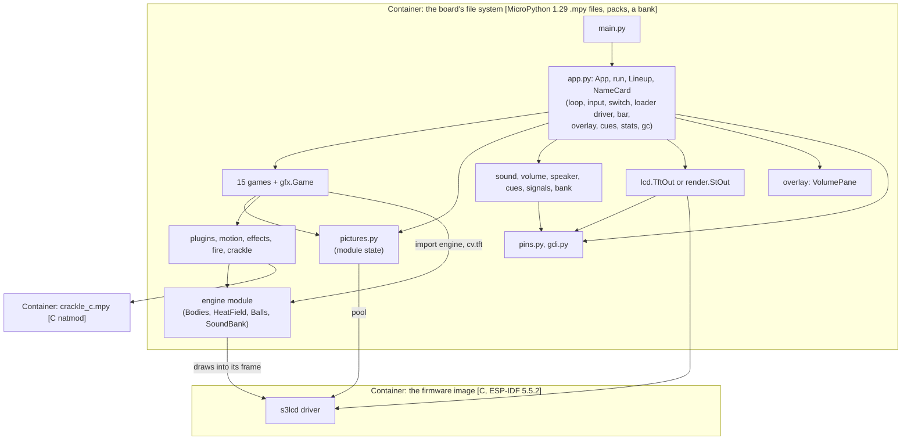
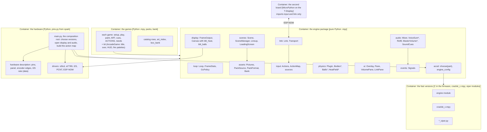

# P838: one engine for the games, with a reference and a fast version of each hot part

Spike P838 ([spark #1201](https://github.com/xmejkal/spark/issues/1201)), for the multiplayer epic P832
([spark #1194](https://github.com/xmejkal/spark/issues/1194)) and the demo epic P652 (spark #875). Written on
2026-11-16 from pixel-games master `3ce8b53` (engine submodule at `9589dcd`). Nothing ran on a board for this page. A
reference `file:line` is in pixel-games unless it starts with `engine/`.

> TL;DR
>
> - **Is the box's runtime reusable? Partly.** The sound, the signals, the overlay and the two display outputs are
>   small swappable classes already. The loop, the input, the game switch with its loader and bar, and the pictures
>   are written for this one box.
> - **The rule: one engine, two versions of each hot part.** A reference version in plain Python runs anywhere and is
>   the Mac's test oracle. A fast version in C or viper does the work on the board. `main.py` chooses once at the
>   start, and a setting forces the reference version per part. The repository already does this in three places, and
>   PEP 399 is the outside source.
> - **Where it lives:** a Python package beside the games first, behind a boundary test. It moves into pixel-engine
>   when a second board uses it. A hardware description and `main.py` hold the pins and drivers, and no game touches
>   them. Every game loses its board and C knowledge, except the C-only games, which declare what they need.
> - **What comes first:** a safety net of frame hashes and cue sequences, then stage 0 (the package, the deploy, the choice
>   of versions), then stage 1 (the input action map), which multiplayer builds on.
> - **What you decide:** the engine's name, where it lives, and whether the second board only sends presses or also
>   shows the game.
>
> Three decisions wait on you: section 8.

## Words on this page

| Word | Means here |
| --- | --- |
| engine | Our engine: the C module `engine` in the firmware and the Python package over it (placeholder name `pixel`) |
| version | The reference version (plain Python) or the fast version (C, viper) of one engine part |
| choose | What `accel.choose` does once at the start: it takes the fast or the reference version of a part |
| pick | Only the PO's D14 press that picks the next game, as P818 named it |
| strategy | A swappable class with the same methods as its siblings, which `main.py` hands to the engine |
| game | A class the PO plays. Its author writes `setup`, `play`, `paint` and `paint_static` |

The console words stay as they are (`pick`, `switch`, `game`, `fps`), because the tests read them.

## Council

Round 1 ran on 2026-11-16 with six members: lenses on architecture (A), speed on the board (S), the game author (G),
tests (T), and UX with AI-UX (U), all on Sonnet, then the refuter (R) on Opus. Every lens kept option C and the PEP 399
shape. The changes it made, one line each:

1. A, R1, R7: `accel` is a factory that `main.py` calls, and engine classes take their version as a constructor argument.
2. S2, A1, T3: the switch is per part, and section 2's table says whether each reference version keeps real time on the board.
3. R1: the tests set `fire.engine`, `plugins.engine` and `balls.engine` after import, so `accel` has one injection point. Corrected count: 30 lines in 9 test files plus `tools/render_scene.py:177-178`, not about 18.
4. S3, R: the fast object is the C type itself, the twin is block-shaped, and no output method runs per draw.
5. S4: module functions kept for the games are bound methods, and stage 4 has a 0.5 ms paint gate.
6. S1: `@native` is a no-op on the board (`bench.md:1033-1035`), so its row went, and `fast.py` stays out of stage 0.
7. R5: three places follow the rule today, not five. The crackle and the display outputs moved to the gaps.
8. R6: `sum_match` and `scale_match` run on the Mac as plain Python, through the viper stub. Real viper runs only on the board.
9. R8: the json example now quotes `make_scanner = c_make_scanner or py_make_scanner`.
10. A2, G4, T3: parts with no reference get a Null Object, or the game declares `needs`, and the lineup hides it.
11. A2: the C draws go through canvas methods (`blit_heat`, `blit_balls`), a Bridge, not through `cv.tft`.
12. R3: `s3lcd.pool` hands out the same block every time, so `Block` is the sound bank's only. The pictures keep their pool.
13. A3, R7: the board profile is split into a hardware description (data) and the composition root (`main.py`). `gdi.py` reads four pins from `pins.py`.
14. A4, R7: stage 1 builds the action map in `main.py`, and stage 7 depends on stages 1 and 4.
15. T1: a new stage N, the net: frame hashes and the cue sequence per game, before any move.
16. T5, S5, A7: stage 0 brings board numbers, few larger modules, an import of every engine module at boot, and deploy tests on a temporary tree.
17. R2: the stages now say which one moves each module into the package.
18. A4: stage 3 is split into 3a and 3b, and stage 5 into 5a (audio) and 5b (physics).
19. T6: the logic stages write mutation rows, proven with spark's `tools/mutate.py --root . --anchors` (round 2, item 5).
20. T7: stage 3 keeps shims for the names the tests patch, with a test that each still resolves, until stage 8.
21. T8: stage 1 first writes a characterization test of the press sequences on the old code.
22. S8: the Fire run's `late` count is a gate after stages 1, 3, 6 and 7, and stage 3 does not make P837's 58 ms worse.
23. T10: each stage has a named story run, and the full suite runs at the net and at stages 0, 5 and 8.
24. T11: stage 9 moves the stubs and the clang libraries with the package.
25. T4: the boundary test walks every import at any depth, has a fixture per violation, and comes with an import-alone test and an import-direction table.
26. G1: the page says who writes what. Authors keep `play(pressed, held)`, or set `ACTIONS` and get `play_actions(actions)`.
27. G2, A5: `Actions` is per player, with `fire_released`, a loopback test of a wrapped count, and a link-lost policy.
28. G3: a new decision: the second board as a controller only, or also as a screen.
29. A5: BLE and a separate codec wait for P833. `Transport` and `LoopbackTransport` stay.
30. G5, R4: games draw pictures through `cv.pic`, the engine sets `covers`, and the inventory lists the missed load sites.
31. G: the games are mostly logic already, so stage 8 keeps one PR per game only for balls, bucket, burning with meteors, and fire.
32. G6: a new-game checklist.
33. G7: cue names are checked against the game's `emit` names. Correction: the engine cannot see `emit` names at build, so a Mac test reads them from the source instead.
34. U1, U2: `accel` prints one `engine` line at boot, and `box.py deploy --engine` writes the setting.
35. U3: a "What a game is" section with an example game, and a package README.
36. U4: the words table, and `accel`'s function is named `choose`.
37. U5: a table of the console lines that freezes their formats.
38. U6, U7: the TL;DR is five bullets, and section 8 puts the PO's real decisions first.

Round 2 ran on 2026-11-16: the refuter on Opus checked `fb01a27`. Its findings, one line each:

1. R, high: the chosen versions did not reach the objects that games build in setup (`bucket.py:145-150`, `burning.py:84`, `balls.py:78`). On MicroPython 1.29 a plugin a game built with the reference default ran Python while `main.py` had chosen C. Now `main.py` builds one `parts` record, every scene gets it in its constructor, games build their plugins from `self.parts`, and a test checks that a game's plugin gets the chosen class. `accel.use`, a Service Locator, is gone.
2. R, high: `tools/crackle.sh` stops at its first failed copy (`set -eo pipefail`, `:33`) and copies flat modules by path (`:70-79`), so the Fire gate broke at stage 1. Each stage that moves a module now updates every tool and probe that names it by its flat path, and its row says which.
3. R, medium: stages 3a to 6 cannot go in any order. `speaker.py` imports `pins` (`speaker.py:5`) and `lcd.py` imports `gdi` (`lcd.py:28`), so the boundary test fails if they move before stage 7. The order is now N, 0, 1, 2, 3a, 3b, 3c, 4, 7, 5a, 5b, 6, 8, 9.
4. R, medium: no stage moved `gfx.py`'s canvas and colours or `fast.py`, or made the kit. A new stage 3c does, and section 6 says where every module ends.
5. R, rejected: spark's `tools/mutate.py --root . --anchors` runs on pixel-games. The mutation rows are proven with it.
6. R, medium: the 15 games read only player 0, so a remote FIRE for player 1 played no game. As a controller, the remote's FIRE also drives player 0 in a one-player game.
7. R, low: of the 30 test lines, 15 set the engine to `None`, and 69 more read `fire.engine.*`, `plugins.engine.*` or `balls.engine.*`. `tests/test_plugins.py:102-104` asserts the module attribute. Stage 5b changes those assertions. The refuter counted 16 and 65, and the page gives the counts from the code.
8. R, low: the TL;DR says "cue sequences", the cue-name test handles a conditional emit (`rescue.py:657`), and the engine sets only the first `covers`.

A correction outside the list: change 2 quoted "Python bodies 5.7 ms for 30 bodies". `bench.md:218` says 5.7 ms for 30
spring bodies and 40 particles together, so the table cites the rain's 160 Python bodies at 8 to 9 fps
(`bench.md:401`) instead.

## The PO's words

- 2026-11-16, after P822 merged: "Ok, so are these features lie the loading of the games and the loading system and the
  bar a=etc, is it well generalzed in the pixel-engine so it could be reused ?" Then: "Just like the sound and the
  soundbar, etc.. Can we actually now create a card and analyze what all and how we can generalize for a reusable
  engine system ?"
- 2026-11-16, on multiplayer P832: "we want to test and mvp and experiment, but in the end we will want to have it
  general enough to be useful, good architecture so we can reuse, extend, all theses good architecture principles,
  strategies, exchangable onesm etc."
- 2026-11-16, the design direction for this spike: "Well, actually let's also talk about what belongs where. I mean
  I'd like to have one engine, or however we call it, basically an extension of the box2d or whatever python framework
  we are using but there should always be the option to use some basic micropython implementation or and advanced
  optimized strategy from the C modules, how would be smart to design such a system ? And have the few games we
  implemented so far actually reafactored to use the engine and only implement the game logic etc, but the sound and
  graphics and other optimized screens and drivers and anything are the optimized fast nes."

**On Box2D:** the box uses neither Box2D nor a Python game framework. Its physics is its own C: `world.c` (bodies that
fall and land), `fx_balls.c` on the uniform grid of `grid.c` (balls that collide) and `fx_fire.c` (the heat field), as
`engine/README.md` lists them. `fx_balls.h` borrows only Box2D v3's names for a material: friction, restitution and
the restitution threshold (`engine/core/fx_balls.h:69`, [Box2D](https://box2d.org/documentation/)).

## 1. Inventory of every runtime part

Lines are `wc -l` at `3ce8b53`. The last column says where each part goes:

- **C** is the C engine core.
- **engine** is the reusable Python package.
- **hardware** is the hardware description and the composition root (`main.py`): pins, drivers, this box's wiring.
- **kit** is code that several games share but no other project needs.
- **content** is one game, or this box's data.

| Part | File(s), lines | Its one job today | What couples it to this box | Target |
| --- | --- | --- | --- | --- |
| C engine module `engine` | `engine/binding.c` 701, `engine/core/` world.c 81, fx_fire.c 491, fx_balls.c 353, grid.c 59, events.h 51 | Bodies, HeatField, Balls, SoundBank, largest_free_internal (`engine/binding.c:684-692`), built into the firmware (`engine/micropython.cmake`, `build.sh engine`) | Its draws need an s3lcd display (`engine/binding.c:307-308`, `:592-593`). It uses ESP-IDF heap caps (`engine/binding.c:12`) | C |
| C native module `crackle_c.mpy` | `engine/natmod/crackle/` with core fx_crackle.c 96, fx_grains.c 175, fx_noise.c 77 | The fire's sound in C, loaded with no firmware rebuild (`engine/natmod/crackle/Makefile`) | `tools/crackle.sh` builds it, and `box.py deploy` does not copy it (`tools/box.py:19`) | C |
| s3lcd driver | `engine/driver/` (a submodule in the submodule) | The panel driver, its frame, and `pool()`, which hands out the same block on every call (`engine/driver/src/s3lcd.c:2924-2925`) | A fork of a third-party driver | hardware (C) |
| The box's start | `games/main.py` 4 | Opens the knob and the speaker, calls `app.run` | Everything | hardware (the composition root) |
| App, the loop and the switch | `games/app.py` 512: `App` 163-371, `Lineup` 93-134, `NameCard` 375-402, `open_st7789` 405, `open_knob` 424, `open_speaker` 441, `run` 446-512 | Eight jobs in `App`: input reads (323-325), the pick (211-219), the build behind the card (246-283), a game's life (198-208, 231-243, 290-308), the overlay (183-185, 339), signals and cues (186-187, 206-208, 235-238), timing lines (316-371), the gc policy (310-314, 341-344, 355-356). `run` opens the hardware and runs the loop (498-509) | Imports pins, gdi, box_bank, catalog, lcd and speaker (`app.py:42-57`). The two buttons are fixed fields (`app.py:177-178`). Constants for this panel and heap (`app.py:61-78`) | engine (loop, scenes, loader, stats, gc), hardware (the `open_*` functions and `run`'s wiring) |
| The catalog and the lineup rule | `games/catalog.py` 39 | The games the box can hold, and `lineup_fault` | The rows are this box's games | content (rows), engine (`lineup_fault`, `games_for`) |
| The pictures | `games/pictures.py` 267 | Reads a game's pack in 8 KB chunks as a generator with progress (`load_steps` 181-220), then draws pictures and layers (223-267) | Module state `PICS`, `SETS`, `ready`, `loaded`, `load_ms` (26-30). Imports `art_index` at import (17-20). `ROOT = "/"` (22). The block is s3lcd's pool (46-48). A repeat of the Mac's tick shims (138-150) | engine (assets) |
| The art index and the packs | `games/art_index.py` 1044 (generated), `games/packs/*.pak` | Where each picture is in which pack | `art/paint.py` and `art/export.py` write them | content |
| Drawing and the game base | `games/gfx.py` 456 | Colours, the recording `Canvas` (58-238), `Particles`, `Dice`, and `Game` (318-456) with title, play and over, the HUD and `BEST` | Screen size from `st7789` (21). Globals `BEST` (302), `PHASES` and `PHASE_SUM` (306-307) | engine (the Canvas, the scene contract), kit (title, over, HUD, Particles, Dice) |
| Output, st7789 path | `games/render.py` 150, `games/st7789.py` 113 | Dirty rectangles and `StOut` (120-150), our SPI driver | The panel's size | engine (an output), hardware (the driver) |
| Output, s3lcd path | `games/lcd.py` 255 | `TftCanvas` (66-205), `TftOut` (208-237), `open_tft` (240-255) | GDI pins (`lcd.py:248-251`), `ORIENTATION` (32), the panel's 240 x 320 (33) | engine (an output), hardware (`open_tft`) |
| Pins | `games/pins.py` 30, `games/gdi.py` 19 | spark's `assign_pins.py` writes `pins.py` from `requirements.json` (`pins.py:1-2`). `gdi.py` names the GDI connector's pins by hand, a walk 4 workaround (`gdi.py:4-7`) | `gdi.py` repeats four pins that `pins.py` already has as `GDI_RST`, `GDI_CS`, `GDI_SD_CS`, `GDI_BL` (`pins.py:19-22`, `gdi.py:16-19`). Only `DC = 3` (`gdi.py:15`) is not in `pins.py` | hardware |
| Plugins | `games/plugins.py` 105 | `Plugin` with FixedUpdate and LateUpdate (37-51), `PhysicsPlugin` on `engine.Bodies` or its twin (54-105) | Stack's gravity as the default (34) | engine (physics) |
| Motion | `games/motion.py` 144 | `Spring`, `Bodies` (the Python twin of `engine.Bodies`, 77), `StepClock` (132) | none | engine (physics, reference) |
| Effects on bodies | `games/effects.py` 104 | The `Effect` strategy, `FireTrail`, `EffectSystem` | The fire's grid (`effects.py:11`) | kit |
| Fire, crackle, burning | `games/fire.py` 336, `games/crackle.py` 383, `games/burning.py` 192, `games/fire_bank.py` 17 | `FirePlugin`, `FireLayer`, palettes, the crackle classes | The C draw takes `cv.tft` (`fire.py:177`, `:182`, `:336`, also `balls.py:137`). `GrainCrackle` and `FireSound` import `crackle_c` with no fallback (`crackle.py:185-186`, `:270-271`) and make their own `engine.SoundBank` (`crackle.py:188-197`), a repeat of `bank.py:42-44` | engine (`HeatField`, the crackle), kit (palettes, `FireLayer`) |
| The mixer | `games/sound.py` 257, `games/sound_viper.py` 79 | `Mixer` with groups (58-128), the `VoiceSum` strategy (39) and its viper twin, the `Refill` strategies `FrameRefill` and `CallbackRefill` (133-254) | 16 kHz (21). Imports `volume.FULL` (19) | engine (audio) |
| The master volume | `games/volume.py` 114, `games/volume_viper.py` 50 | `MasterVolume` (26), `VolumeStore` (61), `VolumeKnob` (82) | None. `open_knob` passes no store, so the step is not saved (`app.py:437`) | engine (audio, input) |
| The speaker | `games/speaker.py` 46 | The adapter that owns the I2S, the refill and the mixer | Imports `pins` (5, 32-34). `IBUF` and `VOICES` (8-9) | hardware (its pins), engine (the adapter) |
| The sound bank | `games/bank.py` 60, `games/box_bank.py` 18 (generated), `games/box_bank.raw` | `Bank` reads one file into `engine.SoundBank` or a bytearray | The index is this box's sounds | engine (`Bank`), content (index, raw) |
| Cues | `games/cues.py` 62 | `SoundCues` plays a game's cues on the mixer when its signals come | The music's name `"music"` (10) | engine (audio) |
| Signals | `games/signals.py` 23 | `Signals`: listeners by name, called at once | none | engine (events) |
| Overlay | `games/overlay.py` 110 | `Overlay` of `Pane`s (36-73), `VolumePane` (76-110) | `volume.STEPS` (28). Its rectangle from the screen size (31-32) | engine (UI) |
| Buttons | `games/buttons.py` 55 | A debounced `Button` with an edge count (19-55) | `BOOT_BUTTON = 0` (13) | engine (input), its pin to hardware |
| The knob | `games/encoder.py` 85 | `Encoder` on the pulse counter, `take_detents` | Counter unit 0, and 4 edges per detent of the PO's CJMCU-111 (23, 50-54) | engine (input), its values to hardware |
| `fast.py` | `games/fast.py` 7 | Meant to give `@native` on MicroPython. On the board it is a no-op, because `micropython` has no `native` name to import (`bench.md:1033-1035`) | none | dropped or replaced (stage 0) |
| Runner's track, the 3D games | `games/track.py` 226, `games/world3d.py` 194 | Runner's obstacles, Tunnel and Road | none | content |
| The games | marshmallow, balls, meteors, bucket, rescue, arcade, arcade2, space3d, world3d, rain | One game each | Each loads its own art in setup, which finds the set already loaded (`pictures.py:191`): `meteors.py:249`, `:254`, `bucket.py:155`, `rescue.py:519`, `arcade.py:70`, `:186`, `:537`, `arcade2.py:47`, `:452`, `space3d.py:280`, `fire.py:198`. Six places check for the C themselves (`balls.py:22-30`, `fire.py:39-46`, `plugins.py:22-29`, `bucket.py:145`, `rain.py:38`, `burning.py:84`) | content |
| Deploy | `tools/box.py` 304 | Lineup, deploy as .mpy, the board's log | Copies the flat `games/*.py` only (`tools/box.py:149`) | Mac tooling |
| Art and sound tools | `art/*.py`, `tools/sound_bank.py`, `tools/fire_bank.py` | Paint the packs, write the banks | This box's look and sounds | content tooling. The pack format is the shared contract |

The tests pin most of this on the Mac. `tests/test_pick.py`, `test_lineup.py`, `test_app_knob.py` and
`test_signals.py` drive `App.frame` with a clock they set. They patch module names such as `app.SETTLE_MS`,
`app.games_for`, `app.Lineup.game_steps` and `pictures.free`. Nine test files and `tools/render_scene.py:177-178` set
`fire.engine`, `plugins.engine` and `balls.engine`, 30 lines in all: 15 set it to `None`, the others to the C built
by clang. 69 more lines read `fire.engine.*`, `plugins.engine.*` or `balls.engine.*`, and `tests/test_plugins.py:102-104`
asserts the module attribute itself. `test_painted_frames.py`
and `tools/render_scene.py` render real frames through `lcd.TftOut` on a stand-in display (`tests/drawing_tft.py`).

## 2. The design rule: one interface, a reference and a fast version

Each hot part of the engine has one interface and two versions:

- **The reference version** is plain Python. It runs on any MicroPython and on CPython on the Mac. It is the Mac's test
  oracle first. It is a fallback on the board only where it keeps real time (the table below).
- **The fast version** is C (the firmware's `engine` module or a native `.mpy`) or viper. It gives the reference
  version's results, faster.

Five rules come with it:

1. **One choice, at the start, by the composition root, handed down in one record.** `main.py` calls
   `accel.choose(part)` once for each part and puts the results in one `Parts` record:
   `parts = Parts(bodies=choose("bodies"), balls=choose("balls"), heat=choose("heat"), voice_sum=choose("sum"),
   volume=choose("volume"))`. The engine objects that `main.py` builds take their version as a constructor argument,
   as `Mixer` takes a `VoiceSum` today (`sound.py:67-68`, `speaker.py:12-18`, `:27`). The games build their own
   plugins in setup (`bucket.py:145-150`, `burning.py:84`, `balls.py:78`), so the `SceneManager` hands every scene
   the same record in its constructor, and a game builds from it: `PhysicsPlugin(N, self.parts.bodies)`. No engine
   class and no game asks `accel` for anything. That is Dependency Injection by constructor, with the record as a
   Parameter Object, not a Service Locator (Martin Fowler,
   [Dependency Injection](https://martinfowler.com/articles/injection.html), its section "Service Locator vs
   Dependency Injection", and [Introduce Parameter Object](https://refactoring.com/catalog/introduceParameterObject.html)).
   Each version is a Strategy, and `accel` is an Abstract Factory
   ([Strategy](https://en.wikipedia.org/wiki/Strategy_pattern),
   [Abstract Factory](https://en.wikipedia.org/wiki/Abstract_factory_pattern)). Nothing chooses per call. A test builds
   a game through `Lineup` with a record whose `bodies` is a marker class, and checks that the game's plugin holds it.
   The refuter showed why on MicroPython 1.29: with a default in the plugin, `main.py` chose C and the game ran Python.
2. **The setting is per part.** `accel` tries to import a tiny `engine_config.py`, which `main.py` or the deploy
   writes. It holds `REFERENCE = ()` (all fast) or a set of part names, such as `("bodies", "volume")`. `accel` never
   imports the hardware. The tests build a `Parts` record too, with the C from clang or with the reference versions,
   in place of today's 30 lines that set `fire.engine`, `plugins.engine` and `balls.engine`.
3. **The fast object is the C type itself.** `accel` returns `engine.Bodies`, `engine.Balls` or `engine.HeatField`,
   never a Python wrapper around them. The Python twin matches the C's method set and stays block-shaped: `step(n)`,
   `read(into)`, `drain(into)`, with no accessor per item. Python decides per frame, and C does whole blocks: a buffer,
   a 256-sample mix block, a step of every body, a whole panel's draw. P628 states this split.
4. **The same tests run against both versions.** A test base class holds the tests, and a subclass per version sets
   it, as PEP 399's example does. On the Mac, `sum_match` and `scale_match` run as plain Python, because the stub turns
   `@micropython.viper` into nothing (`tests/stubs/micropython.py:4-5`). Real viper runs only on the board. So the board
   log of each stage that touches audio carries the match results, and a test the Mac skips is not a pass.
5. **A part with no reference version says so.** Where a game can live without the part, the reference is a Null
   Object that does nothing and draws nothing (`covers` False)
   ([Null Object](https://en.wikipedia.org/wiki/Null_object_pattern)). Where a game cannot, it declares
   `needs = ("balls",)`, the lineup hides it on a board without the C, and `accel.choose` raises at the start rather
   than answering `None`. The games then lose their "no C" branches (`fire.py:218`, `balls.py:78`).

**The source.** PEP 399, "Pure Python/C Accelerator Module Compatibility Requirements", asks for a pure Python version
beside any C accelerator, and for the C to "pass the test suite used for the pure Python code". Its example runs one
`ExampleTest` against `py_heapq` and `c_heapq` ([PEP 399](https://peps.python.org/pep-0399/)). CPython's own modules
choose once at import: `heapq.py` ends with `try: from _heapq import *` and `except ImportError: pass`
([heapq.py](https://github.com/python/cpython/blob/3.11/Lib/heapq.py)), and `json/scanner.py` sets
`make_scanner = c_make_scanner or py_make_scanner` (lines 5-7 and 73,
[json/scanner.py](https://github.com/python/cpython/blob/3.11/Lib/json/scanner.py)). The box differs in one point: the
composition root makes the choice, not each module's import, so the tests and the setting reach it in one place.

**What follows the rule today, and what does not:**

| Part | Reference version | Fast version | Where the choice is made today | The test that runs both | The reference keeps real time on the board |
| --- | --- | --- | --- | --- | --- |
| Mixer's sum | `sound.VoiceSum` (`sound.py:39`) | `sound_viper.ViperVoiceSum` (`sound_viper.py:18`) | Once, `speaker.voice_sum` (`speaker.py:12-18`) | `sum_match` (`tests/test_voices.py:65`), real viper on the board only | No: 9 ms of each 16 ms block with 4 voices (`bench.md:1397`) |
| Master volume | `MasterVolume.scale` (`volume.py:44`) | `ViperMasterVolume` (`volume_viper.py:18`) | Once, `app.open_knob` (`app.py:433-436`) | `scale_match` (`tests/test_volume.py:285`), real viper on the board only | Yes, with a cost: 1.2 ms a block, and Fire lost a frame a second in two of five lines (`bench.md:1030-1032`) |
| Bodies | `motion.Bodies` (`motion.py:77`) | `engine.Bodies` (`engine/core/world.c`) | Per game: `bucket.py:145`, `rain.py:38`, `burning.py:84` pass a flag to `PhysicsPlugin` (`plugins.py:62`) | `tests/test_engine_core.py` against the C built by clang (`engine/tests/world_lib.py`) | Only for small counts: the rain's 160 Python bodies ran at 8 to 9 fps (`bench.md:401`) |

Not yet under the rule:

- **The crackle.** `Crackle` and `NativeCrackle` are twins (`crackle.py:54`, `:134`), tested sample for sample
  (`tests/test_crackle.py`, `engine/tests/test_crackle_core.py`). But the classes Fire plays, `GrainCrackle` and
  `FireSound`, import `crackle_c` with no fallback (`crackle.py:185-186`, `:270-271`). The Python `Crackle` takes 21 ms
  for 16 ms of sound on the board (`crackle.py:6`), so its reference does not keep real time.
- **The display outputs.** `StOut` and `TftOut` share `clear`, `reset` and `draw` (`render.py:120-150`,
  `lcd.py:208-237`), and `run` chooses one (`app.py:458-469`). They are not tested as twins, and the C draws need
  `TftOut`. The st7789 path played the games before s3lcd (`app.py:62`, `:76-77`), but nobody measured today's games on
  it.
- **Balls and the heat field.** No reference version (`balls.py:78`, `fire.py:121`). They get rule 5.
- **Memory outside the heap.** `engine.SoundBank` or a bytearray (`bank.py:42-49`, again in `crackle.py:188-197`).
  The pictures use `s3lcd.pool`, which hands out the same block on every call (`engine/driver/src/s3lcd.c:2924-2925`),
  so it stays the pictures' own.
- **`@native`.** `fast.py` is a no-op on the board (`bench.md:1033-1035`). A native or viper version is a second
  function in a second module that CPython cannot import, as `sound_viper.py` and `volume_viper.py` are, chosen by a
  `try` import.

## 3. The layers, today and in the target

The C4 model's container level ([c4model.com](https://c4model.com/diagrams/container)): each box is a separately
deployed unit, with its technology in brackets. Mermaid's own C4 diagrams are experimental, so these are flowcharts
drawn at that level.

### Today



### Target



`*` marks a part with a reference and a fast version. The rule of the target: arrows point down. A game imports only
the engine and its kit. Only `accel` imports the fast versions. Nothing in the engine imports a game, `pins` or `gdi`.

`main.py` is the composition root, Mark Seemann's name for "a (preferably) unique location in an application where
modules are composed together" ([blog.ploeh.dk](https://blog.ploeh.dk/2011/07/28/CompositionRoot/)). It reads the
hardware description, chooses the versions, opens the display and the audio, builds the action map and starts the
loop. The hardware description is data only. spark writes the pin map the firmware imports (`pins.py:1-2`), and spark
exports facts, never behaviour, so the logic that uses the pins stays in this repository.

## 4. Each engine part in the target

Each part is a few small classes with one job each. The hot path rule holds for all of them: a frame allocates nothing
new, no output method runs per draw, and no call layer goes into the canvas's `fill`. That method is written out by
hand to avoid allocation (`lcd.py:81-82`, `:96`).

### 4.1 The loop and the frame's stages

```python
class Loop:          # run(frame): the fixed-step wait of app.py:498-509, with the console poll as a strategy
class FrameStats:    # begin(t), stage(i), report(now, name) every FPS_EVERY_MS, through a Reporter
class GcPolicy:      # Off (no PSRAM) or Timed(floor, every_frames): today's GC_FLOOR and GC_FRAMES
```

- **Strategies:** the `Reporter` (the console today, a pane or the link later), the `GcPolicy` and the console poll.
- **Industry names:** Game Loop and Update Method (Nystrom,
  [game-loop](https://gameprogrammingpatterns.com/game-loop.html),
  [update-method](https://gameprogrammingpatterns.com/update-method.html)). The stages keep Unity's order, which
  `App.frame` already names (`app.py:317-318`). `FrameStats` is the box's version of Unity's profiler markers
  ([ProfilerMarker](https://docs.unity3d.com/ScriptReference/Unity.Profiling.ProfilerMarker.html)).
- **Reuses:** `run`'s loop, `App.new_interval`, `collect`, the timing lines (`app.py:285-288`, `310-314`, `352-371`)
  and `gfx.PHASES`, which moves from module globals into `FrameStats`. The lines keep their text (section 4.12).

### 4.2 Scenes, the switch and the loading screen

```python
class Scene:             # the engine's contract: name, ART, cues, ACTIONS, needs, plugins, bg, covers,
    def __init__(self, parts): ...         # parts: the versions main.py chose, kept as self.parts
    def step(self, now_ms, actions): ...   # draw(cv), paint_static(cv). The engine calls step.
class Lineup:            # names, build_steps(i): a generator of progress 0 to 1 that returns the Scene
class SceneManager:      # pick(now), settle(now), frame(now, actions): the scene to draw, and refuses a failing build
class LoadingScreen(Scene):  # caption, progress. NameCard is the default look
```

- **Strategies:** the `LoadingScreen` look, the per-frame load budget (`BUILD_CHUNKS` chunks today, `app.py:65`, a time
  budget later) and the catalog (the rows of `catalog.py`).
- **Industry names:** Unity's `SceneManager.LoadSceneAsync`, whose `AsyncOperation.progress` drives a loading bar
  ([LoadSceneAsync](https://docs.unity3d.com/ScriptReference/SceneManagement.SceneManager.LoadSceneAsync.html),
  [progress](https://docs.unity3d.com/ScriptReference/AsyncOperation-progress.html)). Godot's `SceneTree` changes scenes
  ([SceneTree](https://docs.godotengine.org/en/stable/classes/class_scenetree.html)), and its background loading
  reports progress ([background loading](https://docs.godotengine.org/en/stable/tutorials/io/background_loading.html)).
  Title, play and over are Nystrom's State ([state](https://gameprogrammingpatterns.com/state.html)).
- **Reuses:** `Lineup` and `game_steps` (`app.py:93-134`). `pick`, `settle`, `build_frame`, `leave`, `play`,
  `new_game` and `refuse` (`app.py:198-308`) move into `SceneManager` with no change of logic. `NameCard`
  (`app.py:375-402`) becomes the default `LoadingScreen`. Every engine module is imported at boot, never inside a
  game's build, so a build's frames stay as P822 measured them.

### 4.3 Assets

```python
class Pictures:          # one instance: load_steps(set, only), free(), draw(cv, name, x, y, alpha), draw_cut, draw_layers
class PackSource:        # open(set): a file. FlashPacks(root="/") today
class PackFormat:        # check(header), spans(set, only), place(...): PIXPACK1 with art_index today
class Bank:              # as today. Its memory is engine.SoundBank (fast) or a bytearray (reference)
```

- **Strategies:** the source (flash today, an SD card or the link later), the format (`PIXPACK1` and `art_index`,
  `pictures.py:23-24`, `:195`), and the sound bank's memory (`bank.py:42-49`, with `crackle.py:188-197` moved onto it).
  The pictures keep `s3lcd.pool`, which is one block for the board's life (`engine/driver/src/s3lcd.c:2924-2925`).
- **Industry names:** Godot's `ResourceLoader` with threaded loading and its progress (the background loading page
  above). Unity's `AssetBundle` is the same idea: a packed set loaded as one.
- **Reuses:** all of `pictures.py`. Its module state (`pictures.py:26-30`) becomes the fields of one `Pictures`. Until
  stage 8 the module keeps the old names as bound methods, assigned at module level (`draw = _pictures.draw`), never
  as `def` wrappers, so a draw costs no extra call.
- **The games stop loading and stop importing `pictures`.** The engine loads `Scene.ART` before it builds the game
  (P822, `app.py:128-130`), so each game's own `pictures.load` (the eleven sites in section 1) is a second load that
  finds the set loaded. The engine sets the first `covers` from the load's result, and a game may still change it while it plays
  (`marshmallow.py:203`, `meteors.py:349`, `balls.py:73`, `fire.py:194`). A game draws a picture through its canvas,
  `cv.pic(name, x, y, alpha)`. `tools/render_scene.py` builds games without `App`, so it gets its own call to the load.

### 4.4 Audio

The audio is the most finished part. It needs its pins passed in and its names made parameters.

```python
class AudioOut:          # today's Speaker: open(), close(). I2sAmp(pins, ibuf), built by main.py
class Mixer: ...         # as today: play, stop, render(buf), the groups MUSIC and SFX
class VoiceSum: ...      # reference plain Python, fast viper (they exist). A C mixer later keeps render(buf)
class Refill: ...        # FrameRefill or CallbackRefill (they exist)
class MasterVolume: ...  # reference plain scale, fast viper scale (they exist)
class SoundCues:         # as today. The music's name is a parameter, not "music"
```

- **Strategies:** `VoiceSum` (`sound.py:39`, `speaker.py:12-18`), `Refill` (`sound.py:133`, `188`, `225`) and
  `MasterVolume`'s scale (`volume_viper.py:18`) exist. New: `AudioOut`, whose pins come from `main.py`, not from
  `pins.py` (`speaker.py:5`, `:32-34`). `sound.py` already plans a C mixer behind the same `render(buf)`
  (`sound.py:6-7`, `:256-257`).
- **Industry names:** mixer groups are Unity's AudioMixer groups and Godot's audio buses
  ([AudioMixer](https://docs.unity3d.com/Manual/AudioMixer.html),
  [audio buses](https://docs.godotengine.org/en/stable/tutorials/audio/audio_buses.html)). Cues on signals are
  Nystrom's Observer ([observer](https://gameprogrammingpatterns.com/observer.html)).

### 4.5 Input with an action map

This is the part multiplayer needs first.

```python
class Actions:           # one record per player, made once: fire_pressed, fire_held, fire_released,
                         # next_pressed, volume_turn (later move_x, move_y)
class InputSource:       # poll(now, actions): adds what it saw into actions. forget()
class ButtonSource(InputSource):  # a buttons.Button bound to FIRE or NEXT
class KnobSource(InputSource):    # an Encoder's detents into volume_turn
class StickSource(InputSource):   # the joystick of P831: two ADC reads, a dead zone
class RemoteSource(InputSource):  # the link's newest INPUT message: a press count, held, x, y
class ActionMap:         # players[i], each with its sources. poll(now) fills each Actions in place. forget()
```

- **Players:** `players[0]` is the box's own buttons. A remote board fills `players[1]`. The 15 games read only
  player 0, so as a controller the remote's FIRE also drives player 0 in a one-player game: the remote plays any game.
  A two-player game reads `players[1]` for the remote.
- **The link-lost policy:** when the link is lost, the remote player's held state is released and no press is made.
  A loopback test covers that, and a press count that wraps at 256.
- **Strategies:** each `InputSource`. The map is data that `main.py` writes, such as "BOOT is FIRE for player 0, D14
  is NEXT, the remote's button is FIRE for player 1, and for player 0 in a one-player game".
- **Industry names:** Unity Input System's Actions
  ([Actions](https://docs.unity3d.com/Packages/com.unity.inputsystem@1.7/manual/Actions.html)), Godot's `InputMap`
  ([InputMap](https://docs.godotengine.org/en/stable/classes/class_inputmap.html)) and Nystrom's Command, whose first
  example is "Configuring Input" ([command](https://gameprogrammingpatterns.com/command.html)).
- **Reuses:** `buttons.Button` (`buttons.py:19-55`), `encoder.Encoder` and `VolumeKnob` (`volume.py:82-114`). The lines
  that change are `App.__init__`'s two buttons (`app.py:177-178`), the reads in `frame` (`app.py:323-325`) and the
  `forget` calls (`app.py:241-242`).
- **No allocation:** `poll` writes ints and bools into the records made once, as `Button.update` does today.

### 4.6 Display output and the canvas

```python
class FrameOutput:       # clear(), reset(), draw(scene, us, overlay): StOut (st7789) and TftOut (s3lcd)
class Canvas: ...        # fill, box, line, text, big, picture, pic, poly, sprite, keep, blit_heat, blit_balls
```

- **Strategies:** the output (`app.py:78`, `:458-469`). `main.py` opens the driver with a `DisplayPins` record, not
  `gdi` (`lcd.py:248-251`, `app.py:411-415`).
- **The C draws through the canvas.** The C effects draw a whole panel into s3lcd's frame (`engine/binding.c:300-308`),
  and the games pass `cv.tft` for it today (`fire.py:177`, `:182`, `:336`, `balls.py:137`). The canvas gets two
  capability methods, `blit_heat(field, palette, alpha)` and `blit_balls(balls, palette, bg)`. `TftCanvas` calls the C.
  The recording canvas does a documented nothing. This is the Bridge pattern
  ([Bridge](https://en.wikipedia.org/wiki/Bridge_pattern)), as Godot's servers keep the renderer behind an API
  ([using servers](https://docs.godotengine.org/en/stable/tutorials/performance/using_servers.html)).
- **No base class.** The two canvases share their method names, and each is tuned by hand. No base class, no
  `super()` call and no wrapper per draw.
- **Industry names:** `keep` and the dirty rectangles are Nystrom's Dirty Flag
  ([dirty flag](https://gameprogrammingpatterns.com/dirty-flag.html)).

### 4.7 Physics

```python
class Plugin: ...        # FixedUpdate and LateUpdate, as plugins.py:37-51
# parts.bodies: engine.Bodies or motion.Bodies, the same methods (plugins.py:62). PhysicsPlugin(n, parts.bodies)
# parts.balls: engine.Balls, or a Null Object. A game that cannot play without it says needs = ("balls",)
# parts.heat: engine.HeatField, or a Null Object. Fire and Marshmallow say needs = ("heat",)
```

- **Industry names:** Bevy's plugins ([plugins](https://bevy.org/learn/quick-start/getting-started/plugins/)). The
  body's `Effect` is Nystrom's Component ([component](https://gameprogrammingpatterns.com/component.html)). The
  material's words are Box2D v3's (`engine/core/fx_balls.h:69`).
- **Reuses:** `plugins.py`, `motion.py`, and the `HeatField` part of `FirePlugin` (`fire.py:104-122`). The palettes and
  `FireLayer`'s look stay in the fire kit.

### 4.8 Overlay and signals

- **Overlay:** `Overlay` and `Pane` as they are (`overlay.py:36-73`). `VolumePane` reads its cell count from the volume
  it shows, not from `volume.STEPS` (`overlay.py:28`). The next pane is P832's "link lost" (espnow.md, section 3).
  Godot's `CanvasLayer` is a layer drawn over the scene
  ([canvas layers](https://docs.godotengine.org/en/stable/tutorials/2d/canvas_layers.html)).
- **Signals:** `Signals` as it is (`signals.py:9-23`), Godot's signal, its version of the Observer
  ([signals](https://docs.godotengine.org/en/stable/getting_started/step_by_step/signals.html)). It stays direct. P766
  found that a queue is for a sender that must not wait, such as an interrupt or the radio
  ([event queue](https://gameprogrammingpatterns.com/event-queue.html)).

### 4.9 The link (new, for multiplayer)

```python
class Transport:         # open(), send(bytes) without waiting, recv_into(buf): n, or 0 without waiting. close()
class EspNowTransport(Transport): ...   # espnow.md section 3: irecv(0), send(..., False), power save off
class LoopbackTransport(Transport): ... # two ends in one process, for the Mac's tests
class Link:              # a session over a Transport: hello and pairing, seq, alive(now), the newest message per kind
```

- **Industry names:** Godot's `MultiplayerPeer`, an abstract class that ENet, WebSocket, WebRTC and an offline peer
  implement ([MultiplayerPeer](https://docs.godotengine.org/en/stable/classes/class_multiplayerpeer.html)), and Unity
  Netcode's swappable transports
  ([transports](https://docs-multiplayer.unity3d.com/netcode/current/advanced-topics/transports/)). The snapshot and
  the host-authoritative model are Gaffer On Games, as espnow.md section 3 cites.
- **Later, when P833 (the radio spike) shows the need:** a BLE transport, and a codec class apart from `Link`.
- **For the second board:** the T-Display imports the engine's `input` and `link` modules and nothing else. So the
  package's `__init__.py` stays empty, and each module imports alone.

### 4.10 The hardware description and the composition root

```python
# hardware.py: data only, read from spark's pins.py
DISPLAY = DisplayPins(sclk=pins.SCLK, mosi=pins.MOSI, cs=pins.GDI_CS, rst=pins.GDI_RST, bl=pins.GDI_BL,
                      sd_cs=pins.GDI_SD_CS, dc=3)   # DC is the GDI connector's, not in pins.py
AUDIO = AudioPins(bclk=pins.I2S_BCLK, lrc=pins.I2S_LRC, din=pins.I2S_DIN, shutdown=pins.AUDIO_SHUTDOWN)
# main.py: the composition root. It chooses versions, opens the display and the audio, builds the action map, runs
```

- A contract test checks that every `pins` name the description reads exists in `pins.py`, and that the four GDI pins
  equal `gdi.py`'s until `gdi.py` goes (`pins.py:19-22`, `gdi.py:15-19`).
- A second board (the T-Display) is a second description and a second `main.py`, with the same engine.

### 4.11 What a game is

A game holds only its logic. It imports only the engine and the kit. Its author writes four methods and a few class
attributes:

```python
from kit import ArcadeGame
from pixel.audio import Cue

class Catch(ArcadeGame):
    name, hint = "catch", "tap to jump"
    ART = ("catch", None)                  # the engine loads it before setup
    cues = {"jump": Cue("jump"), "die": Cue("die")}

    def setup(self):
        self.y, self.vy = 200, 0.0

    def play(self, pressed, held):         # or set ACTIONS and write play_actions(actions)
        if pressed and self.y >= 200:
            self.vy = -300.0
            self.emit("jump")
        self.vy += 900.0 * self.dt
        self.y = min(200, self.y + self.vy * self.dt)

    def paint(self, cv):
        cv.pic("catch_runner", 40, int(self.y))
```

- **Who writes what:** the engine calls `Scene.step`. The kit's `ArcadeGame.step` runs title, play and over, and calls
  the author's `play`. All 15 games keep `play(pressed, held)`. A game that sets `ACTIONS` gets
  `play_actions(actions)` instead, with its players' records. The author's base class is the kit's `ArcadeGame`, in
  pixel-games, not `Scene`.
- **A new game, step by step:** a catalog row, an art set (`art/paint.py`), its cues, its class, and a test from the
  template game. The package gets a short `README.md`, "write a game in 5 steps". A `box.py new-game` can come later.
- **Cue names:** a Mac test reads each game module and checks that every `cues` key is a name the game emits, or
  `"die"`, which the kit emits (`gfx.py:364`). It collects the string constants of each `emit` argument, both branches
  of a conditional expression included, such as `self.emit("help_child" if p.kind == CHILD else "help")`
  (`rescue.py:657`). The engine cannot see `emit` names at build, so the check is a test.
- **The boundary test's message** says what to use instead, such as "use cv.pic, not pictures.draw".

### 4.12 What the console says

The tests read the console lines (`tests/test_pick.py:128`, `:516`), and so do Claude and the PO. Their formats are
frozen: a new field goes at the end, and an existing field never moves or changes its name.

| Line | Today's source | Rule |
| --- | --- | --- |
| `lineup <n>: <names>`, `import <ms> ms`, `ready` | `app.py:156-159`, `:489` | frozen |
| `pick <name>`, `game <name>` | `app.py:219`, `:243` | frozen |
| `switch <name> <ms> ms, load ..., import ...` and its longer form | `app.py:228-229`, `:280-282` | frozen, new fields at the end |
| `fps`, `time`, `phases`, `avg`, `heap` | `app.py:360-370` | frozen |
| `game <name> refused: <repr>` | `app.py:307` | a later stage gives it a stable shape: `refused <name> <stage> <ErrorClass>: <message>` |
| `engine fast=on choose bodies=C sum=viper volume=viper display=s3lcd balls=C(no reference) ...` | new, stage 0 | one line at boot, the parts in a fixed order, each with why: firmware has it, forced, C missing. `FrameStats`' first report repeats it |

`box.py deploy --engine reference` (or `--engine reference=bodies,volume`) writes `engine_config.py`, so a comparison
of the two versions is one command.

## 5. Where the engine lives

| Option | For | Against |
| --- | --- | --- |
| A. In pixel-engine, beside the C module, now | The PO's question names the pixel-engine. One repository holds the whole engine, and a second project takes one submodule. | Each engine change is two PRs: the package's, and the submodule bump. Its tests need the stubs, which are in pixel-games (`tests/stubs/`). The interfaces change most in the first stages. |
| B. In pixel-games, for good | One PR per change. The tests find it, because they already put `games/` on the path (`tests/test_app_knob.py:13`). | Another project would copy it. |
| **C. B first, then A when a second board uses it (recommended)** | Fast while the shapes settle. The boundary test keeps it movable, so the move is a `git mv` plus paths. The second user is the T-Display remote of P832. | One move later, with a submodule bump and new deploy paths. |

- **Its name:** section 8. It must not be `engine`, the C module's name. On the Mac, `import engine` already finds the
  submodule's folder as an empty package (`plugins.py:26-29`).
- **Its shape:** one package level, an empty `__init__.py`, and a few larger modules (`accel`, `audio`, `display`,
  `input`, `link`, `physics`, `scenes`, `assets`, `loop`, `ui`, `events`, `clock`), not a file per class.
- **The boundary test:** it walks every `Import` and `ImportFrom` in the package at any depth with `ast`, and resolves
  relative names. It fails on an import of a game module, `kit`, `pins`, `gdi`, `hardware`, `catalog`, `art_index` or
  `box_bank`, on `importlib` and on `__import__`. It allows only `accel`'s `try` import of the C and the Mac's empty
  `engine` package. A fixture holds one violation of each kind, so the test proves it fails.
- **The import-alone test:** each package module imports alone in a fresh subprocess, so `input` and `link` can go to
  the T-Display without the rest.
- **The import-direction table**, in the style of import-linter's contracts
  ([contract types](https://import-linter.readthedocs.io/en/stable/contract_types/)): `audio` and `physics` never
  import `display`, `link` imports only `input` and `clock`, and only `accel` imports the C.
- **How it ships:** as .mpy files in a folder on the board. `box.py deploy` compiles each of the package's files with
  the same `mpy-cross` and copies the folder. Today it copies the flat `games/*.py` only (`tools/box.py:149`). A `.py`
  runs before an `.mpy` of the same name (`tools/box.py:16`), and that holds in the folder too, so the deploy removes
  stale files there as well. Freezing the package into the firmware with a `manifest.py`
  ([manifest files](https://docs.micropython.org/en/v1.29.0/reference/manifest.html)) saves heap and import time, but
  each change then needs a firmware build. `mip` and `package.json`
  ([packages](https://docs.micropython.org/en/v1.29.0/reference/packages.html)) fit a published package.
- **How it is tested on the Mac:** as today. The stubs give `framebuf` and `micropython`, and the tests give `time` its
  `ticks_*` (`tests/test_app_knob.py:16-17`). The engine's `clock.py` replaces `pictures.py`'s copies
  (`pictures.py:138-150`). The C keeps its clang tests in pixel-engine (`engine/tests/*_lib.py`), and they stand in
  for the fast version in the twin tests through a `Parts` record.

## 6. The refactor stages

Each stage is one small PR that keeps every game playing. Most stages move code with no change of logic, so the tests
pin them. Martin Fowler names this Strangler Fig and Branch by Abstraction
([strangler fig](https://martinfowler.com/bliki/StranglerFigApplication.html),
[branch by abstraction](https://martinfowler.com/bliki/BranchByAbstraction.html)).

**Every stage's merge gate:**

- its story run: the tests of the modules it touches, plus the net of stage N.
- the full suite at stages N, 0, 5a, 5b and 8, with its real time recorded in stage 0's PR.
- a deploy and a board log with `ready`, an `engine` line (from stage 0), a `game` line and a `switch` line for a game
  with a pack.
- for a stage that touches the frame, the `fps` and `time` lines against bench.md.
- a stage that moves a module updates every tool and probe that copies, imports or names it by its flat path, and its
  row says which. Today these are `tools/crackle.sh` (it stops at the first failed copy, `set -eo pipefail` at `:33`,
  and copies flat modules at `:70-79`), `tools/box.py`, `tools/render_scene.py`, `tools/crackle_wav.py`,
  `tools/fire_bank.py`, and the probes at the root (`probe733_games.py:5-7`, `probe758.py`, `probe762_paint.py`,
  `probe768_box.py`, `probe768_sum.py`). A grep of `tools/`, the root and `docs/discovery/` for the module's file name
  finds them.
- after stages 1, 3, 6 and 7, the Fire run `VOLUME=ViperMasterVolume KNOB=1 tools/crackle.sh 45 FireSound`, which had
  `late 0` in every sound line (`bench.md:1116`).
- for the logic stages (0, 1, 3b, 5a, 5b), their mutation rows in `tests/mutations/*.json`, proven from pixel-games'
  root with spark's `tools/mutate.py --root . --anchors tests/mutations/*.json`. A sweep runs after stage 8.

| # | Stage | What it moves | Risk | How it is checked |
| --- | --- | --- | --- | --- |
| N | **The net** | New `tests/golden/`: per game, with a fixed seed and clock, the sha256 of the `TftOut` stand-in frame at about 5 frames, and the sequence of signals and cues. It is written again only by an explicit command. `tools/render_scene.py --all` renders the frames | A hash that changes with the Mac's Python | Two runs give the same hashes. From here, a stage that moves code keeps every hash, and a stage that changes pixels says why in its PR. A game PR whose hashes stay needs no play |
| 0 | **The home and the choice** | The package with an empty `__init__.py`. Moves `signals.py` and the tick shims into it as `events` and `clock`. Adds `accel` with `choose`, the `Parts` record and `engine_config.py`, and the `engine` boot line. `box.py deploy` copies the folder as .mpy files and gets `--engine`. Adds the boundary, import-alone and direction tests. `fast.py` stays where it is | The deploy of a folder, a stale `.py` in it, the import time | Deploy tests on a temporary tree: a stale `.py` beside its `.mpy` in the folder, a removed module, `--py` for a folder. Board numbers in the PR: the package's import ms against the same files flat (3 cold boots), `gc.mem_free()` and an idle `gc.collect()` time before and after importing the package and all games, `esp32.idf_heap_info(esp32.HEAP_EXEC)` before and after the viper modules. The `crackle_c.mpy` deploy gap (`tools/box.py:19`) is fixed here or filed |
| 1 | **Input: the action map** (multiplayer needs it first) | First a characterization test of the press sequences on the old code: a press during a build frame, a press on the frame of the pick, a held press across a switch ([characterization testing](https://michaelfeathers.silvrback.com/characterization-testing)). Then `buttons.py` and `encoder.py` into `input`, with `Actions`, `ActionMap`, `ButtonSource` and `KnobSource`. `main.py` builds the map, and `App` reads it. Tools: `tools/crackle.sh:75` and `probe733_games.py:7` copy `encoder.py` | A press lost or doubled around a pick or a build (`app.py:241-242`) | The characterization test passes before and after. `test_pick`, `test_app_knob`, `test_encoder`. On the board the PO presses through a few games (the same buttons, so no feel change) |
| 2 | **The link** (P832's slices, in the package) | `link`: `Transport`, `EspNowTransport`, `LoopbackTransport`, `Link`. `RemoteSource` for `players[1]`. `LinkPane` | The radio's internal RAM beside the display's DMA buffer (espnow.md section 6) | Loopback tests on the Mac, with the link-lost policy and a wrapped count. espnow.md's step 1 ping-pong, then step 3 (the remote BOOT button) on two boards |
| 3a | **Scenes, moved** | `Lineup`, `NameCard`, `games_for` and `lineup_fault` into `scenes`, with no change of logic. The rows stay in `catalog.py`. `app.py` keeps re-export shims for the names the tests patch (`SETTLE_MS`, `games_for`, `Lineup.game_steps`), with a test that each still resolves | A patch that no longer reaches the code | `test_pick`, `test_lineup` with their assertions unchanged, and the shim test |
| 3b | **Scenes, the manager** | `App`'s switch jobs (`app.py:198-308`) into `SceneManager`, `LoadingScreen` as a strategy with `NameCard` as its default | The P822 timing | A `switch` line within bench.md's P822 numbers (`bench.md:1631-1636`). P837 (the 58 ms longest) runs first, or its number is measured beside, so 3b does not make it worse |
| 3c | **Drawing and the kit** | `gfx.py` splits. Its colours, `Canvas`, `FULL`, the screen size and `rgb565` (today from `st7789.py`, `gfx.py:21`) go into `display`. `fast.py` goes into the package unchanged (its no-op on the board, `bench.md:1033-1035`, is a card of its own). `Game`, `Particles`, `Dice`, `hint_lines` and `BEST` go into a new `games/kit.py` as `ArcadeGame`, with `effects.py` beside it. The scene contract goes into `scenes`. `gfx.py` stays as a re-export shim until stage 8. Tools: `tools/crackle.sh:76` copies `gfx.py` | An import cycle between `display` and `st7789.py` | The net's hashes, every game's tests, `test_hud`, `test_overlay` |
| 4 | **Assets** | `pictures.py`'s state into `Pictures` with `PackSource` and `PackFormat`. The module's names become bound methods. `bank.py` into `assets`, and `crackle.py` takes its bank memory from it. The canvas gets `pic` | A game that reads `pictures.PICS` directly. A slower draw | `test_pictures_sets`, `test_painted_frames`, the net's hashes. The gate: runner's paint ms in play within 0.5 ms of before. The board's `load` ms against bench.md |
| 7 | **The hardware** (after 1, 3c and 4, before 5a and 6) | `hardware.py` and `main.py` as the composition root, the only modules that import `pins` and `gdi`. The display and the audio take their pins. The contract test of the pin names. `gdi.py` goes, `DC` moves into `hardware.py`, and `app.py`'s `open_*` functions and `run`'s wiring move into `main.py`. Tools: `tools/crackle.sh:75` copies `pins.py` | Pins mixed up between the I2S and the panel | `test_sound`, `test_overlay`, `test_render_scene`, the contract test. A board run with sound and the knob |
| 5a | **Audio** | `sound.py`, `sound_viper.py`, `volume.py`, `volume_viper.py`, `cues.py`, `speaker.py` (as `AudioOut`) and `overlay.py` into the package, with `crackle.py`'s classes (the bank's index `fire_bank.py` stays content). `VoiceSum` and `MasterVolume` reach the mixer through `parts`. Tools: `tools/crackle.sh:70-71`, `:74-75`, `:79` and `probe733_games.py:5-6` copy these modules | The callback's timing | The twin tests, with the match results in the board log. `test_voices`, `test_volume`, `test_signals`, `test_overlay`. A board run with `--engine reference=volume`, the one audio part whose reference keeps real time |
| 5b | **Physics** | `plugins.py` and `motion.py` into `physics`. `FirePlugin`'s `HeatField` part into `physics`, the rest of `fire.py` stays in the kit. `Bodies`, `Balls` and `HeatField` reach the games through `parts`, with the Null Objects and `needs`. The canvas gets `blit_heat` and `blit_balls`. The 30 test lines that set `.engine` become `Parts` records, the 69 reads of `X.engine.*` read the record, and the assertions of `tests/test_plugins.py:102-104` change to the record. Tools: `tools/crackle.sh:70-71` copies `fire.py` | A game that kept its own `self.c` | The twin test of the bodies, and the test that a game's plugin gets the chosen class. `test_rain`, `test_bucket`, `test_burning`, `test_balls`, `test_fire`, the net's hashes. A board run with `--engine reference=bodies` on a game with few bodies |
| 6 | **The loop, stats and gc** | `run`'s loop into `Loop`. The timing lines and `gfx.PHASES` into `FrameStats`. The gc choices into `GcPolicy`. `render.py`, `lcd.py` and `st7789.py` into `display`. Tools: `tools/crackle.sh:74`, `:76`, `tools/render_scene.py` | A collection moved into a frame that plays | The log lines keep their text (section 4.12). fps and the slowest frame against bench.md |
| 8 | **The games** | Each game keeps only its logic. One PR per game for balls, bucket, burning with meteors, and fire with marshmallow, where the C knowledge goes. The one-line removals in the other games (their own `pictures.load`, their `covers` line) go into stages 4 and 5b. The shims of stages 3a and 3c and the module names of stage 4 go, and what is left of `app.py` goes. After it, `games/` holds only the games, the kit, `catalog.py`, the generated indexes and banks, `hardware.py` and `main.py`. The boundary test gets a rule for the games: no `engine`, `pins`, `gdi`, `pictures` or driver | A game that looks or feels different | The game's tests and the net's hashes. The PO plays a game when its hashes change |
| 9 | **The move to pixel-engine** (when the T-Display uses the package) | The package to the pixel-engine repository, with its history, together with `tests/stubs/` and the clang libraries its tests use. pixel-games bumps the submodule, and the deploy and the tests read it there | Paths in the deploy and the tests | The boundary, twin and import-alone tests in pixel-engine. The full suites of both repositories. A deploy and a board log |

The order is the table's: N, 0, 1, 2, 3a, 3b, 3c, 4, 7, 5a, 5b, 6, 8, 9. N, 0 and 1 come before P832 writes any
game-facing code. Multiplayer then builds its remote input as an `InputSource` and its link as a `Transport` in the
package. espnow.md's step 1 ping-pong needs no game code, so it can run on the bench while stages 0 and 1 are in
review. Stage 7 comes before 5a and 6, because `speaker.py` imports `pins` (`speaker.py:5`) and `lcd.py` imports `gdi`
(`lcd.py:28`), and the boundary test fails while a package module imports either. Stage 8 comes last. Stage 3 is the one the PO asked about by name (the loading and the bar).

## 7. What not to generalize yet, and why

- **A Python version of the balls and the heat field.** A Python heat field would not keep a frame on the board, and
  the Mac already runs the real C through clang (`engine/tests/balls_lib.py`, `tests/test_fire.py:21`). They get a
  Null Object or `needs`, not a twin, until a board without the C must play them.
- **A C draw onto another driver.** The C effects need s3lcd (`engine/binding.c:307-308`, `:592-593`). The canvas
  methods hide the call, and the recording canvas does nothing.
- **The screen size and the orientation.** `WIDTH` and `HEIGHT` are constants from `st7789.py` (`gfx.py:21`), and
  `TftCanvas.fill` maps them inline (`lcd.py:79-100`). A parameter would add a lookup to every fill, and there is one
  panel.
- **A base class for the canvas or the output.** It would put a call in the hot path.
- **The arcade template.** Title, over, HUD and `BEST` (`gfx.py:302-456`) are these games' style, so they stay a kit.
- **The fire's look.** Palettes, `FireLayer`'s burns and `effects.py` are content (`effects.py:11`). Only the
  `HeatField` under them is engine.
- **An event queue, an ECS, a scene tree, asyncio.** The box's loop is a plain `while True`, and espnow.md rejects
  `aioespnow` for that reason. Signals stay direct (P766). The only queue is the radio's receive.
- **Lockstep and client-side prediction.** espnow.md section 3 rules both out for these two boards.
- **The art and sound tools.** They are content tooling. The shared contract is the pack format (`PIXPACK1`, the
  16-byte header and `art_index`, `pictures.py:23-24`) and the bank's index.
- **Renaming the C module.** PEP 399 would name it `_pixel`, beside the package `pixel`. The rename needs a firmware
  build, and `accel` hides the name. It waits for a firmware build that is due anyway.
- **A data-driven scene file, a registry of strings, a plugin loader.** Python classes chosen in `main.py` are enough.

## 8. Open decisions for the PO

Three decisions are yours:

1. **What is the engine called?** Recommended: `pixel`, the name in the pixel-engine repository. It is short, it
   matches pixel-games, and it does not clash with the C module `engine`. Any other name works if the package and the
   repository say the same.
   What you will see: `from pixel.audio import Cue` at the top of a game.
2. **Does the engine start in pixel-games and move to pixel-engine once a second board uses it?** Recommended: yes
   (option C). The answer to "is it in the pixel-engine" is "it will be, once its shape is proven", and the boundary
   test keeps it movable.
   What you will see: a `pixel/` folder in pixel-games now, and one move PR when the T-Display joins.
3. **Is the second board only a controller, or also a screen?** As a controller it sends its presses, and the box shows
   the game. Its FIRE drives player 0 in a one-player game, so it plays any game. A two-player game runs on the box
   alone and reads the remote as `players[1]`. As a screen the box
   also sends the game's state each frame, and the T-Display draws it through a `StateView` strategy. Each two-player
   game then needs a state message and a second drawing of itself for the smaller screen. Recommended: start as a
   controller. The screen can follow for one game, once the controller plays well.
   What you will see first: the T-Display's button plays any game on the box.

Decided unless you object:

4. **One setting per part, written by `box.py deploy --engine`.** What you will see: an `engine ...` line at each boot
   that says which version each part runs.
5. **The net, then stages 0 and 1, before P832's first game-facing slice.** The ping-pong probe runs beside them. What
   you will see: no change on the box until stage 1, then the same buttons.
6. **Games keep `play(pressed, held)`.** All 15 games play unchanged until stage 8. What you will see: nothing new.
7. **No loading screen per game yet.** `NameCard` stays the default look. What you will see: the bar you liked.
8. **.mpy files, not frozen into the firmware.** What you will see: deploys as today, with one more folder.

## What the code could not decide

- Whether a package folder of .mpy files imports as fast as flat modules on the board. P819 measured flat .mpy files
  only. Stage 0 measures it.
- Whether the T-Display's MicroPython has room for the engine's `input` and `link`, and whether it has
  `machine.Encoder`. espnow.md section 4 has the board's facts, and nothing has run there.
- Whether a frozen package fits the firmware partition beside the engine.
- What `ActionMap.poll` costs per frame on the board. It is a few attribute stores, but nobody has timed it.
- Whether the frame hashes of the net stay the same across the Mac's Python versions. Stage N checks it.
- Whether the PO wants the arcade template reused by another project. The code treats it as this box's style.

## Sources

- PEP 399: [Pure Python/C Accelerator Module Compatibility Requirements](https://peps.python.org/pep-0399/). CPython
  3.11: [Lib/heapq.py](https://github.com/python/cpython/blob/3.11/Lib/heapq.py),
  [Lib/json/scanner.py](https://github.com/python/cpython/blob/3.11/Lib/json/scanner.py), also read in the local
  CPython 3.11.13.
- Gamma, Helm, Johnson and Vlissides, Design Patterns (1994): [Strategy](https://en.wikipedia.org/wiki/Strategy_pattern),
  [Abstract Factory](https://en.wikipedia.org/wiki/Abstract_factory_pattern),
  [Bridge](https://en.wikipedia.org/wiki/Bridge_pattern). [Null Object](https://en.wikipedia.org/wiki/Null_object_pattern).
- Robert Nystrom, Game Programming Patterns: [Game Loop](https://gameprogrammingpatterns.com/game-loop.html),
  [Update Method](https://gameprogrammingpatterns.com/update-method.html),
  [Command](https://gameprogrammingpatterns.com/command.html),
  [Observer](https://gameprogrammingpatterns.com/observer.html),
  [State](https://gameprogrammingpatterns.com/state.html),
  [Dirty Flag](https://gameprogrammingpatterns.com/dirty-flag.html),
  [Event Queue](https://gameprogrammingpatterns.com/event-queue.html),
  [Component](https://gameprogrammingpatterns.com/component.html).
- Unity: [SceneManager.LoadSceneAsync](https://docs.unity3d.com/ScriptReference/SceneManagement.SceneManager.LoadSceneAsync.html),
  [AsyncOperation.progress](https://docs.unity3d.com/ScriptReference/AsyncOperation-progress.html),
  [AudioMixer](https://docs.unity3d.com/Manual/AudioMixer.html),
  [Input System Actions](https://docs.unity3d.com/Packages/com.unity.inputsystem@1.7/manual/Actions.html),
  [ProfilerMarker](https://docs.unity3d.com/ScriptReference/Unity.Profiling.ProfilerMarker.html),
  [Netcode transports](https://docs-multiplayer.unity3d.com/netcode/current/advanced-topics/transports/).
- Godot (stable): [SceneTree](https://docs.godotengine.org/en/stable/classes/class_scenetree.html),
  [background loading](https://docs.godotengine.org/en/stable/tutorials/io/background_loading.html),
  [InputMap](https://docs.godotengine.org/en/stable/classes/class_inputmap.html),
  [audio buses](https://docs.godotengine.org/en/stable/tutorials/audio/audio_buses.html),
  [canvas layers](https://docs.godotengine.org/en/stable/tutorials/2d/canvas_layers.html),
  [signals](https://docs.godotengine.org/en/stable/getting_started/step_by_step/signals.html),
  [MultiplayerPeer](https://docs.godotengine.org/en/stable/classes/class_multiplayerpeer.html),
  [using servers](https://docs.godotengine.org/en/stable/tutorials/performance/using_servers.html).
- Box2D: [documentation](https://box2d.org/documentation/), for the material's words only. Bevy:
  [plugins](https://bevy.org/learn/quick-start/getting-started/plugins/).
- MicroPython v1.29.0: [manifest files](https://docs.micropython.org/en/v1.29.0/reference/manifest.html),
  [packages](https://docs.micropython.org/en/v1.29.0/reference/packages.html),
  [.mpy files](https://docs.micropython.org/en/v1.29.0/reference/mpyfiles.html).
- Martin Fowler: [Strangler Fig](https://martinfowler.com/bliki/StranglerFigApplication.html),
  [Branch by Abstraction](https://martinfowler.com/bliki/BranchByAbstraction.html). Mark Seemann:
  [Composition Root](https://blog.ploeh.dk/2011/07/28/CompositionRoot/). Michael Feathers:
  [characterization testing](https://michaelfeathers.silvrback.com/characterization-testing). import-linter:
  [contract types](https://import-linter.readthedocs.io/en/stable/contract_types/). Simon Brown:
  [C4 container diagram](https://c4model.com/diagrams/container).
- In this repository: bench.md, P831's [finding](../2026-11-16-p831-engine-capabilities/finding.md) and
  [espnow.md](../2026-11-16-p831-engine-capabilities/espnow.md), sections 3, 4, 6 and 7, P819's
  [finding](../2026-11-15-p819-smooth-switch/finding.md), P628's [layers](../2026-11-05-p628-engine-layers/README.md)
  and P766's [panes and events](../2026-11-11-p766-panes-events/README.md).

Every web page was reached on 2026-11-16. The Godot and Unity pages are their current versions. The Unity Input System
page is version 1.7, as P831 cites it.
