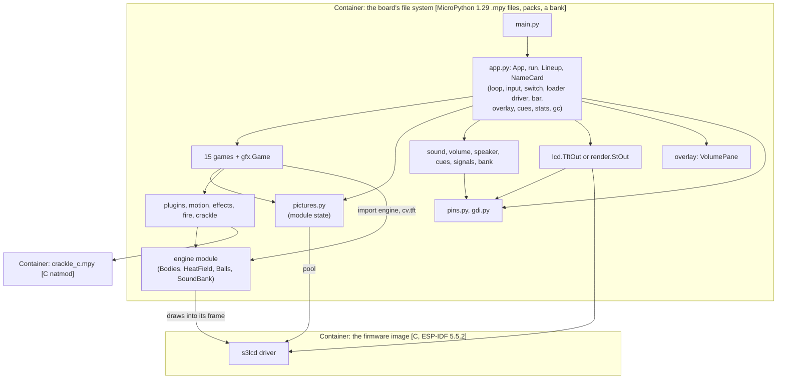
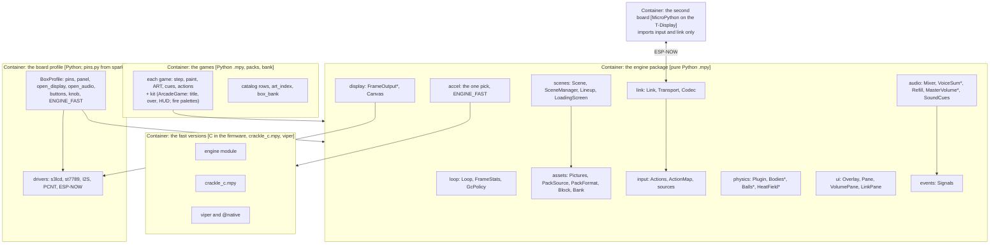

# P838: one engine for the games, with a plain and a fast version of each hot part

Spike P838 ([spark #1201](https://github.com/xmejkal/spark/issues/1201)), for the multiplayer epic P832
([spark #1194](https://github.com/xmejkal/spark/issues/1194)) and the demo epic P652 (spark #875). Written on
2026-11-16 from pixel-games master `3ce8b53` (engine submodule at `9589dcd`). Nothing ran on a board for this page. A
reference `file:line` is in pixel-games unless it starts with `engine/`.

> TL;DR: Make one engine. It is a Python package with the C module under it. Each hot part of the engine has one
> interface and two versions. The reference version is plain Python and runs anywhere, the Mac's tests included. The
> fast version is C, viper or `@native`. The engine picks one at import, by what the firmware has, and a setting can
> force the reference version. The box already works this way in five places (the mixer's sum, the master volume,
> the bodies, the crackle, the display output), so the rule is the repository's own, and PEP 399 is its source. A
> board profile under the engine holds the pins, the display driver and the speaker, and no game touches it. The games
> end with only their logic: step, paint, their assets, cues and actions. Start with stage 0 (the package, the
> one-time pick, the deploy). Stage 1 (the input action map) comes next, and multiplayer builds on it.

The PO asked whether the loading, the bar, the sound and the volume pane are general enough to reuse. The answer is
"partly". The sound path is the most reusable part today: small classes, each with a plain and a fast strategy. The
loader is already a step-wise generator with a progress value, but it writes module globals. The code that runs it
behind the card and draws the bar lives inside `App`, a class with eight jobs. This page maps every part (section 1),
states the design rule (section 2), draws the layers (section 3), gives each part its interface (section 4), says
where the engine lives (section 5) and orders the refactor (section 6). The refactor ends with every game holding only
its logic.

## The PO's words

- 2026-11-16, after P822 merged: "Ok, so are these features lie the loading of the games and the loading system and the
  bar a=etc, is it well generalzed in the pixel-engine so it could be reused ?" Then: "Just like the sound and the
  soundbar, etc.. Can we actually now create a card and analyze what all and how we can generalize for a reusable
  engine system ?"
- 2026-11-16, on multiplayer P832: "we want to test and mvp and experiment, but in the end we will want to have it
  general enough to be useful, good architecture so we can reuse, extend, all theses good architecture principles,
  strategies, exchangable onesm etc."
- 2026-11-16, the design direction for this spike: "Well, actually let's also talk about what belongs where. I mean
  I'd like to have one engine, or however we call it, basically an extension of the box2d or whatever python framework
  we are using but there should always be the option to use some basic micropython implementation or and advanced
  optimized strategy from the C modules, how would be smart to design such a system ? And have the few games we
  implemented so far actually reafactored to use the engine and only implement the game logic etc, but the sound and
  graphics and other optimized screens and drivers and anything are the optimized fast nes."

**On Box2D:** the box does not use Box2D or any Python game framework. Its physics is its own C: `world.c` (bodies
that fall and land), `fx_balls.c` on the uniform grid of `grid.c` (balls that collide) and `fx_fire.c` (the heat
field), listed in `engine/README.md`. `fx_balls.h` only borrows Box2D v3's names for a material: friction,
restitution and the restitution threshold (`engine/core/fx_balls.h:69`, [Box2D](https://box2d.org/documentation/)).
"The engine" on this page means our own: the C module and the Python package over it.

## 1. Inventory of every runtime part

Lines are `wc -l` at `3ce8b53`. In the last column:

- **C** is the C engine core.
- **engine** is the reusable Python layer.
- **board** is the board profile: pins, drivers and the box's wiring.
- **kit** is code that several games share but that no other project needs.
- **content** is one game, or this box's data.

| Part | File(s), lines | Its one job today | What couples it to this box | Target layer |
| --- | --- | --- | --- | --- |
| C engine module `engine` | `engine/binding.c` 701, `engine/core/` world.c 81, fx_fire.c 491, fx_balls.c 353, grid.c 59, events.h 51 | Bodies, HeatField, Balls, SoundBank, largest_free_internal (`engine/binding.c:684-692`), built into the firmware (`engine/micropython.cmake`, `build.sh engine`) | Its draws need an s3lcd display (`engine/binding.c:307-308`, `:592-593`); ESP-IDF heap caps (`engine/binding.c:12`) | C |
| C native module `crackle_c.mpy` | `engine/natmod/crackle/` with core fx_crackle.c 96, fx_grains.c 175, fx_noise.c 77 | The fire's sound in C, loaded with no firmware rebuild (`engine/natmod/crackle/Makefile`) | Built by `tools/crackle.sh`; `box.py deploy` does not copy it (`tools/box.py:19`) | C |
| s3lcd driver | `engine/driver/` (a submodule in the submodule) | The panel driver, its frame, `pool()` (`engine/driver/src/s3lcd.c:2951`) | A fork of a third-party driver | board (C) |
| The box's start | `games/main.py` 4 | Opens the knob and the speaker, calls `app.run` | Everything | board |
| App, the loop and the switch | `games/app.py` 512: `App` 163-371, `Lineup` 93-134, `NameCard` 375-402, `open_st7789` 405, `open_knob` 424, `open_speaker` 441, `run` 446-512 | Eight jobs in `App`: input reads (323-325), the pick (211-219), the build behind the card (246-283), a game's life (198-208, 231-243, 290-308), the overlay (183-185, 339), signals and cues (186-187, 206-208, 235-238), timing lines (316-371), the gc policy (310-314, 341-344, 355-356). `run` opens the hardware and runs the loop (498-509) | Imports pins, gdi, box_bank, catalog, lcd, speaker (`app.py:42-57`); the two buttons are fixed fields (`app.py:177-178`); constants for this panel and heap (`app.py:61-78`) | engine (loop, scenes, loader, stats, gc), board (the `open_*` functions and `run`'s wiring) |
| The catalog and the lineup rule | `games/catalog.py` 39 | The games the box can hold, and `lineup_fault` | The rows are this box's games | content (rows), engine (`lineup_fault`, `games_for`) |
| The pictures | `games/pictures.py` 267 | Reads a game's pack in 8 KB chunks as a generator with progress (`load_steps` 181-220), then draws pictures and layers (223-267) | Module state `PICS`, `SETS`, `ready`, `loaded`, `load_ms` (26-30); imports `art_index` at import (17-20); `ROOT = "/"` (22); the block is s3lcd's pool (46-48); a repeat of the Mac's tick shims (138-150) | engine (assets) |
| The art index and the packs | `games/art_index.py` 1044 (generated), `games/packs/*.pak` | Where each picture is in which pack | Written by `art/paint.py` and `art/export.py` | content |
| Drawing and the game base | `games/gfx.py` 456 | Colours, the recording `Canvas` (58-238), `Particles`, `Dice`, and `Game` (318-456) with title, play and over, the HUD and `BEST` | Screen size from `st7789` (21); globals `BEST` (302), `PHASES`, `PHASE_SUM` (306-307) | engine (the Canvas; the scene contract in `Game`), kit (title, over, HUD, Particles, Dice) |
| Output, st7789 path | `games/render.py` 150, `games/st7789.py` 113 | Dirty rectangles and `StOut` (120-150); our SPI driver | The panel's size | engine (the reference display output), board (the driver) |
| Output, s3lcd path | `games/lcd.py` 255 | `TftCanvas` (66-205), `TftOut` (208-237), `open_tft` (240-255) | GDI pins (`lcd.py:248-251`), `ORIENTATION` (32), the panel's 240 x 320 (33) | engine (the fast display output), board (`open_tft`) |
| Pins | `games/pins.py` 30, `games/gdi.py` 19 | This board's pins. spark's `assign_pins.py` writes `pins.py` from `requirements.json` (`pins.py:1-2`); `gdi.py` adds the GDI connector's pins by hand, a walk 4 workaround (`gdi.py:4-7`) | This board | board |
| Plugins | `games/plugins.py` 105 | `Plugin` with FixedUpdate and LateUpdate (37-51); `PhysicsPlugin` on `engine.Bodies` or its twin (54-105) | Stack's gravity as the default (34) | engine (physics) |
| Motion | `games/motion.py` 144 | `Spring`, `Bodies` (the Python twin of `engine.Bodies`, 77), `StepClock` (132) | none | engine (physics, reference) |
| Effects on bodies | `games/effects.py` 104 | `Effect` strategy, `FireTrail`, `EffectSystem` | The fire's grid (`effects.py:11`) | kit |
| Fire, crackle, burning | `games/fire.py` 336, `games/crackle.py` 383, `games/burning.py` 192, `games/fire_bank.py` 17 | `FirePlugin`, `FireLayer`, palettes; the crackle classes | The C draw takes `cv.tft` (`fire.py:177`, `:182`, `:336`; also `balls.py:137`); crackle makes its own `engine.SoundBank` (`crackle.py:188-197`), a repeat of `bank.py:42-44` | engine (`HeatField` and the crackle behind interfaces), kit (palettes, `FireLayer`) |
| The mixer | `games/sound.py` 257, `games/sound_viper.py` 79 | `Mixer` with groups (58-128), the `VoiceSum` strategy (39) and its viper twin, the `Refill` strategies `FrameRefill` and `CallbackRefill` (133-254) | 16 kHz (21); imports `volume.FULL` (19) | engine (audio) |
| The master volume | `games/volume.py` 114, `games/volume_viper.py` 50 | `MasterVolume` (26), `VolumeStore` (61), `VolumeKnob` (82) | none; `open_knob` passes no store, so the step is not saved (`app.py:437`) | engine (audio, input) |
| The speaker | `games/speaker.py` 46 | Adapter that owns the I2S, the refill and the mixer | Imports `pins` (5, 32-34); `IBUF`, `VOICES` (8-9) | board (its pins), engine (the adapter) |
| The sound bank | `games/bank.py` 60, `games/box_bank.py` 18 (generated), `games/box_bank.raw` | `Bank` reads one file into `engine.SoundBank` or a bytearray | The index is this box's sounds | engine (`Bank`), content (index, raw) |
| Cues | `games/cues.py` 62 | `SoundCues` plays a game's cues on the mixer when its signals come | The music's name `"music"` (10) | engine (audio) |
| Signals | `games/signals.py` 23 | `Signals`: listeners by name, called at once | none | engine (events) |
| Overlay | `games/overlay.py` 110 | `Overlay` of `Pane`s (36-73); `VolumePane` (76-110) | `volume.STEPS` (28); its rectangle from the screen size (31-32) | engine (UI) |
| Buttons | `games/buttons.py` 55 | A debounced `Button` with an edge count (19-55) | `BOOT_BUTTON = 0` (13) | engine (input), its pin to the board |
| The knob | `games/encoder.py` 85 | `Encoder` on the pulse counter, `take_detents` | Counter unit 0, and 4 edges per detent of the PO's CJMCU-111 (23, 50-54) | engine (input), its values to the board |
| `fast.py` | `games/fast.py` 7 | `@native` on MicroPython, nothing on the Mac | none | engine (the pick) |
| Runner's track, the 3D games | `games/track.py` 226, `games/world3d.py` 194 | Runner's obstacles; Tunnel and Road | none | content |
| The games | marshmallow, balls, meteors, bucket, rescue, arcade, arcade2, space3d, world3d, rain | One game each | Each loads its own art in setup (`meteors.py:254`, `bucket.py:155`, `rescue.py:519`, `arcade.py:70`, `:186`, `:537`, `arcade2.py:47`), which finds the set already loaded (`pictures.py:191`); six places check for the C themselves (`balls.py:22-30`, `fire.py:39-46`, `plugins.py:22-29`, `bucket.py:145`, `rain.py:38`, `burning.py:84`) | content |
| Deploy | `tools/box.py` 304 | Lineup, deploy as .mpy, the board's log | Copies the flat `games/*.py` only (`tools/box.py:149`) | Mac tooling |
| Art and sound tools | `art/*.py`, `tools/sound_bank.py`, `tools/fire_bank.py` | Paint the packs, write the banks | This box's look and sounds | content tooling (the pack format is the shared contract) |

The tests pin most of this on the Mac. `tests/test_pick.py`, `test_lineup.py`, `test_app_knob.py` and
`test_signals.py` drive `App.frame` with a clock they set. They patch module names such as `app.SETTLE_MS`,
`app.games_for`, `app.Lineup.game_steps` and `pictures.free`, so a move changes those patch targets. Their assertions
stay. `test_painted_frames.py` and `tools/render_scene.py` render real frames through `lcd.TftOut` on a stand-in
display (`tests/drawing_tft.py`). That makes them the golden check for any move in the display path.

## 2. The design rule: one interface, a reference version and a fast version

Each hot part of the engine has one interface and two versions:

- **The reference version** is plain Python. It runs on any MicroPython and on CPython on the Mac, so the tests run
  it. It is the one source of the behaviour.
- **The fast version** is C (the firmware's `engine` module or a native `.mpy`), viper or `@native`. It gives the
  reference version's results, faster.

Four rules come with it:

1. **The pick is made once.** The engine picks a version when the module is imported, by what the firmware has, and
   never per call. A setting, `ENGINE_FAST = False` in the board profile, forces the reference version everywhere.
   With it, a bug can be split into "the logic" and "the C" in one run.
2. **The same tests run against both versions.** A test class runs once with each version. A fast version that the
   Mac cannot build is skipped there and run on the board, as `sum_match` and `scale_match` are today.
3. **C does whole blocks, and Python decides per frame.** A C call takes a buffer or a block (a mix block of 256
   samples, a step of every body, a whole panel's draw), never one sample or one body. Python decides what happens:
   the game's rules, the events, the order of the stages. P628 states this split, and it holds.
4. **A part with no reference version says so.** `engine.Balls` and `engine.HeatField` have no Python twin today. Their
   games show "no C" (`fire.py:218`) or nothing (`balls.py:78`). That is allowed, but it is a gap, and it is written
   down (section 7).

**The source.** PEP 399, "Pure Python/C Accelerator Module Compatibility Requirements", asks for a pure Python
version beside any C accelerator, and for the C to "pass the test suite used for the pure Python code". Its test
example runs the same `ExampleTest` against `py_heapq` and `c_heapq` ([PEP 399](https://peps.python.org/pep-0399/)).
CPython's own modules pick once at import: `heapq.py` ends with `try: from _heapq import *` and
`except ImportError: pass` ([heapq.py](https://github.com/python/cpython/blob/3.11/Lib/heapq.py)), and
`json/scanner.py` takes `make_scanner` from `_json` or sets it to `None`
([json/scanner.py](https://github.com/python/cpython/blob/3.11/Lib/json/scanner.py)). PEP 399 names an accelerator
like its module with an underscore in front.

**The repository already works this way:**

| Part | Reference version | Fast version | Where the pick is made today | The test that runs both |
| --- | --- | --- | --- | --- |
| Mixer's sum | `sound.VoiceSum` (`sound.py:39`) | `sound_viper.ViperVoiceSum` (`sound_viper.py:18`) | Once, `speaker.voice_sum` (`speaker.py:12-18`) | `sound_viper.sum_match` (`tests/test_voices.py:65`; the board) |
| Master volume | `volume.MasterVolume.scale` (`volume.py:44`) | `volume_viper.ViperMasterVolume` (`volume_viper.py:18`) | Once, `app.open_knob` (`app.py:433-436`) | `volume_viper.scale_match` (`tests/test_volume.py:285`) |
| Bodies | `motion.Bodies` (`motion.py:77`) | `engine.Bodies` (`engine/core/world.c`) | Per game: `bucket.py:145`, `rain.py:38`, `burning.py:84` pass a flag to `PhysicsPlugin` (`plugins.py:62`) | `tests/test_engine_core.py`, against the C built by clang (`engine/tests/world_lib.py`) |
| Crackle | `crackle.Crackle` (`crackle.py:54`) | `crackle.NativeCrackle` on `crackle_c.mpy` (`crackle.py:134`) | In the caller | `tests/test_crackle.py`, sample for sample (`crackle.py:8-10`) |
| Display output | `render.StOut` with `st7789.py` | `lcd.TftOut` with s3lcd | Once, `run` (`app.py:458-469`) | `test_overlay` (both outputs); `test_render_scene` (TftOut) |
| Small hot loops | the plain function | `@native` (`fast.py:3-7`) | Once, at import | every test that calls them |
| Memory outside the heap | a bytearray | `s3lcd.pool` (`pictures.py:41-51`), `engine.SoundBank` (`bank.py:42-49`, `crackle.py:188-197`) | Once per load, in three copies | `test_pictures_sets`, `test_signals` |

So the rule is not new. What the box lacks is one place that makes the pick. Today each module asks for itself
whether the C is there (`balls.py:22-30`, `fire.py:39-46`, `plugins.py:22-29`, `bank.py:35-39`), and the bodies are
picked per game. The engine gets one small module, `accel.py`, with `fast(reference, name)`: it answers the fast
version when the firmware has it and `ENGINE_FAST` allows it, else the reference version. Each engine module calls it
once at import.

## 3. The layers, today and in the target

The C4 model's container level ([c4model.com](https://c4model.com/diagrams/container)): each box is a separately
deployed unit, with its technology in brackets. Mermaid's own C4 diagrams are experimental, so these are flowcharts
drawn at that level.

### Today



### Target



`*` marks a part with a reference and a fast version. The rule of the target: arrows point down. A game imports only
the engine (and its kit). The engine imports the fast versions through `accel` alone. Nothing in the engine imports
a game, `pins` or `gdi`. The board profile is the composition root, Mark Seemann's name for "a (preferably) unique
location in an application where modules are composed together"
([blog.ploeh.dk](https://blog.ploeh.dk/2011/07/28/CompositionRoot/)). It builds the parts with this board's pins and
hands them to the engine. spark already writes the pin map the firmware imports (`pins.py:1-2`), so the profile reads
`pins.py` and spark stays its source. `gdi.py` is the one hand-written exception (`gdi.py:4-7`).

## 4. Each engine part in the target

Each part is a few small classes with one job each. A strategy is a class with the same methods as its siblings. The
board profile picks it, or `accel` picks it when the choice is between a reference and a fast version. The hot path rule
holds for all of them: a frame allocates nothing new, and no extra call layer goes into the canvas's `fill`. That
method is written out by hand to avoid allocation (`lcd.py:81-82`, `:96`).

### 4.1 The loop and the frame's stages

```python
class Loop:          # run(frame): the fixed-step wait of app.py:498-509; the console poll as a strategy
class FrameStats:    # begin(t), stage(i), report(now, name) every FPS_EVERY_MS through a Reporter
class GcPolicy:      # Off (no PSRAM) or Timed(floor, every_frames): today's GC_FLOOR and GC_FRAMES
```

- **Strategies:** the `Reporter` (print to the console today; a pane or the link later), the `GcPolicy`, the console
  poll.
- **Industry names:** Game Loop and Update Method (Nystrom,
  [game-loop](https://gameprogrammingpatterns.com/game-loop.html),
  [update-method](https://gameprogrammingpatterns.com/update-method.html)). The stages keep Unity's order, which
  `App.frame` already names (`app.py:317-318`). `FrameStats` is the box's version of Unity's profiler markers
  ([ProfilerMarker](https://docs.unity3d.com/ScriptReference/Unity.Profiling.ProfilerMarker.html)).
- **Reuses:** `run`'s loop (`app.py:498-509`), `App.new_interval`, `collect` and the timing and log lines
  (`app.py:285-288`, `310-314`, `352-371`), and `gfx.PHASES`, which moves from module globals into `FrameStats`. The
  log lines keep their exact text, because `test_pick.py:128` and `:516` read them with regular expressions.

### 4.2 Scenes, the switch and the loading screen

```python
class Scene:             # what a game implements: name, ART, cues, actions, plugins, bg, covers,
    def step(self, now_ms, pressed, held): ...   # draw(cv), paint_static(cv)
class Lineup:            # names, build_steps(i): a generator of progress 0..1 that returns the Scene
class SceneManager:      # pick(now), settle(now), frame(now, actions): the scene to draw; refuses a failing build
class LoadingScreen(Scene):  # caption, progress; NameCard is the default look
```

- **Strategies:** the `LoadingScreen` look (today's `NameCard`; a game or a project can give its own), the per-frame
  load budget (`BUILD_CHUNKS` chunks today, `app.py:65`; a time budget later) and the catalog (the rows of
  `catalog.py`).
- **Industry names:** Unity's `SceneManager.LoadSceneAsync`, whose `AsyncOperation.progress` drives a loading bar
  ([LoadSceneAsync](https://docs.unity3d.com/ScriptReference/SceneManagement.SceneManager.LoadSceneAsync.html),
  [progress](https://docs.unity3d.com/ScriptReference/AsyncOperation-progress.html)). Godot's `SceneTree` changes scenes
  ([SceneTree](https://docs.godotengine.org/en/stable/classes/class_scenetree.html)), and its background loading
  reports a progress value
  ([background loading](https://docs.godotengine.org/en/stable/tutorials/io/background_loading.html)). Title, play and
  over are Nystrom's State ([state](https://gameprogrammingpatterns.com/state.html)).
- **Reuses:** `Lineup` and `game_steps` as they are (`app.py:93-134`). `pick`, `settle`, `build_frame`, `leave`,
  `play`, `new_game` and `refuse` (`app.py:198-308`) move into `SceneManager` with no change of logic. `NameCard`
  (`app.py:375-402`) becomes the default `LoadingScreen`. `gfx.Game` splits. The scene contract goes to the engine:
  its `step`, `draw`, `ART`, `cues`, `plugins` and `signals`. The arcade template (title, over, HUD, `BEST`) stays in
  the games as `ArcadeGame`.

### 4.3 Assets

```python
class Pictures:          # one instance: load_steps(set, only), free(), draw(cv, name, x, y, alpha), draw_cut, draw_layers
class PackSource:        # open(set) -> a file; FlashPacks(root="/") today
class PackFormat:        # check(header), spans(set, only), place(...): PIXPACK1 with art_index today
class Block:             # bytes(n): reference a bytearray; fast s3lcd.pool or engine.SoundBank, outside the GC heap
class Bank:              # as today, its memory from Block
```

- **Strategies:** the source (flash today; an SD card or the link later), the format (`PIXPACK1` and `art_index`,
  `pictures.py:23-24`, `:195`), the memory block (`pictures.py:41-51`, `bank.py:42-49`, `crackle.py:188-197`).
- **Industry names:** Godot's `ResourceLoader` with threaded loading and its progress (the background loading page
  above). Unity's `AssetBundle` is the same idea: a packed set loaded as one.
- **Reuses:** all of `pictures.py`. The module state (`pictures.py:26-30`) becomes the fields of one `Pictures`. The
  module keeps `load`, `draw`, `draw_cut`, `draw_layers` and `free` as one-line functions that call the default
  instance until the games move (stage 8). The three copies of "memory outside the GC heap" become one `Block`.
- **The games stop calling `pictures.load`.** The engine loads `Scene.ART` before it builds the game (P822,
  `app.py:128-130`). So the call in each game's setup is a second load that finds the set loaded, and it can go.

### 4.4 Audio

The audio is the most finished part. It needs its pins passed in and its names made parameters.

```python
class AudioOut:          # today's Speaker: open(), close(); I2sAmp(pins, ibuf) from the board profile
class Mixer: ...         # as today: play, stop, render(buf), groups MUSIC and SFX
class VoiceSum: ...      # reference plain Python, fast viper (exists); a C mixer later keeps render(buf)
class Refill: ...        # FrameRefill or CallbackRefill (exists)
class MasterVolume: ...  # reference plain scale, fast viper scale (exists)
class SoundCues:         # as today; the music's name is a parameter, not "music"
```

- **Strategies:** these exist and the caller swaps them: `VoiceSum` (`sound.py:39`, `speaker.py:12-18`), `Refill`
  (`sound.py:133`, `188`, `225`), `MasterVolume`'s scale (`volume_viper.py:18`). New: `AudioOut`, whose pins come
  from the board profile, not from `pins.py` (`speaker.py:5`, `:32-34`). `sound.py` already plans a C mixer behind the
  same `render(buf)` (`sound.py:6-7`, `:256-257`), a whole block per call.
- **Industry names:** mixer groups are Unity's AudioMixer groups and Godot's audio buses
  ([AudioMixer](https://docs.unity3d.com/Manual/AudioMixer.html),
  [audio buses](https://docs.godotengine.org/en/stable/tutorials/audio/audio_buses.html)). Cues on signals are
  Nystrom's Observer ([observer](https://gameprogrammingpatterns.com/observer.html)).
- **Reuses:** `sound.py`, `sound_viper.py`, `volume.py`, `volume_viper.py`, `cues.py` and `bank.py` as they are.
  Only `speaker.py` changes (its pins come in), and `cues.MUSIC_SOUND` becomes an argument.

### 4.5 Input with an action map

This is the part multiplayer needs first.

```python
class Actions:           # one record, made once: fire_pressed, fire_held, next_pressed, volume_turn (later move_x, move_y)
class InputSource:       # poll(now, actions): adds what it saw into actions; forget()
class ButtonSource(InputSource):  # a buttons.Button bound to FIRE or NEXT
class KnobSource(InputSource):    # an Encoder's detents into volume_turn
class StickSource(InputSource):   # the joystick of P831: two ADC reads, a dead zone
class RemoteSource(InputSource):  # the link's newest INPUT message: a press count, held, x, y
class ActionMap:         # its sources; poll(now) -> the Actions, cleared and filled in place; forget()
```

- **Strategies:** each `InputSource`. The map is data that the board profile writes, such as "BOOT is FIRE, D14 is
  NEXT, the remote's button is FIRE too".
- **Industry names:** Unity Input System's Actions
  ([Actions](https://docs.unity3d.com/Packages/com.unity.inputsystem@1.7/manual/Actions.html)), Godot's `InputMap`
  ([InputMap](https://docs.godotengine.org/en/stable/classes/class_inputmap.html)) and Nystrom's Command, whose first
  example is "Configuring Input" ([command](https://gameprogrammingpatterns.com/command.html)).
- **Reuses:** `buttons.Button` (`buttons.py:19-55`), `encoder.Encoder` and `VolumeKnob` (`volume.py:82-114`). The
  lines that change are `App.__init__`'s two buttons (`app.py:177-178`), the reads in `frame` (`app.py:323-325`) and
  the `forget` calls (`app.py:241-242`). A game still gets `step(now, pressed, held)` (`app.py:336`,
  `gfx.py:375`), so no game changes. A game that needs more names its actions, and a two-player game reads `Actions`.
- **No allocation:** `poll` writes ints and bools into the one `Actions`, as `Button.update` does today.

### 4.6 Display output and the canvas

```python
class FrameOutput:       # clear(), reset(), draw(scene, us, overlay): reference StOut (st7789.py), fast TftOut (s3lcd)
class Canvas: ...        # fill, box, line, text, big, picture, poly, sprite, keep: the recording Canvas and TftCanvas
```

- **Strategies:** the backend (`app.py:78`, `:458-469`). The board profile opens the driver and hands the output to
  the engine. `open_tft` and `open_st7789` take a `DisplayPins` record, not `gdi` (`lcd.py:248-251`,
  `app.py:411-415`).
- **Industry names:** Godot's servers keep the renderer behind a low-level API
  ([using servers](https://docs.godotengine.org/en/stable/tutorials/performance/using_servers.html)). `keep` and the
  dirty rectangles are Nystrom's Dirty Flag ([dirty flag](https://gameprogrammingpatterns.com/dirty-flag.html)).
- **Reuses:** `lcd.py`, `render.py`, `st7789.py` and gfx's `Canvas` as they are. The two outputs already share
  `clear`, `reset` and `draw` (`render.py:120-150`, `lcd.py:208-237`). The target only names that shared shape.
- **The C draws.** The C effects draw a whole panel into s3lcd's frame (`engine/binding.c:300-308`), and a game passes
  `cv.tft` for it (`fire.py:177`, `balls.py:137`). The engine wraps that call in the effect's own `draw(cv)`, so a
  game never names the driver. With the reference output, the effect draws through the canvas, or says it cannot.

### 4.7 Physics and effects

```python
class Plugin: ...        # FixedUpdate and LateUpdate, as plugins.py:37-51
class Bodies:            # reference motion.Bodies, fast engine.Bodies: spawn, step, read, drain (one API, plugins.py:62)
class Balls:             # fast engine.Balls only; no reference yet
class HeatField:         # fast engine.HeatField only; no reference yet
```

- **Strategies:** the version, picked once by `accel`, not per game (`bucket.py:145`, `rain.py:38`, `burning.py:84`
  today).
- **Industry names:** Bevy's plugins ([plugins](https://bevy.org/learn/quick-start/getting-started/plugins/)). The
  body's `Effect` is Nystrom's Component ([component](https://gameprogrammingpatterns.com/component.html)). The
  material's words are Box2D v3's (`engine/core/fx_balls.h:69`).
- **Reuses:** `plugins.py`, `motion.py` and the `HeatField` part of `FirePlugin` (`fire.py:104-122`). The palettes and
  `FireLayer`'s look stay in the fire kit.

### 4.8 Overlay and signals

- **Overlay:** `Overlay` and `Pane` as they are (`overlay.py:36-73`). `VolumePane` reads its cell count from the
  volume it shows, not from `volume.STEPS` (`overlay.py:28`). The next pane is P832's "link lost" (espnow.md, section 3,
  "Where it hooks into App.frame()"). Industry name: Godot's `CanvasLayer`, a layer drawn over the scene
  ([canvas layers](https://docs.godotengine.org/en/stable/tutorials/2d/canvas_layers.html)).
- **Signals:** `Signals` as it is (`signals.py:9-23`). It is Godot's signal, its version of the Observer
  ([signals](https://docs.godotengine.org/en/stable/getting_started/step_by_step/signals.html)). It stays direct, with
  no queue. P766 found that a queue is for a sender that must not wait, such as an interrupt or the radio
  ([event queue](https://gameprogrammingpatterns.com/event-queue.html)).

### 4.9 The link (new, for multiplayer)

```python
class Transport:         # open(), send(bytes) without waiting, recv_into(buf) -> n or 0 without waiting, close()
class EspNowTransport(Transport): ...   # espnow.md section 3: irecv(0), send(..., False), power save off
class LoopbackTransport(Transport): ... # two ends in one process: the Mac tests
class BleTransport(Transport): ...      # P832's experiment
class Link:              # a session over a Transport: hello and pairing, seq, alive(now), the newest message per kind
class Codec:             # the 4-byte header and the INPUT and STATE payloads of espnow.md
```

- **Strategies:** the `Transport` (ESP-NOW, BLE, loopback), the `Codec`, and which board is the host.
- **Industry names:** Godot's `MultiplayerPeer`, an abstract class that ENet, WebSocket, WebRTC and an offline peer
  implement ([MultiplayerPeer](https://docs.godotengine.org/en/stable/classes/class_multiplayerpeer.html)), and Unity
  Netcode's swappable transports
  ([transports](https://docs-multiplayer.unity3d.com/netcode/current/advanced-topics/transports/)). The snapshot and
  the host-authoritative model are Gaffer On Games, as espnow.md section 3 cites.
- **Reuses:** espnow.md's `Link` sketch, cut in two: the session (`Link`) and the radio (`EspNowTransport`).
  `RemoteSource` (4.5) is how a remote board plays every game with no change to the game.
- **For the second board:** the T-Display imports the engine's `input` and `link` modules and nothing else. So the
  package's `__init__.py` stays empty, and each module imports alone.

### 4.10 The board profile

```python
class BoxProfile:        # this box: pins (spark's pins.py, gdi.py), the panel, ENGINE_FAST
    def open_display(self): ...   # s3lcd or st7789, with its pins -> a FrameOutput
    def open_audio(self, volume): ...  # the I2S amplifier, its pins -> an AudioOut
    def input_map(self): ...      # BOOT is FIRE, D14 is NEXT, the knob is the volume -> an ActionMap
```

- It is the only code that imports `pins`, `gdi` or a driver's open call. `main.py` makes it and starts the engine.
- A second board (the T-Display) is a second profile with its own pins, and the same engine.
- **Industry name:** the composition root (above). Godot's `DisplayServer` and `AudioServer` play the same part
  beneath the scene tree.

## 5. Where the engine lives

| Option | For | Against |
| --- | --- | --- |
| A. In pixel-engine, as a Python package beside the C module, now | The PO's question names the pixel-engine. One repository is the whole engine, and a second project takes one submodule. | Each engine change is two PRs: the package's, and the submodule bump. Its tests need the stubs, which are in pixel-games (`tests/stubs/`). The interfaces are not settled yet, and they change most in the first stages. |
| B. In pixel-games as a package in `games/`, for good | One PR per change. The tests find it, because they already put `games/` on the path (`tests/test_app_knob.py:13`). | Another project would copy it. |
| **C. B first, then A when a second board uses it (recommended)** | Fast while the shapes settle. A test keeps the boundary, so the move is a `git mv` plus paths. The move comes with a second user: the T-Display remote of P832. | One move later, with a submodule bump and new deploy paths. |

- **Its name:** an open decision (section 8). It must not be `engine`, which is the C module's name. On the Mac,
  `import engine` already finds the submodule's folder as an empty package (`plugins.py:26-29`). The page writes
  `pixel` as a placeholder.
- **The boundary test:** a test reads each of the package's modules with `ast`. It fails on an import of a game module,
  `pins`, `gdi`, `catalog`, `art_index` or `box_bank`, and on any `import engine` outside `accel`.
- **The twin tests:** each part with two versions gets one test class that a subclass runs against each version, as
  PEP 399's example does. `tests/test_engine_core.py` already does this for the bodies.
- **How it ships:** as .mpy files in a folder on the board. `box.py deploy` compiles each of the package's files with
  the same `mpy-cross` and copies the folder. Today it copies the flat `games/*.py` only (`tools/box.py:149`), so
  stage 0 changes the deploy. A `.py` runs before an `.mpy` of the same name (`tools/box.py:16`), and that holds in
  the folder too, so the deploy removes stale files there as well. Later, the package can be frozen into the firmware
  with a `manifest.py` (MicroPython's [manifest files](https://docs.micropython.org/en/v1.29.0/reference/manifest.html)).
  That saves heap and import time, but each change then needs a firmware build and a flash. `mip` and `package.json`
  ([packages](https://docs.micropython.org/en/v1.29.0/reference/packages.html)) fit a published package, which this
  is not yet.
- **How it is tested on the Mac:** as today. The stubs give `framebuf` and `micropython`, and the tests give `time` its
  `ticks_*` (`tests/test_app_knob.py:16-17`). The engine gets one `clock.py` in place of `pictures.py`'s copies
  (`pictures.py:138-150`). The C keeps its clang tests in pixel-engine (`engine/tests/*_lib.py`), and they stand in
  for the fast version in the twin tests.

## 6. The refactor stages

Each stage is one small PR that keeps every game playing. It mostly moves code with no change of logic, so the tests
pin it. Martin Fowler names these Strangler Fig and Branch by Abstraction
([strangler fig](https://martinfowler.com/bliki/StranglerFigApplication.html),
[branch by abstraction](https://martinfowler.com/bliki/BranchByAbstraction.html)). Every stage ends with these checks:

- the full Mac suite, with the frame and painted tests green (`test_painted_frames`, `test_painted_rounds`,
  `test_render_scene`, the `*_frames` tests);
- a deploy and a board log that shows `ready`, a `game` line, and a `switch` line for a game with a pack;
- for a stage that touches the frame, the `fps` and `time` lines against bench.md.

| # | Stage | What it moves | Risk | How it is checked |
| --- | --- | --- | --- | --- |
| 0 | **The home and the pick** | Creates the package with an empty `__init__.py`; moves `signals.py`, `fast.py` and the tick shims into it; adds `accel.py` with `ENGINE_FAST`, the one place that imports the C; `box.py deploy` copies the folder as .mpy files; adds the boundary test | The deploy of a folder; a stale `.py` in it | `test_box` with a dry run that lists the folder's commands; the boundary test; the twin test of the bodies runs through `accel` |
| 1 | **Input: the action map** (multiplayer needs this first) | `buttons.py` and `encoder.py` into `input`; new `Actions`, `ActionMap`, `ButtonSource`, `KnobSource`; `App` reads the map | A press lost or doubled around a pick or a build (`app.py:241-242`) | `test_pick`, `test_app_knob`, `test_encoder`, a new `test_input`; on the board the PO presses through a few games (the same buttons, so no feel change) |
| 2 | **The link** (P832's slices, built in the package) | New `link`: `Transport`, `EspNowTransport`, `LoopbackTransport`, `Link`, `Codec`; `RemoteSource`; `LinkPane` | The radio's internal RAM beside the display's DMA buffer (espnow.md section 6) | Loopback tests on the Mac; espnow.md's step 1 ping-pong, then step 3 (the remote BOOT button) on two boards |
| 3 | **Scenes and the loading screen** | `App`'s switch jobs into `scenes` (`SceneManager`, `Lineup`, `LoadingScreen` with `NameCard` as its default); `lineup_fault` and `games_for` to the engine; the rows stay | The P822 timing: the build's frames and its longest share of a frame | `test_pick`, `test_lineup` (the patch targets move, the assertions stay); a `switch` line within bench.md's P822 numbers |
| 4 | **Assets** | `pictures.py`'s state into a `Pictures` with `PackSource`, `PackFormat` and `Block`; the module's functions call a default instance; `Bank` and the crackle take memory from `Block` | A game that reads `pictures.PICS` directly | `test_pictures_sets`, `test_painted_frames`, `render_scene.py --all` with the same pictures; the board's `load` ms against bench.md |
| 5 | **Physics and audio behind `accel`** | `Bodies`, `Balls`, `HeatField`, `VoiceSum`, `MasterVolume`, the crackle: each picked once by `accel`, not per game or per caller; one twin test class per pair | A game that kept its own `self.c` | The twin tests (PEP 399 style); `test_rain`, `test_bucket`, `test_burning`, `test_voices`, `test_volume`; a board run with `ENGINE_FAST` on, then off |
| 6 | **The loop, stats and gc** | `run`'s loop into `Loop`; the timing lines and `gfx.PHASES` into `FrameStats`; the gc choices into `GcPolicy` | A collection moved into a frame that plays | The log lines keep their text (`test_pick.py:128`, `:516`); fps and the slowest frame against bench.md |
| 7 | **The board profile** | `BoxProfile` in `main.py`: `open_display` and `open_audio` take their pins; the only module that imports `pins` and `gdi`; `VolumePane` reads its steps from the volume | Pins mixed up between the I2S and the panel | `test_sound`, `test_volume`, `test_overlay`, `test_render_scene`; a board run with sound and the knob |
| 8 | **The games, one game per PR** | Each game keeps only its logic: `step` or `play`, `paint`, `ART`, `cues`, its actions. It loses `import engine`, `cv.tft`, its own `pictures.load`, its own C check and its own clock. The order: rain, bucket, burning (bodies), balls, marshmallow and fire (the C draws), meteors, rescue, then the arcade modules one class at a time | A game that looks or feels different | The game's own tests and its frame and painted tests; the boundary test grows a rule for the games (no `engine`, `pins`, `gdi` or driver); the PO plays the game when its PR changes anything he sees |
| 9 | **The move to pixel-engine** (when the T-Display uses the package) | The package to the pixel-engine repository, with its history; pixel-games bumps the submodule; deploy and the tests read it there | Paths in the deploy and the tests | The boundary and twin tests in pixel-engine; the full suites of both repositories; a deploy and a board log |

Stage 0, then stage 1, come before P832 writes any game-facing code. Multiplayer then builds its remote input as an
`InputSource` and its link as a `Transport` in the package, not beside it. espnow.md's step 1 ping-pong needs no game
code, so it can run on the bench while stages 0 and 1 are in review. Stages 3 to 7 can follow in any order. Stage 3 is
the one the PO asked about by name (the loading and the bar). Stage 8 is last, because each game PR uses what the
stages before it made. After stage 8 every game holds only its logic, and the sound, the drawing, the screens and the
drivers are the engine's fast versions.

## 7. What not to generalize yet, and why

- **A Python version of the balls and the heat field.** They have no reference version (`balls.py:78`,
  `fire.py:121`). A Python heat field would not run at frame rate on the board. The Mac already runs the real C through
  clang (`engine/tests/balls_lib.py`, `tests/test_fire.py`), so the tests need no Python twin. Write one only when a
  board without the C module must play these games.
- **A second display backend for the C draws.** The C effects need s3lcd (`engine/binding.c:307-308`, `:592-593`).
  The engine hides the call (4.6), but a C draw onto another driver has no user.
- **The screen size and the orientation.** `WIDTH` and `HEIGHT` are constants from `st7789.py` (`gfx.py:21`), and
  `TftCanvas.fill` maps them inline, with no helper call (`lcd.py:79-100`). A parameter would add a lookup to every
  fill, and there is one panel.
- **A base class for the canvas.** Two canvases already share its shape, each tuned by hand. A base class with
  `super()` calls would cost time in the hot path.
- **The arcade template.** Title, over, HUD and `BEST` (`gfx.py:302-456`) are the style of these games, so they stay a
  kit in pixel-games.
- **The fire's look.** Palettes, `FireLayer`'s burns and `effects.py` are content (`effects.py:11`). Only the
  `HeatField` under them is engine.
- **An event queue, an ECS, a scene tree, asyncio.** The box's loop is a plain `while True`, and espnow.md rejects
  `aioespnow` for that reason. Signals stay direct (P766). The only queue is the radio's receive.
- **Lockstep and client-side prediction.** espnow.md section 3 rules both out for these two boards.
- **The art and sound tools.** They are content tooling. The shared contract is the pack format (`PIXPACK1`, the
  16-byte header and `art_index`, `pictures.py:23-24`) and the bank's index, and the engine's `PackFormat` owns it.
- **Renaming the C module.** PEP 399's naming would make the C module `_pixel`, beside the package `pixel`. That
  rename needs a firmware build, and `accel` hides the name anyway. It can wait until a firmware build is due.
- **A data-driven scene file, a registry of strings, a plugin loader.** Python classes chosen in the board profile
  are enough.

## 8. Open decisions for the PO

1. **What is the engine called?** Recommended: `pixel` for the Python package, the name of the pixel-engine
   repository. It is short, it matches pixel-games, and it does not clash with the C module `engine`. Other names are
   free, as long as the package and the repository say the same.
2. **Does the engine start in pixel-games and move to pixel-engine once a second board uses it?** Recommended: yes
   (option C). It answers "is it in the pixel-engine" with "it will be, once its shape is proven", and the boundary
   test keeps it movable.
3. **Is `ENGINE_FAST` one switch for the whole engine, set in the board profile?** Recommended: yes, one switch, read
   once at import. A switch per part can come when a bug needs it.
4. **Do stages 0 and 1 come before P832's first game-facing slice?** Recommended: yes. The ping-pong probe can run
   beside them, because it touches no game code.
5. **Does a game keep `step(now, pressed, held)`?** Recommended: yes. The action map feeds those two values, so all
   15 games play unchanged until stage 8, and only a new two-player game reads `Actions`.
6. **Does each game get its own loading screen now?** Recommended: no. Stage 3 makes the look a strategy, with
   `NameCard` as the default. A game's own card waits until the PO asks for one.
7. **Is the engine shipped as .mpy files and not frozen into the firmware?** Recommended: .mpy files now, so a change
   needs no firmware build. Freeze it only if a board run shows that the import time or the heap needs it.

## What the code could not decide

- Whether a package folder of .mpy files imports as fast as flat modules on the board. P819 measured only flat .mpy
  files.
- Whether the T-Display's MicroPython has room for the engine's `input` and `link`, and whether it has
  `machine.Encoder`. espnow.md section 4 has the board's facts, and nothing has run there.
- Whether a frozen package fits the firmware partition beside the engine.
- What `ActionMap.poll` and the `accel` pick cost on the board. The pick runs once. The poll is a few attribute
  stores a frame, but nobody has timed it.
- Whether the C draws of `Balls` and `HeatField` can take a canvas without a cost per frame. That is a binding
  question, and the code does not show it.
- Whether the PO wants the arcade template reused by another project. The code treats it as this box's style.

## Sources

- PEP 399: [Pure Python/C Accelerator Module Compatibility Requirements](https://peps.python.org/pep-0399/). CPython
  3.11: [Lib/heapq.py](https://github.com/python/cpython/blob/3.11/Lib/heapq.py),
  [Lib/json/scanner.py](https://github.com/python/cpython/blob/3.11/Lib/json/scanner.py) (also read in the local
  CPython 3.11.13).
- Robert Nystrom, Game Programming Patterns: [Game Loop](https://gameprogrammingpatterns.com/game-loop.html),
  [Update Method](https://gameprogrammingpatterns.com/update-method.html),
  [Command](https://gameprogrammingpatterns.com/command.html),
  [Observer](https://gameprogrammingpatterns.com/observer.html),
  [State](https://gameprogrammingpatterns.com/state.html),
  [Dirty Flag](https://gameprogrammingpatterns.com/dirty-flag.html),
  [Event Queue](https://gameprogrammingpatterns.com/event-queue.html),
  [Component](https://gameprogrammingpatterns.com/component.html).
- Unity: [SceneManager.LoadSceneAsync](https://docs.unity3d.com/ScriptReference/SceneManagement.SceneManager.LoadSceneAsync.html),
  [AsyncOperation.progress](https://docs.unity3d.com/ScriptReference/AsyncOperation-progress.html),
  [AudioMixer](https://docs.unity3d.com/Manual/AudioMixer.html),
  [Input System Actions](https://docs.unity3d.com/Packages/com.unity.inputsystem@1.7/manual/Actions.html),
  [ProfilerMarker](https://docs.unity3d.com/ScriptReference/Unity.Profiling.ProfilerMarker.html),
  [Netcode transports](https://docs-multiplayer.unity3d.com/netcode/current/advanced-topics/transports/).
- Godot (stable): [SceneTree](https://docs.godotengine.org/en/stable/classes/class_scenetree.html),
  [background loading](https://docs.godotengine.org/en/stable/tutorials/io/background_loading.html),
  [InputMap](https://docs.godotengine.org/en/stable/classes/class_inputmap.html),
  [audio buses](https://docs.godotengine.org/en/stable/tutorials/audio/audio_buses.html),
  [canvas layers](https://docs.godotengine.org/en/stable/tutorials/2d/canvas_layers.html),
  [signals](https://docs.godotengine.org/en/stable/getting_started/step_by_step/signals.html),
  [MultiplayerPeer](https://docs.godotengine.org/en/stable/classes/class_multiplayerpeer.html),
  [using servers](https://docs.godotengine.org/en/stable/tutorials/performance/using_servers.html).
- Box2D: [documentation](https://box2d.org/documentation/) (named for the material's words only). Bevy:
  [plugins](https://bevy.org/learn/quick-start/getting-started/plugins/).
- MicroPython v1.29.0: [manifest files](https://docs.micropython.org/en/v1.29.0/reference/manifest.html),
  [packages](https://docs.micropython.org/en/v1.29.0/reference/packages.html),
  [.mpy files](https://docs.micropython.org/en/v1.29.0/reference/mpyfiles.html).
- Martin Fowler: [Strangler Fig](https://martinfowler.com/bliki/StranglerFigApplication.html),
  [Branch by Abstraction](https://martinfowler.com/bliki/BranchByAbstraction.html). Mark Seemann:
  [Composition Root](https://blog.ploeh.dk/2011/07/28/CompositionRoot/). Simon Brown:
  [C4 container diagram](https://c4model.com/diagrams/container).
- In this repository: P831's [finding](../2026-11-16-p831-engine-capabilities/finding.md) and
  [espnow.md](../2026-11-16-p831-engine-capabilities/espnow.md), sections 3, 4, 6 and 7; P819's
  [finding](../2026-11-15-p819-smooth-switch/finding.md); P628's [layers](../2026-11-05-p628-engine-layers/README.md);
  P766's [panes and events](../2026-11-11-p766-panes-events/README.md).

Every web page was reached on 2026-11-16. The Godot and Unity pages are their current versions. The Unity Input System
page is version 1.7, as P831 cites it.
