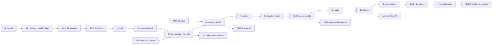

# P844: the engine refactor, re-planned

Spike P844 ([spark #1208](https://github.com/xmejkal/spark/issues/1208)), for the engine epic P841
([spark #1205](https://github.com/xmejkal/spark/issues/1205)). Written on 2026-11-16 from pixel-games master `1d002da`
(engine submodule at `9589dcd`). It starts from P838's stages ([finding](../2026-11-16-p838-engine-layer/finding.md),
section 6). It folds in the PO's decisions of 2026-11-16, the lessons of the three surveys ([synthesis](synthesis.md))
and the council's first round. Nothing ran on a board for this page. A `file:line` is in pixel-games. A path that
starts with `engine/` is in the pixel-engine submodule. A MicroPython path is in v1.29.0, the clone that `build.sh`
makes.

> TL;DR
>
> - **What we take from other frameworks.** We copy no code. We reuse MicroPython's own parts (MIT): its board
>   folder, `pins.csv` and `espnow`. We take designs from Flipper Zero, UIFlow 2, InfiniTime, Presto, CircuitPython and
>   TIC-80. We leave LVGL until a build spike, and asyncio, widget trees and every GPL or Espressif-only code.
> - **The order:** the net, then the C module's new name, the package, input, scenes, drawing, assets, the board
>   folder, audio, physics, the loop, the games one module at a time, and the move to pixel-engine. The link waits for
>   multiplayer, after the engine.
> - **One fact changes the start.** The firmware's C module is named `engine`, and it hides any package of that name.
>   So the C module becomes `_engine` and the board gets a new firmware first. That flash waits for your yes.
> - **Each step builds only what has a reader.** Long and repeat presses and the "handled" rule come with the app kit
>   (P843). A spike decides whether a reset between games pays.
> - **What you see:** the box plays the same through the package stages, with one new line at boot. You play at the
>   input, the switch, the audio and each game's stage. Each board run needs the box on the USB cable.
> - **Ready now:** the net (N), the new names in two PRs (0a-1, 0a-2) and the package (0b-1).

## Council

Round 1 ran on 2026-11-16 with five members: lenses on Sonnet for the PO and Claude as readers (U), the board and the
build (B), architecture (A) and tests (T), then the refuter on Opus (R). The PO added change 41 the same evening. One
line per change:

1. U: the TL;DR has six plain bullets. The first says what we copy, take and leave. The `file:line` detail left it.
2. U, B: the flash of 0a waits for the PO's yes. Its PR shows the image's sha256 and the saved rollback image, then
   stops. The TL;DR and the board gates name the stages that need his bench and the USB cable.
3. U: every stage has a "What the PO sees" line, and the stages where he plays are named.
4. U: "Open questions" holds only what the PO must answer. Pixel-games first and a controller first are taken
   defaults that he can change. The plan's own choices moved to "Decided here".
5. U: the cards that enter Ready now are N, 0a and 0b-1.
6. U: every done line names a command and what it prints, or "the PO says yes in the PR".
7. U: the words table adds the net, Null Object, needs, characterization test, composition root and Chooser. It keeps
   "pick" for D14 only, "version" for reference or fast, "swappable part" for any strategy class, "release" for an API
   number.
8. B: step zero of 0a copies the image on the build folder (1,821,872 B) to a kept file outside the repository, with
   its sha256. Stage 0a writes the full undo.
9. B: the deploy keeps `:crackle_c.mpy` until stage 9, so a rollback keeps the crackle.
10. B: 0a's board check and done line say the order: flash, deploy, check.
11. B: `check_firmware` imports `_engine` and lists its four classes and `HeatField.cool`. It refuses the old name, a
    missing name and an unknown answer. It runs before `ls`. A dry run never refuses. The answers of the old, the new
    and no C are kept as fixtures. Changed: the fixtures come from 0a's first board run, because this page runs nothing
    on the board.
12. B: the folder deploy removes the flat files of the modules that moved into the package. Changed: it uses a
    `MOVED` table, not "every root module that `games/` lacks". The board keeps a `boot.py` that MicroPython wrote
    (`ports/esp32/modules/inisetup.py:47`), and that rule deletes it. Nested folders deploy from stage 1.
13. B: 0b-1's board numbers are cold imports, `gc.mem_free()` after a collect, and a median per module. The baseline is
    the 5.0 s for every module (`README.md:102`).
14. B: 0a's checklist greps `crackle_c` over `tools/`, the README, `crackle.py`'s docstrings, `tools/box.py:19` and
    the probes. The README's flash step (`README.md:97`) names the build-engine path.
15. A: stage D and its card are gone. `s3lcd` already splits the bus (`lcd.py:250-251`, `s3lcd_spi_bus.c`,
    `s3lcd_i80_bus.c`) and reads a start-up table as data (`engine/driver/src/s3lcd.c:1389-1410`). Stage 7b takes the
    panel's start-up list and its bus kind.
16. A: no code without a reader. Stage 1 builds `pressed`, `held` and `turn` only. Long, repeat, released and
    `LONG_MS` come with P843's first card. Stage 3b keeps the life cycle and the crash rule. The "handled" rule goes to
    P843. The `Switcher` waits for S1. Stage 7b writes `Panel` only, and 5a adds `Audio`.
17. A: stage 8 lists every game module in eight cards, and names the engine API that games import. `fire.py`,
    `track.py`, `effects.py` and `cues.py` each have their place.
18. A: 0b is split into 0b-1 (the package, the folder deploy, the boundary, the board numbers) and 0b-2 (`accel`,
    the composition root, `--engine`, the boot line). `docs/design-decisions/` is dropped.
19. A: 3c puts `Particles` and `effects.py` into the package, because A1 gives `Particles` a fast version. `kit.py`
    keeps `ArcadeGame`, `Dice`, the HUD and `hint_lines`.
20. A: stage 7 is split into 7a (the board definition, proved by the same generated sdkconfig, with no flash) and 7b
    (`Panel` and `open_display`). It names a fallback and how the profile and `pins.py` reach the board's root.
21. A: stage 6 is a move plus the `Loop`, `FrameStats` and `GcPolicy` extraction. The Mac's host lives in `tests/`
    from stage N. The part names come from the `choose` calls. A test checks that the root `engine/` never gets an
    `__init__.py`. Changed: `--engine reference` writes `"all"`, and a forced name that no `choose` call uses shows
    in the boot line as `unused=`. A list on the Mac is a second copy of the names.
22. T: the net has two levels: the game level and the App level, which pins the `game` and `switch` lines and a frame
    per game after each pick. The App level guards stages 1, 3b and 6.
23. T: the net hashes frames 1 and 5, each row's shot frame, a frame in the middle and the last one. It records the
    cues over the whole run, one process per subject.
24. T: one mixer golden: a fixed cue list through the reference sum and volume, the samples' sha256. The gates of
    0b-2 and 5a name the test "the reference and the chosen class give equal samples".
25. T: the net runs in under 90 s, one process per subject, in parallel. A fast tier runs in every story run, and the
    full tier at the full-suite stages.
26. T: `frames.json` records the clang version, the font file's sha256 and the Python version. A mismatch fails with
    "toolchain changed". A hash change is its own PR with the old and new pictures side by side. A moving stage never
    touches the hash file.
27. T: the cue recorder gives each game a fresh `Signals` that records every `emit`, as `App` does
    (`app.py:235`). A test checks that every game with cues records at least one. `SUBJECTS` is compared with
    `catalog.py`.
28. T: the net's negative tests also prove that a moved sprite, a changed press timing and a changed cue are caught.
29. T: each logic stage names its mutation rows. 0b-1 reads how `mutate.py` finds a package's tests. If it cannot, a spark card
    is filed.
30. T: the import-alone tests run in one pool with `-I -B`. Tests that patch `time` run in a fresh process or restore
    it. The direction table lists the allowed imports. A test checks that `engine.__file__` is
    `games/engine/__init__.py`.
31. T: every part with two versions has a row in a twin table, and a test fails for a part without one. The page says
    what a Mac run cannot see.
32. T: one table of board gates with numbers, from a baseline run at stage N. The hook checks the Mac tests. The agent
    and the PO read the board numbers. A stage's PR stays a draft until its board result is in.
33. T: the full suite also runs at stages 1, 3b and 6. The boundary fixtures stay out of test discovery. A test in
    stage 8 checks that no shim name of 3a or 3c remains.
34. R: 3a changes logic after all. `Lineup` calls `pictures.load_steps` (`app.py:130`), `games_for` reads
    `catalog.ROWS` (`app.py:82-90`) and `NameCard` is a `gfx.Game` (`app.py:375`). 3a passes the rows and the loader to
    the constructors, and gives `NameCard` a base class in the engine.
35. R: `open_knob(volume)` breaks `run`'s fallback (`app.py:457`) and four probes (`probe768_box.py:114`,
    `probe764_box.py:71`, `probe550.py:68`, `tools/probe635.py:198`). 0b-2 drops the fallback and updates them.
36. R: `tests/test_plugins.py:99-109` sets `sys.modules["engine"]`. In 0a it sets `sys.modules["_engine"]`.
37. R: the Fire run builds its own `Mixer` (`probe733_games.py:416-418`), so it never goes through `accel`. The gate
    of 0b-2 is `box.py deploy --engine ...` then `box.py log`. Changed: the box's log prints no `late` count today
    (it lives in `sound.py:171-172`), so the Fire run stays the gate for the sound's timing, and 5a adds `late` to the
    log.
38. R: `accel` does not import `_crackle` at boot. Native code takes executable memory that stays taken until the next
    soft reset (`ports/esp32/main.c:301-316`, `:219`). `accel` checks the file with `os.stat`, and the crackle loads
    when Fire builds, as today.
39. R: `deploy --board` clashes with `list --board` (`tools/box.py:6`, `:261`), so the flag is `--target`. The
    games' alias `engine` names the C module after 0a. Changed: the clash lasts until 5b, not 0b, because the 30 test
    lines that set the alias change once, to the `Parts` record.
40. R: the `Panel` record holds no pin numbers, so `DC` goes to the pins. The board folder adds `mpconfigboard.h` and
    the SPIRAM_OCT variant file. `crackle.py:141` has no `as native`. `synthesis.md` cites `gdi.py:16-19`.
41. The PO: P842's scope after 7b. spark chooses the firmware stack per project through its tool registry. Its chain
    stays engine-agnostic. A contract test reads spark's fixture records. The engine's tool gets `--help` and
    `--json`. The engine ships its own docs and Claude Code skills.

Round 2 ran on 2026-11-16: the refuter on Opus checked `64948db`, with a peer council's extra checks. One line per
item:

1. R2: spark's `assign_pins.py` refuses a signal on a strap pin and exits 1, so `GDI_DC` cannot go into
   `requirements.json`. Stage 7b keeps `DC` in a hand-written `connector_pins.py` with `gdi.py`'s source, and its card
   is Needed by P527 (spark #726, open). No new card.
2. R2: the saved image is the full set `~/esp/rollback/engine-2026-11-13/` with its `SHA256SUMS`, and a copy at
   `~/esp/p844-pre0a-micropython.bin`. Step zero is done. The undo flashes that set.
3. R2: 0b-2 lists every caller it changes: `tests/test_app_knob.py:125`, `tests/test_signals.py:194-196`,
   `probe768_box.py:115`, `probe768_sum.py:44`, `probe733_games.py:634`, beside the four probes of round 1.
4. R2: `mutate.py` builds a dotted name only under `scripts/` (`tools/mutate.py:264-270`). 0b-1 files a spark card
   for package support. The package's rows are proven with `--anchors` until then.
5. R2: `accel` no longer imports `engine_config`, which the boundary forbids. `main.py` reads it and passes
   `reference=` to the `Chooser`.
6. R2: the module is `engine/signals.py`, not `events.py`, because `signals.py:3-4` keeps "event" for a C physics
   event.
7. R2: the old firmware's answer is captured before the flash and the new one after. The "no C" answer is written by
   hand, with no stock-image flash.
8. R2: the `.engine` lines are 28 in the tests, `tests/test_bucket.py:497` and `tools/render_scene.py:177-178`. 5b
   moves the last into `tests/mac_host.py`. 5a's `Audio` record names its pins by signal name and holds no numbers.
9. R2: 0a is two PRs, pixel-engine first (0a-1), then pixel-games (0a-2), and two cards.
10. R2: the net's game level took 42 s on 8 workers and 104 s in series (snake alone 33 s), so "under 90 s" holds only
    in parallel. The page says so.
11. R2, not applied: `ports/esp32/modesp32.c:366` stays. Line 365 is `HEAP_DATA`, and `HEAP_EXEC` is at 366.
12. R2, rejected by the refuter, no change: `help('modules')` as the firmware probe (a built-in import takes no
    executable memory, and `help` cannot see `HeatField.cool`), and `engine_config` taking executable memory.

## Words on this page

| Word | Means here |
| --- | --- |
| engine | The Python package that games import, `games/engine/` until stage 9 (the PO's name) |
| `_engine` | The C module in the firmware, today `engine` (`engine/binding.c:701`) |
| `_crackle` | The crackle's native module, today `crackle_c.mpy` (`engine/natmod/crackle/Makefile:7`) |
| version | The reference version (plain Python) or the fast version (C, viper) of one part |
| swappable part | Any strategy class that `main.py` hands in, such as an output or a refill |
| release | A number on the engine's API. None exists until stage 9 |
| Chooser | The class in `engine/accel.py` that chooses each part's version once at boot and says why |
| composition root | `main.py`: the one place that builds the parts and wires them (Mark Seemann's name) |
| Null Object | A reference version that does nothing, for a part a game can live without |
| needs | A game's list of parts it cannot live without. The lineup hides the game on a board without them |
| the net | Stage N's hashes of every game's frames and its cue sequences, checked on the Mac |
| characterization test | A test that pins what the old code does before a change, right or wrong (Michael Feathers) |
| host | What runs the engine and owns the hardware: the box, the Mac's stand-in, later the T-Display |
| driver | A class that talks to one kind of hardware: a panel, an amplifier, a button, the knob |
| board folder | `boards/<board>/`: the board's firmware build settings and its profile, with its pins from spark |
| pick | Only the PO's D14 press that picks the next game, as P818 named it |

From 0a to 5b, a game's module attribute `engine` names the C module `_engine` (`import _engine as engine`), not the
package. Stage 5b ends this: the games then read the `Parts` record.

## What changed since P838

| # | Change | Why | Source |
| --- | --- | --- | --- |
| 1 | The package is `engine`, the C module `_engine`, the crackle `_crackle` | The PO approved the names. PEP 8 starts the name of a C module with a Python interface with `_` | P841 |
| 2 | A new stage 0a renames and flashes before the package exists | A non-extensible built-in wins over the file system (`py/builtinimport.c:396-402`), and `MP_REGISTER_MODULE` registers ours that way (`engine/binding.c:701`) | the code |
| 3 | The layout: `engine/`, `native/`, `drivers/` with display, audio and input, `boards/<board>/`, `tests/`. The pins stay in spark | The PO: "the layout sounds good" | P841 |
| 4 | The link (P838's stage 2) leaves the epic for P832 | Multiplayer comes after the engine refactor | P832 |
| 5 | Stage 0 is three stages: 0a, 0b-1, 0b-2 | One fact (the name) and two jobs (the folder, the choice) | the code, council A |
| 6 | Stage 3b adds the life cycle and the crash rule | The switch and the app kit both need them | UIFlow 2, Tildagon |
| 7 | Stage 7 is two stages: the board definition (7a) and the panel as data (7b) | MicroPython builds an out-of-tree board (`ports/esp32/Makefile:8-11`). `s3lcd` takes a start-up list | MicroPython, CircuitPython |
| 8 | Stage 6 is a move plus the loop's extraction. The Mac's host exists from stage N | The net uses it from the start | TIC-80, 32blit, Thumby Color |
| 9 | Stage 8 is eight cards, one per game module or a small group | Each game's PR stays small and its hashes say what changed | council A |
| 10 | The `Parts` record comes in 5b, with its first reader | 0b-2 passes its two choices by constructor | P838 rule 1 |
| 11 | P837 runs before 3b, P824 before 3c, P822's step 2 after 4 | Each one fits where its code moves | P837, P824, P822 |
| 12 | P842 takes spark's side after 7b: the tool registry, the parts export, a contract test, `--help` and `--json`, the skills | The PO's words of 2026-11-16 (change 41) | P842 |

## The layout

In pixel-games, stages 0b-1 to 8:

```text
games/                     the board's root, as today: box.py deploy copies it
  engine/                  the package (0b-1 on): signals, clock (0b-1), accel (0b-2), input (1), scenes (3a),
                           display, effects (3c), assets (4), audio, ui (5a), physics (5b), loop (6)
  drivers/                 input/buttons.py, input/encoder.py (1), audio/i2s_amp.py (5a), display/st7789.py (6)
  kit.py                   (3c) ArcadeGame, Dice, the HUD, hint_lines
  main.py                  the composition root (0b-2 on)
  <the games>, catalog.py, art_index.py, box_bank.*
boards/firebeetle2-esp32s3/  (7a) board.json, mpconfigboard.cmake, mpconfigboard.h, mpconfigvariant_SPIRAM_OCT.cmake,
                           sdkconfig.board, board.md, then (7b) profile.py, pins.py (spark's)
engine/                    the pixel-engine submodule: today's C (binding.c, core/, natmod/, driver/)
tests/                     with mac_host.py (N on)
```

In pixel-engine, after stage 9:

```text
engine/                    the package
native/                    binding.c, core/, natmod/crackle/ (the C of _engine and _crackle)
drivers/                   display/ (s3lcd, the submodule, and st7789.py), audio/, input/
boards/<board>/            one folder per board
tests/                     one suite against both versions
```

On the board, the package is the folder `:engine/` and the drivers are `:drivers/`. Until stage 9, pixel-games has
two folders named `engine`: the submodule at the root and the package in `games/`. On the Mac, the tests put `games/`
on the path (`tests/test_app_knob.py:13`). On CPython a regular package wins there over the submodule, which has no
`__init__.py` and so is a namespace package. MicroPython takes the first folder on the path instead, but on the board
`games/` is the root, so no second `engine` folder exists there. Two tests of 0b-1 hold this: `engine.__file__` is
`games/engine/__init__.py`, and the root `engine/` has no `__init__.py`.

## The order



A dotted arrow is a card outside the epic's line. It starts once its stage is merged.

## The gates of every stage

- **The story run:** the tests of the modules the stage touches, plus the net's fast tier.
- **The full suite** at stages N, 0b-1, 1, 3b, 5a, 5b, 6 and 8, with the net's full tier and its real time in the PR.
- **A deploy and a board log** with `ready`, the `engine` line (from 0b-2), a `game` line and a `switch` line for a
  game with a pack. The PR stays a draft until the board result is in.
- **The board numbers** of the table in "The board gates", against the baseline of stage N.
- **The tools:** a stage that moves a module updates every tool and probe that copies or names it by its flat path.
  Its PR lists them. A grep of `tools/`, the root and `docs/discovery/` for the file name finds them.
- **The Fire run** after stages 0a, 0b-2, 1, 3b, 6 and 7b:
  `VOLUME=ViperMasterVolume KNOB=1 tools/crackle.sh 45 FireSound`, with `late 0` in every sound line (`bench.md:1116`).
  It builds its own `Mixer` (`probe733_games.py:416-418`), so it checks the sound's timing, not the choice.
- **The mutation rows** of a logic stage in `tests/mutations/*.json`, proven from the pixel-games root with
  `python3 ~/Development/spark/tools/mutate.py --root . --anchors tests/mutations/*.json`. Stage 0a makes the folder.
  The rows of each stage are in its section. A sweep runs after stage 8.

## The board gates

The hook checks the Mac tests only. The agent writes the board numbers in the PR, and the PO reads them. Stage N
makes one baseline run on the board (a deploy of every game and a 120 s log) that fills the empty cells.

| Gate | Today | Its source | A stage holds | Read by |
| --- | --- | --- | --- | --- |
| The Mac tests and the net | pass | the hook | pass | the hook |
| fps per game | the baseline run | stage N | at most 1 below the baseline | the agent, the PO |
| The slowest frame | the baseline run | stage N | at most 5 ms over the baseline | the agent |
| runner's revisit switch | 1344 ms, longest 58 ms | `bench.md:1631-1632` | within 10 % of the baseline. After P837, longest at most 22 ms | the agent |
| The sound's `late` (Fire run) | 0 | `bench.md:1116` | 0 | the agent |
| The import of every module | 5.0 s | `README.md:102` | within 10 % | the agent |
| `HEAP_EXEC` free | not measured | stage 0b-1 | no drop after 0b-2 | the agent |
| The PO's play | none | none | "the PO says yes in the PR" at 1, 3b, 5a and each 8x | the PO |

The tolerances are proposals. The PO can change them.

**What a Mac run cannot see:** real viper (the stub makes `@micropython.viper` plain Python,
`tests/stubs/micropython.py:4-5`), the executable memory, real C timing, and the panel's real colours.

## Stage N: the net

**What is → what will be:** a move can change a game's picture or sound and no test sees it → every game's frames,
cues and switch lines are pinned by hashes on the Mac.

**The Mac's host.** `tests/mac_host.py` holds `MacHost`: the stand-in display `DrawingTft` (`tests/drawing_tft.py`),
the clock `FrameClock` (`tools/render_scene.py:137`), the C engines through clang (`tools/render_scene.py:175-179`)
and a press script. `tools/render_scene.py` imports it. TIC-80, 32blit and Thumby Color run their games on such a host.

**The game level.** `tools/render_scene.py --golden PATH` renders each subject of `SUBJECTS`
(`tools/render_scene.py:95`) in its own process, in parallel. It hashes frames 1 and 5, the row's shot frame, a frame
in the middle and the last frame, as it renders. It records the cues over the whole run: each game gets a fresh
`Signals` that records `(frame, name)` on every `emit`, as `App` hands one over (`app.py:235`, `gfx.py:357-360`).

**The App level.** A test built on `tests/test_pick.py`'s `Box` (`:73-93`) drives `App.frame` with `lcd.TftOut` on
`MacHost`'s display, a fixed button script and the stand-in clock. It pins the `game` and `switch` lines and one frame
hash per game after each pick. Stages 1, 3b and 6 change `App`, and this level guards them.

**The mixer golden.** A fixed cue list renders 50 blocks through `sound.VoiceSum` and `volume.MasterVolume`. The
samples' sha256 is stored.

**Files:** `tests/mac_host.py`, `tests/golden/frames.json`, `tests/golden/cues.json`, `tests/golden/app.json`,
`tests/golden/mixer.json`, `tests/test_golden.py`. `frames.json` records the clang version, the sha256 of the font
file and the Python version.

**The rules.** `render_scene.py --golden` is the one command that writes the files again. A hash change is its own PR,
with the old and new pictures side by side. A stage that moves code never touches the files. When the clang, the font
or the Python differs from the record, the net fails with `toolchain changed: regenerate on the baseline commit first`.

**The tests that fail first:**

1. `test_every_subject_has_hashes`: it fails while the files are empty.
2. `test_subjects_match_the_catalog`: `SUBJECTS` holds every game of `catalog.py`.
3. `test_every_game_with_cues_records_one`.
4. `test_a_changed_colour_is_caught`, `test_a_moved_sprite_is_caught`, `test_a_changed_press_timing_is_caught`,
   `test_a_changed_cue_is_caught`: each renders one subject with one patch and expects a failure.
5. `test_two_runs_give_the_same_hashes`.

**The budget.** The full tier runs in under 90 s only in parallel. Round 2 timed the game level on the Mac: 42 s
on 8 workers, 104 s in series, and snake alone 33 s. So `test_golden` runs one process per subject in a pool. The fast tier (frames 1 and 5, the App level, the mixer) runs in
every story run. The full tier runs at the full-suite stages.

**What it needs.** clang and MicroPython's font from the clone `build.sh` makes. When either is missing, the net
fails and names the command. It does not skip, because every later stage uses it as its gate.

**The baseline run.** One deploy of every game and `python3 tools/box.py log --seconds 120`, written to bench.md. It
fills the board gates' empty cells.

**Mutation rows:** none. It is test code.

**What the PO sees:** nothing on the box. The PR shows the subjects and their hashes.

**Done when** `python3 -m unittest tests.test_golden` passes twice in a row in under 90 s on 8 workers, each negative test fails
the net as expected, and bench.md has the baseline's numbers.

## Stage 0a: the C module's new names

**What is → what will be:** the firmware's C module is `engine` and the crackle is `crackle_c`, so no package
`engine` can load on the board → `_engine` in a flashed firmware, `_crackle.mpy` on the board, and a deploy that
refuses the old firmware.

**Step zero is done.** The rebuild overwrites the image, and builds are not reproducible (bench.md). So the full set
of today's build is kept outside the repository in `~/esp/rollback/engine-2026-11-13/`: `firmware.bin`,
`micropython.bin`, `bootloader/`, `partition_table/`, `flash_args` (the offsets 0x0, 0x8000 and 0x10000) and
`SHA256SUMS`. `micropython.bin` is 1,821,872 B with the sha256
`21b8ba912924981459d5b3b1b13c8a1db8d699f25ab7f2931bcd2ebb1584d773`. A second copy is
`~/esp/p844-pre0a-micropython.bin`. The PR quotes `SHA256SUMS`.

**0a-1, the pixel-engine PR** (first, alone: the C's new names):

- `engine/binding.c:683` and `:701`: `MP_QSTR_engine` becomes `MP_QSTR__engine`. The CMake name `usermod_engine`
  (`engine/micropython.cmake:4`) stays: no module sees it.
- `engine/natmod/crackle/Makefile:7`: `MOD = _crackle`. The comment of `engine/natmod/crackle/crackle_mod.c:1` and
  the names in `engine/tests/grains_lib.py` follow. A check in this PR: the native module builds with a name that
  starts with `_`.
- `engine/README.md` names the two modules.

**0a-2, the pixel-games PR** (it bumps the submodule to 0a-1's merge):

- The games import the C under its new name and keep their attribute: `import _engine as engine` at `balls.py:24`,
  `fire.py:40`, `plugins.py:23`, `bank.py:37` and `crackle.py:188`, `:275`. The crackle: `import _crackle as
  crackle_c` at `crackle.py:141`, and `import _crackle as native` at `:185` and `:271`. So the lines that set
  `fire.engine`, `plugins.engine` and `balls.engine` stay as they are: 28 in the tests, `tests/test_bucket.py:497`'s
  `setattr`, and `tools/render_scene.py:177-178`.
- `tests/test_plugins.py:99-109` sets `sys.modules["_engine"]`, not `sys.modules["engine"]`.
  `tests/test_fire.py:209-215`'s docstring says why `fire.engine` is `None` on the Mac.
- `tools/box.py` gets two jobs:
  - `Deploy.check_firmware()` runs first, before `ls`. One `mpremote exec` imports `_engine` and prints whether it has
    `Bodies`, `HeatField`, `Balls`, `SoundBank` and `HeatField.cool` (`README.md:63`). An `ImportError` of `_engine`
    makes a second probe: an `engine` with `Bodies` is the old firmware. The answers:
    - all five names: the deploy goes on.
    - the old name: `refused: the board's C module is still named engine: flash the image of ./build.sh engine first`.
    - a missing name: `refused: the firmware lacks <name>: flash the image of ./build.sh engine first`.
    - no C at all: the deploy goes on, as for the stock image.
    - any other answer: `refused: unknown firmware answer: <answer>`.

    A dry run never refuses. The answers are kept in `tests/fixtures/firmware/`. The old firmware's answer is
    captured before the flash, and the new one after it. The "no C" answer is written by hand from the probe's
    text, because no stock image is flashed for it. Stage 9 removes the check.
  - `copy_crackle()`: if `engine/natmod/crackle/_crackle.mpy` is built, it copies it. If not, it prints
    `no _crackle.mpy: Fire plays without its crackle` and goes on. It keeps `:crackle_c.mpy` until stage 9, so a
    rollback keeps the crackle.
- `tools/crackle.sh:71` builds and copies `_crackle.mpy`. `probe733_games.py` and `probe768_sum.py` use the new
  names.
- The checklist: a grep for `crackle_c` over `tools/`, `README.md`, `crackle.py`'s docstrings, `tools/box.py:19` and
  the root probes finds every old name. `README.md:97`'s flash step names `build-engine/micropython.bin`.

**The tests that fail first:**

- `tests/test_box.py`: `test_the_old_firmware_is_refused_before_ls`, `test_a_missing_name_is_refused`,
  `test_an_unknown_answer_is_refused`, `test_a_firmware_without_our_c_deploys_as_today`,
  `test_a_dry_run_never_refuses`, `test_the_crackle_goes_as_underscore_crackle_and_the_old_one_stays`,
  `test_no_crackle_built_says_so_and_deploys_the_rest`.
- `tests/test_games_layout.py`: `test_no_game_imports_the_old_c_names`, an `ast` walk over `games/*.py` that fails on
  `import engine` and `import crackle_c`.

**The PO's yes.** The PR shows the new image's sha256 and the saved image's path and sha256, then stops. The flash
waits for the PO's yes, as spark's deploy rule asks.

**The flash, the deploy, the check, in this order.** The flash runs as `README.md:94-97` says: `mpremote bootloader`,
then `esptool --before no_reset --after watchdog_reset write_flash 0x10000 build-engine/micropython.bin`, with the
hash checked. Between the flash and the deploy, the games on the board import `engine`, find no C and play without it.
So the deploy follows at once. Then the check: `import _engine` has the five names, and `import engine` raises
`ImportError`.

**The undo.** Flash `~/esp/rollback/engine-2026-11-13/micropython.bin` at 0x10000 the same way, after
`shasum -a 256 -c SHA256SUMS` in that folder. `flash_args` holds the offsets for a full write. Check out the commit before 0a and its submodule
commit. Deploy again. The board's `:crackle_c.mpy` is still there.

**Mutation rows** (`tests/mutations/p8xx-stage0a.json`): the `ImportError` branch of `check_firmware` passes the old
firmware. A missing name passes. The dry run refuses.

**What the PO sees:** his yes before the flash, then the same box.

**Done when** `python3 tools/box.py log` after the flash and the deploy prints `ready`, a `game` and a `switch` line,
the Fire run prints `late 0`, a deploy onto the old image prints `refused: the board's C module is still named engine`
(a test with the kept fixture), and the PO said yes to the flash in the PR.

## Stage 0b-1: the package

**What is → what will be:** the runtime is flat files → a package `engine` in a folder on the board, which the deploy
copies and cleans, behind a boundary test.

**Files:**

- `games/engine/__init__.py`: empty, so each module imports alone (the T-Display later takes only `input` and the
  link).
- `games/engine/signals.py`: `Signals`, moved from `games/signals.py` with no change. The name stays `signals`,
  because the module's docstring keeps "event" for a C physics event (`signals.py:3-4`). The five importers change their
  line: `app.py:55`, `tests/test_signals.py:29`, `tests/test_bucket.py:31`, `tests/test_meteors.py:37`,
  `tests/test_marshmallow.py:20`. They write `from engine import signals`. No shim: no tool or probe names `signals.py`.
- `games/engine/clock.py`: `since`, `ticks_us` and `ticks_diff`, moved from `pictures.py:138-150`. `pictures.py`
  imports them, so `pictures.since` (`app.py:59`) still works until stage 4.
- `games/engine/README.md`: what the package is, and the rule of two versions.

**The deploy of a folder** (`tools/box.py`). `PACKAGES = ("engine",)`. `Deploy` compiles `games/engine/*.py` into a
temporary `engine/` folder with `-s engine/<name>.py`. If `ls :` has no `engine/`, it makes `:engine`. It copies the
`.mpy` files into it. Then it lists `:engine/` and removes two kinds of file: a `.py` that now has an `.mpy` (the board
reads the `.py` first, `py/builtinimport.c:73-77`), and a file whose source is gone. A `MOVED` table names the flat
modules that moved into the package (here `signals`). The deploy removes their `.py` and `.mpy` at the root. A rule of
"every root module that `games/` lacks" also deletes the board's `boot.py`, which MicroPython writes
(`ports/esp32/modules/inisetup.py:47`). `--py` copies the sources and removes their `.mpy` files. MicroPython runs a
package's `__init__.mpy` (`py/builtinimport.c:504-508`). `tools/crackle.sh:74` copies `app.py`, which now imports
`engine.signals`, so `crackle.sh` copies the `engine` folder too.

**The boundary.** `tests/test_engine_boundary.py` walks every `Import` and `ImportFrom` of the package at any depth
with `ast`. A package module imports only `engine.*` and MicroPython's built-in modules (a list in the test). Only
`accel` imports `_engine`, from 0b-2 on. No package module imports `engine_config`: `main.py` reads it.
`importlib` and `__import__` are refused. `tests/boundary_fixtures/` holds one file per kind of violation. Its names
do not start with `test`, so discovery skips them. The direction table names each module's allowed imports. It starts
as `{"signals": (), "clock": (), "accel": ("_engine",)}` and grows with each stage.

**The tests that fail first:**

- `tests/test_engine_boundary.py`: `test_no_package_module_imports_outside_the_engine`,
  `test_each_fixture_is_caught`, `test_the_imports_follow_the_direction_table`,
  `test_engine_is_the_package_in_games`, `test_the_submodule_has_no_init`.
- `tests/test_import_alone.py`: each package module imports alone, all in one process pool with `-I -B`.
- `tests/test_box.py`: `test_the_package_goes_into_its_folder`, `test_a_board_with_the_folder_gets_no_mkdir`,
  `test_a_stale_py_in_the_folder_goes`, `test_a_removed_module_goes`, `test_a_moved_module_goes_from_the_root`,
  `test_boot_py_stays`, `test_py_copies_the_folder_s_sources`.

**The board's numbers** (`probe844_import.py` at the root, run with `mpremote run`, written to bench.md):

1. **A package against flat files.** The probe copies the same ten compiled modules of `games/` once flat
   (`:p844_*.mpy`) and once in a folder (`:p844/` with an `__init__.mpy`). After each of three hard resets it imports
   one set cold, with `time.ticks_us()` around each module. bench.md gets the median per module. The probe removes
   its files at the end. The baseline is 5.0 s for every module (`README.md:102`), and the `import <ms> ms` line
   (`app.py:159`) before and after 0b-1 is the second number.
2. **The heap.** `gc.mem_free()` after a `gc.collect()`, and the time of an idle `gc.collect()`: before the package,
   after it, and after every game module of the catalog is imported.
3. **The executable memory.** `esp32.idf_heap_info(esp32.HEAP_EXEC)` (`ports/esp32/modesp32.c:366`) at boot and
   after the viper modules import. This is the baseline for 0b-2.

If the package imports more than 10 % slower than flat files, the PR says so, and a card to freeze the package with
`manifest.py` is filed.

**`mutate.py` and the package.** spark's `tools/mutate.py` builds a dotted name only for a path under `scripts/`
(`tools/mutate.py:264-270`). Any other file is imported by its stem from its own folder. So it cannot import
`games/engine/signals.py` as `engine.signals`, and its run cannot find the tests that import the package. `--anchors`
still works, because it only checks the rows' anchors and syntax. 0b-1 files a spark card: package support in
`mutate.py` for a root other than `scripts/`. The package's rows are proven with `--anchors`, and their runs wait for
that card.

**Gates:** the story run, the full suite, a deploy and the board log.

**Mutation rows** (`tests/mutations/p8xx-stage0b1.json`): a stale `.py` in the folder stays. A removed module stays.
A moved module stays at the root.

**What the PO sees:** the same box, and one new folder on the board.

**Done when** `python3 tools/box.py deploy --all` then `python3 tools/box.py log` prints `ready`, `game` and `switch`
lines with every game playing from the package, the deploy tests pass, and bench.md has the import, heap and
`HEAP_EXEC` numbers.

## Stage 0b-2: the choice

**What is → what will be:** the two choices of a version are made in two places (`speaker.py:12-18`,
`app.py:433-436`) → they are made once in `main.py`, with an `engine` line at boot and `box.py deploy --engine`.

**Files and classes:**

- `games/engine/accel.py` imports only `os` and `_engine`:

  ```python
  class Chooser:
      """Chooses each part's version once and remembers why, for the boot line."""
      def __init__(self, reference=()): ...
      def choose(self, part, fast, reference, label):
          """The fast class (fast() imports and answers it), or the reference class when the part is forced or
          fast() raises ImportError, AttributeError or SyntaxError (today's speaker.py:16)."""
      def line(self):
          """engine sum=viper volume=reference(forced) native=_engine,_crackle.mpy"""
  ```

  The part names are those of the `choose` calls, in their order. `native=` names `_engine` if it imports, and
  `_crackle.mpy` if `os.stat` finds the file. `accel` never imports `_crackle`. Native code takes executable memory
  that stays taken until the next soft reset (`ports/esp32/main.c:301-316`, `:219`), so the crackle loads when Fire
  builds, as today. A forced name that no `choose` call used shows at the end of the line as `unused=<name>`.
- `games/main.py` becomes the composition root. It reads `engine_config.REFERENCE` (`"all"`, a tuple of part names,
  or `()` when the file is absent) and passes it as `Chooser(reference=...)`. Its `compose()` builds the knob and the speaker from the chosen
  classes and prints `chooser.line()`. `if __name__ == "__main__":` runs it, so a test imports it. `Speaker` takes its
  `VoiceSum` in its constructor (`speaker.py:27`), and `speaker.voice_sum()` goes. `open_knob(volume)` takes the
  chosen volume, and its `try` import (`app.py:433-436`) goes. `run` loses its fallback `knob or open_knob()`
  (`app.py:457`). The callers that change with it:
  - the four probes that relied on the fallback build their knob through `main.compose()`: `probe768_box.py:114`,
    `probe764_box.py:71`, `probe550.py:68` and `tools/probe635.py:198`.
  - `tests/test_app_knob.py:125` calls `app.open_knob()` with no volume.
  - `tests/test_signals.py:194-196` and `probe768_box.py:115` call `app.open_speaker`.
  - `probe768_sum.py:44` calls `voice_sum()`.
  - `probe733_games.py:634` passes `knob=None` when `KNOB` is off, which the fallback filled.
- `engine_config.py` on the board: `REFERENCE = ("volume",)  # tools/box.py deploy --engine`.
  `box.py deploy --engine reference` writes `REFERENCE = "all"`, and `--engine reference=volume` writes the named
  parts. A deploy without `--engine` removes `:engine_config.py`, so a forced setting lasts one deploy and the boot
  line shows it.
- `tests/test_twins.py` holds the twin table: each part name of a `choose` call in `main.py` (read with `ast`) and the
  test class that runs both versions (`sum`: `tests/test_voices.py`'s `sum_match`, `volume`: `tests/test_volume.py`'s
  `scale_match`). A part without a row fails the test.

**The tests that fail first:**

- `tests/test_accel.py`: `test_a_forced_part_takes_its_reference`,
  `test_a_missing_fast_version_takes_the_reference_and_says_why`, `test_the_line_names_the_parts_in_call_order`,
  `test_all_forces_every_part`, `test_an_unused_forced_name_shows_in_the_line`, `test_no_config_forces_nothing`,
  `test_accel_never_imports_crackle`.
- `tests/test_main.py`: `test_the_knob_gets_the_chosen_volume`, `test_the_speaker_gets_the_chosen_sum`.
- `tests/test_twins.py`: `test_every_chosen_part_has_a_twin_test`.
- `tests/test_golden.py`: `test_the_reference_and_the_chosen_class_give_equal_samples` (the mixer golden).
- `tests/test_box.py`: `test_engine_reference_writes_all`, `test_engine_reference_names_writes_them`,
  `test_a_deploy_without_engine_removes_the_config`, `test_a_malformed_engine_value_is_refused_before_any_board_command`.

**Board:** the boot line for three deploys: no `--engine`, `--engine reference=volume`, `--engine reference`. With the
plain sum, 4 voices take 9 ms of each 16 ms block (`bench.md:1397`), so the third run's sound is recorded, not judged.
`HEAP_EXEC` against 0b-1's baseline.

**Gates:** the story run, a deploy with `--engine reference=volume` then `box.py log`, which prints
`volume=reference(forced)` and plays Marshmallow with sound. The Fire run for the sound's timing.

**Mutation rows** (`tests/mutations/p8xx-stage0b2.json`): a forced part is ignored. A missing fast version raises,
with no fallback. The line drops `native=`. `--engine` writes nothing. A deploy without `--engine` keeps the old
`engine_config.py`. The knob gets the reference volume whatever was chosen.

**What the PO sees:** the same box, and one new line at boot, such as
`engine sum=viper volume=viper native=_engine,_crackle.mpy`.

**Done when** `python3 tools/box.py deploy --engine reference=volume runner` then `python3 tools/box.py log` prints
`engine sum=viper volume=reference(forced) native=_engine,_crackle.mpy`, the knob still turns the volume, and the
twin and mixer tests pass.

## Stage 1: input, the action map

**What is → what will be:** the two buttons are fixed fields of `App` (`app.py:177-178`, `:323-325`) → an action
map that `main.py` builds, with `pressed`, `held` and the knob's `turn`.

- **First, a characterization test** of today's press sequences on the old code: a press during a build frame, a press
  on the frame of the pick, a held press across a switch. The net's App level runs beside it.
- **Drivers:** `buttons.py` and `encoder.py` move into `games/drivers/input/` with no change. `PACKAGES` gets
  `drivers`, with its nested folder, and `MOVED` gets the two names.
- **The engine:** `engine/input.py` with `Actions` (one record per player, made once), `InputSource`, `ButtonSource`,
  `KnobSource` and `ActionMap`. A button gives `pressed` and `held`, and the knob gives `turn`, the detents of this
  frame. Long, repeat and released wait for P843, their first reader.
- **Who reads what:** `App` reads `next.pressed` for the pick, `turn` for the volume, and FIRE's `pressed` and `held`
  for the game.
- **Tools:** `tools/crackle.sh:75` and `probe733_games.py:7` copy `encoder.py`.
- **Tests:** the characterization test before and after, the net's App level, `test_pick`, `test_app_knob`,
  `test_encoder`, and a test that `turn` resets each frame. The full suite.
- **Board:** `ActionMap.poll`'s cost shows in the `phases` line.
- **Mutation rows:** `turn` is not reset. `held` stays after the release. Player 0's FIRE reads NEXT.

**What the PO sees:** the same buttons and knob. He presses through a few games.

**Done when** the characterization test and the App level pass before and after, bench.md has the poll's cost, and
the PO says yes in the PR that the feel is the same.

## Stage 3: scenes (3a moves them, 3b adds the manager)

**What is → what will be:** `App` holds eight jobs, among them the switch with its loader and bar (`app.py:198-308`)
→ a `SceneManager` with a scene life cycle and a crash rule.

- **3a, moved with three changes of shape.** `Lineup`, `NameCard`, `games_for` and `lineup_fault` move into
  `engine/scenes.py`. They read the game box's modules today: `Lineup` calls `pictures.load_steps` (`app.py:130`),
  `games_for` reads `catalog.ROWS` (`app.py:82-90`), and `NameCard` is a `gfx.Game` (`app.py:375`). So `Lineup` takes
  the rows and the loader in its constructor, and `NameCard` gets a base class in the engine. The rows stay in
  `catalog.py`. `app.py` keeps re-export shims for the names the tests patch (`SETTLE_MS`, `games_for`,
  `Lineup.game_steps`), with a test that each still resolves.
- **P837 first.** The 58 ms frame of runner's load (`bench.md:1631-1636`) is split, or its number is measured beside
  3b, so 3b does not make it worse.
- **3b, the life cycle.** A scene has `build_steps` (the `Lineup`'s generator behind the card, UIFlow 2's
  `on_launch`), `enter(now)` (its `on_ready`), `step(now, actions)`, `draw(cv)` and `leave()`. Pause, resume and the
  "handled" rule come with P843, their first caller.
- **3b, the crash rule** (Tildagon). An exception in `step` or `draw` is refused as a failing build is
  (`app.py:303-307`): the same `game <name> refused: <repr>` line, and the box moves on to the next game.
- **The switch stays in one process.** A `Switcher` strategy waits for spike S1's result.
- **Tests:** `test_pick` and `test_lineup` with their assertions unchanged, the shim test, the net's App level, a
  test that a `step` that raises is refused, and the full suite at 3b.
- **Mutation rows** (3b): a raising `step` stops the box. `leave` is skipped at a switch. `enter` runs before the build
  ends.

**What the PO sees:** 3a, nothing. 3b, the same switch with its card and bar. He switches through the lineup.

**Done when** the `switch` lines are within the board gates, a test game that raises in `step` prints
`game <name> refused:` and the next game plays, `App` holds no switch code, and the PO says yes in the PR.

## Later stages, one paragraph each

**S1, spike: reset-to-launch** (after 3b). Presto and Thumby Color start each app after a reset, for a clean heap. A
probe writes the next game's name where it survives a `machine.soft_reset()` (a file, or `machine.RTC().memory()`),
resets and reads it at boot. It measures the time from the press to the game's first frame against the `switch`
lines, and the heap after ten switches each way. **What the PO sees:** nothing unless the spike pays. **Done when**
bench.md has both numbers and the page says whether a `Switcher` with a `ResetSwitch` gets a card.

**3c, drawing and the kit.** `gfx.py` splits. Its colours, `Canvas`, the screen size and `rgb565` go into
`engine/display.py`. `Particles` and `effects.py` go into `engine/effects.py`, because A1 gives `Particles` a fast
version. `Game`, `Dice`, `hint_lines` and `BEST` go into `games/kit.py` as `ArcadeGame`. `gfx.py` stays a re-export
shim until stage 8. If P824 is merged, `fast.py` is gone. If not, `fast.py` moves unchanged. **What the PO sees:**
nothing. **Done when** the net passes unchanged and every game's tests pass.

**4, assets.** `pictures.py`'s module state (`pictures.py:26-30`) becomes one `Pictures` with a `PackSource` and a
`PackFormat`. The module keeps its names as bound methods until stage 8. `bank.py` goes into `engine/assets.py`, and
the crackle takes its bank's memory from it. The canvas gets `pic`. P822's step 2 (the lineup's sets kept in memory)
then becomes a `Pictures` strategy. Mutation rows: a `PackSource` offset off by one chunk. **What the PO sees:** the
same pictures. **Done when** the net passes, runner's `paint` in the `time` line is within 0.5 ms of the baseline, and
the `load` numbers match bench.md.

**7a, the board definition.** `boards/firebeetle2-esp32s3/` holds a MicroPython board definition: `board.json`,
`mpconfigboard.cmake`, `mpconfigboard.h`, `mpconfigvariant_SPIRAM_OCT.cmake`, `sdkconfig.board` and `board.md`.
`build.sh` passes it as `BOARD_DIR` (`ports/esp32/Makefile:8-11`), in place of `BOARD` and `BOARD_VARIANT`
(`build.sh:15`). The first check: can the folder name the user C modules, and does its `include` of the S3 common file
work from outside the tree? If not, a `manifest.py` with `c_module()` (`tools/manifestfile.py:522`) names them, or
`build.sh` keeps `BOARD` and `BOARD_VARIANT` and `boards/` holds data only. **What the PO sees:** nothing, and no
flash. **Done when** the build from the folder writes the same generated sdkconfig as `./build.sh engine` (`diff`
prints nothing).

**7b, the panel as data.** The board folder gets `profile.py`, data only: which drivers, and a `Panel` record (the
size, the offsets, the rotation, the SPI rate, the bus kind and the start-up list that `s3lcd` reads,
`engine/driver/src/s3lcd.c:1389-1410`). The record holds no pin numbers. `pins.py` is spark's, moved from `games/`.
`DC = 3` (`gdi.py:15`) goes into a hand-written `connector_pins.py` in the board folder, with `gdi.py`'s source. It
cannot go into `requirements.json` now: spark's `assign_pins.py` refuses a signal on a strap pin and exits 1, so
`pins.py` would stop regenerating. P527 (spark #726, open) lets a connector's pin through with the strap named. When it
is merged, `GDI_DC` moves into `requirements.json`, so this card's "Needed by" names P527. `gdi.py` goes: its four other pins (`gdi.py:16-19`) are in
`pins.py:19-22`. `main.py` builds the display with one `open_display(panel, pins)`. `box.py deploy --target
firebeetle2-esp32s3` copies `profile.py` to `:board_profile.mpy` and `pins.py` to `:pins.mpy`. The one board is the
default target. **What the PO sees:** the same screen. **Done when** a deploy with `--target` then `box.py log` plays
every game with sound and the knob, and a contract test passes for every pin name the profile reads.

**5a, audio.** `sound.py`, `sound_viper.py`, `volume.py`, `volume_viper.py`, `cues.py` and `overlay.py` go into the
package. `speaker.py` becomes `drivers/audio/i2s_amp.py`. An `Audio` record in the profile names its pins by spark's
signal names (`I2S_BCLK`, `I2S_LRC`, `I2S_DIN`, `AUDIO_SHUTDOWN`, `pins.py:4`, `:24-26`), and `main.py` reads their
numbers from `pins.py`. Like `Panel`, it holds no pin numbers. The
crackle's classes move, and the bank's index `fire_bank.py` stays content. The `fps` line gets the refill's `late`
count at its end, so `box.py log` shows it. Mutation rows: the refill's `late` count, the volume's scale. **What the PO
sees:** the same sound. He plays Fire and turns the knob. **Done when** the twin tests and the mixer golden pass,
`box.py log` with `--engine reference=volume` shows `late 0`, and the PO says yes in the PR.

**5b, physics.** `plugins.py` and `motion.py` go into `engine/physics.py` with `FirePlugin`'s heat field. `main.py`
builds the `Parts` record (`bodies`, `balls`, `heat`, `sum`, `volume`), and every scene gets it in its constructor.
`Balls` and `HeatField` get Null Objects or `needs`. The canvas gets `blit_heat` and `blit_balls`. The lines that set
`.engine` become `Parts` records: 28 in the tests and `tests/test_bucket.py:497`. `tools/render_scene.py:177-178` (its
`engines()`) moves into `tests/mac_host.py`, which builds the Mac's `Parts` record. The games' alias `engine` goes. The boot line gains `bodies=`, `balls=`
and `heat=` at its end. Mutation rows: a game's plugin ignores the record, `needs` hides nothing. **What the PO sees:**
the same physics. **Done when** a test shows that a game's plugin holds the chosen class, the net passes, and
`box.py deploy --engine reference=bodies` then `box.py log` plays runner.

**6, the loop.** A move plus an extraction: `run`'s loop becomes `Loop`, the timing lines `FrameStats`, the gc choices
`GcPolicy`. `render.py`, `lcd.py` and `st7789.py` move into `engine/display.py` and `drivers/display/`. `FrameOutput`
(`clear`, `reset`, `draw(scene, us, overlay)`) is the host's boundary: `TftOut` and `StOut` on the board, `MacHost`'s
display on the Mac. Mutation rows: `GcPolicy` collects on every frame, `FrameStats` drops the `late` field. **What the
PO sees:** nothing. **Done when** the console lines keep their text, the net and its App level pass, and fps and the
slowest frame are within the board gates.

**8, the games.** Each game module keeps only its logic, one card each or a small group:

| Card | Modules |
| --- | --- |
| 8a | `balls.py` |
| 8b | `bucket.py` |
| 8c | `burning.py` with `meteors.py` |
| 8d | `fire.py` with `marshmallow.py` |
| 8e | `rescue.py` |
| 8f | `arcade.py` (flappy, runner, snake) with `track.py` |
| 8g | `arcade2.py` (stack, cave, gravpong) |
| 8h | `world3d.py` and `space3d.py` |

A game imports only the kit and the engine's public API: `engine.display` (colours, `Canvas`), `engine.effects`
(`Particles`, `Effect`), `engine.physics` (`Plugin`, `PhysicsPlugin`), `engine.input` (`Actions`) and `engine.audio`
(`Cue`). The places: `fire.py`'s heat field is in `engine.physics` from 5b, and its `FireLayer` and palettes stay in
`games/fire.py` as content. `track.py` stays content beside `arcade.py`. `effects.py` is in the engine from 3c, and
`cues.py` from 5a. The boundary test gets a rule for the games, and the last card adds a test that no shim name of 3a
or 3c remains. **What the PO sees:** each game as before. He plays each game whose hashes changed. **Done when** the
net passes or the PO says yes in the PR for each changed game, and `games/` holds only the games, the kit, the
catalog, the generated indexes and `main.py`.

**9, the move to pixel-engine.** The package, `drivers/`, `boards/`, `tests/stubs/`, `tests/mac_host.py` and the clang
libraries move to pixel-engine, which takes the layout the PO approved: `engine/`, `native/` (today's `binding.c`,
`core/` and `natmod/`), `drivers/`, `boards/`, `tests/`. pixel-games bumps the submodule. `check_firmware` and the
kept `:crackle_c.mpy` go. **What the PO sees:** nothing. **Done when** both repositories' full suites pass, and a
deploy from pixel-games then `box.py log` plays every game.

## After the epic

- **P842 (spark #1206), spark and the engine** (after 7b). spark's design input stays the requirements file
  (spark's `commands/build.md`, "The requirements file"), and its chain stays engine-agnostic. It writes `pins.py`
  always, plus a parts export keyed by spark's part ids, which the engine's driver catalog reads. spark chooses the
  firmware stack per project through its tool registry (`commands/setup.md`, `scripts/tools.py`): today the role
  `firmware-image` is `micropython-esp32s3` (`data/tools.json:10`). "MicroPython with the engine" becomes a second
  tool with a contract that it meets, chosen with `tools.py --use` and saved in the project's `.spark/tools.json`. A
  contract test in the engine reads spark's fixture records, so the two formats cannot drift. The engine's tool
  (`tools/box.py` today) gets `--help` and `--json`, as spark's rule "one core, many interfaces" asks. The engine ships
  its own docs and Claude Code skills (a new game, a new board, a deploy), and if the registry says the engine is in
  use, spark's skills call them. spark still exports facts, never behaviour. A board folder written by hand works
  the same. **Done when** a spark project with the engine's tool chosen builds, its `pins.py` and parts export pass
  the engine's contract test, and `box.py --help` and `box.py list --json` print.
- **P843 (spark #1207), the app kit** (after 3c). It is the second user of the scene contract. It brings the input
  words its menus need: `long`, `repeat`, `released` and `LONG_MS`. D14's limit holds: a hold of about 5 s on D14
  powers the board off (`app.py:470-471`), so NEXT gets `long` but no `repeat`, and `LONG_MS` stays far below it. It
  brings the "handled" rule: the manager offers `next`, `next_long` and `turn` to the scene first, and if the
  scene answers `False`, the manager does its default. It brings pause and resume, and a launcher on `AppSelector`'s next, previous
  and select. LVGL waits for a build spike on 1.29.
- **P832 (spark #1194), the link** (after stage 9). `Transport` with `poll`, a peer id and an offline peer, after
  Godot's `MultiplayerPeer`. `EspNowTransport` drains `irecv(0)` once a frame. The controller sends its inputs with a
  sequence number and the last few inputs repeated. `RemoteSource` fills `players[1]`, and its FIRE also drives
  player 0 in a one-player game.
- **The acceleration candidates, in measured order.** Each one keeps its Python reference, and the bench decides.
  - **A1, particles in C.** `Particles` (`gfx.py:250`) costs 57 µs a particle, and 40 particles take 2.3 ms
    (`bench.md:210-218`). P597 (spark #798) waits on a C particle kernel. After 5b.
  - **A2, `@micropython.native` where it helps** (P824, spark #1179). Today's `@native` is a no-op on the board
    (`bench.md:1033-1035`). Before 3c.
  - **A3, the mixer's sum in C** behind `render(buf)` (`sound.py:6-7`). The viper sum takes 0.9 ms for 4 voices and
    1.4 ms for 8 (`speaker.py:9`). A game that needs more voices starts it.
  - **A4, the pack's `place` in C.** If P837's split across frames does not reach 22 ms, it starts.
  - **A5, a line compositor for `paint_static`,** after CircuitPython's `_stage`. The board's RAM or stage 4's paint
    gate starts it.

## The cards to file

Each card is a sub-issue of P841 with "Needed by" and the pixel-games slice. Filing gives each card its P-number.
**N, 0a-1, 0a-2 and 0b-1 enter Ready now.** The others wait in the backlog in this order.

| Stage | Title | Done when |
| --- | --- | --- |
| N | a move can change a game's picture or sound and no test sees it → every game's frames, cues and switch lines are pinned by hashes on the Mac | `python3 -m unittest tests.test_golden` passes twice in under 90 s on 8 workers, each negative test fails the net, bench.md has the baseline |
| 0a-1 | pixel-engine's C module and crackle are named `engine` and `crackle_c` → `_engine` and `_crackle`, built and tested on the Mac | `./build.sh engine` builds, `make -C engine/natmod/crackle` writes `_crackle.mpy`, and pixel-engine's clang tests pass |
| 0a-2 | the games and the deploy use the old C names, so no package `engine` can load → `_engine` in a flashed firmware, `_crackle.mpy` deployed, the old firmware refused | after the PO's yes, the flash and the deploy, `box.py log` prints `ready`, `game` and `switch`, the Fire run prints `late 0`, and the old firmware's answer is refused |
| 0b-1 | the runtime is flat files → a package `engine` in a folder that the deploy copies and cleans, behind a boundary test | `box.py deploy --all` then `box.py log` plays every game from the package, bench.md has the import, heap and `HEAP_EXEC` numbers |
| 0b-2 | the versions are chosen in two places → once in `main.py`, with an `engine` boot line and `deploy --engine` | `deploy --engine reference=volume` then `log` prints `volume=reference(forced)`, and the knob works |
| 1 | the two buttons are fixed fields of `App` → an action map with `pressed`, `held` and the knob's `turn`, built in `main.py` | the characterization test and the App level pass before and after, the PO says yes to the feel |
| 3a | the lineup, the card and the lineup rule live in `app.py` and read its modules → they live in `engine.scenes` and take their rows and loader | `test_pick` and `test_lineup` pass unchanged, the shim test passes |
| 3b | `App` switches games itself → a `SceneManager` with a life cycle and a crash rule | a raising test game prints `refused` and the next one plays, the `switch` lines hold, the PO says yes |
| S1 | nobody knows what a reset between games costs → a measured reset-to-launch against the switch in one process | bench.md has the press-to-frame time and the heap after ten switches each way |
| 3c | `gfx.py` mixes the canvas with the arcade style → `engine.display` and `engine.effects`, and `games/kit.py` for the arcade kit | the net passes unchanged, every game's tests pass |
| 4 | the pictures are module state → one `Pictures` with a source and a format strategy | the net passes, runner's paint within 0.5 ms, `load` matches bench.md |
| 7a | the board's build settings live in `build.sh` → a MicroPython board folder that `build.sh` builds | the build writes the same sdkconfig as before (`diff` prints nothing) |
| 7b | the panel is fixed in `lcd.py` and `gdi.py` repeats pins → a `Panel` record in the board's profile and one `open_display` | `DC` sits in `connector_pins.py` until P527, `deploy --target` then `log` plays every game with sound and the knob, the pin contract test passes |
| 5a | the audio is flat files that read `pins` → engine audio with an I2S amplifier driver that takes its pins | the twin tests and the mixer golden pass, `log` shows `late 0` with `--engine reference=volume`, the PO says yes |
| 5b | the games build their physics from module flags → from the `Parts` record `main.py` chose | a game's plugin holds the chosen class, the net passes, `--engine reference=bodies` plays runner |
| 6 | the loop, the stats and the outputs live in `app.py` → `Loop`, `FrameStats`, `GcPolicy` and `FrameOutput` | the console lines keep their text, the net passes, fps within the board gates |
| 8a to 8h | a game module still holds board and C knowledge → it holds only its logic (one card per row of stage 8's table) | the net passes or the PO says yes for the changed game |
| 9 | the engine lives in pixel-games → it lives in pixel-engine with its drivers and boards | both full suites pass, a deploy from pixel-games plays every game |
| A1 | the particles are Python at 57 µs each → a C particle kernel behind the same methods, the Python kept as reference | the twin test passes, bench.md shows the gain, the particle games' fps does not drop |

P837, P824, P842, P843 and P832 exist. Each gets the "Needed by" and the scope this page gives. A3 to A5 are not
filed: each waits for its trigger.

## Decided here

1. **P841's "the engine accepts both C names until the flash" changes.** On the board a built-in `engine` hides the
   package (`py/builtinimport.c:396-402`). So the flash comes first, in 0a, no code accepts both names, and the
   deploy refuses the old firmware.
2. **Two folders named `engine` in pixel-games until stage 9.** Two tests hold them apart. A new path for the
   submodule touches `build.sh`, `micropython.cmake` and the test paths, for a few weeks' gain.
3. **The `Parts` record comes in 5b**, with its first reader.
4. **`pins.csv` comes with P842**, as spark's export beside `pins.py`.
5. **No release number** for the engine's API until stage 9. The submodule's commit is the version.
6. **A deploy without `--engine` removes `engine_config.py`**, so a forced reference never stays unseen.
7. **`:crackle_c.mpy` stays on the board until stage 9**, for a rollback.
8. **`DC` stays in the board folder's `connector_pins.py` until P527** (spark #726) lets `assign_pins.py` take a
   connector's strap pin.

## Open questions for the PO

1. **The flash of 0a.** Recommended: yes, at your bench, once 0a's PR shows the two images' sha256. You need the box
   on the USB cable for about 15 minutes.
2. **Two defaults the council took, and you can change:** the work starts in pixel-games and moves to pixel-engine in
   stage 9, and the second board is a controller first. Recommended: keep both.
3. **Where P843 (the app kit) goes in Ready.** Recommended: after 3c, so it tests the scene contract while stages 4 to
   8 run.
4. **The board gates' tolerances** (1 fps, 5 ms, 10 %). Recommended: as written, until the baseline run shows the
   noise.

## Sources

- The surveys: [A](survey-a-screens-and-apps.md), [B](survey-b-small-game-engines.md),
  [C](survey-c-architecture-drivers-audio-net.md), and the [synthesis](synthesis.md) with each source's license.
- P838's [finding](../2026-11-16-p838-engine-layer/finding.md): the stages, the rule of two versions, the console
  lines, and its sources (PEP 399, Nystrom, Fowler, Seemann, Unity, Godot).
- MicroPython v1.29.0 source: `py/builtinimport.c:73-77`, `:396-402` and `:504-508`, `ports/esp32/Makefile:8-11`,
  `ports/esp32/main.c:219` and `:301-316`, `ports/esp32/modesp32.c:366`, `ports/esp32/modules/inisetup.py:47`,
  `tools/manifestfile.py:522`, and the board folders `ports/esp32/boards/ESP32_GENERIC_S3/` and `LILYGO_T3_S3/`.
- spark: `commands/build.md` ("The requirements file"), `commands/setup.md`, `scripts/tools.py`, `data/tools.json:10`.
- Michael Feathers: [characterization testing](https://michaelfeathers.silvrback.com/characterization-testing).
- The cards: P841 (spark #1205), P842 (#1206), P843 (#1207), P832 (#1194), P822 (#1175), P837 (#1200), P824 (#1179).
