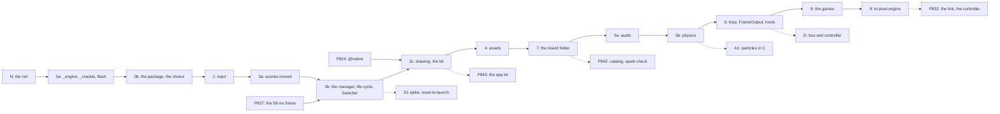

# P844: the engine refactor, re-planned

Spike P844 ([spark #1208](https://github.com/xmejkal/spark/issues/1208)), for the engine epic P841
([spark #1205](https://github.com/xmejkal/spark/issues/1205)). Written on 2026-11-16 from pixel-games master `1d002da`
(engine submodule at `9589dcd`). It starts from P838's stages ([finding](../2026-11-16-p838-engine-layer/finding.md),
section 6) and folds in the PO's decisions of 2026-11-16 and the lessons of the three surveys
([synthesis](synthesis.md)). Nothing ran on a board for this page. A `file:line` is in pixel-games, and a path that
starts with `engine/` is in the pixel-engine submodule. A MicroPython path is in v1.29.0, the clone `build.sh` makes.

> TL;DR
>
> - **The order:** N, 0a, 0b, 1, 3a, 3b, 3c, 4, 7, 5a, 5b, 6, 8, 9. P838's stage 2 (the link) leaves the epic. It
>   becomes P832's first card, after the engine, as the PO decided.
> - **A new fact from the code changes stage 0.** MicroPython loads a built-in C module first. A folder of the same
>   name never loads (`py/builtinimport.c:396-402`). Our firmware's C module is `engine` (`engine/binding.c:701`). So the C module
>   becomes `_engine` and the board gets the new firmware in stage 0a. Only then can a package `engine` load.
> - **Stage 0b is the package.** `games/engine/` holds `events`, `clock` and `accel`. `main.py` chooses the two
>   versions that exist today (the mixer's sum and the master volume) once, and prints an `engine` line at boot.
>   `box.py deploy` copies a folder and writes `engine_config.py`.
> - **The surveys' lessons land in five stages.** Long and repeat presses and the knob's turn go into stage 1. The
>   scene life cycle, the "handled" rule and the `Switcher` go into 3b. The Mac's host goes into 6, and the board folder
>   with the panel as data into 7. A new stage D splits a display driver into a bus and a controller.
> - **After the epic, four kinds of card follow.** P842 brings the driver catalog and spark's check. P843 brings the
>   app kit, after 3c. P832 brings the link. The acceleration candidates come in measured order, particles first.

## Council

No council read this page yet. The card asks for two rounds before the PR: a lens on the architecture and the
refuter, then a second round on the fixes.

## Words on this page

| Word | Means here |
| --- | --- |
| engine | The Python package that games import, `games/engine/` until stage 9 (the PO's name) |
| `_engine` | The C module in the firmware, today `engine` (`engine/binding.c:701`) |
| `_crackle` | The crackle's native module, today `crackle_c.mpy` (`engine/natmod/crackle/Makefile:7`) |
| version | The reference version (plain Python) or the fast version (C, viper) of one engine part, as in P838 |
| choose | What `accel.Chooser.choose` does once at boot: it takes the fast or the reference version of one part |
| host | What runs the engine and owns the hardware: the box, the Mac's stand-in, later the T-Display |
| driver | A class that talks to one kind of hardware: a panel, an amplifier, a button, the knob |
| board folder | `boards/<board>/`: the board's profile and its firmware build settings, with no pin numbers of its own |
| pick | Only the PO's D14 press that picks the next game, as P818 named it |

## What changed since P838

| # | Change | Why | Source |
| --- | --- | --- | --- |
| 1 | The package is `engine`, the C module `_engine`, the crackle `_crackle` | The PO approved the names. PEP 8 starts the name of a C module with a Python interface with `_` | P841 |
| 2 | A new stage 0a renames and flashes before the package exists | A non-extensible built-in wins over the file system (`py/builtinimport.c:396-402`), and `MP_REGISTER_MODULE` registers ours that way (`engine/binding.c:701`) | the code |
| 3 | The layout: `engine/`, `native/`, `drivers/` with display, audio and input, `boards/<board>/`, `tests/`. The pins stay in spark | The PO: "the layout sounds good" | P841 |
| 4 | The work starts in pixel-games and moves to pixel-engine in stage 9 | The PO: "let's do it" | P841 |
| 5 | The link (P838's stage 2) leaves the epic for P832 | Multiplayer comes after the engine refactor | P832 |
| 6 | The second board is a controller first | The PO's decision | P841 |
| 7 | Stage 1 adds long and repeat presses and the knob's turn | Two buttons and a knob need more words for menus | Flipper Zero, Pyxel, LVGL |
| 8 | Stage 3b adds the life cycle, the "handled" rule, the crash rule and a `Switcher` | A switch and an app both need them | UIFlow 2, Flipper Zero, InfiniTime, Tildagon, Presto |
| 9 | Stage 6 makes `FrameOutput` the host's boundary, with the Mac as a named host | The net (stage N) then lives on after stage 9 | TIC-80, 32blit, Thumby Color |
| 10 | Stage 7 writes the board folder as a MicroPython board definition, and the panel as data | MicroPython builds an out-of-tree board (`ports/esp32/Makefile:8-11`) | MicroPython, CircuitPython |
| 11 | For a second display, a new stage D splits a display driver into a bus and a controller | `s3lcd` does both today (`engine/driver/src/s3lcd.c`) | esp_lcd |
| 12 | The `Parts` record comes in 5b, with its first reader | Stage 0b passes its two choices by constructor. A record with no reader is code with no caller | P838 rule 1 |
| 13 | P837 runs before 3b, P824 before 3c, P822's step 2 after 4 | Each one fits where its code moves | P837, P824, P822 |

## The layout

In pixel-games, stages 0b to 8:

```text
games/                     the board's root, as today: box.py deploy copies it
  engine/                  the package (0b on): accel, events, clock; input (1); scenes (3a); display (3c);
                           assets (4); audio, ui (5a); physics (5b); loop (6)
  drivers/                 (1 on) input/buttons.py, input/encoder.py; audio/i2s_amp.py (5a); display/st7789.py (6)
  kit.py                   (3c) ArcadeGame, Particles, Dice, the HUD
  main.py                  the composition root (0b on)
  <the games>, catalog.py, art_index.py, box_bank.*
boards/firebeetle2-esp32s3/  (7) board.json, mpconfigboard.cmake, sdkconfig.board, board.md, profile.py, pins.py
engine/                    the pixel-engine submodule: today's C (binding.c, core/, natmod/, driver/)
tests/
```

In pixel-engine, after stage 9:

```text
engine/                    the package
native/                    binding.c, core/, natmod/crackle/ (the C of _engine and _crackle)
drivers/display/           s3lcd (the submodule), st7789.py; drivers/audio/; drivers/input/
boards/<board>/            one folder per board
tests/                     one suite against both versions
```

On the board, the package is the folder `:engine/` and the drivers are `:drivers/`. Until stage 9, pixel-games has
two folders named `engine`: the submodule at the root and the package in `games/`. On the Mac, the tests put `games/`
on the path (`tests/test_app_knob.py:13`). A regular package wins there over the submodule, which is a namespace
package with no `__init__.py`. Stage 0b's full suite proves it.

## The order



A dotted arrow is a card outside the epic's line. It starts once its stage is merged.

## The gates of every stage

- **The story run:** the tests of the modules the stage touches, plus the net of stage N.
- **The full suite** at stages N, 0b, 5a, 5b and 8, with its real time in the PR.
- **A deploy and a board log** with `ready`, the `engine` line (from 0b), a `game` line and a `switch` line for a
  game with a pack.
- **The frame:** a stage that touches it shows the `fps` and `time` lines against bench.md.
- **The tools:** a stage that moves a module updates every tool and probe that copies or names it by its flat path.
  Its PR lists them. A grep of `tools/`, the root and `docs/discovery/` for the file name finds them.
- **The Fire run** after stages 0b, 1, 3b, 6 and 7: `VOLUME=ViperMasterVolume KNOB=1 tools/crackle.sh 45 FireSound`,
  with `late 0` in every sound line, as `bench.md:1116` had.
- **The mutation rows** of a logic stage (0a, 0b, 1, 3b, 5a, 5b) in `tests/mutations/*.json`, proven from the
  pixel-games root with spark's `python3 ~/Development/spark/tools/mutate.py --root . --anchors tests/mutations/*.json`.
  The folder does not exist yet, so stage 0a makes it. A sweep runs after stage 8.

## Stage N: the net

**What is → what will be:** a move can change a game's picture or sound and no test sees it → every game's frames
and cue sequence are pinned by hashes on the Mac.

**Files:**

- `tools/render_scene.py` gets `--golden PATH`. It renders each subject of `SUBJECTS` (`tools/render_scene.py:95`)
  through its own `frames()` (`:182`) at the counts 1, 5, 25 and 60, each in a fresh process, as
  `tests/test_painted_frames.py` does. It writes one sha256 per subject and count of the stand-in's frame bytes. It is
  the one command that writes the hashes again.
- The same run records each game's signals in order: a listener on the game's `Signals` writes `(frame, name)`. That
  is the cue sequence.
- `tests/golden/frames.json` and `tests/golden/cues.json`: the hashes and the sequences.
- `tests/test_golden.py`: it renders again and compares. A failure names the subject, the count and the command that
  writes the file again.

**The tests that fail first:**

1. `test_every_subject_has_hashes`: it fails while `tests/golden/frames.json` is empty.
2. `test_a_changed_colour_changes_the_hash`: it renders one subject with one colour patched and expects another hash.
   This proves that the net sees a change.
3. `test_two_runs_give_the_same_hashes`: two renders of one subject in two processes.

**What it needs:** clang (for the C engines through ctypes, `tools/render_scene.py:175-179`) and MicroPython's font
from the clone `build.sh` makes. When either is missing, the net fails and names the command. It does not skip,
because every later stage uses it as its gate.

**Gates:** the full suite and its time. No board run, and no mutation rows (test code only).

**What the PO sees:** nothing on the box. The PR shows the table of subjects with their hashes.

**Done when** two runs give the same hashes, the patched colour fails the net, and the full suite passes.

## Stage 0a: the C module's new names

**What is → what will be:** the firmware's C module is `engine` and the crackle is `crackle_c`, so no package
`engine` can load on the board → `_engine` in a flashed firmware and `_crackle.mpy` on the board, and a deploy that
refuses the old firmware.

**The pixel-engine PR:**

- `engine/binding.c:683` and `:701`: `MP_QSTR_engine` becomes `MP_QSTR__engine`. The CMake library name
  `usermod_engine` (`engine/micropython.cmake:4`) stays: no module sees it.
- `engine/natmod/crackle/Makefile:7`: `MOD = _crackle`. The comment of `engine/natmod/crackle/crackle_mod.c:1` and
  the names in `engine/tests/grains_lib.py` follow. A check in this PR: the native module builds with a name that
  starts with `_`.
- `engine/README.md` names the two modules.

**The pixel-games PR** (it bumps the submodule):

- The games import the C under its new name and keep their attribute name: `import _engine as engine` at
  `balls.py:24`, `fire.py:40`, `plugins.py:23`, `bank.py:37` and `crackle.py:188`, `:275`. `import _crackle as native`
  at `crackle.py:141`, `:185`, `:271`. So the 30 test lines that set `fire.engine`, `plugins.engine` and
  `balls.engine` stay as they are. On the Mac, `import _engine` raises `ImportError`, so each module's `engine` is
  `None`, as its `hasattr` check makes it today.
- `tests/test_fire.py:209-215`: the docstring says why `fire.engine` is `None` on the Mac.
- `tools/box.py` gets two jobs:
  - `Deploy.check_firmware()`: before any copy, one `mpremote exec` imports `engine` and prints whether it has
    `Bodies`. True means the old firmware: `refused: the board's C module is still named engine: flash the image of
    ./build.sh engine first`. An `ImportError` means a firmware without our C, which deploys as today.
  - `copy_crackle()`: if `engine/natmod/crackle/_crackle.mpy` is built, it copies it and removes `:crackle_c.mpy`.
    If `_crackle.mpy` is not built, it prints `no _crackle.mpy: Fire plays without its crackle` and goes on. This
    closes the gap of `tools/box.py:19`.
- `tools/crackle.sh:71` builds and copies `_crackle.mpy`. `probe733_games.py` and `probe768_sum.py` use the new
  names.
- The docstring of `tools/box.py` (`:1-28`) and the README name both steps.

**The tests that fail first:**

- `tests/test_box.py`: `test_the_old_firmware_is_refused_before_any_copy` (the fake runner answers `True` to the
  exec), `test_a_firmware_without_our_c_deploys_as_today`, `test_the_crackle_goes_as_underscore_crackle_and_the_old_one_goes`,
  `test_no_crackle_built_says_so_and_deploys_the_rest`.
- `tests/test_games_layout.py`: `test_no_game_imports_the_old_c_names`, an `ast` walk over `games/*.py` that fails on
  `import engine` and `import crackle_c`.

**The flash.** `./build.sh engine` builds `build-engine/micropython.bin`. The flash runs as `bench.md:85` describes:
`mpremote bootloader`, then `esptool --before no_reset --after watchdog_reset write_flash 0x10000 micropython.bin`,
with the hash checked. Before it, the PR records the sha256 of the image on the board's build. The way back is a
flash of that image, as `bench.md:262` did. Agents flashed this board before (`bench.md:170`, `:261`).

**The board check:** `import _engine` has `Bodies`, `HeatField`, `Balls` and `SoundBank`. `import engine` raises
`ImportError`. The log has `ready`, `game` and `switch` lines. The Fire run has `late 0`.

**Mutation rows** (`tests/mutations/p8xx-stage0a.json`): the firmware check passes the old firmware. The crackle copy
keeps `:crackle_c.mpy`.

**What the PO sees:** the same box, after one flash.

**Done when** the board runs the new firmware, every game plays as before, the Fire run has `late 0`, and a deploy
onto the old firmware is refused.

## Stage 0b: the package and the choice

**What is → what will be:** the runtime is flat files, and the two choices of a version are made in two places
(`speaker.py:12-18`, `app.py:433-436`) → a package `engine` on the board, the versions chosen once in `main.py`, an
`engine` line at boot, and `box.py deploy --engine`.

**Files and classes:**

- `games/engine/__init__.py`: empty, so each module imports alone (the T-Display later takes only `input` and the
  link).
- `games/engine/events.py`: `Signals`, moved from `games/signals.py` with no change. The five importers change their
  line: `app.py:55`, `tests/test_signals.py:29`, `tests/test_bucket.py:31`, `tests/test_meteors.py:37`,
  `tests/test_marshmallow.py:20`. No shim: no tool or probe names `signals.py`.
- `games/engine/clock.py`: `since`, `ticks_us` and `ticks_diff`, moved from `pictures.py:138-150`. `pictures.py`
  imports them, so `pictures.since` (`app.py:59`) still works until stage 4.
- `games/engine/accel.py`, which imports only `engine_config`, `_engine` and `_crackle`:

  ```python
  PARTS = ("sum", "volume")  # the parts with two versions, in the boot line's order; 5b adds bodies, balls, heat

  def reference_parts():
      """engine_config.REFERENCE, the parts forced to their reference version, or () when the file is absent."""

  class Chooser:
      """Chooses each part's version once and remembers why, for the boot line."""
      def __init__(self, reference=()): ...
      def choose(self, part, fast, reference, label):
          """The fast class (fast() imports and answers it), or the reference class when the part is forced or
          fast() raises ImportError, AttributeError or SyntaxError (today's speaker.py:16)."""
      def line(self):
          """engine sum=viper volume=reference(forced) native=_engine,_crackle"""
  ```

- `games/main.py` becomes the composition root. Its `compose()` builds the knob and the speaker from the chosen
  classes and prints `chooser.line()`. `if __name__ == "__main__":` runs it, so a test imports it. `Speaker` takes its
  `VoiceSum` in its constructor (`speaker.py:27`), and `speaker.voice_sum()` goes. `open_knob(volume)` takes the
  chosen volume, and its `try` import (`app.py:433-436`) goes.
- `engine_config.py` on the board: `REFERENCE = ("volume",)  # tools/box.py deploy --engine`. `box.py deploy
  --engine reference` forces every part of `accel.PARTS`, and `--engine reference=volume` forces the named ones. A
  deploy without `--engine` removes `:engine_config.py`, so a forced setting lasts one deploy and the boot line shows
  it.
- `docs/design-decisions/` with one short file per decision of P838, P841 and this page, as Pyxel keeps them. The
  package's `README.md`: the rule of two versions and the boot line.

**The deploy of a folder** (`tools/box.py`). `PACKAGES = ("engine",)`. For each package, `Deploy` compiles
`games/engine/*.py` into a temporary `engine/` folder with `-s engine/<name>.py`. If `ls :` has no `engine/`, it makes
`:engine`. It copies the `.mpy` files into it. Then it lists `:engine/` and removes two kinds of file: a `.py`
that now has an `.mpy` (MicroPython reads the `.py` first, `py/builtinimport.c:73-77`), and a file whose source is
gone. `--py` copies the sources and removes their `.mpy` files. MicroPython runs a package's `__init__.mpy`
(`py/builtinimport.c:504-508`). `tools/crackle.sh:74` copies `app.py`, which now imports `engine.events`, so
`crackle.sh` copies the `engine` folder too.

**The boundary.** `tests/test_engine_boundary.py` walks every `Import` and `ImportFrom` of the package at any depth
with `ast`. A package module imports only `engine.*` and MicroPython's built-in modules (a list in the test). Only
`accel` imports `_engine`, `_crackle` and `engine_config`. `importlib` and `__import__` are refused.
`tests/fixtures/boundary/` holds one file per kind of violation. A table of directions, in the style of import-linter's
contracts, starts as `{"events": (), "clock": (), "accel": ()}` and grows with each stage.

**The tests that fail first:**

- `tests/test_engine_boundary.py`: `test_no_package_module_imports_outside_the_engine`,
  `test_each_fixture_is_caught`, `test_each_module_imports_alone` (a fresh process per module),
  `test_the_imports_follow_the_direction_table`.
- `tests/test_accel.py`: `test_a_forced_part_takes_its_reference`, `test_a_missing_fast_version_takes_the_reference_and_says_why`,
  `test_the_line_names_the_parts_in_their_order`, `test_no_config_forces_nothing`.
- `tests/test_main.py`: `test_the_knob_gets_the_chosen_volume`, `test_the_speaker_gets_the_chosen_sum`.
- `tests/test_box.py`: `test_the_package_goes_into_its_folder`, `test_a_board_with_the_folder_gets_no_mkdir`,
  `test_a_stale_py_in_the_folder_goes`, `test_a_removed_module_goes`, `test_py_copies_the_folder_s_sources`,
  `test_engine_reference_writes_the_config`, `test_an_unknown_part_is_refused_before_any_board_command`,
  `test_a_deploy_without_engine_removes_the_config`.

**The board's numbers** (`probe844_import.py` at the root, run with `mpremote run`, three cold boots each, written to
bench.md):

1. **A package against flat files.** The probe copies the same ten compiled modules of `games/` once flat (`:p844_*.mpy`)
   and once in a folder (`:p844/` with an `__init__.mpy`). After a hard reset it imports one set with
   `time.ticks_us()` around it. It removes its files at the end. The `import <ms> ms` line (`app.py:159`) before and
   after 0b is the second number.
2. **The heap.** `gc.mem_free()` after a `gc.collect()`, and the time of an idle `gc.collect()`: before the package,
   after it, and after every game module of the catalog is imported.
3. **The executable memory.** `esp32.idf_heap_info(esp32.HEAP_EXEC)` (`ports/esp32/modesp32.c:366`) before and after
   `accel` imports the viper modules. Both were imported at boot before, so the number shows that the move costs
   nothing new.
4. **The boot line** for three deploys: no `--engine`, `--engine reference=volume`, and `--engine reference`. With
   the plain sum, 4 voices take 9 ms of each 16 ms block (`bench.md:1397`), so the log's sound lines are recorded, not
   judged.

If the package imports more than 10 % slower than flat files, the PR says so, and freezing the package with
`manifest.py` becomes a card.

**Gates:** the story run (`test_box`, `test_engine_boundary`, `test_accel`, `test_main`, `test_signals`,
`test_app_knob`, `test_sound`, `test_volume`, `test_pick`, the net), the full suite, a deploy and the board log, the
Fire run.

**Mutation rows** (`tests/mutations/p8xx-stage0b.json`):

- `accel`: a forced part is ignored. A missing fast version raises, with no fallback. The line drops `native=`.
- `box.py`: a stale `.py` in the folder stays. A removed module stays. `--engine` writes nothing. A deploy without
  `--engine` keeps the old `engine_config.py`.
- `main.py`: the knob gets the reference volume whatever was chosen.

**What the PO sees:** the same box, and one new line at boot, `engine sum=viper volume=viper native=_engine,_crackle`.
`python3 tools/box.py deploy --engine reference=volume runner` makes it `volume=reference(forced)`, and the knob still
works.

**Done when** the box plays every game from the package, the boot line names each choice and its reason, the deploy
tests pass, and bench.md has the package's import, heap and HEAP_EXEC numbers.

## Stage 1: input, the action map

**What is → what will be:** the two buttons are fixed fields of `App` with press and held only (`app.py:177-178`,
`:323-325`) → an action map that `main.py` builds, with long and repeat presses and the knob's turn.

- **First, a characterization test** of today's press sequences on the old code: a press during a build frame, a press
  on the frame of the pick, a held press across a switch (Michael Feathers'
  [characterization testing](https://michaelfeathers.silvrback.com/characterization-testing)).
- **Drivers:** `buttons.py` and `encoder.py` move into `games/drivers/input/` with no change. `PACKAGES` gets
  `drivers`.
- **The engine:** `engine/input.py` with `Actions` (one record per player, made once), `InputSource`, `ButtonSource`,
  `KnobSource` and `ActionMap`. Each button gives `pressed`, `held` and `released` (P838), plus `long` (true once, on
  the frame its hold passes `LONG_MS`) and `repeat` (a count, one each `REPEAT_MS` after `long`). This is Flipper Zero's
  Short, Long and Repeat and Pyxel's `btnp(hold, repeat)`, written by us. The knob gives `turn`, the detents of this
  frame.
- **D14's limit:** a hold of about 5 s on D14 powers the board off (`app.py:470-471`). So NEXT gets `long` but no
  `repeat`, and `LONG_MS` is a feel value far below it. The PO's play decides it, starting at 500 ms.
- **Who reads what:** `App` reads `next.pressed` for the pick, `turn` for the volume, and FIRE's `pressed` and `held`
  for the game. No game reads `long` or `repeat` yet, so the box feels the same.
- **Tools:** `tools/crackle.sh:75` and `probe733_games.py:7` copy `encoder.py`.
- **Tests:** the characterization test before and after, `test_pick`, `test_app_knob`, `test_encoder`, and new tests
  for `long` (once), `repeat` (its count), `released` and a `turn` that resets each frame.
- **Board:** the PO presses through a few games. `ActionMap.poll`'s cost appears in the `phases` line, the open
  question of P838.
- **Mutation rows:** `long` fires on every frame of the hold. `repeat` starts before `long`. `turn` is not reset.

**Done when** the characterization test passes before and after, the PO plays with the same feel, and the poll's
cost is in bench.md.

## Stage 3: scenes (3a moves them, 3b adds the manager)

**What is → what will be:** `App` holds eight jobs, among them the switch with its loader and bar (`app.py:198-308`)
→ a `SceneManager` with a scene life cycle, a "handled" rule and a `Switcher` strategy.

- **3a, moved:** `Lineup`, `NameCard`, `games_for` and `lineup_fault` into `engine/scenes.py`, with no change of logic.
  The rows stay in `catalog.py`. `app.py` keeps re-export shims for the names the tests patch (`SETTLE_MS`,
  `games_for`, `Lineup.game_steps`), with a test that each still resolves.
- **P837 first.** The 58 ms frame of runner's load (`bench.md:1631-1636`) is split, or its number measured beside 3b,
  so 3b does not make it worse.
- **3b, the life cycle.** A scene has `build_steps` (the `Lineup`'s generator behind the card, UIFlow 2's
  `on_launch`), `enter(now)` (its `on_ready`), `step(now, actions)`, `draw(cv)` and `leave()`. Pause and resume come
  with their first caller, P843's app over a game or P832's "link lost". The contract names them now, and no code
  calls them yet.
- **3b, the "handled" rule** (InfiniTime's bool, Flipper Zero's back event). The manager offers the system actions to
  the scene first: `next`, `next_long` and `turn`. If the scene used the action, `scene.handle(action)` answers `True`. If
  it answers `False`, the manager does its default: the pick for `next`, the volume for `turn`. The call runs only on
  a frame with such an action, so it costs nothing on most frames. Every game keeps the default, so nothing changes.
- **3b, the crash rule** (Tildagon). An exception in `step` or `draw` is refused as a failing build is
  (`app.py:303-307`): the same `game <name> refused: <repr>` line, and the box moves on to the next game.
- **3b, the `Switcher`.** `SceneManager` takes a `Switcher` strategy. `InProcessSwitch` is today's switch: leave,
  free, build behind the card. A `ResetSwitch` waits for spike S1.
- **Tests:** `test_pick` and `test_lineup` with their assertions unchanged, the shim test, a test per handled action,
  a test that a `step` that raises is refused, and a fake `Switcher` that records its calls.
- **Gates:** a `switch` line within bench.md's P822 numbers, the Fire run, the net.
- **Mutation rows:** an unhandled `next` makes no pick. A handled `next` still picks. A raising `step` stops the box.

**Done when** the box switches as before with the `switch` lines in bench.md's range, a raising game is refused and
the next one plays, and `App` holds no switch code.

## Later stages, one paragraph each

**S1, spike: reset-to-launch** (after 3b). Presto and Thumby Color start each app after a reset, for a clean heap. A
probe writes the next game's name where it survives a `machine.soft_reset()` (a file, or `machine.RTC().memory()`),
resets and reads it at boot. It measures the time from the press to the game's first frame against the `switch`
lines, and the heap after ten switches each way. **Done when** bench.md has both numbers and the page says whether a
`ResetSwitch` is worth a card.

**3c, drawing and the kit.** `gfx.py` splits. Its colours, `Canvas`, the screen size and `rgb565` go into
`engine/display.py`. `Game`, `Particles`, `Dice`, `hint_lines` and `BEST` go into `games/kit.py` as `ArcadeGame`, with
`effects.py` beside it. `gfx.py` stays a re-export shim until stage 8. If P824 is merged, `fast.py` is gone. If it is
not, `fast.py` moves unchanged. **Done when** the net's hashes are the same and every game's tests pass.

**4, assets.** `pictures.py`'s module state (`pictures.py:26-30`) becomes one `Pictures` with a `PackSource` and a
`PackFormat`. The module keeps its names as bound methods until stage 8. `bank.py` goes into `engine/assets.py`, and
the crackle takes its bank's memory from it. The canvas gets `pic`. P822's step 2 (the lineup's sets kept in memory)
then becomes a `Pictures` strategy. **Done when** runner's paint in play is within 0.5 ms of before and the `load`
numbers match bench.md.

**7, the board folder.** `boards/firebeetle2-esp32s3/` holds a MicroPython board definition: `board.json`,
`mpconfigboard.cmake`, `sdkconfig.board` and `board.md`. `build.sh` passes it as `BOARD_DIR`
(`ports/esp32/Makefile:8-11`), in place of its `BOARD` and `BOARD_VARIANT` (`build.sh:15`). The folder also holds
`profile.py`, data only: which drivers, a `Panel` record (size, offsets, rotation, SPI rate, `DC`) and an `Audio`
record. It also holds spark's `pins.py`, as today. `main.py` builds the display from the `Panel` record with one
`open_display(panel, pins)`, as CircuitPython builds a panel from its board files. `gdi.py` goes: its four repeated
pins (`gdi.py:16-19`) are in `pins.py:19-22`, and only `DC = 3` (`gdi.py:15`) moves into the record. A check in this
stage: whether `mpconfigboard.cmake` can name the user C modules, and whether its `include` of the S3 common file works
from outside the tree. **Done when** a deploy with `--board firebeetle2-esp32s3` plays every game with sound and the
knob, and a contract test checks every pin name the profile reads.

**5a, audio.** `sound.py`, `sound_viper.py`, `volume.py`, `volume_viper.py`, `cues.py` and `overlay.py` go into the
package. `speaker.py` becomes `drivers/audio/i2s_amp.py` with its pins passed in. The crackle's classes move, and the
bank's index `fire_bank.py` stays content. **Done when** the twin tests pass, the board log carries the viper match
results, and a run with `--engine reference=volume` keeps `late 0`.

**5b, physics.** `plugins.py` and `motion.py` go into `engine/physics.py` with `FirePlugin`'s heat field. `main.py`
builds the `Parts` record (`bodies`, `balls`, `heat`, `sum`, `volume`), and every scene gets it in its constructor.
`Balls` and `HeatField` get Null Objects or `needs`. The canvas gets `blit_heat` and `blit_balls`. The 30 test lines
that set `.engine` become `Parts` records. The boot line gains `bodies=`, `balls=` and `heat=` at its end. **Done
when** a game's plugin holds the chosen class, the net's hashes hold, and a run with `--engine reference=bodies` plays
a game with few bodies.

**6, the loop and the hosts.** `run`'s loop becomes `Loop`, the timing lines `FrameStats`, the gc choices
`GcPolicy`. `FrameOutput` is the host's boundary: `clear`, `reset`, `draw(scene, us, overlay)`. `TftOut` and `StOut`
are the board's outputs. The Mac's stand-in becomes a named host: `tools/mac_host.py` with `DrawingTft`
(`tests/drawing_tft.py`), `FrameClock` (`tools/render_scene.py:137`) and the C engines through clang
(`tools/render_scene.py:175`). TIC-80, 32blit and Thumby Color keep the same split. `render.py`, `lcd.py` and
`st7789.py` go into `engine/display.py` and `drivers/display/`. **Done when** the console lines keep their text, fps
and the slowest frame match bench.md, and the net runs on `MacHost`.

**D, the display drivers** (when a second display is chosen). A display driver becomes a bus (it moves bytes and
reports the end of a send) and a controller (what the bytes mean), with the controller's start-up table as data in
the board folder, as esp_lcd splits them. `s3lcd` stays one C driver for the first display. **Done when** the second
display shows a game through its own controller class on a shared bus class.

**8, the games.** Each game keeps only its logic. One PR per game for balls, bucket, burning with meteors, and fire
with marshmallow. The shims of 3a and 3c go, and what is left of `app.py` goes. The boundary test gets a rule for the
games: no `engine` internals, `pins`, `gdi`, `pictures` or driver. **Done when** `games/` holds only the games, the
kit, the catalog, the generated indexes, `main.py`, and the net's hashes hold or the PO played the game whose hashes
changed.

**9, the move to pixel-engine.** The package, `drivers/`, `boards/`, `tests/stubs/` and the clang libraries move to
pixel-engine, which takes the layout the PO approved: `engine/`, `native/` (today's `binding.c`, `core/` and
`natmod/`), `drivers/`, `boards/`, `tests/`. pixel-games bumps the submodule. **Done when** both repositories' full
suites pass, and a deploy from pixel-games plays every game.

## After the epic

- **P842 (spark #1206), the driver catalog and spark's check** (after stage 7). The engine's catalog holds one binding
  per driver: the part it supports and the keys it reads, as a Zephyr binding does. spark exports the board's facts,
  `pins.py` and `pins.csv`. A spark check says whether the engine has a driver for every part. A board folder written
  by hand works the same.
- **P843 (spark #1207), the app kit** (after 3c). It is the second user of the scene contract: a launcher on
  `AppSelector`'s next, previous and select, menus and lists moved by the knob's `turn` through the "handled" rule, a
  long press as back. Its first app (a clock or a settings screen) calls pause and resume first. LVGL waits for a build
  spike on 1.29.
- **P832 (spark #1194), the link** (after stage 9, as the PO decided). `Transport` with `poll`, a peer id and an
  offline peer, after Godot's `MultiplayerPeer`. `EspNowTransport` drains `irecv(0)` once a frame. The controller sends
  its inputs with a sequence number and the last few inputs repeated. `RemoteSource` fills `players[1]`, and its FIRE
  also drives player 0 in a one-player game.
- **The acceleration candidates, in measured order.** Each one keeps its Python reference, and the bench decides.
  - **A1, particles in C.** `gfx.Particles` (`gfx.py:250`) costs 57 µs a particle, and 40 particles take 2.3 ms
    (`bench.md:210-218`). P597 (spark #798) waits on a C particle kernel. After 5b.
  - **A2, `@micropython.native` where it helps** (P824, spark #1179). Today's `@native` is a no-op on the board
    (`bench.md:1033-1035`). Before 3c.
  - **A3, the mixer's sum in C** behind `render(buf)` (`sound.py:6-7`). The viper sum takes 0.9 ms for 4 voices and
    1.4 ms for 8 (`speaker.py:9`). A game that needs more voices starts it.
  - **A4, the pack's `place` in C.** It starts if P837's split across frames does not reach 22 ms.
  - **A5, a line compositor for `paint_static`,** after CircuitPython's `_stage`. The board's RAM or stage 4's paint
    gate starts it.

## The cards to file

Each card is a sub-issue of P841 with "Needed by" and the pixel-games slice. Filing gives each card its P-number.

| Stage | Title | Done when |
| --- | --- | --- |
| N | a move can change a game's picture or sound and no test sees it → every game's frames and cues are pinned by hashes on the Mac | two runs give the same hashes, a patched colour fails the net, the full suite passes |
| 0a | the C module and the crackle are named `engine` and `crackle_c`, so no package `engine` can load → `_engine` in a flashed firmware, `_crackle.mpy` deployed, the old firmware refused | the board runs the new firmware, every game plays, the Fire run has `late 0`, a deploy onto the old firmware is refused |
| 0b | the runtime is flat files with its versions chosen in two places → the `engine` package on the board, its versions chosen once in `main.py`, a boot line and `deploy --engine` | the box plays every game from the package, the boot line names each choice, bench.md has the import, heap and HEAP_EXEC numbers |
| 1 | two buttons are fixed fields of `App` with press and held only → an action map with long and repeat presses and the knob's turn, built in `main.py` | the characterization test passes before and after, the PO plays with the same feel, the poll's cost is in bench.md |
| 3a | the lineup, the card and the lineup rule live in `app.py` → they live in `engine.scenes`, with shims for the tests | `test_pick` and `test_lineup` pass unchanged, the shim test passes |
| 3b | `App` switches games itself → a `SceneManager` with a life cycle, a "handled" rule, a crash rule and a `Switcher` | the `switch` lines are in bench.md's range, a raising game is refused, `App` holds no switch code |
| S1 | nobody knows what a reset between games costs → a measured reset-to-launch against the switch in one process | bench.md has the press-to-frame time and the heap after ten switches each way |
| 3c | `gfx.py` mixes the canvas with the arcade style → `engine.display` holds the canvas, `games/kit.py` the arcade kit | the net's hashes hold, every game's tests pass |
| 4 | the pictures are module state → one `Pictures` with a source and a format strategy | runner's paint within 0.5 ms of before, the `load` numbers match bench.md |
| 7 | the board's settings live in `build.sh`, `gdi.py` and constants → a board folder that MicroPython builds and a profile `main.py` reads | a deploy with `--board` plays every game with sound and the knob, the pin contract test passes |
| 5a | the audio is flat files that read `pins` → engine audio with an I2S amplifier driver that takes its pins | the twin tests pass, the board log has the viper matches, `--engine reference=volume` keeps `late 0` |
| 5b | the games build their physics from module flags → the games build it from the `Parts` record `main.py` chose | a game's plugin holds the chosen class, the net holds, `--engine reference=bodies` plays |
| 6 | the loop, the stats and the outputs live in `app.py` and the Mac's stand-in is a test file → `Loop`, `FrameStats`, `GcPolicy` and `FrameOutput` with the Mac as a named host | the console lines keep their text, fps matches bench.md, the net runs on `MacHost` |
| D | a display driver is one C file for one panel → a bus and a controller, with the start-up table as data | a second display shows a game through its own controller on a shared bus |
| 8 | the games still hold board and C knowledge → each game holds only its logic | `games/` holds only games, kit, catalog, indexes and `main.py`, and the net holds |
| 9 | the engine lives in pixel-games → it lives in pixel-engine with its drivers and boards | both full suites pass, a deploy from pixel-games plays every game |
| A1 | the particles are Python at 57 µs each → a C particle kernel behind the same methods, the Python kept as reference | the twin test passes, the bench shows the gain, the fps of the particle games does not drop |

P837, P824, P842, P843 and P832 exist. Each gets the "Needed by" this page names. A3 to A5 are not filed: each waits
for its trigger above.

## Open questions, each with a recommended answer

1. **P841 says the engine accepts both C names until the flash.** On the board that cannot work: a built-in `engine`
   hides the package (`py/builtinimport.c:396-402`). Recommended: the flash comes first, in 0a, no code accepts both
   names, and the deploy refuses the old firmware.
2. **Two folders named `engine` in pixel-games until stage 9** (the submodule and the package). Recommended: accept
   it. Stage 0b's full suite proves the tests find the package, and stage 9 ends it. A new path for the submodule
   touches `build.sh`, `micropython.cmake` and the test paths, for a few weeks' gain.
3. **The `Parts` record waits for 5b.** Recommended: yes. Stage 0b hands its two choices to their constructors, which
   is the same injection with no record that nobody reads.
4. **`pins.csv` now or with P842.** Recommended: with P842, as spark's export beside `pins.py`. Stage 7 keeps spark's
   `pins.py`, which the firmware imports today.
5. **Where P843 starts.** Recommended: after 3c, as the second user of the scene contract, while stages 4 to 8 run.
   It tests the contract before the games depend on it.
6. **A version number for the engine's API.** Recommended: none until stage 9. Until then the submodule's commit is
   the version.
7. **A deploy without `--engine` removes `engine_config.py`.** Recommended: yes, so a forced reference never stays on
   the board unseen.

## Sources

- The surveys: [A](survey-a-screens-and-apps.md), [B](survey-b-small-game-engines.md),
  [C](survey-c-architecture-drivers-audio-net.md), and the [synthesis](synthesis.md) with each source's license.
- P838's [finding](../2026-11-16-p838-engine-layer/finding.md): the stages, the rule of two versions, the console
  lines, and its sources (PEP 399, Nystrom, Fowler, Seemann, Unity, Godot).
- MicroPython v1.29.0 source: `py/builtinimport.c:73-77`, `:396-402` and `:504-508`, `ports/esp32/Makefile:8-11`,
  `ports/esp32/modesp32.c:366`, and the board folders `ports/esp32/boards/ESP32_GENERIC_S3/` and `LILYGO_T3_S3/`.
- Michael Feathers: [characterization testing](https://michaelfeathers.silvrback.com/characterization-testing).
- The cards: P841 (spark #1205), P842 (#1206), P843 (#1207), P832 (#1194), P822 (#1175), P837 (#1200), P824 (#1179).
