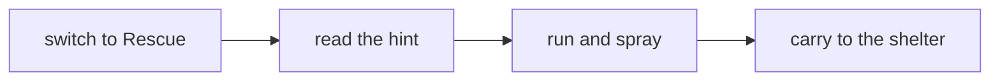
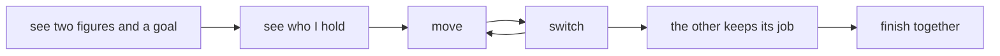

# Jobs and journeys
<!-- Tags as in the brief: E with a pointer, H with its source, D with who and when; an unknown is —. -->

## Who
<!-- One line per persona: who · evidence status (E pointer | H source).
e.g. `- Team leads who assign work · H Lena's belief, no interview yet` -->
- The PO as the box's player · E his answers D1 to D3 in brief.md, n = 1
- The PO as the engine's author, who writes the next game with Claude in a session · E D5 and D8 in brief.md
- A visitor who sees the box, or a reader of the repository · H the facilitator's reading of the PO's "we should sell it more". Nobody was asked <!-- REQUIRED:who -->

## Jobs
<!-- One job story per line, each clause tagged: When …, I want to …, so I can ….
e.g. `- When I assign a task in a meeting [E tickets.csv:6], I want the assignee to see it that day [H Lena], so I can stop chasing people [E tickets.csv:7]` -->
- Job 1 · When I show or play a game with motion-capture figures [E the PO, https://github.com/xmejkal/spark/issues/1279], I want the figures big enough that their detail shows [E "ours are tiny and one doesn't appreciate the details so much", the same card], so I can "sell it more" [E the same card]
- Job 2 · When I play a mission [E D1], I want to pick who I control and switch between figures [E D1], so I can finish a task that needs more than one figure [E D1's example, which the facilitator wrote and the PO chose]
- Job 3 · When I do not hold a figure [E D4], I want it to have its own life [E D4], so the scene looks alive [H the facilitator's reading of D4]
- Job 4 · When I write the next game [E D5], I want the figure, its poses and its steering ready to import [E D5, D6], so I do not write them again in each game [H the facilitator's reading. E for the repeat today: `games/rescue.py:90`, `games/rescue.py:203`, `games/meteors.py:119`] <!-- REQUIRED:jobs -->

## Today they…
<!-- Per job: what they do instead today (a competitor, a workaround or nothing), tagged.
e.g. `- Job 1 · paste each task into Slack by hand · E tickets.csv:7` -->
- Job 1 · the figures are painted at about 24 px a body height · E `games/rescue.py:39` ("24.07 px a body height")
- Job 2 · nothing. Each game has one figure that the player steers · E `games/rescue.py:90` (`Fireman`), `games/meteors.py:119` (the walker in `Rules`) · caveat: two games read, the other thirteen not
- Job 3 · Rescue's people run, wave and turn in panic by a rule written in the game · E `games/rescue.py:203-229` (`Person`)
- Job 4 · each game writes its own class and copies the cycles' numbers by hand · E `games/rescue.py:39-43`, `games/meteors.py:217` <!-- REQUIRED:today -->

## Journeys
<!-- One ### per actor and scenario: the table, then a Mermaid flowchart of the same steps. Never a Mermaid
journey block: it forces a score on every task. "n/a — a one-step job" may replace both.
e.g. `| 2 | opens the app | E analytics, 90 days | never sees the task | not yet | Do they read email? |` -->
### The PO — plays Rescue today <!-- REQUIRED:journey -->
| step | what they do | evidence | friction or harm | today | open question |
| --- | --- | --- | --- | --- | --- |
| 1 | switches to Rescue with PICK and waits for its art | E ★C5, ★C8 (a load of 638 ms) | — | works | — |
| 2 | reads the hint on the title | H council/user.md USER-8: one blinking line for under a second | he learns by losing a round | partly | Does he stand by when he shows it? |
| 3 | runs the fireman left and right with the stick, sprays with FIRE | E ★C6 | the figures are about 24 px tall | works | — |
| 4 | carries people to the shelter | E `games/rescue.py:90-95` | he holds one figure for the whole game | works | — |

### The PO — plays a mission with two figures
| step | what they do | evidence | friction or harm | today | open question |
| --- | --- | --- | --- | --- | --- |
| 1 | sees two 96 px figures and a goal on one screen | calculated ★C3, ★C11 | about three figures fit across the screen (H council/user.md USER-12) | not yet | Is 96 px the figure or the picture? (Q3) |
| 2 | sees which figure he holds | — | no mark exists | not yet | — |
| 3 | moves the held figure to its place | E ★C6 | at the captured speed it crosses the screen in about 1.5 s | not yet | — |
| 4 | switches to the other figure | E ★C5 | no free button; a long hold of PICK can power an older board off (★C7) | not yet | Which input? (Q5) |
| 5 | the first figure keeps its place or its job | H A5 | no idle pose exists (H council/user.md USER-20) | not yet | What does it do? (Q7) |
| 6 | both act, and the mission ends | D1's example | — | not yet | — |

