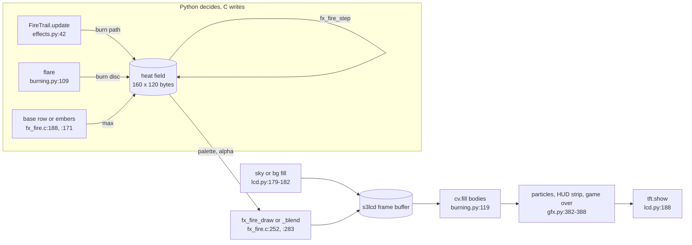
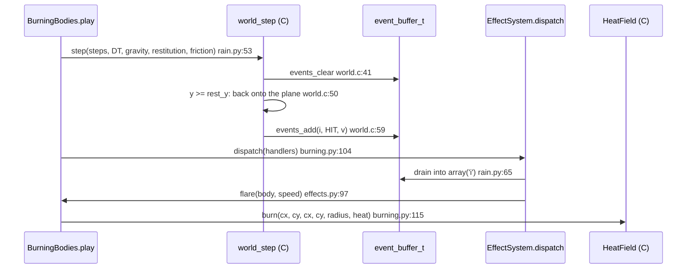
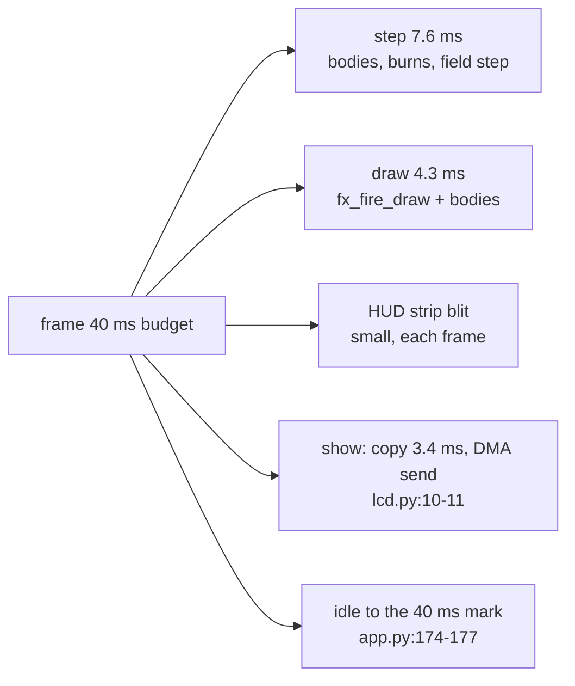
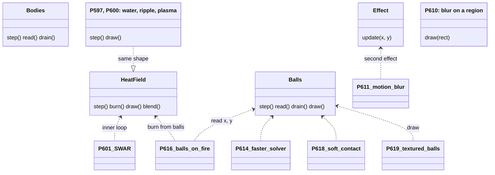
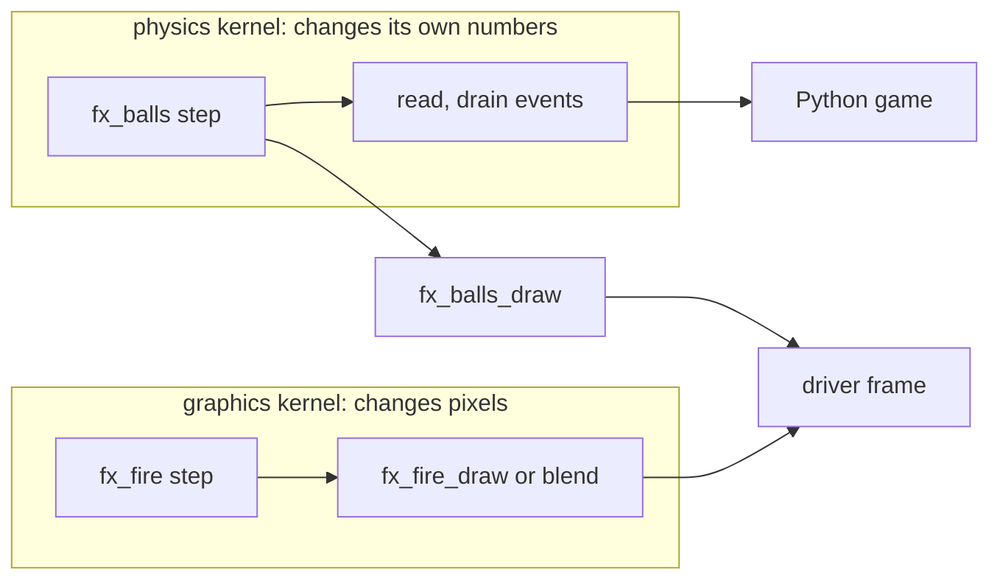

# The engine in depth: lessons D to G (P627 #840)

Paths are relative to the root of `firebeetle-games`. Line numbers are from master `184fa2e`, 2026-11-05.
Each lesson starts with its short version, then the steps, a picture, and how other libraries do the same.
A claim marked H is a hypothesis: I did not read it in the code or in a source.
The lessons A to C are in `docs/engine-walkthrough.md`. This page starts where it stops.
Since P633 (#847), `rain.Stepper` and its `StepClock` are `plugins.PhysicsPlugin` (`games/plugins.py`), and the
fire's field, gusts and step clock (`Fire.acc`) are `fire.FirePlugin`. `Game.step` runs their hooks around the game's
play. The lessons below keep the old names and lines, which are true at the commit they cite.

## Lesson D. How effects combine

The short version. Every effect in the burning scene writes into one shared byte field, the heat. The rule
for a write is "keep the larger value" (`fx_fire.c:347`, `:172`, `:133`). The field steps once. Then one C draw turns the
whole field into pixels, opaque or blended over the frame (`fx_fire.c:252`, `:283`). Everything else,
the bodies, the particles and the HUD, is painted after the fire in a fixed order by `Game.draw` (`gfx.py:369-388`).

### Step by step

1. One field. `engine.HeatField(W, H, SEED)` holds 160 by 120 bytes, one cell per 2 by 2 px (`fire.py:43`,
   `:111`). The C struct keeps two pointers, `heat` and `cooling` (`fx_fire.h:25-26`).
2. Three kinds of writers, one rule. The base row writes spots or noise (`fx_fire.c:188-196`). An ember writes
   its cell (`:171-172`). A burn writes a disc along a segment (`:334-353`). Each keeps the max:

```c
// fx_fire.c:345-349
for (int32_t ox = -r; ox <= r; ox++) {
    int32_t x = cx + ox;
    if (x >= 0 && x < w && ox * ox + oy * oy <= r * r && row[x] < heat) {
        row[x] = heat;
    }
}
```

   So two trails that cross never overflow a byte, and the order of the burns does not matter.
3. Who burns. `FireTrail.update` burns a path a little behind each body (`effects.py:42-56`). `flare` burns one disc
   at a hard hit (`burning.py:109-115`). Both call the same `field.burn` (`binding.c:232-247`). The burning scene turns
   the base off, so only burns feed the field (`burning.py:69`, `fx_fire.c:188-189`).
4. Order inside a frame. `BurningBodies.play` runs step, read, dispatch (flares), update (trails), and then
   `Fire.play` steps the field (`burning.py:102-107`, `fire.py:148`). So a flare rises in the frame it happened.
5. The step moves the heat. Each cell reads the cells below it and cools (`fx_fire.c:197-233`). This is the
   mixing stage: a hot trail and a cold patch of the cooling map meet here, cell by cell.
6. The draw is the composite. `Fire.paint` picks opaque or blend (`fire.py:166-169`). Opaque writes
   `palette[heat]` for every pixel (`fx_fire.c:270-279`). The blend mixes each pixel with what the frame already holds:

```c
// fx_fire.c:309-319, comment line 315 left out
for (int32_t y = 0; y < h; y++, col += w) {
    uint8_t a = alpha[*col];
    if (a == 0) {
        continue;  // the four pixels keep what they hold
    }
    uint16_t c = palette[*col], *p = out + 2 * y;
    p[0] = alpha_blend_565(c, p[0], a);
    p[1] = alpha_blend_565(c, p[1], a);
    p[pw] = alpha_blend_565(c, p[pw], a);
    p[pw + 1] = alpha_blend_565(c, p[pw + 1], a);
}
```

   The alpha per heat is data from Python: clear at 0, full from heat 96 (`fire.py:90-91`).
7. The layers above the fire. `TftOut.draw` paints the background and the still picture first (`lcd.py:179-182`).
   Then `Game.draw` paints in this order: `paint`, particles `fx.draw`, `hud`, `draw_over` (`gfx.py:379-388`).
   In the burning scene `paint` is the fire draw and then one `cv.fill` per body (`burning.py:117-121`).
8. The filter is not a layer. NEAREST or LINEAR only decides how one cell becomes four pixels
   (`fx_fire.c:252-269`). It costs 2.15 ms more a frame (`bench.md:429-430`).

### The picture: data flow of one frame



### How others do it

- Godot, CanvasLayer. Godot draws 2D items in layers: "Lower values are drawn behind higher values", and the layer
  wins over an item's `z_index`. `FireLayer` names this model (`fire.py:201-203`).
  Source: https://docs.godotengine.org/en/stable/classes/class_canvaslayer.html
- SDL, blend modes. SDL3 names the blend the fire does: `SDL_BLENDMODE_BLEND`, RGB = src times srcA plus dst times
  (1 minus srcA). It also has `ADD` and `MOD`, which the engine lacks. A "keep the max" write has no SDL name.
  Source: https://wiki.libsdl.org/SDL3/SDL_BlendMode
- The difference: those libraries blend finished pictures. The engine blends once, at the end, and combines the effects
  earlier, in the heat field, as numbers. That is why two burns cost no extra draw.

## Lesson E. Physics: bodies against balls

The short version. A body only meets its own plane (`world.c:50-63`). A ball meets every ball nearby and the walls.
`substep` finds the pairs on a grid, pushes them apart, and fixes the velocity afterwards (`fx_balls.c:260-306`).
Both report a hit as three ints in an event buffer. Python drains it once a frame and decides what it causes
(`events.h:14-16`, `effects.py:91-97`, `balls.py:117`).

### Step by step, one substep of the balls

1. Integrate. Gravity into `vy`, and each ball moves. It keeps its old place in `px`, `py` (`fx_balls.c:266-272`).
2. Broad phase. The grid sorts the balls into 10 px cells with a counting sort (`grid.c:37-50`, cell size
   `fx_balls.h:22`). Then each ball looks only at its 3 by 3 cells, and a pair is tested once, from the lower index:

```c
// fx_balls.c:277-287
grid_locate(g, x[i], y[i], &cx, &cy);
for (int32_t dy = -1; dy <= 1; dy++) {
    for (int32_t dx = -1; dx <= 1; dx++) {
        const int32_t *items;
        int32_t m = grid_cell(g, cx + dx, cy + dy, &items);
        for (int32_t k = 0; k < m; k++) {
            if (items[k] > i) {  // each pair once, from its lower index
                contact(b, &v, i, items[k], pass, hit_min);
            }
        }
    }
}
```

   The grid knows no shape (`grid.h:1-3`). It is the Spatial Partition pattern.
3. Narrow phase. `contact` tests two discs exactly. If `d2 >= rr * rr`, they do not overlap and it returns
   (`fx_balls.c:127-131`). The
   normal comes from one fast inverse square root (`:133-138`).
4. Response on positions. The overlap is pushed out along the normal, split by mass from a table (`:139-144`).
   Friction takes back the sliding part of the move (`:145-155`). The walls clamp and take the move into them
   (`:185-211`). Two passes repeat this (`FX_BALLS_PASSES`, `fx_balls.h:25`).
5. Velocity from the move. `v = move / dt` times the damping, after a cap of 1.5 px a substep (`:292-304`).
6. Bounce last. Hits that closed at the threshold or faster get restitution at the velocity level (`:218-258`).
   A resting ball under another counts as ground (`:239-250`).
7. Events back to Python. Only pass 0 writes events, and only above `hit_min` (`:156-161`, walls `:208-210`).
   `events_add` keeps the first 64 and counts the rest (`events.h:29-38`). Python drains with one call
   (`binding.c:436-445`). The pit counts them (`balls.py:117-119`). The burning scene maps `HIT` to `flare`
   (`burning.py:80`, `effects.py:91-97`).

The bodies skip steps 2 to 6. Their whole contact is one test against `rest_y` and a bounce or a sleep (`world.c:50-63`).

### The picture: one hit, from C to a flare



### How this differs from a graphics effect

| | balls, bodies (physics) | heat field (graphics) |
| --- | --- | --- |
| What a step changes | positions and velocities in float arrays | bytes of heat in a field |
| Who reads the result | Python, in bulk, `read` (`fx_balls.c:317-326`) | nobody: the draw reads it in C |
| Facts out | events, `drain` | none |
| Facts in | spawn, kick, material | burn, look, base, filter |
| Draw | `fx_balls_draw` paints discs over a bg fill (`:332-353`) | `fx_fire_draw` or `_blend` |
| Time per step, board | 4.21 ms for one step of a settled pile of 100 balls (`bench.md:469`, run106) | about 1.3 ms of the burning scene's 7.6 ms step (H, derived) |

### How others do it

- Box2D v3. Its step has the same shape. When shape AABBs overlap, a contact begins. A manifold holds up to 2
  points. Substeps give accuracy (4 recommended). Restitution is "solved after the main solver pass using the pre-solve
  approach velocity" under `b2WorldDef::restitutionThreshold`. After a step the game polls `b2World_GetContactEvents`.
  The engine's names `friction`, `restitution`, `restitution_threshold` are Box2D's (`fx_balls.h:69`).
  Source: https://box2d.org/documentation/md_simulation.html
- Chipmunk2D. `cpSpaceStep` advances the space, `cpSpaceUseSpatialHash` picks a hash as the broad phase, and a
  `cpCollisionHandler` has `beginFunc`, `preSolveFunc`, `postSolveFunc` and `separateFunc`. The engine has only the
  equivalent of `postSolveFunc`, and as a buffer, not a callback.
  Source: https://raw.githubusercontent.com/slembcke/Chipmunk2D/master/include/chipmunk/cpSpace.h
- The method itself is Jakobsen's position Verlet (`fx_balls.h:2-4`), with Macklin's friction and the XPBD velocity pass
  (`fx_balls.c:116-117`, `:213-217`). Box2D uses impulses instead. Both are "positions first, velocities after" today.

## Lesson F. What costs time on the board

The short version. The S3 has a float unit, but a float division and `sqrtf` are library calls. So the contact code
removed them (`fx_balls.c:82-85`, `grid.c:23-25`). The second cost was text. In the rain, each HUD redraw cost 24 to 28 ms in one frame, twice a second (`bench.md:342`, P599). So the HUD is drawn into a strip only when its text changes, and the strip is blitted every frame (`lcd.py:107-118`). The third is a plain trade, LINEAR against
NEAREST, 2.15 ms a frame (`bench.md:429-430`).

### Step by step

1. No `sqrtf`, no division in a contact. `inv_sqrt` is Lomont's constant plus two Newton steps (`fx_balls.c:86-95`).
   The mass share is a table built at compile time (`:99-102`). The grid cell is an integer division, in hardware:

```c
// grid.c:26-28
int32_t c = (int32_t)x / g->cell_px, r = (int32_t)y / g->cell_px;
*cx = c < 0 ? 0 : c >= g->cols ? g->cols - 1 : c;
*cy = r < 0 ? 0 : r >= g->rows ? g->rows - 1 : r;
```

2. Find the arrays once. Each array macro called `grid_bytes`, and the compiler does not inline it. `view_t` holds
   the seven pointers for one substep (`fx_balls.c:18-28`). One substep of 300 packed balls fell from 7.0 ms to 4.6 ms
   with this alone (`bench.md:465`).
3. The HUD strip. `TftCanvas.keep` compares a key. On a new key it redraws into a `Strip`. It blits the strip
   every frame (`lcd.py:107-118`). The fire's key is its label, which changes twice a second (`fire.py:193`, `:181-184`).
4. Whole-panel draws. Both C draws write every pixel and mark the whole frame dirty (`binding.c:307`, `:470`).
   So the partial send of s3lcd cannot help them.
5. The frame cap hides costs. `FRAME_MS = 40` caps the rate at 25 fps (`app.py:31`, `:174-177`). So the bench keeps
   the draw ms in its own column (`bench.md:435`).

### The picture: where a burning frame goes (board, run89, nearest)



Numbers: `bench.md:429-430` (step and draw), `lcd.py:10-11` (the copy). The idle share is not measured (H).

### How others do it

- Box2D v3 keeps the same budget trick: a fixed `timeStep` with `subStepCount` 4, and it warns that per-frame
  calls that return values stall the pipeline. Source: https://box2d.org/documentation/md_simulation.html
- Godot servers. "Avoid calling server functions that return values each frame, because they stall the
  asynchronous server." The engine's `read` in bulk follows the same rule (`world.h:37-38`).
  Source: https://docs.godotengine.org/en/stable/tutorials/performance/using_servers.html
- Nystrom, Data Locality. `view_t` and the parallel arrays are this pattern: keep what a loop touches in one place.
  Source: https://gameprogrammingpatterns.com/data-locality.html

## Lesson G. What is left

The short version. Twelve open cards sit on the engine, six of them under epic P620 #827 "More effects". Each one
adds a writer to a field, a painter, or a step to the solver. None changes the rule "C steps and paints, Python
decides". The titles below are from the cards on 2026-11-05. Where a card lands in the code is my reading (H).

### The cards and where each one lands

| Card | What it adds | Where it lands (H) |
| --- | --- | --- |
| P597 #798 water and sparks | a C spring surface and a particle part | a new core file beside `fx_fire.c`, same block shape |
| P600 #801 ripple, sand, shockwave, plasma | four new kernels | each its own `fx_*.c`, each with step and draw |
| P601 #802 SWAR and PIE | several bytes per register | the inner loop of `fx_fire_step` (`fx_fire.c:209-232`) |
| P606 #808 the Runner gets wet | the rain inside a game | `Stepper` plus a painter, as `BurningBodies` does |
| P610 #814 blur on a region | a pass over part of the frame | a new draw on `tft->frame_buffer` with a rect, not whole-panel |
| P611 #815 motion blur behind a body | a second `Effect` on a body | `Body.effect` becomes a list (`effects.py:71`) |
| P614 #820 faster ball solver | a measured inner loop | `contact` and `substep` (`fx_balls.c:124`, `:260`) |
| P618 #824 soft contact | stiffness and damping ratio | `contact`'s push (`fx_balls.c:139-144`), Box2D's `contactHertz` |
| P619 #819 textured balls | small pictures per ball | `fx_balls_draw` (`fx_balls.c:332-353`) |
| P616 #822 balls on fire | `FireTrail` on balls, blend over the pit | needs `Balls.read` plus `HeatField.burn`, and a blend after `fx_balls_draw` |
| P622 #829 glue in copies | one `StepClock`, shared read, drain, frame helpers | `binding.c` and the games |
| P609 #812 the engine epic | its own repository, names | everything above |

### The picture: what each card touches



### How others do it

- Box2D v3 has the soft contact P618 names: `contactHertz` and `contactDampingRatio` in `b2WorldDef` (H: the
  names are in the card, I did not read that page). Source: https://box2d.org/documentation/md_simulation.html
- Nystrom, Update Method (https://gameprogrammingpatterns.com/update-method.html) and Component. A second effect on a body is a second component. Nystrom shows one
  entity split into `InputComponent`, `PhysicsComponent` and `GraphicsComponent`, talking through shared state or
  messages. Source: https://gameprogrammingpatterns.com/component.html

## Physics against graphics: why they look alike today

The short version. Every C type has the same five verbs: make, set, step, read or drain, draw (`binding.c:120-125`,
`:516-525`). The balls are even named "an effects kernel" (`fx_balls.h:1`). The engine grew card by card, and each card
copied the shape of the last one. So a physics solver and a heat field look the same from Python.

What is the same, and why that is right:

- The bodies and the balls each live in one block with no pointer, sized from `cap` (`world.h:14-16`, `grid.h:12-14`,
  `fx_balls.h:38-40`). This is a memory rule, not a physics rule. The heat field differs: it holds pointers to the
  caller's heat and cooling buffers (`fx_fire.h:25-27`).
- A step takes whole fixed steps from a `StepClock` (`motion.py:132-143`). Unity does the same: `FixedUpdate` runs zero
  or more times a frame to catch up (source: https://docs.unity.com/en-us/engine/current/manual/scripting/managing-update-order/execution-order).
- Facts out as an event buffer, drained once a frame (`events.h`). Box2D and Chipmunk do the same after a step
  (https://box2d.org/documentation/md_simulation.html, https://raw.githubusercontent.com/slembcke/Chipmunk2D/master/include/chipmunk/cpSpace.h).

What is different, and what hides it today:

- A physics kernel changes its own numbers and hands them back. A graphics kernel changes pixels in the driver's frame.
  `fx_balls_draw` does both jobs in one type, so the physics solver also paints (`fx_balls.c:332`). That is the knot.
- A graphics kernel has no events and no read. A physics kernel has no palette and no blend. The verbs overlap only in
  `step` and `draw`.
- Both C draws fill the whole panel and mark it all dirty (`binding.c:307`, `:470`). So two C painters cannot stack
  without the second one blending, and a game cannot keep the solver and drop the painter.



The arrow from the ball step to `fx_balls_draw` is the knot: one type does both jobs.

In Nystrom's words, the engine today has a `PhysicsComponent` and a `GraphicsComponent` glued into one object, as
Bjørn was before the split. The options for the split are in `layers-options.md` (P628 #841).

## Not checked

- I did not run the Mac tests or the board. Every number is from `bench.md` at the lines cited.
- Chipmunk's docs site failed on a certificate, so its facts come from the header on GitHub.
- LVGL's layer page moved and the new address answered 404, so LVGL is not cited.
- The "1.3 ms of the field step" in lesson E is derived, not measured: the fire alone steps in 6.4 ms a frame
  (`bench.md:431`), the burning scene in 7.6, and the two share the field step. H.
