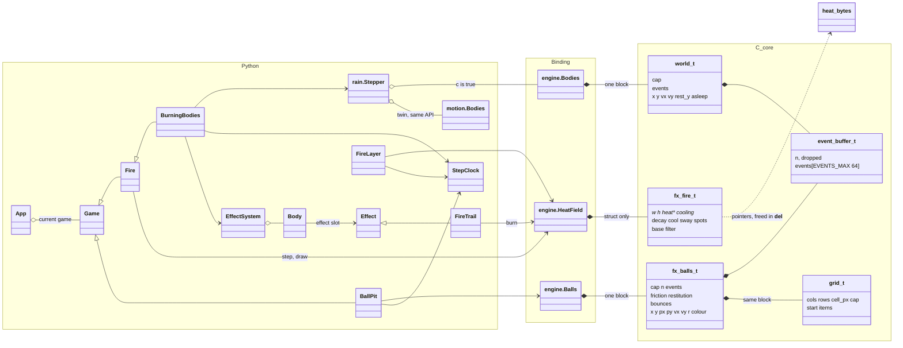
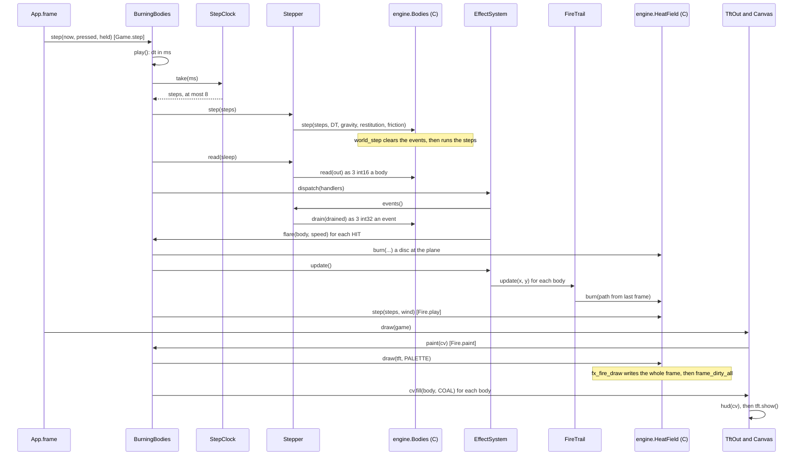

# The effects engine, one lesson at a time (P594 #795)

All paths are relative to the root of this repository. Line numbers are from master on 2026-11-05. Since P632, `engine/`
is the pixel-engine submodule, and its line numbers are those of pixel-engine `97f2d64`.
`bench.md` is that repository's bench log. A board number below is a median or a range from one bench run, with its run name.
Since P633 (#847), `rain.Stepper` and its `StepClock` are `plugins.PhysicsPlugin` (`games/plugins.py`), and the
fire's field, gusts and step clock are `fire.FirePlugin`, whose `StepClock` replaces `Fire.acc`. `Game.step` runs
their hooks around the game's play. The lessons below keep the old names and lines, which are true at the commit
they cite.
The same lessons as step-by-step pictures: [the P594 engine lessons on Miro](https://miro.com/app/board/uXjVEavQ4JQ=/?moveToWidget=3458764689493945034).

## 0. The short version

The engine has three layers. The first is the C core in `engine/core/`. It has no MicroPython header and no ESP-IDF header,
so a Mac test builds it with clang (`engine/tests/clang_lib.py`) and the board build compiles the same files. The second is the
binding, `engine/binding.c`. It turns a Python call into a C call and checks every argument on the way. The third is the games
in `games/`. They own the clock, the buttons, the pictures and every decision.
The rule is "C steps and paints, Python decides" (D12 in the code comments). C moves the bodies and the heat, then paints the
whole panel. C also writes down facts, for example "body 3 hit the floor at 900 px/s". Python reads those facts once a frame and
chooses what they cause: a flare, a respawn, a count on the HUD. So a new look is new Python, and the C does not change.

## 1. The classes

The three layers use different tools for the same ideas. A C struct is one block of numbers. A binding type wraps one block.
A Python class holds the rules of the game. `engine.Bodies` is written `Bodies_C` and `motion.Bodies` is `Bodies_Py` below,
so the two do not mix. `rain.Stepper` is `Stepper`.

Where each class lives: `Game` `gfx.py:292`, `App` `app.py:47`, `StepClock` and `Bodies_Py` `motion.py:132` and `:77`,
`Stepper` `rain.py:39`, `Effect`, `FireTrail`, `Body`, `EffectSystem` `effects.py:19`, `:33`, `:67`, `:82`, `Fire` and `FireLayer`
`fire.py:94` and `:201`, `BallPit` `balls.py:68`, `BurningBodies` `burning.py:56`.
`heat_bytes` in the picture is the block that `HeatField` allocates for the heat and the cooling map. It is not a type in the code.

## 2. One frame of the burning scene

`App.frame` runs every 40 ms (`FRAME_MS`, `app.py:31`). Two clocks run inside it. The bodies step every 10 ms through a
`StepClock`. The heat field steps every 40 ms through the counter `Fire.acc` (`fire.py:143`).

Code for each arrow: `app.py:89` (step), `burning.py:97-107` (play), `rain.py:50` (Stepper.step), `rain.py:55` (read),
`effects.py:91-97` (dispatch), `burning.py:109-115` (flare), `effects.py:99-104` (update), `effects.py:42-56` (FireTrail.update),
`fire.py:130-149` (field step), `gfx.py:369-388` (Game.draw), `fire.py:162-171` (paint), `lcd.py:176` (TftOut.draw).
The burns land before the field step in the same frame, so a new flare already rises in that frame.

## Lesson A. The C core, and why a block holds no pointer

Read `engine/core/world.h:14-20` and `world.c:7-16`. A world is one block: the `world_t` header, then five float arrays and
one byte array. `world_bytes(cap)` says how big the block is (`world.c:14`). Each call finds an array from `cap` with a macro
(`X(w)`, `Y(w)` and so on, `world.c:7-12`). The header says the reason: "It stores no pointer ... so the block may move with
its owner". In the binding the owner is the Python object, and its block lives on the GC heap, so "the GC frees it with the
object and no finaliser runs" (`binding.c:35-36`, `:43`). The same shape holds for the grid (`grid.h:12-14`) and the balls
(`fx_balls.c:7-16`, with the grid first so the floats stay aligned).
A small case against this rule is the fire. `fx_fire_t` does store two pointers, `heat` and `cooling` (`fx_fire.h:25-26`),
because its field can be 1,024 by 1,024 cells and may sit in internal RAM or in PSRAM (`binding.c:160-168`). So the binding
adds a finaliser, `__del__`, which frees the block once (`binding.c:310-318`).
Every core file says the same in its first lines: "Plain C99 with no MicroPython or IDF header" (`world.h:3`, `fx_fire.h:3`,
`fx_balls.h:6`, `grid.h:3`, `events.h:3`). One file reaches outside: `fx_fire.c:3` includes `blend565.h` from `engine/driver/src`, and its
own comment calls that header "plain C".
The gain is speed that Python cannot reach. A body-step in C takes 0.135 µs and today's `fall_bodies` in Python takes 36.95 µs
(`bench.md:236` and `:238`, P589). That is about 270 times.

## Lesson B. The binding: from a Python call to C

Follow `Bodies.step` as the example, `binding.c:71-85`.
1. MicroPython finds `step` in the type's locals table (`binding.c:120-125`) and calls `bodies_step` with the arguments.
2. `bodies_world(args[0])` checks that `self` really is a `Bodies` and raises `TypeError` if not (`binding.c:48-53`). That stops a
   call like `Bodies.step(5, ...)`.
3. The code checks the ranges and raises `ValueError`: `steps` must be 0 to 64 (`binding.c:75-77`).
4. `mp_obj_get_float` turns each number into a C float (`binding.c:79-81`).
5. `world_step` runs. The binding adds no logic.
The other checks follow the same habit. The index of `spawn` is range-checked (`:59`). `read` and `drain` accept only an
`array('h')` or an `array('i')` of the right length (`:92`, `:104`). A static assert says that `int` is 32 bits, because the
events go out as `array('i')` (`binding.c:19`). `Balls.step` rejects a `dt` that is NaN or zero with `!(v[0] > 0.0f)`
(`:413`), and `set_material` rejects NaN in the same way (`:494`). `HeatField` checks that the object is not freed (`live`,
`:180-186`), and `draw` checks that the display is an s3lcd of the right size and that the palette is an `array('H')` of 256
(`:283-299`). A wrong call stops at the border, so the C core can trust its input.
The module is registered at `binding.c:542-560`, and the build lists the five C files in `engine/micropython.cmake:5-11`.
Data crosses in bulk, not one value at a time. `read` writes all bodies into one array, so Python makes no float (`world.h:37-38`).
A call itself is cheap: 2.60 µs one way (`bench.md:249`, P589). Reading 12 values back one by one from C costs 60.03 µs, against 32.35 µs for 12 Python list reads (`bench.md:247-248`),
which is why the games read in bulk and C paints.

## Lesson C. Events: how a hit gets to Python

An event is three ints: `id`, `kind`, `speed` (`events.h:14-16`). The kinds are `EVENT_HIT = 1` and `EVENT_SLEEP = 2`
(`events.h:12`), exported as `engine.HIT` and `engine.SLEEP` (`binding.c:545-546`) and mirrored as `motion.HIT` and `motion.SLEEP`
(`motion.py:37`). The buffer holds 64 events (`events.h:10`). A step call keeps the first 64 and counts the rest in `dropped`
(`events.h:29-33`).
The path of one hit in the burning scene:
1. `world_step` reaches the plane and calls `events_add(..., EVENT_HIT, (int32_t)v)` (`world.c:59`).
2. `step` clears the buffer at its start, also for 0 steps (`world.c:41`, `binding.c:71`). So Python must call `step` every frame,
   or the old events would be drained twice (`rain.py:50-52`).
3. `Stepper.events()` calls `drain` into one `array('i')` made once (`rain.py:48`, `:63`), and `world_drain` copies the events
   (`events.h:41-49`).
4. `EffectSystem.dispatch` walks the array and calls `handlers[kind](body, speed)` for the kinds it holds (`effects.py:91-97`).
5. In the burning scene the only handler is `flare` (`burning.py:80`). A hit at 600 px/s or more (`FLARE_MIN`, `:43`) burns a disc
   whose radius and heat grow with the speed (`flare_size`, `:50-53`).
The rule shows clearly here. C does not know what a flare is. The same event in the ball pit does something else: `BallPit`
only counts the hits for its HUD (`balls.py:117-119`). The ball events differ in one more way. They come from the first pass of
the solver only, and only above `hit_min` (`fx_balls.h:75-81`, `fx_balls.c:155-160`, `:207-209`).
Board number: the step plus the drain costs about 0.18 ms a frame (`bench.md:245`, P589, a drain of 16 events alone 162.5 µs at `:244`), and a step, a read and a
drain allocate 0 B (`bench.md:402`, P590).

## Lesson D. How effects combine

The lessons D to G in depth, with code, diagrams and other libraries: [engine-deep-dives.md](engine-deep-dives.md) (P627).

Four pieces work together on one field of heat: a byte per cell, 0 to 255, in `fx_fire_t.heat`.
1. A body effect puts heat in. `FireTrail.update` finds the cell under the body, picks a point `lag` frames behind it, and calls
   `field.burn` along the path from the last burn point (`effects.py:42-56`). `fx_fire_burn` walks the segment and, for every cell
   inside radius `r`, writes the larger of the old heat and the new heat (`fx_fire.c:334-352`, the test at `:347`). The rule is
   "keep the max", not "add". So two bodies close together never overflow a byte, and the order of burns does not matter.
   Embers and the spots at the base use the same rule (`fx_fire.c:172`, `:133`).
2. The field's own step moves the heat. Each cell becomes the sum of the three cells below it and the cell two below, times the decay, shifted right by 7,
   at most the hottest of those four, less the cooling map and the fade (`fx_fire.h:54-62`, `fx_fire.c:180-238`).
   The scene sets `set_base(False)`, so the base row is cleared and only the burns feed the fire (`burning.py:69`,
   `fx_fire.c:188-189`). The look is data: `LOOK = (BURN_DECAY, BURN_COOL, SWAY, 0, 1, FAST, 0, BURN_FADE)` (`burning.py:58`).
3. The filter decides how a cell is magnified to its 2 by 2 pixels. `NEAREST` copies the cell. `LINEAR` mixes it with its
   neighbours at the weights (9a + 3b + 3c + d + 8) >> 4, the same as OpenGL's `GL_LINEAR` at 2x (`fx_fire.h:84-91`,
   `fx_fire.c:240-280`). The Python side only chooses: `set_filter(mag_filter)` from the mode table (`fire.py:67`, `:117-122`).
   Linear costs about 2.15 ms more to draw (6.41 ms against 4.26 ms in the burning scene, `bench.md:429-430`, P608).
4. The blend puts the fire over a picture. `fx_fire_blend` turns each pixel into
   `alpha_blend_565(palette[heat], pixel, alpha[heat])` and skips cells of alpha 0 (`fx_fire.c:283-322`). Python gives the
   `ALPHA` table, which is clear at heat 0 and full from heat 96 (`fire.py:94-95`). `FirePlugin.draw` picks blend or opaque draw
   (`fire.py:129-136`). The burning scene draws the field twice (P639): opaque, or blended over the sky in its picture
   mode, behind the bodies, then blended in front of them at `FRONT_ALPHA`, a cutout with a soft edge
   (`burning.py:142-148`). It draws in 15.11 to 15.46 ms (run123, linear). The picture mode of the fire
   and the unused `FireLayer.draw` use the blend (`fire.py:277-280`). The picture mode costs 11.51 to 13.32 ms to draw
   (`bench.md:433`, P608).
The scroll moves the whole field under the screen by `dx` cells, clears what it uncovers and moves the live embers too
(`fx_fire.c:356-377`). `FireLayer.update` turns the world's speed into whole cells with an integer remainder and calls it
(`fire.py:215-228`), and `Effect.scroll` lets a trail follow (`effects.py:28-30`, `:62-64`). No game uses it now. The PO tried it
behind the flappy bird and kept it for other games (`bench.md:456`, P602).
A new effect is one more `Effect` subclass with `update(x, y)` and `reset()` (`effects.py:19-26`). Its callers do not change.

## Lesson E. Physics: bodies (P590) against balls (P598)

| | `world_t` bodies (P590) | `fx_balls_t` balls (P598) |
| --- | --- | --- |
| Shape | a point that falls onto its own plane `rest_y` | a disc of radius 2 to 5 (`fx_balls.h:19-20`) |
| Contacts | none between bodies | every overlapping pair, plus the walls |
| Integration | gravity into `vy`, then `x`, `y` move (`world.c:47-49`) | the same, then positions are pushed apart, then velocity becomes the move over `dt` (`fx_balls.c:266-271`, `:302-303`) |
| Floor | bounce by `restitution`, `vx` times `friction`, or sleep under `1.5 * gravity * dt` (`world.c:50-62`) | the solver, see below |
| Twin in Python | `motion.fall_bodies` (`motion.py:42-74`) | none |
| Board | 0.21 to 0.23 ms for 160 bodies (`bench.md:398`) | 4.2 ms at 100 settled balls, 13.8 ms at 300 (`README.md`, `bench.md:469`) |

The bodies are the small case. The Mac tests hold the C to its Python twin, so a game runs on either (`motion.py:5-8`).
The balls are the large case. `substep` (`fx_balls.c:259-305`) does this, four times per step (`SUBSTEPS`, `balls.py:41`):
1. Integrate. Each ball gains `gravity * dt` and moves. It remembers its old place in `px`, `py` (`:265-271`).
2. Broad phase. `grid_build` sorts the balls into 10 px cells with a counting sort (`grid.c:37-50`). The cell is two largest
   radii wide, so two touching centres are at most one cell apart (`fx_balls.h:22`). A ball then looks at its 3 by 3 cells and
   tests each pair once, from the lower index (`fx_balls.c:276-287`).
3. Relaxation. `FX_BALLS_PASSES = 2` passes. In `contact` the overlap is pushed out along the normal, split by mass, which
   is the radius squared, so the lighter ball moves further (`:123-143`, `share` at `:99-101`). This is Jakobsen's position
   Verlet, named in `fx_balls.h:3-4`.
4. Friction. If `friction > 0`, the sliding part of the pair's move is taken back, up to `friction` times the push. That is
   Coulomb friction on positions (`held`, `:118-120`, used at `:144-154`). The walls do the same in one dimension
   (`wall_friction`, `:170-172`).
5. Walls. `walls` puts the ball back inside the box and removes its move into the wall (`:184-210`).
6. Velocity and the cap. A ball may move at most `FX_BALLS_MOVE_MAX = 1.5` px in a substep, so no touching pair can swap
   sides. Then `v = move / dt` times the damping (`:291-303`, `fx_balls.h:26`).
7. Bounce. The solver itself is inelastic. Restitution is applied last, at the velocity level, only for hits that closed at the
   threshold speed or faster (`bounce`, `:217-257`, collected in `bounce_add`, `:104-112`). The names are Box2D v3's
   (`fx_balls.h:69`). A ball at rest under another is treated as ground (`:239-249`).
The PO felt the first material as "the balls really don't bounce" (`fx_balls.h:45`). The fix is data, not code: restitution
0.7, friction 0.5, threshold 100 px/s are set from Python (`balls.py:44-51`, `:80`).

## Lesson F. What costs time on the board

The S3 has a hardware float unit, but a float division and `sqrtf` are library calls. The first ball solver paid one `sqrtf`
and four divisions per touching pair in each pass (`bench.md:471`, P598). Four changes remove them:
1. A fast inverse square root with two Newton steps, relative error under 1e-5, in `inv_sqrt` (`fx_balls.c:82-95`).
2. A table of mass shares computed at compile time, so a contact divides nothing (`:97-101`).
3. An integer division for the grid cell, which is in hardware (`grid.c:22-29`).
4. `view_t`, the arrays found once per substep, because each array macro called `grid_bytes`, which the compiler could not inline
   (`fx_balls.c:18-28`).
Board number: one substep of 300 packed balls fell from 7.0 ms to 4.6, then 4.1, then 4.3 ms with the contact change
(`bench.md:465`, runs 97 to 97d). The 4.3 after 4.1 is a small rise on that probe. The change aimed at a settled pile, where every pair touches: there it removed one `sqrtf` and four divisions per pair in each pass (the comment at `inv_sqrt` in `fx_balls.c` cites run99, 100 resting balls at 23 ms a frame).
The second cost is the HUD. A new label needs a rebuild of its text strip, and the bench log puts that at about 50 ms twice a
second in every scene, which caps a scene near 23 to 24 fps (`bench.md:472`, P598). P599 drew the HUD once into a strip and
blitted it each frame (`cv.keep`, used in `balls.py:162-164` and `fire.py:191-193`). The strip made the common frame cheap and
the redraw expensive: 24 to 28 ms in the rain (`bench.md`, P599 section at line 328).
The third cost is a plain trade. The linear fire draws 2.15 ms slower than nearest at the same fps, because `FRAME_MS` caps the
rate at 25 (`bench.md:435`). The fps number alone hides that cost, so the bench keeps the draw time in its own column.

## Lesson G. What is left

All of these are open cards. The first six now sit under the new epic P620 #827 "More effects".
- P597 #798 water.
- P600 #801 ripple, shockwave and plasma.
- P601 #802 SWAR and PIE: do several bytes in one register, or use the S3's vector unit.
- P606 #808 rain in the Runner.
- P610 #814 blur on a screen region.
- P611 #815 motion blur behind a fast body, combined with its `FireTrail` (`README.md:84`).
Beside them stay these cards:
- P614 #820 a faster ball solver. Pit numbers to beat: 24 fps at 95 balls, 8 fps at 320 (`bench.md:468`).
- P618 #824 a soft contact with a damping ratio. Today a contact is a hard push.
- P619 #825 balls drawn from small pictures (textured balls).
- P616 #822 balls on fire.
- P609 #812, the engine epic.

## Not checked

- The reason why the 4.3 ms substep is slower than the 4.1 ms one is not in the log.
- The claim "a Mac test builds the core with clang" rests on `engine/tests/clang_lib.py:1-30`. I did not run the tests.
- I did not check the D-numbers (D12 and others) against their decision pages.
- The 50 ms HUD figure and the 24 to 28 ms figure come from two different bench sections and I did not reconcile them.
- I did not open the issues for the cards in lesson G. Their titles come from the brief and `README.md:84`.
