# The game box and spark: who does what, and how they talk (P896)

> The game box is a FireBeetle 2 ESP32-S3 with a 240 x 320 screen, a joystick, a knob, buttons and sound. It plays 15
> games written in MicroPython, six of them on a C engine. spark is a Claude Code plugin that turns a list of parts into a wired,
> pinned board. The two meet in one file, the pin map `games/pins.py`, which spark writes and the games import. The
> screen's pins are the exception: spark could not place them, so `games/gdi.py` types them by hand.
> Everything above the pins (the engine, the drivers, the games) comes from the conversation with Claude, not from
> spark.

This page is the overview. It says what each part does, how the parts talk, and how far spark can build an
engine-based app or a game today. The lessons on the engine itself are in [engine-walkthrough.md](engine-walkthrough.md)
and [engine-deep-dives.md](engine-deep-dives.md). The same pictures, as infographics, are in five frames on the
[Miro hub board](https://miro.com/app/board/uXjVEavQ4JQ=/?moveToWidget=3458764690785736286). All paths are relative to the root of this repository, on
master `5461560` (2026-11-17). A path that starts with `spark:` is in the
[spark repository](https://github.com/xmejkal/spark), on main `8ab39d54`.

## 1. The parts in one picture

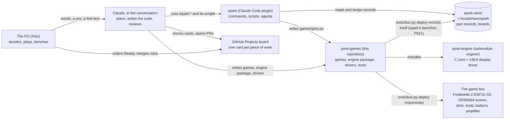

| Who or what | What it does | Where |
| --- | --- | --- |
| The PO | Decides what starts and in which order, plays each game before a feel change merges, runs the bench. | `spark:scrum/TEAM.md` |
| Claude in the conversation | Plans, writes the games, the engine package and the drivers, runs the tests and reviews, deploys. | `spark:scrum/TEAM.md` |
| spark's commands and skills | Turn a goal into parts, a requirements file, a pin map, a breadboard sheet and a Wokwi simulation. | `spark:commands/`, `spark:skills/` |
| spark's scripts | Do every deterministic step, answer `--json`, exit 0 (ok), 1 (problems) or 2 (could not run). | `spark:scripts/` |
| spark's agents | Find a part, read a datasheet, research a module, review one dimension of a design. | `spark:agents/` |
| pixel-games | The games, their framework (`App`, `gfx.Game`), the engine package, the drivers, the tools and the tests. | `games/`, `tools/`, `tests/` |
| pixel-engine | The C core (bodies, balls, the heat field, sound) and the s3lcd display driver. | `engine/` |
| The board on GitHub | One card per piece of work, from Idea to Done, with limits on each stage. | https://github.com/users/xmejkal/projects/2 |

## 2. The box, layer by layer

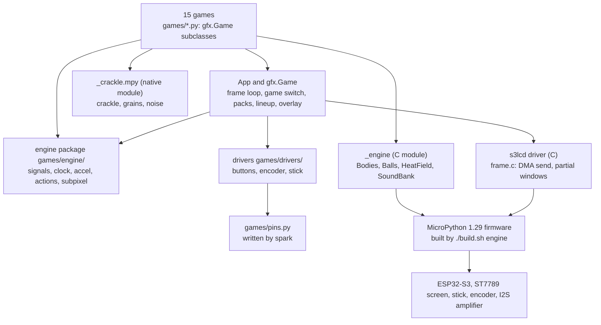

From the bottom up:

- The firmware is MicroPython 1.29 with ESP-IDF 5.5, built by `./build.sh engine` (README.md, "Build and
  run"). The build registers the C module `_engine` and refuses an image that also registers the old name
  `engine`.
- The C engine (`engine/core/`) is plain C99 with no MicroPython header, so the Mac tests build the same files with
  clang. It moves bodies and balls, burns and cools the heat field, and renders sound. Its rule is "C steps and paints,
  Python decides" ([engine-walkthrough.md](engine-walkthrough.md), section 0).
- The display driver (`engine/driver/`, a fork of s3lcd) paints into a frame in PSRAM and sends it by DMA, only the
  windows that changed.
- The engine package (`games/engine/`) is the Python side of the engine. `signals.py` lets a game emit an event by
  name. `clock.py` holds the time helpers. `accel.py` picks the fast or the plain version of a part at boot.
  `actions.py` binds the inputs to actions (FIRE, PICK, the knob's turn, the stick's x and y) and holds the rules
  `lean` (a direction) and `rate` (a speed). `subpixel.py` moves a speed in whole pixels.
- The drivers (`games/drivers/`) read one input each: `buttons.py` (debounced buttons), `encoder.py` (the knob),
  `stick.py` (the joystick, -100 to 100, with a dead zone). They take their pins from `games/pins.py`.
- `App` (`games/app.py`) owns the screen, the action map, the game, the overlay and the sound cues. D14 picks the
  next game, and the game builds behind a name card once no press came for 700 ms. `catalog.py` names the 15 games,
  and `:lineup.py` on the board says which ones the box plays.
- The games subclass `gfx.Game` and fill in `setup`, `play` and `paint`. Six of them use the C engine: Marshmallow,
  BallPit, Meteors, Bucket, Rescue and Runner. The others draw on the canvas in Python.

## 3. One frame

A frame starts every 40 ms (`FRAME_MS`, `games/app.py:67`), so the box runs at 25 fps at most. The games run at
21 to 24 fps on the box (README.md, "Status").

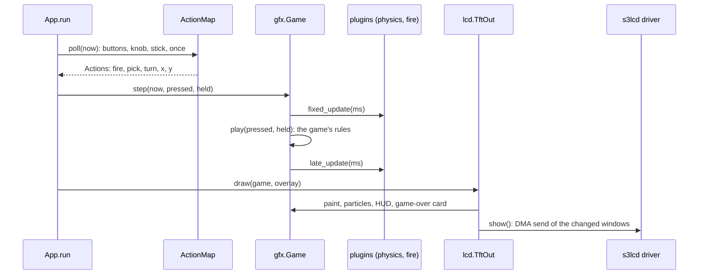

The order of the hooks follows Unity's fixed and late update. While a game plays, the garbage collector is off, so a
collection never stops a frame. `App.collect` runs small collections at quiet moments instead: every 5 frames and at
most changes of state (`games/app.py`, `GC_FRAMES`). A frame still makes some objects (`bench.md` measured 8 to 14 KB
for each draw), and new code keeps that number down: the stick's path (P872) uses ints and objects made in `setup`
only, so it makes none.

## 4. Two versions of each hot part

Each part that runs every frame has a plain version in Python and a fast version in C or viper (P841, the
[engine plan](discovery/2026-11-16-p844-engine-plan/plan.md)). The plain version is the oracle: the Mac tests run both
on the same input and need the same answer (`tests/test_twins.py`). Two parts go through `main.compose` at boot,
the mixer's sum and the master volume: it picks the fast one, and `tools/box.py deploy --engine reference` forces the
plain one, for a test on the box. The C parts (bodies, balls, the heat field) fall back to Python when the firmware
has no `_engine`, at import.

## 5. Where spark and the engine meet

They meet in one file today. spark's `assign_pins.py` reads `requirements.json` (the box's parts: the amplifier, the
joystick, the encoder, the microphone) and writes the pin map. The drivers import it and type no GPIO number. Two
places still type pins by hand: the screen's cable pins in `games/gdi.py` (DC, RST, CS, SD_CS, BL), because a
requirements file cannot pin a part to a connector yet (P663), and the BOOT button in `games/drivers/buttons.py`.

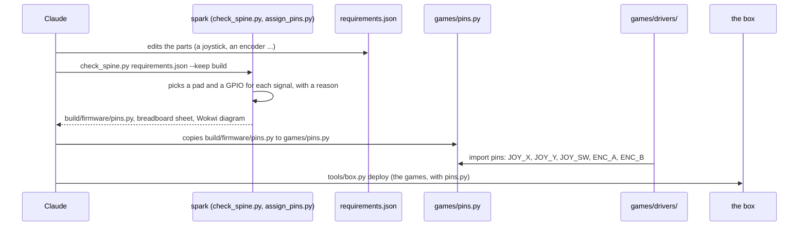

The other places where they touch:

- The deploy's record (P921): before its reset, `tools/box.py deploy` runs spark's launcher in the store once
  (`bench.py record pixel-games`), and after a recorded line spark's `bench.py show` names pixel-games for the box.
- Part records: `parts/` in this repository holds one spark record, the microphone's, made from a photo
  (README.md names `/spark:identify` as its source).
- The wiring guide: [wiring.html](wiring.html) shows every wire with pictures. spark's README shows it as its example.
- The project files: `.spark/project.json` and `.spark/rules.json` are spark's, written by `/spark:init`.

What is not joined yet:

| Step | spark | pixel-games |
| --- | --- | --- |
| Flash the firmware | `/spark:deploy` (`deploy.py`): looks at the board, asks for a yes, erases, writes the image a passed simulation tested, copies a facts file and reads it back | `./build.sh engine`, then esptool by hand (README.md, "Build and run") |
| Copy the program | the project's files, with the image | `tools/box.py deploy`: compiles `.mpy`, copies the games, the engine package, the packs and `:lineup.py`, refuses a firmware with no `_engine` |
| Look at the board | `look.py` asks before it reads a board that the project does not know (P865). It remembers a board by a MAC-shaped USB serial after one yes, and asks each time for a board with no serial or a serial its firmware set | `tools/box.py log` reads the console |

P892 ([#1266](https://github.com/xmejkal/spark/issues/1266)) puts the same question in front of every board touch in
spark. P663 ([#892](https://github.com/xmejkal/spark/issues/892)) gives spark one model for pin conflicts: walk P581
found that the pin assigner gave the screen cable's pins to the amplifier and the stick.

## 6. How far spark can build an engine-based app or game today

| Step | spark today | For an engine game |
| --- | --- | --- |
| Pick the parts from a goal | partly (`/spark:idea`, `/spark:drawer`) | partly: the modules are in `requirements.json`, but the screen of this box was chosen before spark |
| Research a missing part | partly (`/spark:research`, `/spark:identify`) | the microphone's record came this way |
| Build the board: pin map, breadboard sheet, Wokwi diagram | works (`/spark:build`) | partly: the box's `games/pins.py` is spark's, but the screen's cable pins are typed by hand |
| Check the board | works (`check_all.py`, five checks) | the box's run ends in `problems`, for two reasons: eight reserved pins (the screen's cable, the SPI bus, a button) connect to no part, and no Wokwi diagram comes out |
| Simulate | works (`run_scenario.py`) | stops for the box: the encoder sits on GPIO 43 and 44, which the Wokwi board does not have, and the amplifier (MAX98357A) has no Wokwi model |
| Firmware | spark exports facts only: the pin map, stand-in modules for an import check | the engine, the drivers and the games come from the conversation |
| Flash and deploy | partly (`/spark:deploy`) | the C engine's firmware and the game copy go through pixel-games' own tools |

So spark brings a project from an idea to a wired board with a pin map that the firmware imports. For an engine
game, the part that matters most is the screen, and that is the part spark could not place: its cable's pins are
typed by hand, and its simulation stops. From there the
conversation writes the engine-based code, and pixel-games' tools build, test and deploy it. spark has no idea of a
display engine or a game, and that is by its rule: "Spark exports facts, never behaviour" (`spark:AGENTS.md`). We
found no card that plans to bring the engine into spark.

## 7. The workflow, from an idea to a game on the box

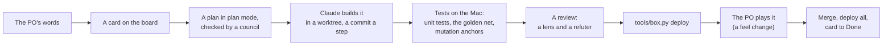

The golden net (`tests/golden/`) pins every game's frames, sounds and switch lines by hashes. A change that keeps a
game's play the same keeps every hash, and a hash that changes is its own PR. `tools/render_scene.py` draws a game on
the Mac the board's way, and the screens below come from it.

## 8. Use cases, with examples

- Play the games with the stick (P872, [#1240](https://github.com/xmejkal/spark/issues/1240), done 2026-11-17). The
  PO said "lets change it to left and right, not just one button". Eight games read the stick through `lean` and
  `rate`, the other seven stay one-button, and the golden net did not change. Two PRs, each played by the PO on the
  box before the merge.
- One rule in one place (P885, [#1254](https://github.com/xmejkal/spark/issues/1254), done). Bucket, meteors and
  starfire move through `SubPixel`, and a tilt to the left is as fast as the same tilt to the right.
- Add a new game. Write a `gfx.Game` subclass, add a row to `games/catalog.py`, paint its art in `art/sets/` and run
  `art/paint.py`, add its sounds to `tools/sound_bank.py`, add a subject to `tools/render_scene.py`, write its tests,
  record the golden hashes on the baseline commit, then `tools/box.py deploy NAME`.
- A new gadget with a screen. spark picks the parts, wires the board and writes the pin map. The engine and the games
  of this repository are a start for its code, written in the conversation.
- Two boxes play together (P832, [#1194](https://github.com/xmejkal/spark/issues/1194), open): ESP-NOW and, as an
  experiment, Bluetooth. A second action map serves the second player.

## 9. Screens

Each picture is a sheet of frames, drawn on the Mac by `tools/render_scene.py` the board's way.

| Marshmallow (heat field) | Meteors (bodies, heat field, stick) | Rescue (fire, hose, people) |
| --- | --- | --- |
| 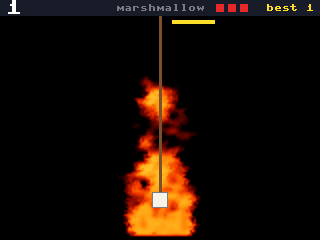 | 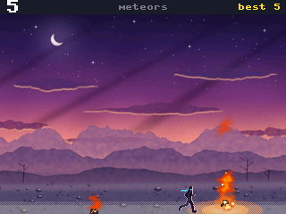 | 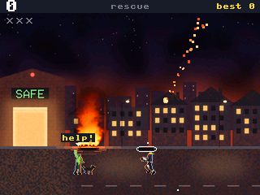 |
| Ball pit (C balls) | Starfire (flat 3D, the stick aims) | Bucket (bodies, the stick steers) |
| 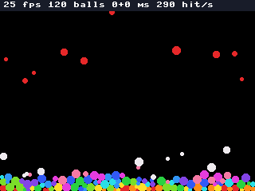 | 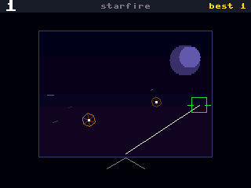 | 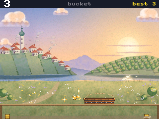 |

## 10. The numbers

| What | Value | Source |
| --- | --- | --- |
| Frame | 40 ms, 25 fps at most, 21 to 24 fps measured | `games/app.py:67`, README.md |
| Ball pit | about 100 balls at 23 to 24 fps | README.md |
| Rain, C against Python | 0.22 ms against 28 ms a step | README.md |
| Game switch, Rescue | 548 ms, from 22,272 ms before the packs | README.md |
| Boot import | 5.0 s with `.mpy`, 9.9 s with `.py` | README.md |
| Free heap at boot | about 8 MB | `bench.md`, P849 |
| Art | 4.5 MB in nine packs, 2.9 MB of flash | README.md |
| Tests on the Mac | 1043 tests, and the golden net's 23 | the gate of P885, 2026-11-17 |

## Read more

- [engine-walkthrough.md](engine-walkthrough.md): the engine, one lesson at a time.
- [engine-deep-dives.md](engine-deep-dives.md): the engine's parts in depth.
- [games/engine/README.md](../games/engine/README.md): the engine package and its rule of two versions.
- [art-packs.md](art-packs.md) and [sound.md](sound.md): the art and the sound.
- [The engine plan](discovery/2026-11-16-p844-engine-plan/plan.md): where the engine goes next (P841).
- spark: its [README](https://github.com/xmejkal/spark#readme) and
  [how it works](https://github.com/xmejkal/spark/blob/main/docs/guide/how-it-works.md).
