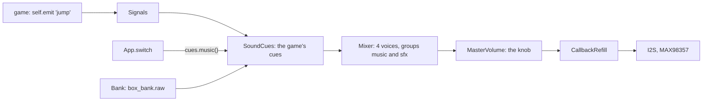

# Sound in the game box (P768)

The short version: a game says what happened, and the box plays the sound. The music plays in every game.

## Give a game a sound

1. Add the sound to `SOUNDS` in `tools/sound_bank.py`: a name, the samples and the source with its license.
2. Run `python3 tools/sound_bank.py`. It writes `games/box_bank.raw`, `games/box_bank.py` and
   `games/box_bank.SOURCES.md`. Add `--wav DIR` to hear each sound on the Mac.
3. Name the cue in the game: `cues = {"jump": Cue("jump")}`.
4. Emit the signal where it happens: `self.emit("jump")`.
5. Copy `box_bank.raw`, `box_bank.py` and the game's file to the board.

`Game.die()` emits `die`. A game with no cues is silent, and a game with no `signals` (a test) runs as before.

## A sound that plays on

A cue with `loop=True` is one voice that plays on, as the fire of `Runner`: `"fire": Cue("fire", loop=True)`. Its
signal carries a level from 0 to 256: `self.emit("fire", self.fire_k)`. The level scales the cue's gain, and 0 ends
the voice. Emit 0 where the game ends, because `play` does not run after a death.

`Marshmallow` (P773) does the same with the bank as it is: `serve` plays `pickup`, `burn` plays `land`, and `flame`
is the `fire` loop. Its level is the flame's height, `top_px * LEVELS // FLAME_MAX_PX`, sent when it moved by at
least `FLAME_STEP` (16). A marshmallow whose time ran out plays `burn` too. The game emits `flame` with 0 before
`die()` and at each restart.

`Bucket` (P773) uses the bank as it is too: `catch` plays `pickup` and `miss` plays `land`. It has no loop.

`Meteors` (P773) uses the bank as it is: `land` plays `land` once for each meteor, at its first hit on the ground.
With the `FireSound` voice of the probes, each meteor whooshes by its airspeed, as in `BurningBodies`
(`follow_bodies`), and a parked body moves 0, so it is silent.

`Rescue` (P800) brings its own sounds to the bank. `hose` is its one loop, a hiss that plays while the fireman sprays,
so with the music two voices stay free for the rest: `siren` (two tones, at the round's start and when a person is
trapped), `whoosh` and `boom` (a meteor), `cheer` (a person saved), `pickup`, and the shouts `help` and `help_child`,
each under 0.8 s. The shouts are cut from a CC0 recording, `games/help16k.wav`; the child's is the same word played
faster by `tools/sound_bank.py`. The game emits `hose` with 0 at each restart and before `die()`.

## The music

`App.switch` calls `cues.music()`. It starts the bank's sound `music` once, as a protected loop in the group
`music`, and the loop plays on over a switch of the game. `mixer.group_gain["music"]` is its gain (Q15), apart from
the game sounds' `mixer.group_gain["sfx"]`. A bank with no `music` gives a box with no music.

The music is a note list in `tools/sound_bank.py`: `THEMES` holds two candidates, and `MUSIC` names the one in the
bank. To change the tune, edit the notes or `MUSIC`, and run the tool.

## The voices

The `Speaker` has 4 voices. The music and a looping cue are protected. A new sound takes a free voice, or else the
oldest voice that is not protected. `sound.VoiceSum` is the plain MicroPython sum and always works.
`sound_viper.ViperVoiceSum` gives the same samples faster, and the `Speaker` uses it when it imports.

## What it costs

See bench.md, P768. The sound with the music costs each of the 14 games at most 1 fps.
